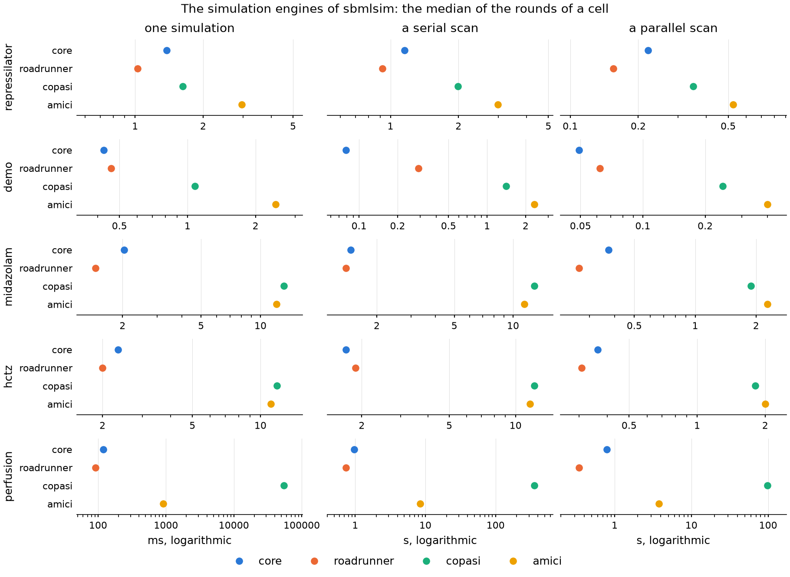

# Benchmarks

`sbmlsim` runs a simulation with one of four engines, see [Engines](simulation.md#engines): the Rust engine [core](simulation.md#core) ([sbmlsim-core](https://github.com/matthiaskoenig/sbmlsim-core), compiled to WebAssembly, see [Optional packages](installation.md#optional-packages)), [roadrunner](simulation.md#roadrunner), [COPASI](simulation.md#copasi) and [AMICI](simulation.md#amici). This page is what each of them costs. `scripts/engine_benchmark.py` loads, simulates and scans four packaged models and one large model in every engine which is installed, compares the results with roadrunner and prints the tables below.

Read a cell together with its configuration. Every number belongs to one machine, one model, one number of output times, one number of points and one number of workers, and the engines change places when any of those change: the two sections after the tables measure the same scan again, cold against warm and over the width of the output grid, and the engines do not come out in the same order in all of them. The tables answer "what does this cost here", they do not rank the engines.

## The run

```bash
# every model in every engine which is installed, pinned to eight cores
taskset -c 0,2,4,6,8,10,12,14 uv run --no-sync python scripts/engine_benchmark.py --workers 8 \
    --out tables.md --figure docs/images/benchmarks/engines.png
```

That command printed the tables below and drew the figure: the four packaged models and the large model, every engine which is installed, and the scans over the default of 1000 points on 8 workers. `--out FILE` writes the tables into a file, `--figure FILE` draws the comparison and `--json FILE` writes the measurement with every number as it was measured; `--models`, `--engines`, `--points`, `--repetitions` and `--rounds` narrow or widen the run, and `--cold` and `--steps` are the measurements of the two sections after it. Nothing regenerates this page, so a new measurement is a run of the script and a commit of its tables and its figure.

The large model is `benchmarks/models/machine_perfusion_liver_flat.xml`, the liver of a normothermic machine perfusion: 839 species, 1007 reactions, 570 parameters, 387 rules and 43 compartments in 2.6 MB, which is twelve times the largest packaged model, scanned over the flow of its pump. It is in the repository and no part of the package, so no install carries it, see `benchmarks/models/README.md`. One of its simulations is tens of seconds in COPASI, so it is scanned over as many points as the parallel scan has workers and measured in fewer and shorter rounds than the packaged models, which the first table of the run says of every model.

`--no-sync` keeps the environment as it is. COPASI comes with the extra `dev` and the engine core with every install, since its bindings `sbmlsim-core` are a dependency of sbmlsim in `uv.lock`. AMICI comes from the extra `amici` (`uv sync --extra dev --extra amici`), which is not in `uv.lock`, see [Optional packages](installation.md#optional-packages); a plain `uv run`, which syncs the environment to the lock, uninstalls it and measures the three other engines. An engine which is not installed is skipped and named below the table, so a shorter table is never a slow engine.

The machine: a 12th Gen Intel Core i7-12700 (12 cores, 20 hardware threads) with 62 GB of memory, Ubuntu 24.04.5 with the kernel 7.0.0-43, python 3.14.10. Every measurement on this page was pinned to one hardware thread of each of the eight performance cores (`taskset -c 0,2,4,6,8,10,12,14`), which is where the eight workers of a parallel scan run. It is an interactive desktop and the CPU governor is `powersave`, so the clocks are the kernel's choice and not a fixed frequency.

What that leaves of a cell: a cell is the median of its rounds, each round the median of its timed calls, and the engines of a model take turns within a round. A median of medians is what makes a measurement on a machine which is not perfectly idle worth reading at all: a round which was slow because something else ran moves a mean and does not move a median, and an earlier version of this page reported means with their deviations, where a disturbed cell announced itself with a deviation of a quarter of its mean and had to be measured again. The ratios against the engine core are the other half of the same idea. A ratio of two medians measured in the same turns of the same run survives a machine which is uniformly busy, while the seconds do not, so the ratios are the part of this page which carries to another machine. Pinning is what makes either possible: an earlier unpinned measurement had roadrunner ahead of the engine core on the parallel scan of HCTZ, 0.506 seconds against 0.622, the opposite of every pinned run since.

## The tables

### What every model was measured with

| model | output times | scan points | simulations | warm ups | rounds |
|---|---:|---:|---:|---:|---:|
| repressilator | 101 | 1000 | 20 | 3 | 5 |
| demo | 101 | 1000 | 20 | 3 | 5 |
| midazolam | 101 | 1000 | 20 | 3 | 5 |
| hctz | 101 | 1000 | 20 | 3 | 5 |
| perfusion | 101 | 8 | 3 | 1 | 3 |

### Loading a model

| model | engine | load s | first compile s | compile s | instantiate s |
|---|---|---:|---:|---:|---:|
| repressilator | core | 0.0222 | 0.0299 | 0.000443 | 0.00013 |
| repressilator | roadrunner | 0.0203 | 0.0392 |  |  |
| repressilator | copasi | 0.0551 | 0.0557 |  |  |
| repressilator | amici | 0.0305 | 0.0309 |  |  |
| demo | core | 0.0256 | 0.0273 | 0.000562 | 0.000134 |
| demo | roadrunner | 0.0241 | 0.043 |  |  |
| demo | copasi | 0.0534 | 0.0522 |  |  |
| demo | amici | 0.0322 | 0.032 |  |  |
| midazolam | core | 0.0571 | 0.0679 | 0.00215 | 0.000429 |
| midazolam | roadrunner | 0.0548 | 0.197 |  |  |
| midazolam | copasi | 0.154 | 0.147 |  |  |
| midazolam | amici | 0.0783 | 0.0784 |  |  |
| hctz | core | 0.0958 | 0.108 | 0.00245 | 0.000344 |
| hctz | roadrunner | 0.102 | 0.193 |  |  |
| hctz | copasi | 0.228 | 0.222 |  |  |
| hctz | amici | 0.129 | 0.126 |  |  |
| perfusion | core | 3.41 | 3.84 | 0.0992 | 0.00544 |
| perfusion | roadrunner | 3.98 | 5.57 |  |  |
| perfusion | copasi | 7.75 | 6.63 |  |  |
| perfusion | amici | 4.2 | 4.15 |  |  |

### One simulation and a scan

| model | engine | simulate ms | scan serial s | scan parallel s |
|---|---|---:|---:|---:|
| repressilator | core | 1.38 | 1.16 | 0.221 |
| repressilator | roadrunner | 1.02 | 0.923 | 0.155 |
| repressilator | copasi | 1.62 | 1.99 | 0.35 |
| repressilator | amici | 2.97 | 2.99 | 0.527 |
| demo | core | 0.426 | 0.0791 | 0.0493 |
| demo | roadrunner | 0.459 | 0.292 | 0.0622 |
| demo | copasi | 1.08 | 1.41 | 0.243 |
| demo | amici | 2.45 | 2.34 | 0.4 |
| midazolam | core | 2.03 | 1.47 | 0.373 |
| midazolam | roadrunner | 1.46 | 1.39 | 0.267 |
| midazolam | copasi | 13.1 | 12.9 | 1.89 |
| midazolam | amici | 12 | 11.4 | 2.28 |
| hctz | core | 2.34 | 1.7 | 0.363 |
| hctz | roadrunner | 2 | 1.88 | 0.308 |
| hctz | copasi | 11.8 | 12.2 | 1.81 |
| hctz | amici | 11.1 | 11.6 | 2 |
| perfusion | core | 119 | 0.962 | 0.792 |
| perfusion | roadrunner | 91.7 | 0.741 | 0.346 |
| perfusion | copasi | 5.45e+04 | 357 | 98.3 |
| perfusion | amici | 914 | 8.46 | 3.76 |

### Against the engine core

| model | engine | load | one simulation | a serial scan | a parallel scan |
|---|---|---:|---:|---:|---:|
| repressilator | core | 1 | 1 | 1 | 1 |
| repressilator | roadrunner | 0.916 | 0.741 | 0.798 | 0.703 |
| repressilator | copasi | 2.48 | 1.17 | 1.72 | 1.58 |
| repressilator | amici | 1.38 | 2.15 | 2.58 | 2.38 |
| demo | core | 1 | 1 | 1 | 1 |
| demo | roadrunner | 0.94 | 1.08 | 3.69 | 1.26 |
| demo | copasi | 2.08 | 2.52 | 17.8 | 4.94 |
| demo | amici | 1.26 | 5.75 | 29.6 | 8.11 |
| midazolam | core | 1 | 1 | 1 | 1 |
| midazolam | roadrunner | 0.959 | 0.717 | 0.944 | 0.715 |
| midazolam | copasi | 2.7 | 6.46 | 8.72 | 5.06 |
| midazolam | amici | 1.37 | 5.91 | 7.76 | 6.11 |
| hctz | core | 1 | 1 | 1 | 1 |
| hctz | roadrunner | 1.06 | 0.855 | 1.11 | 0.849 |
| hctz | copasi | 2.38 | 5.04 | 7.17 | 4.97 |
| hctz | amici | 1.35 | 4.75 | 6.86 | 5.5 |
| perfusion | core | 1 | 1 | 1 | 1 |
| perfusion | roadrunner | 1.17 | 0.773 | 0.77 | 0.437 |
| perfusion | copasi | 2.27 | 459 | 371 | 124 |
| perfusion | amici | 1.23 | 7.7 | 8.79 | 4.74 |

### The agreement with roadrunner

| model | engine | max rel. diff. | max abs. diff. |
|---|---|---:|---:|
| repressilator | core | 4.32e-12 |  |
| repressilator | roadrunner | 0 |  |
| repressilator | copasi | 4.33e-09 |  |
| repressilator | amici | 3.69e-09 |  |
| demo | core | 0 | 0 |
| demo | roadrunner | 0 | 0 |
| demo | copasi | 0 | 0 |
| demo | amici | 0 | 0 |
| midazolam | core | 1.70e-08 | 0 |
| midazolam | roadrunner | 0 | 0 |
| midazolam | copasi | 2.68e-07 | 1.64e-23 |
| midazolam | amici | 2.72e-07 | 0 |
| hctz | core | 1.20e-11 | 0 |
| hctz | roadrunner | 0 | 0 |
| hctz | copasi | 1.63e-08 | 1.40e-21 |
| hctz | amici | 1.63e-08 | 0 |
| perfusion | core | 7.49e-06 | 0 |
| perfusion | roadrunner | 0 | 0 |
| perfusion | copasi | 7.81e-03 | 0 |
| perfusion | amici | 7.45e-06 | 0 |

Measured with python 3.14.10, sbmlsim 0.29.0, libroadrunner 2.12.0.dev683, sbmlsim-core 0.8.0, python-copasi 4.48.311, amici 1.2.0: every cell is the median of its rounds, a round the median of its timed calls after its warm ups, and the engines take turns within a model, so a change of the load of the machine reaches every engine of a comparison alike. The run measured 20 simulations after 3 warm ups in 5 rounds and scanned 1000 points unless the model above says otherwise, and the parallel scans ran on 8 workers.

- A cell is the median of the rounds of its model, each round the median of its timed calls: a round which was slow because the machine was doing something else moves a mean and not a median, which is why the tables report medians and no deviation.
- The table against the engine core is the median of an engine divided by the median of the engine core on the same model and measure, so the engine core is 1, a number above it is that many times its time and a number below it is a cell it loses. The ratios are what carries from one machine to another; the seconds of the tables above belong to this one.
- `load s` is `load_model` with the model already compiled, `first compile s` the first load of that model in this process, the one which compiles it (the LLJIT of roadrunner, the module of the engine core); the runtime of the engine core is created once per process, so only the first model of a run pays it in this column. AMICI is loaded from a cache which was warmed before the measurement, so its compilation from cold, minutes per model, is not measured, and COPASI, which compiles the model on every load, has the same measurement twice.
- `compile s` and `instantiate s` are the compilation of the SBML into the module of the engine core and its instantiation in the runtime, which `load s` of the other engines does not break out. They are no part of `load s` of the core either, which finds the module compiled (the engine keeps it per SBML and process), and they are part of its `first compile s`.
- `simulate ms` is one `Simulator.simulate` at the defaults of `Simulator`, i.e. the tolerances a run has and not the tighter ones of the agreement below, which is measured in simulations of its own: every speed of this table is the speed of a run as a user gets it. `scan serial s` and `scan parallel s` are that simulation over the points of the scan on one worker and on the workers of the parallel scan below.
- The scan times are warm: every scan runs once before it is timed, so they exclude the pool of worker processes, which is kept per process and number of workers, the model every worker loads and compiles and the first batch of the threads of the engine core. A measurement which includes that first run is not the same measurement: it is several times larger for an engine whose parallel scan runs in worker processes, which carries the pool and one compilation of the model per worker, while the engine core, which starts no pool, pays only its own compilation there.
- The simulation of a model is its horizon with an equidistant output, which every engine computes alike (the steps of the integrator are each engine's own), in the time unit of the model: `repressilator` to 100 in 101 output times, its scan over `n` from 1.5 to 4.0; `demo` to 100 in 101 output times, its scan over `Km_A` from 0.5 to 2.0; `midazolam` to 1440 in 101 output times, its scan over `PODOSE_mid` from 5.0 to 100.0; `hctz` to 1440 in 101 output times, its scan over `PODOSE_hctz` from 5.0 to 100.0; `perfusion` to 60 in 101 output times, its scan over `Q_pump` from 0.0015 to 0.006. How much output a point has matters for the parallel scan of the engine core, see the workers of a parallel scan below.
- The workers of a parallel scan are 8 python processes for roadrunner, COPASI and AMICI, which load the model in every worker, and for the engine core the threads of the engine inside one python process: `Simulator.run` hands the points of a scan to the engine in batches which it integrates on 8 threads of its own (`worker._run_chunk_core`, at most `CORE_MAX_CHUNK` points per batch), so a run of the engine core starts no pool of processes at all and loads the model once. The two do not scale alike: a process runs the whole point, a thread of the engine integrates while the result of the run is assembled in its one python process, so the more output a point has, the less the threads gain.
- `max rel. diff.` and `max abs. diff.` are the agreement with roadrunner at atol 1e-12 and rtol 1e-10: the largest difference of a column divided by the largest magnitude of that column in roadrunner, and, for a column which is identically zero in roadrunner, where a relative difference is undefined, the largest absolute difference. roadrunner is the reference, COPASI is not bitwise reproducible across loads of a model.
- An empty cell is a measurement which was not made.



## What the tables say

**roadrunner 2.12 changed this page.** Up to libroadrunner 2.11 CVODE factorized a dense Jacobian, and the large model, whose Jacobian is 0.45 % dense at 919 states, spent nearly all of its time there: one simulation took 2.7 s and the engine core was 22 times faster. roadrunner 2.12 ([#1450](https://github.com/sys-bio/roadrunner/pull/1450)) added the sparse direct solver KLU and a colored sparse difference quotient Jacobian, and both are its defaults (`linear_solver="klu"`, `jacobian="sparse_difference_quotient"`). The same simulation now takes 91.7 ms, a factor of 29, and roadrunner leads the large model outright. The two settings only work together: with either one alone CVODE falls back to the dense factorization and the model takes 3.3 s, since at 919 states the factorization is the whole cost and the Jacobian evaluation is not.

- **Loading a model.** On the four packaged models roadrunner and the engine core load an already compiled model within a few percent of each other (0.102 s against 0.0958 s for HCTZ), COPASI takes a bit over twice as long and compiles the model on every load, and AMICI imports its compiled extension in about 1.3 times roadrunner's load. The large model keeps that order: the engine core loads it in 3.41 s, roadrunner in 3.98 s, AMICI in 4.20 s and COPASI in 7.75 s. Compiling is where they differ most. roadrunner's LLJIT adds about 91 ms to the load of HCTZ (0.193 s against 0.102 s) and 1.6 s to the load of the perfusion model (5.57 s against 3.98 s), while the engine core writes the WebAssembly module of HCTZ in 2.5 ms and instantiates it in 0.3 ms, and of the perfusion model in 99 ms and 5.4 ms. AMICI is the exception the table cannot show: its first compilation of a model is minutes, once per machine, and the measurement warms that cache before it times anything.
- **One simulation.** roadrunner leads every model of this run. On the small models the margins are a quarter or less and the two engines are close enough that the ordering moves with the run: the repressilator is 1.02 ms against 1.38 ms, `demo` 0.459 ms against 0.426 ms (the one cell the engine core takes), midazolam 1.46 ms against 2.03 ms and HCTZ 2.00 ms against 2.34 ms. COPASI and AMICI take about five to six times the engine core on the two physiologically based models. The large model is where the numbers separate: roadrunner 91.7 ms, the engine core 119 ms, AMICI 914 ms and COPASI 54.5 s, so COPASI is 459 times the engine core and 595 times roadrunner on the model where a simulation actually costs something.
- **A serial scan.** The engine core runs the 1000 points of `demo` in 0.0791 s against roadrunner's 0.292 s, nearly four times less, and HCTZ in 1.70 s against 1.88 s. The reason is where the python is: a serial scan of roadrunner runs point by point through python, while a scan of the engine core hands a whole chunk, here up to 250 points, to the engine as one batch, so the per-point python is paid once per chunk. The smaller the model, the more that matters, which is why `demo` gains most and the repressilator, whose oscillating integration is the work, gains nothing at all (1.16 s against 0.923 s). On the eight points of the perfusion model, where the integration is everything, roadrunner needs 0.741 s against the engine core's 0.962 s, AMICI's 8.46 s and COPASI's 357 s.
- **A parallel scan.** On eight workers the engine core keeps `demo` (0.0493 s against 0.0622 s) and roadrunner takes the other four. The two parallelize different things: roadrunner's eight worker processes each run whole points, their integration and the python around them, while the engine core runs eight threads of the engine inside one python process, which assembles every result alone. That shows on the large model, where roadrunner goes from 0.741 s to 0.346 s, a factor of 2.1 on eight processes, while the engine core goes from 0.962 s to 0.792 s, a factor of 1.2 on eight threads: eight points of this model produce a lot of output, and assembling it is serial python. The section below measures that one python process directly, cold against warm.
- **The agreement.** At atol 1e-12 and rtol 1e-10 every engine agrees with roadrunner to 2.8e-07 relative or better on the packaged models, and on `demo` every one of them reproduces roadrunner exactly. The engine core is the closest there, by a factor of 16 on midazolam and of about 1400 on HCTZ and 1000 on the repressilator, because it integrates with the vector of absolute tolerances which roadrunner computes per state, while COPASI and AMICI have a single absolute tolerance and are given the smallest one with a safety factor, see [Absolute tolerances](simulation.md#absolute-tolerances). The large model separates them differently: the engine core and AMICI are level there, both at 7.5e-06 of roadrunner, while COPASI is at 7.8e-03, three orders of magnitude further away, which is a model to compare engine by engine before trusting a number, see [Comparing the engines](simulation.md#comparing-the-engines). Agreeing with roadrunner more closely is not the same as being more accurate: the roadrunner rows are 0 because roadrunner is the reference of the column, not because it is the truth, and the error of the engine core is not bounded by roadrunner's, see [core](simulation.md#core).

## The sparse solver of roadrunner

The factor of 29 above is worth its own measurement, since it is the difference between a page where roadrunner is last on large models and one where it is first. `linear_solver` and `jacobian` are settings of `Simulator`, so the four combinations are measured in one process on the perfusion model, each the median of three rounds:

| `linear_solver` | `jacobian` | one simulation |
| --- | --- | ---: |
| `klu` | `sparse_difference_quotient` | 88.5 ms |
| `dense` | `difference_quotient` | 2584 ms |
| `dense` | `sparse_difference_quotient` | 2451 ms |
| `klu` | `difference_quotient` | 2612 ms |

The first row is what roadrunner 2.12 does by default and the second is what 2.11 did. Neither half helps alone: KLU with a dense difference quotient Jacobian falls back to the dense solver, and the sparse Jacobian with the dense solver saves nothing worth measuring, because the factorization and not the Jacobian evaluation is where a model of 919 states spends its time. A model with no sparsity pattern, for instance one under conserved moiety analysis, takes the dense path whatever these settings say. The packaged models are too small for any of this to matter: HCTZ has 22 states, where the dense factorization is a rounding error. The four rows were measured back to back in one process, each the median of three rounds of three simulations, which is what the ratio rests on.

## A cold scan and a warm scan are different measurements

`scan serial s` and `scan parallel s` are warm: every scan of the table runs once before it is timed. That first run is where a parallel scan of roadrunner, COPASI or AMICI starts its pool of worker processes and every worker loads and compiles the model, and where the engine core compiles its module and starts its first batch of threads. `sbmlsim.parallel` keeps a pool per process and number of workers, so the second scan of a session finds all of it ready.

`--cold` times that first run as well and reports it next to the warm measurement. It is a cold measurement of the first model and engine of a process only, since the pool and the runtime of the engine core are kept per process, so each engine was measured in a run of its own, the HCTZ model over 1000 points on 8 workers:

```bash
# the cold scans of one engine next to its warm ones, in a process of its own
for engine in core roadrunner copasi amici; do
  taskset -c 0,2,4,6,8,10,12,14 uv run --no-sync python scripts/engine_benchmark.py \
      --models hctz --engines "$engine" --workers 8 --cold
done
```

| engine | scan parallel cold s | scan parallel s | cold / warm |
| --- | ---: | ---: | ---: |
| core | 0.649 | 0.555 | 1.2 |
| roadrunner | 1.23 | 0.306 | 4.0 |
| copasi | 2.80 | 1.67 | 1.7 |
| amici | 3.48 | 2.67 | 1.3 |

The first parallel scan of a process costs roadrunner 4.0 times its warm one, because it starts eight worker processes and loads the model in each of them, while the engine core, which starts no pool, pays 1.2 times its warm scan for its first batch of threads. So the two engines change places with the question being asked, and this is the clearest case of it on the page: the first scan of 1000 points in a process costs 0.65 s in the engine core and 1.2 s in roadrunner, so the engine core is twice as fast, while in a session or a fit which scans again and again every later scan costs 0.56 s in the engine core and 0.31 s in roadrunner, so roadrunner is twice as fast. A single number for "how much faster" says nothing unless it says which of the two it is, and at which output grid, see the next section.

A serial scan has no cold run worth the name: the same four runs give 2.06 s cold against 1.94 s warm for the engine core, 1.83 against 1.83 for roadrunner and 11.8 against 11.8 for COPASI, with only AMICI showing a real difference (15.4 against 11.9). The pool of worker processes is what a cold scan pays for.

## The width of the output grid

A thread of the engine core integrates while the one python process of the run assembles every result, so the wider the output grid of a point, the less the threads gain. `--steps` scans every model on another equidistant grid, here the same scan of HCTZ, 1000 points on 8 workers, warm, with the two engines taking turns in one process:

```bash
# the same scan on four output grids, `steps + 1` output times per point
for steps in 10 25 100 400; do
  taskset -c 0,2,4,6,8,10,12,14 uv run --no-sync python scripts/engine_benchmark.py \
      --models hctz --engines core roadrunner --workers 8 --steps "$steps"
done
```

| output times per point | core s | roadrunner s | core / roadrunner |
| ---: | ---: | ---: | ---: |
| 11 | 0.268 | 0.209 | 1.28 |
| 26 | 0.304 | 0.251 | 1.21 |
| 101 | 0.395 | 0.288 | 1.37 |
| 401 | 0.876 | 0.681 | 1.29 |

Both engines get slower with a wider grid and the ratio hardly moves, between 1.21 and 1.37 of roadrunner's time across a factor of forty in output: on this model and this machine the threads of the engine core are behind eight worker processes at every width, and the width is not what decides it. An earlier measurement of this table, with libroadrunner 2.11 and sbmlsim-core 0.2.0, had the engine core ahead by 15 to 25 % up to a hundred output times and behind at 401, so the crossing it reported was within the margin that roadrunner's own release has since swallowed. The serial scans of the same four runs show the other side of it, 1.51, 1.55, 1.70 and 2.37 seconds for the engine core against 1.41, 1.49, 1.89 and 3.43 for roadrunner: the engine core starts level and ends 31 % ahead, so serially its batches gain exactly where its threads do not. That is the mechanism behind the workers of a parallel scan: threads of the engine waiting on the one python process of the run, which has more to assemble the wider the grid. The tables at the top of the page use 101 output times for every model. A single simulation has no such threads either, so none of this reaches it.

## Measuring your own model

The numbers which matter are the ones of your model on your machine. Everything of the benchmark is in `scripts/engine_benchmark.py`:

```bash
# one model, a smaller scan, the tables, the figure and the measurement written out
mkdir -p results
uv run --no-sync python scripts/engine_benchmark.py --models hctz --points 200 \
    --out results/tables.md --figure results/engines.png --json results/benchmark.json
```

`results/` is ignored by the repository, so the files do not turn up as changes of a checkout. The method is the one of a microbenchmark: the simulations of a cell are timed `--repetitions` times after three untimed ones (`WARMUPS` of the script), that is one round whose median is its time, and the cell is the median of `--rounds` such rounds; the engines of a model take turns within a round, so the machine treats them alike, and a model is measured on its own with the points and rounds it carries. A scan is seconds rather than milliseconds, so it runs once before the timed runs and then once per round. The agreement is measured in simulations of its own at atol 1e-12 and rtol 1e-10, where the engines agree, see [Comparing the engines](simulation.md#comparing-the-engines), while every speed of the table is measured at the defaults of `Simulator`, i.e. at the tolerances of a run. Pin the process to a fixed set of cores, as the runs of this page did, if you want numbers which compare across runs, and read the ratios rather than the seconds if you want to compare with the tables above: the medians survive a machine which is busy now and then, and the ratios survive a machine which is slower than this one throughout.
