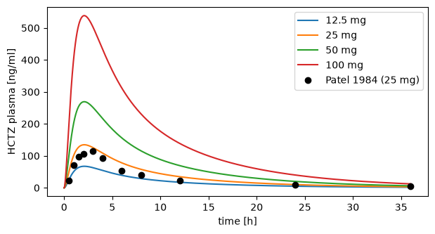

# Data

A simulation experiment works with two kinds of data. Measured data, such as the plasma concentrations of a clinical study, is a `DataSet`: a pandas data frame that knows the units of its columns. Everything a figure or a fit reads, simulated or measured, is named by a `Data` object, which you create before the experiment runs and resolve to numbers afterwards.

## Datasets

A `DataSet` is created from a data frame and the units of its columns. Here are the plasma concentrations of hydrochlorothiazide (HCTZ) measured by Patel et al. (1984) after a 25 mg tablet:

```python
import pandas as pd

from sbmlsim.data import DataSet
from sbmlsim.units import ureg

patel1984 = pd.DataFrame(
    {
        "time": [0.5, 1, 1.5, 2, 3, 4, 6, 8, 12, 24, 36],
        "cp": [22.8, 71.6, 97.9, 107, 115, 92.6, 54.2, 39.3, 23.3, 9.0, 4.6],
        "cp_sd": [21.9, 32.4, 39.1, 36.0, 29.0, 21.1, 11.6, 9.5, 11.9, 6.3, 5.2],
    }
)
dset = DataSet.from_df(patel1984, ureg=ureg, udict={"time": "hr", "cp": "ng/ml"})
print(dset.head(3))
print(dset.get_quantity("cp")[:3].to("µg/l").round(1))
```

```text title="Output"
   time    cp  cp_sd time_unit cp_unit
0   0.5  22.8   21.9        hr   ng/ml
1   1.0  71.6   32.4        hr   ng/ml
2   1.5  97.9   39.1        hr   ng/ml
[22.8 71.6 97.9] microgram / liter
```

`udict` gives the unit of a column, and the columns `cp_sd`, `cp_se`, `cp_min` and `cp_max` share the unit of `cp`. `get_quantity` returns a column as a pint quantity, which converts to any unit of the same dimension. `ureg` is the unit registry of `sbmlsim`; inside an experiment use `self.ureg`.

### Units in the table

Tables exported from a database such as [PK-DB](https://pk-db.com) carry the units as columns. There are two forms:

- A `<column>_unit` column gives the unit of `<column>` and of its `_sd`, `_se`, `_min` and `_max` columns.
- A `unit` column gives the unit of every number of its row: `mean`, `value`, `median`, `sd`, `se`, `min` and `max`. The column `cv` is relative and has no unit.

The units may change from row to row. `from_df` converts every row to the unit of the first row with a value and rewrites the unit column:

```python
pkdb = pd.DataFrame(
    {
        "time": [0, 30, 1],
        "time_unit": ["min", "min", "hr"],
        "mean": [0.0, 2.1, 800.0],
        "sd": [0.0, 0.3, 100.0],
        "unit": ["mg/l", "mg/l", "µg/l"],
    }
)
print(DataSet.from_df(pkdb, ureg=ureg))
```

```text title="Output"
   time time_unit  mean  mean_sd mean_unit
0   0.0       min   0.0      0.0      mg/l
1  30.0       min   2.1      0.3      mg/l
2  60.0       min   0.8      0.1      mg/l
```

The time of the last row became 60 min and its mean and SD 0.8 and 0.1 mg/l. With a `unit` column, `sd` and `se` are renamed to `mean_sd` and `mean_se`.

A few more rules:

- A unit with a number in it, as publications write it (`micromol/(0.5*hr)`, `ml/min/(1.73*m^2)`), is read as part of the values: `8.6 micromol/(0.5*hr)` becomes `17.2 micromole/hour`.
- A column whose rows cannot be brought to one unit raises a `ValueError` that names the column and its units. That happens for units of different dimensions, units with an offset such as `degC`, units the registry does not know (see [Units](units.md#the-unit-registry-and-q)) and values that are not numbers.
- `from_df` does not change the data frame you pass in, and a copy or slice of a dataset has its own units.

In an experiment, `datasets()` returns the datasets by key. `load_pkdb_dataframe(sid, data_path)` reads the TSV file of a PK-DB study from the `data_path` of the experiment; `examples/glucose/experiments/dose_response.py` shows it in use.

## Referring to data

A `Data` object names one of three things:

- a variable of a task: `Data("cp", task="task_po25")`,
- a column of a dataset: `Data("cp", dataset="patel1984")`,
- a function of other data: `Data("cp_norm", function="cp / max(cp)", variables={"cp": ...})`.

The variable of a task can be `time`, a variable of the model, an observable, or a parameter of a `PK` observable such as `pk.cmax`. A species in brackets, `[Cve_hctz]`, is its concentration, without brackets its amount.

```python
from sbmlsim.data import Data

print(Data("[Cve_hctz]", task="task_po25").sid)
print(Data("Cve_hctz", task="task_po25").sid)
print(Data("pk.cmax", task="task_doses").sid)
```

```text title="Output"
task_po25__conc__Cve_hctz
task_po25__Cve_hctz
task_doses__pk__cmax
```

The `sid` of a `Data` is built from its source and its name, so it is a valid SBML id. Figures, fit mappings and the JSON file refer to data by it. Pass `sid=` to choose it yourself, for example when you read the same variable twice with different selections.

The data a figure, a fit mapping or `data()` reads decides what a task records. To read a variable after the run that nothing else reads, list it in `data()`.

## Reading the data of a run

This experiment simulates the 25 mg dose of the study and a scan over four doses, and computes the mass concentration `cp` and its PK parameters:

```python
from pathlib import Path
from typing import override

from sbmlsim import Q
from sbmlsim.experiment import ExperimentRunner, SimulationExperiment
from sbmlsim.resources import HCTZ_SBML
from sbmlsim.simulation import (
    PK,
    Change,
    Dimension,
    Formula,
    Observable,
    Scan,
    Simulation,
)
from sbmlsim.simulator import Simulator
from sbmlsim.task import Task


def oral_dose() -> Simulation:
    return Simulation(
        time_unit="hr",
        end=36,
        changes=[Change(0, {"PODOSE_hctz": Q(25, "mg")})],
    )


class Hctz(SimulationExperiment):
    @override
    def datasets(self) -> dict[str, DataSet]:
        units = {"time": "hr", "cp": "ng/ml"}
        return {"patel1984": DataSet.from_df(patel1984, udict=units, ureg=self.ureg)}

    @override
    def models(self) -> dict[str, Path]:
        return {"hctz": HCTZ_SBML}

    @override
    def simulations(self) -> dict[str, Simulation | Scan]:
        doses = Dimension("dose", values={"PODOSE_hctz": Q([12.5, 25, 50, 100], "mg")})
        return {"po25": oral_dose(), "doses": Scan(oral_dose(), [doses])}

    @override
    def observables(self) -> dict[str, Observable]:
        return {
            "cp": Formula("cp", "[Cve_hctz] * Mr_hctz", unit="ng/ml"),
            "pk": PK("pk", "cp", dose="PODOSE_hctz", route="oral"),
        }

    @override
    def tasks(self) -> dict[str, Task]:
        return {
            "task_po25": Task(model="hctz", simulation="po25"),
            "task_doses": Task(model="hctz", simulation="doses"),
        }

    @override
    def data(self) -> dict[str, Data]:
        data = [
            Data("[Cve_hctz]", task="task_po25"),
            Data("cp", task="task_doses"),
            Data("pk.cmax", task="task_doses"),
        ]
        return {d.sid: d for d in data}


runner = ExperimentRunner(Hctz, base_path=None, data_path=None, simulator=Simulator())
[result] = runner.run_experiments(Path("results"), keep_results=True)
experiment = result.experiment
print(experiment)
```

```text title="Output"
*** SimulationExperiment: Hctz ***
data                 ['task_po25__conc__Cve_hctz', 'task_doses__cp', 'task_doses__pk__cmax']
datasets             ['patel1984']
fit_mappings         []
simulations          ['po25', 'doses']
observables          ['cp', 'pk']
tasks                ['task_po25', 'task_doses']
results              ['task_po25', 'task_doses']
figures              []
```

`Data.get_data(experiment)` returns the values as an `xarray.DataArray` with the unit in `attrs["units"]`. `to_units` converts them, and `to_quantity` turns the array into a pint quantity:

```python
from sbmlsim.data import to_quantity

conc = Data("[Cve_hctz]", task="task_po25").get_data(experiment, to_units="µmol/l")
print(conc.dims, conc.attrs["units"])
print(f"{to_quantity(conc, experiment.ureg).max():~.3f}")

measured = Data("cp", dataset="patel1984").get_data(experiment)
print(measured.dims, measured.attrs["units"], measured.values[:3])
```

```text title="Output"
('_point',) µmol/l
0.452 μmol / l
('row',) ng/ml [22.8 71.6 97.9]
```

A timecourse has the time points the integrator chose, the dimension `_point`, and a dataset column the dimension `row`. A simulation with output `times` has the dimension `time` instead. The values of a task are in the units of the model, here mmol/l for the concentration, unless you ask for others.

## Selecting points

The data of a scan has one dimension per scan dimension, before the time. The peak concentration `pk.cmax` is one value per simulation, so it only has the dimension `dose`:

```python
cmax = Data("pk.cmax", task="task_doses").get_data(experiment)
print(cmax.dims, cmax.attrs["units"])
print(cmax.to_pandas().round(1))
print(cmax["dose.PODOSE_hctz"].values)
```

```text title="Output"
('dose',) nanogram / milliliter
dose
0     67.3
1    134.6
2    269.2
3    538.3
Name: task_doses__pk__cmax, dtype: float64
[ 12.5  25.   50.  100. ]
```

Every array of a task carries the values a dimension sets as the coordinate `<dimension>.<target>`, here `dose.PODOSE_hctz`, and `Data("dose.PODOSE_hctz", task="task_doses")` reads them as data of their own. The plain name of a changed target, `PODOSE_hctz`, is its timecourse, which a task only records when some data reads it.

`sel` selects points by their labels. A single label drops the dimension, a list keeps it:

```python
one = Data("cp", task="task_doses", sel={"dose": 2}).get_data(experiment)
two = Data("cp", task="task_doses", sel={"dose": [0, 3]}).get_data(experiment)
print(one.dims, two.dims, two["dose.PODOSE_hctz"].values)
```

```text title="Output"
('_point',) ('dose', '_point') [ 12.5 100. ]
```

The labels of a dimension are `0, 1, 2, ...` unless the `Dimension` sets `labels=`. A dimension of the scan that the data does not have is skipped, so the same `sel` works for the time and the values of a curve. A dimension or label that does not exist raises an error when the experiment is initialized. For a dataset, `sel={"group": "b"}` keeps the rows whose column `group` is `b`.

In a scan every simulation keeps its own time points, so `time` is data over `(dose, _point)` like `cp`, padded with `NaN` where a simulation has fewer points. `to_quantity` turns the arrays into quantities, which plot with matplotlib in their units, and `label_axes` labels the axes with them:

```python
import matplotlib.pyplot as plt

from sbmlsim.plot import label_axes

time = to_quantity(Data("time", task="task_doses").get_data(experiment), ureg)
cp = Data("cp", task="task_doses").get_data(experiment)

fig, ax = plt.subplots(figsize=(7, 3.5))
for k, mg in enumerate(cp["dose.PODOSE_hctz"].values):
    ax.plot(time[k].to("hr"), to_quantity(cp[k], ureg), label=f"{mg:g} mg")
data_time = to_quantity(Data("time", dataset="patel1984").get_data(experiment), ureg)
ax.plot(
    data_time,
    to_quantity(measured, ureg),
    "o",
    color="black",
    label="Patel 1984 (25 mg)",
)
label_axes(ax, "time", "HCTZ plasma")
ax.legend()
```



For figures that are part of an experiment, see [Plots](plotting.md): a curve with `over="dose"` draws one line per dose.

## Functions of data

Data can be computed from other data with a formula. The formula uses the names of `variables` and `parameters`:

```python
cp_norm = Data(
    "cp_norm",
    function="cp / max(cp)",
    variables={"cp": Data("cp", task="task_doses")},
)
norm = cp_norm.get_data(experiment)
print(norm.dims, norm.max(dim="_point").values)
```

```text title="Output"
('dose', '_point') [1. 1. 1. 1.]
```

The variables are broadcast by the names of their dimensions, so a function of a scan keeps the scan dimensions. `max` and `min` with one argument reduce it along the time of every simulation, ignoring the `NaN` of padding, so `cp / max(cp)` scales every dose to its own peak. For a dataset column they reduce over the rows. With two or more arguments they are the elementwise maximum and minimum.

The formula is written in the math of [PEtab](https://petab.readthedocs.io), the same as the formulas of changes and observables. It differs from the L3 formula syntax of SBML that older versions of `sbmlsim` used:

- `log(x)` is the natural logarithm. Use `log10(x)` for base 10 and `log(x, b)` for base `b`. This difference changes a result without an error.
- Write `arcsin`, `arccos`, `arctan`, `arcsinh` and so on instead of `asin`, `acos`, `atan` and `asinh`.
- Write `sqrt(x)` or `x^(1/n)` instead of `root(n, x)`.
- `pi` is an ordinary name, so pass its value: `parameters={"pi": math.pi}`.
- `ceiling`, `ceil`, `floor` and `factorial` do not exist.

The other differences raise a `ValueError` when the data is evaluated. The reductions `mean` and `at` need the time points of a simulation, so they exist only in observables, see [Observables](observables.md).
