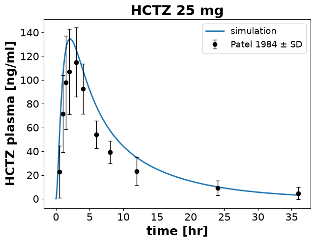

# Simulation experiments

A simulation experiment describes one study in code: the model, the measured data, the simulations, and the figures that compare them. You write it as a python class, and an `ExperimentRunner` runs it and writes the results, the figures and a report. Parameter fits use the same classes, so a study you described once can be plotted, reported and fitted (see [Parameter fitting](fitting.md)).

For a quick simulation you do not need an experiment, `Simulator.run` is enough (see [Simulations](simulation.md)). An experiment pays off when you compare a model with data, keep many studies in one project, or want figures and reports you can regenerate.

## A first experiment

Patel et al. (1984) gave 25 mg of hydrochlorothiazide (HCTZ) to healthy volunteers and measured the drug in plasma. The experiment below holds their data, simulates the same dose with the HCTZ model that ships with `sbmlsim` and draws both in one figure:

```python
from pathlib import Path
from typing import override

import pandas as pd

from sbmlsim import Q
from sbmlsim.data import DataSet
from sbmlsim.experiment import SimulationExperiment
from sbmlsim.plot import Axis, Figure
from sbmlsim.resources import HCTZ_SBML
from sbmlsim.simulation import Change, Formula, Observable, Simulation
from sbmlsim.task import Task

patel1984 = pd.DataFrame(
    {
        "time": [0.5, 1, 1.5, 2, 3, 4, 6, 8, 12, 24, 36],
        "cp": [22.8, 71.6, 97.9, 107, 115, 92.6, 54.2, 39.3, 23.3, 9.0, 4.6],
        "cp_sd": [21.9, 32.4, 39.1, 36.0, 29.0, 21.1, 11.6, 9.5, 11.9, 6.3, 5.2],
    }
)


class Patel1984(SimulationExperiment):
    """A single oral dose of 25 mg HCTZ (Patel et al. 1984)."""

    @override
    def datasets(self) -> dict[str, DataSet]:
        units = {"time": "hr", "cp": "ng/ml", "cp_sd": "ng/ml"}
        return {"hctz25": DataSet.from_df(patel1984, udict=units, ureg=self.ureg)}

    @override
    def models(self) -> dict[str, Path]:
        return {"hctz": HCTZ_SBML}

    @override
    def simulations(self) -> dict[str, Simulation]:
        po25 = Simulation(
            time_unit="hr",
            end=36,
            changes=[Change(0, {"PODOSE_hctz": Q(25, "mg")})],
        )
        return {"po25": po25}

    @override
    def observables(self) -> dict[str, Observable]:
        return {"cp": Formula("cp", "[Cve_hctz] * Mr_hctz", unit="ng/ml")}

    @override
    def tasks(self) -> dict[str, Task]:
        return {"task_po25": Task(model="hctz", simulation="po25")}

    @override
    def figures(self) -> dict[str, Figure]:
        fig = Figure(experiment=self, sid="fig_cp")
        [plot] = fig.create_plots(
            xaxis=Axis("time", unit="hr"), yaxis=Axis("HCTZ plasma", unit="ng/ml")
        )
        plot.set_title("HCTZ 25 mg")
        plot.add_data(task="task_po25", xid="time", yid="cp", label="simulation")
        plot.add_data(
            dataset="hctz25",
            xid="time",
            yid="cp",
            yid_sd="cp_sd",
            label="Patel 1984",
            color="black",
            marker="o",
            linestyle="",
        )
        return {"fig_cp": fig}
```

Every method returns a dictionary, and the parts refer to each other by its keys: the task `task_po25` runs the simulation `po25` on the model `hctz`, and the figure reads the task and the dataset `hctz25`. The observable `cp` turns the molar concentration of the model into ng/ml, the unit of the data.

The `ExperimentRunner` loads the models, runs the experiment and writes its outputs into a folder per experiment:

```python
from sbmlsim.experiment import ExperimentRunner
from sbmlsim.simulator import Simulator

runner = ExperimentRunner(
    Patel1984, base_path=None, data_path=None, simulator=Simulator()
)
results = runner.run_experiments(output_path=Path("results"), keep_results=True)
for path in sorted(Path("results").rglob("*.*")):
    print(path)
```

```text title="Output"
results/Patel1984/Patel1984.json
results/Patel1984/Patel1984_fig_cp.svg
results/Patel1984/datasets/Patel1984_hctz25.tsv
```

The run wrote the figure as SVG, the dataset as TSV and the definition of the experiment as JSON.

In a terminal or a notebook the run also shows its progress: a bar over all experiments and a row for each experiment that is running, with what it is doing (its simulations, drawing or writing its figures, ...) and how far it got. At the end it prints how long each experiment took in each phase:

```text
⏱ Timings in seconds ───────────────────────────────────────────────────────────────────────────────
experiment      models  initialize  simulations  data  figures  outputs  total
────────────────────────────────────────────────────────────────────────────────────────────────
✓ Beermann1976    0.22        0.05         0.04  0.02     0.55     0.01   0.89  ━━━━━━━━━━━━
✓ Patel1984       0.23        0.09         0.21  0.03     0.63     0.02   1.20  ━━━━━━━━━━━━━━━━
✓ Weir1998        0.22        0.03         0.05  0.01     0.26     0.01   0.57  ━━━━━━━━
────────────────────────────────────────────────────────────────────────────────────────────────
total             0.67        0.17         0.30  0.05     1.43     0.04   2.66  ━━━━━━━━━━━━━━━━
share              25%          6%          11%    2%      54%       1%   100%
3 experiments, initialized in 0.36 s and run in 2.42 s on 3 workers
```

The phases are loading the models, initializing the experiment (its definitions and their checks), the simulations, evaluating the data of the fit mappings, the figures (drawing them and writing their files) and the outputs (datasets, results and JSON). A column `other` appears when time went elsewhere, for example into code that a subclass runs in its own `run`. In the terminal the bar of each row shows the phases in the colours of the column headers, so you see at a glance where the time goes; here the figures take more than half of it. The same numbers are in `ExperimentResult.timings`.

The progress and the timings are shown only when the output goes to a terminal or a notebook, not when it is redirected into a file. `run_experiments(progress=True)` always shows them, `progress=False` prints nothing at all.

To look at a figure in a notebook, ask the experiment for its matplotlib figures:

```python
experiment = results[0].experiment
fig = experiment.create_mpl_figures()["fig_cp"]
```



## The parts of an experiment

An experiment overrides the methods it needs. Define them in this order, since each part can only refer to the parts before it:

- `datasets()`: measured data as `DataSet` objects, data frames with units. See [Data](data.md).
- `models()`: a path, an SBML string or an `AbstractModel` with changes (see [Models](models.md)). A relative path is resolved against the `base_path` of the experiment. The changes of a model are applied before every simulation of it, unless the simulation sets the same value itself.
- `simulations()`: `Simulation` or `Scan` objects, see [Simulations](simulation.md) and [Parameter scans](scans.md).
- `observables()`: `Formula`, `PK` and `Custom` observables, see [Observables](observables.md).
- `tasks()`: a `Task` runs one simulation on one model. Results are stored by task.
- `data()`: `Data` objects you want to read after the run that no figure or fit mapping reads already. See [Data](data.md).
- `fit_mappings()`: pairs of data and simulation for a fit, see [Parameter fitting](fitting.md).
- `figures()`: `Figure` objects with plots and curves, see [Plots](plotting.md).

A few rules apply to the keys. Each key must be a valid SBML id (letters, digits and `_`, not starting with a digit; no `-`, `.` or spaces), and each key must be unique in the whole experiment, so a task cannot have the same key as a simulation. The runner checks the keys when it creates the experiment and names all invalid keys in one error. It also checks what the data of a task read: a variable that is neither `time`, an observable, a dimension of the scan nor a variable of the model raises before anything is simulated.

Mark each method with `typing.override`. A type checker then reports a method that overrides nothing, such as a misspelled `simulation()`.

To save time, a task only records the variables that the data, figures and fit mappings of the experiment read. `run_experiments(reduced_selections=False)` records every variable of the model as well.

## Results

With `keep_results=True` the results stay in memory after the run. `experiment.results` holds one `ScanResult` per task. The values are in the units of the model, so the time is in minutes here, and an observable has the unit it declares. `res.q[...]` gives a variable as a quantity, which `.to(...)` converts:

```python
res = experiment.results["task_po25"]
print(res)
print(res.units)
print(f"end: {res.q['time'].max().to('hr'):~}")
print(f"peak: {res.q['cp'].max():~.1f}")
```

```text title="Output"
ScanResult(_point: 867; cp)
{'time': 'min', 'cp': 'nanogram / milliliter'}
end: 36.0 h
peak: 134.6 ng / ml
```

By default the runner releases the results once it has written the outputs, so a run of many experiments only holds the results of the experiment it is running. `experiment.results` then raises an error. `save_results=True` writes the result of every task as a netCDF file, `<experiment>_<task>.nc`, which `ScanResult.from_netcdf` reads back.

To read data in the units you want, such as a variable over the points of a scan, use `Data.get_data`, see [Data](data.md#reading-the-data-of-a-run).

## Running many experiments

`ExperimentRunner` takes a list of experiment classes. They are independent, so the runner runs them in parallel worker processes: with the default `n_workers=None` it starts one worker per four experiments, at most one per CPU, and a run of a few experiments stays in the calling process. `n_workers=1` runs everything in the calling process, another number starts that many workers. The 28 experiments of the HCTZ project run in 12 s in parallel instead of 21 s.

A worker imports the experiment classes again, which has two consequences:

- A script that runs experiments in parallel needs its code under `if __name__ == "__main__":`.
- The classes must be importable from a module. Classes defined in a function or in the main script, as in a notebook, run in the calling process. The same holds for a run with `keep_results=True`, with shown figures or with a unit registry of its own.

If the simulator runs its scans in a pool (`Simulator(n_workers=4)`) and you do not set `n_workers`, the experiments run one after another and their scans use the pool. If a worker crashes, its experiment runs again in the calling process.

The workers report what they are doing to the progress display, so its rows are the experiments that are running in the workers. The models and the initialization in the timings are then the ones of the workers, which load the models again; the line below the table gives the time the runner took to initialize the experiments before the run.

## When something fails

One failing experiment does not stop the run. An error in a definition, such as a bad key or a missing dataset, is logged with its traceback when the runner is created, and that experiment is skipped. An error during the run ends only that experiment, and a failing figure is skipped while the others are written.

At the end of the run, the log lists the failures. Each `ExperimentResult` records them in `error`, `failed_figures` and `failed`, and the report shows them. A figure that failed leaves no old file from an earlier run in the output folder.

To stop on errors instead:

- `run_experiments(raise_on_failure=True)` raises one `ExperimentRunError` after all experiments ran.
- `ExperimentRunner(..., on_error="raise")` raises an error of a definition right away.

## Reports

`ExperimentReport` renders the results of a run into an HTML report with the figures, models, simulations, datasets and the code of every experiment. The function `run_experiments` of `sbmlsim.experiment.runner` runs a list of experiments and writes the report in one call:

```python
from sbmlsim.experiment.runner import run_experiments

if __name__ == "__main__":
    run_experiments([Patel1984], output_path=Path("report"))
```

```text title="Output"
📋 Report ──────────────────────────────────────────────────────────────────────
experiments         1
report              file://./report/index.html
```

The last line of the output is a link to `report/index.html`, which most terminals open with a click, and `show_report=True` opens it in the web browser. The report links the source file of an experiment defined in a module; an experiment of a notebook has no file to link. To build the report from results you already have, call `ExperimentReport(results).create_report(output_path)` from `sbmlsim.report.experiment_report`; `report_type=ExperimentReport.ReportType.MARKDOWN` writes markdown instead of HTML.

## The JSON file

Every run writes `<experiment>.json` with the models, simulations, tasks, data and figures of the experiment. `experiment.to_json()` returns the same text:

```python
import json

definition = json.loads(experiment.to_json())
print(list(definition))
print(definition["simulations"]["po25"]["changes"])
```

```text title="Output"
['experiment_id', 'base_path', 'data_path', 'models', 'tasks', 'observables', 'simulations', 'data', 'figures']
[{'times': [0], 'values': {'PODOSE_hctz': {'value': 25, 'unit': 'milligram'}}}]
```

Paths, quantities, enums, arrays and objects with a `to_dict()` method are written as such. Any other value raises a `TypeError`; the runner then logs the error and writes no JSON file for that experiment. If you put your own objects into an experiment, give them a `to_dict()` method that returns the fields that describe their behaviour.

## Examples

The [examples](https://github.com/matthiaskoenig/sbmlsim/tree/develop/examples) folder has complete experiments:

- `examples/initial_assignment`: a model with changes and two simulations.
- `examples/curve_types`: every curve type of the plots.
- `examples/glucose`: datasets and a dose response scan.
- `examples/experiment_scans.py`: PK parameters of midazolam over three doses, a band over parameter draws and a fit.
- `examples/hctz_fitting`: pharmacokinetic experiments with data from two studies and the fitting problems built on them.
