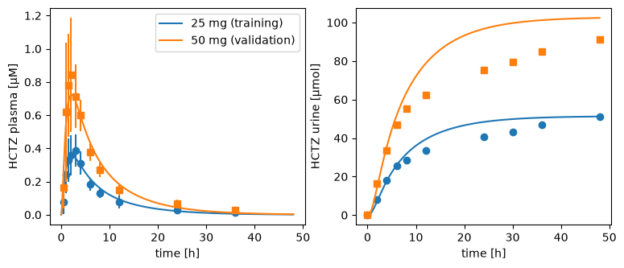
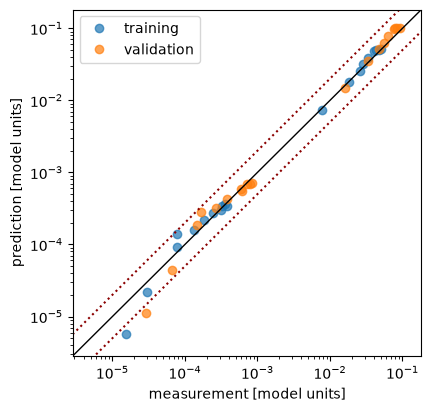

# Parameter fitting

A fit changes parameters of a model until its simulations match measured data. You tell `sbmlsim` which data belongs to which simulation (fit mappings), which parameters it may change and within which bounds (fit parameters), and how to compare simulation and data (settings). It runs local or global optimizers of SciPy from many start points, and a report shows how well the fitted model describes the data.

This page continues the fit at the end of the [Tutorial](tutorial.md#fit-the-model-to-data). The examples use `examples/hctz_fitting`, the HCTZ model with the clinical studies of Patel et al. (1984) and Beermann et al. (1976). It is part of the repository, not of the installed package, so run the code from the root of a clone of [sbmlsim](https://github.com/matthiaskoenig/sbmlsim).

## A first fit

### Define the problem

The study of Patel et al. (1984) gave single oral doses of HCTZ to healthy volunteers and measured HCTZ in the plasma and the amount excreted into the urine. The simulation experiment `Patel1984` describes the study, and its fit mappings pair each measured curve with the simulated variable, e.g. `fm_25_tab` is the plasma concentration after a 25 mg tablet.

An `OptimizationProblem` collects the data and the parameters of a fit. Here the data of the 25 mg tablet is fitted (training data), and the 50 mg tablet is kept back to check the fit on data it was not fitted to (validation data). The fit estimates the dissolution rate of the tablet and the excretion rate of the kidneys:

```python
from examples.hctz_fitting import DATA_PATH, HCTZ_PATH
from examples.hctz_fitting.experiments.studies import Patel1984
from sbmlsim.fit import FitMappingCollection, FitParameter, MappingKind
from sbmlsim.fit.optimization import OptimizationProblem

problem = OptimizationProblem(
    opid="hctz_patel",
    mapping_collections=[
        FitMappingCollection(Patel1984, mappings=["fm_25_tab", "fm_25_tab_urine"]),
        FitMappingCollection(
            Patel1984,
            mappings=["fm_50_tab", "fm_50_tab_urine"],
            kind=MappingKind.VALIDATION,
        ),
    ],
    fit_parameters=[
        FitParameter(pid="Ka_dis_hctz", lower_bound=0.01, upper_bound=10, unit="1/hr"),
        FitParameter(pid="KI__HCTZEX_k", lower_bound=1e-5, upper_bound=1, unit="1/ml"),
    ],
    base_path=HCTZ_PATH,
    data_path=DATA_PATH,
)
```

`base_path` is the directory the models of the experiments are relative to, `data_path` the directory of their datasets.

### Run the optimization

`FitSettings` say how simulation and data are compared. The settings below divide every residual by the mean of its curve, so the plasma concentration and the amount in urine count the same although their values differ by orders of magnitude. Every curve gets the same weight whatever its number of points, and a point measured with a small standard deviation counts more than an uncertain one. `run_optimization` draws `size` random start points within the bounds, runs the local least squares optimizer from each and collects the results:

```python
from sbmlsim.fit import FitSettings
from sbmlsim.fit.options import ResidualType, WeightingCurvesType, WeightingPointsType
from sbmlsim.fit.runner import run_optimization

settings = FitSettings(
    residual=ResidualType.NORMALIZED,
    weighting_curves=(WeightingCurvesType.POINTS,),
    weighting_points=WeightingPointsType.ERROR_WEIGHTING,
)
fit = run_optimization(problem, settings, size=4, seed=1, show_progress=False)
print(fit.df_fits[["run", "cost", "Ka_dis_hctz", "KI__HCTZEX_k"]])
```

```text title="Output"
🚀 Optimization ────────────────────────────────────────────────────────────────

🎛 Parameters (2) ───────────────────────────────────────────────────────────────
parameter      start   lower   upper   unit
───────────────────────────────────────────
Ka_dis_hctz    -       0.01    10      1/hr
KI__HCTZEX_k   -       1e-05   1       1/ml
runs                4
workers             1 (serial)
converged           4/4 runs
best cost           0.0496035
optimizer time      0.2 s
   run      cost  Ka_dis_hctz  KI__HCTZEX_k
0    0  0.049603     0.304798      0.005028
1    1  0.049603     0.304798      0.005028
2    3  0.049603     0.304798      0.005028
3    2  0.049603     0.304798      0.005028
```

Every run ends at about the same parameters, so the optimum is well defined. With a seed the start points, and therefore the result, are the same in every session.

### Look at the report

A `FitReport` evaluates parameter sets on the problem: metrics, figures and an HTML page. `from_optimization_result` reports the best parameter set of a fit:

```python
from pathlib import Path

from sbmlsim.fit.report import FitReport

report = FitReport.from_optimization_result(problem, fit, mapping_figures=False)
metrics = report.metrics_df()
print(metrics[["kind", "n", "NRMSE", "R2", "GMFE", "within_2fold"]].round(2))
report.create(Path("results"), name="hctz_patel")
```

```text title="Output"
         kind   n  NRMSE    R2  GMFE  within_2fold
0    training  21   0.15  0.98  1.19          95.0
1  validation  21   0.20  0.93  1.24          95.0

📋 Report ──────────────────────────────────────────────────────────────────────
directory           hctz_patel
parameter sets      hctz_patel_0
mappings            2 training, 2 validation
report              file://./results/hctz_patel/index.html
```

The metrics are computed separately for the training data and the validation data. `GMFE` is the geometric mean fold error and `within_2fold` the percentage of points whose prediction is within a factor of two of the data, see [Metrics](#metrics). `create` writes the report into `results/hctz_patel`, with `index.html` as its page. `mapping_figures=False` skips the figure of every fit mapping to keep this example fast. Without it, the report has a figure per mapping with the data and the simulated curve.

`report.points` is the table behind the figures of the report: one row per data point with its time `x`, the data `DV`, its standard deviation `DV_SD` and the prediction `IPRED`, all in the units of the model, which `problem.x_units` and `problem.y_units` give for every mapping of `problem.mapping_keys`. To draw the fitted curves against the data, simulate the doses with the fitted values and turn both into quantities:

```python
import matplotlib.pyplot as plt

from sbmlsim import Q
from sbmlsim.plot import label_axes
from sbmlsim.resources import HCTZ_SBML
from sbmlsim.simulation import Simulation
from sbmlsim.simulator import Simulator

fitted = fit.parameter_set()
fitted_changes = {pid: Q(v, fitted.units[pid]) for pid, v in fitted.values.items()}
points = report.points(fitted)
units = dict(zip(problem.mapping_keys, zip(problem.x_units, problem.y_units)))

simulator = Simulator()
model = simulator.load(HCTZ_SBML)

fig, (ax1, ax2) = plt.subplots(1, 2, figsize=(9, 3.5))
for dose, kind, marker in [(25, "training", "o"), (50, "validation", "s")]:
    tablet = Simulation(
        time_unit="hr",
        end=48,
        preinit_changes={**fitted_changes, "PODOSE_hctz": Q(dose, "mg")},
    )
    res = simulator.run(model, tablet)
    for ax, key, yid, unit in [
        (ax1, f"fm_{dose}_tab", "[Cve_hctz]", "µM"),
        (ax2, f"fm_{dose}_tab_urine", "Aurine_hctz", "µmol"),
    ]:
        label = f"{dose} mg ({kind})"
        (line,) = ax.plot(res.q["time"].to("hr"), res.q[yid].to(unit), label=label)
        data = points[points.mapping == key]
        x_unit, y_unit = units[key]
        time = Q(data.x.to_numpy(), x_unit)
        dv = Q(data.DV.to_numpy(), y_unit)
        sd = Q(data.DV_SD.to_numpy(), y_unit)
        ax.vlines(time, dv - sd, dv + sd, color=line.get_color())
        ax.plot(time, dv, marker, color=line.get_color())
label_axes(ax1, "time", "HCTZ plasma")
label_axes(ax2, "time", "HCTZ urine")
ax1.legend()
```



The fitted model follows the 25 mg data, although in the urine it rises faster than the data between 12 and 36 hours. For the 50 mg tablet, which the fit has not seen, it predicts about 10 % more HCTZ in the urine than was measured. The goodness of fit plots every prediction against its measurement on logarithmic axes, so plasma and urine fit into one plot. Points on the diagonal are perfect predictions, and the dotted lines mark a factor of two:

```python
fig, ax = plt.subplots(figsize=(4.5, 4.5))
positive = points[(points.DV > 0) & (points.IPRED > 0)]
for kind, data in positive.groupby("kind"):
    ax.loglog(data.DV, data.IPRED, "o", alpha=0.7, label=kind)
limits = [positive[["DV", "IPRED"]].min().min() / 2, positive.DV.max() * 2]
ax.plot(limits, limits, color="black", linewidth=1)
for factor in [2, 0.5]:
    ax.plot(limits, [factor * v for v in limits], ":", color="darkred")
ax.set(xlabel="measurement [model units]", ylabel="prediction [model units]")
ax.set(xlim=limits, ylim=limits)
ax.legend()
```



The report draws this figure and a Bland-Altman plot with a panel per kind of data, see [Report of a fit](#report-of-a-fit).

## Fit mappings

A `FitMapping` is defined in the `fit_mappings()` of a `SimulationExperiment` and pairs a reference, usually the measured data, with an observable, the simulated variable. Both are `FitData`: the reference reads columns of a dataset (`dataset=`), the observable a variable or observable of a task (`task=`). The [Tutorial](tutorial.md#fit-the-model-to-data) defines a complete experiment with one mapping, and `examples/hctz_fitting/experiments/studies/patel1984.py` has many.

- `xid` and `yid` are the x (usually `time`) and the y of the data.
- `yid_sd` or `yid_se` is the column of the standard deviation or the standard error of the data. A standard error is converted to a standard deviation with the number of subjects, `count`, an integer or a column of the dataset.
- `sel` selects labels of the dimensions of a scan, or rows of a dataset by the values of its columns, see [Data](data.md).
- `FitMapping(metadata=...)` attaches a `MappingMetaData` to describe the curve, e.g. the tissue, the route or the dosing. Filters can select data by it, and reports show it and can group by it. `examples/hctz_fitting/experiments/metadata.py` is an example of a subclass.

`sbmlsim` checks that reference and observable have compatible units and converts the data to the units of the model.

### Values per simulation and over a dimension

A fit mapping does not have to be a timecourse. Its kind follows from the dimensions of the observable after `sel`:

- A timecourse has the time as x.
- A value per simulation has no x, e.g. the peak concentration of a `PK` observable: `FitData(self, task="task_doses", xid=None, yid="pk.cmax", sel={"dose": "standard"})`. Its reference is one or several rows of a dataset, e.g. the subjects of a study group selected with `sel={"group": "25mg"}`.
- Values over a dimension of a scan have the values of the dimension as x, e.g. `FitData(self, task="task_doses", xid="dose.PODOSE", yid="pk.cmax")` against data with the doses as x. The simulated values are interpolated linearly to the x of the data, so the dimension must be monotonic and cover the data.

Anything else raises when the problem is initialized and asks you to select a label with `sel=`. A prediction which is `NaN`, e.g. a PK parameter of a curve without a terminal phase, gets a large failure residual. A value of a dimension replaces a fitted parameter with the same target, so such a parameter has no effect on the points of the scan; the problem warns about it. `examples/experiment_scans.py` fits the metabolism of midazolam to a table of cmax over the dose. These mappings cannot be exported to PEtab.

## Training, validation and outlier data

What a fit does with a curve is decided by the `MappingKind` of its `FitMappingCollection`, so the same curve can be training data of one fit and validation data of another:

| kind | fitted | in the report | use it for |
| --- | --- | --- | --- |
| `TRAINING` (default) | yes | yes | the data the parameters are estimated from |
| `VALIDATION` | no | yes | checking the fit on data it has not seen |
| `OUTLIER` | no | yes | data which is not usable, but which you want to compare with the model |
| `EXCLUDED` | no | no | data the model does not describe, e.g. a study arm with a second drug the model knows nothing about |

With many studies, writing the collections by hand gets tedious. `FitMappings` (in `sbmlsim.fit.helpers`) loads all fit mappings of the experiments once, and `select` assigns the kinds in three steps:

1. Filters select the training data. A filter is a function of the key of a mapping and the `FitMapping`, e.g. a test of its metadata. A mapping which fails a filter is excluded.
2. Outliers are named by their keys. An outlier stays excluded if the filters exclude it.
3. Validation data is chosen from the rest, by keys or by a filter.

Here the fit uses all HCTZ amounts in urine of the two studies, drops one curve as an outlier and validates on the highest dose:

```python
from examples.hctz_fitting.experiments.studies import Beermann1976
from sbmlsim.fit.helpers import FitMappings

fit_mappings = FitMappings(
    experiment_classes=[Beermann1976, Patel1984],
    base_path=HCTZ_PATH,
    data_path=DATA_PATH,
)
selection = fit_mappings.select(
    filters=[lambda key, fit_mapping: key.endswith("_urine")],
    outliers={"fm_hctz_iv1_5_urine"},
    validation={"fm_200_tab_urine", "fm_200_sus_urine"},
    print_info=False,
)
selection.print(detail=False)
```

```text title="Output"
📊 Data (44 fit mappings) ──────────────────────────────────────────────────────
experiment     training   validation   outlier   excluded   mappings
────────────────────────────────────────────────────────────────────
Beermann1976   8          0            1         9          18
Patel1984      6          2            0         18         26

total          14         2            1         27         44
```

`selection.collections` holds the `FitMappingCollection`s, one per experiment and kind, and `selection.df` a table of every mapping with its kind and metadata. `select_mapping_collections` does it all in one call. `examples/hctz_fitting/fitting/mapping_collections.py` names the outliers and the validation data once and defines each fit as a list of filters on the metadata.

On an initialized problem, `mapping_counts()` gives the number of mappings of each kind.

## Parameters

A `FitParameter` names an entity of the model (`pid`) with its bounds and unit:

- `lower_bound` and `upper_bound` are the box the optimizer searches.
- `unit` is a unit of pint or of the unit ids of the model, e.g. `per_min`. Without it the value is in the unit of the model.
- `start_value` is where every run starts with `sampling=SamplingType.START` (see [Running the optimization](#running-the-optimization)). A parameter with an infinite bound is not sampled and needs it as well.
- `description` describes the parameter in the report. Without it, the report uses its name in the model.
- `prior` is a prior of PEtab v2, a distribution of [sampling](sampling.md) or an [`Uncertain`](uncertainty.md) value, e.g. `Uncertain(Q(1.2, "1/hr"), cv=0.3)`. The fit itself does not use it; it is exported to PEtab and evaluated by `log_prior` of the PEtab layer.

The optimizer searches the parameters on the `parameter_scale` of the settings: `LOG10` by default, because a rate constant often spans orders of magnitude, or `LOG` and `LINEAR`. A logarithmic scale needs finite positive bounds. `FitParameter(scale=...)` sets the scale of a single parameter, e.g. `LINEAR` for one which can be zero or negative. Bounds, start values and results are always in the units of the model.

### One parameter for part of the data

Sometimes a parameter should be estimated from only part of the data. The dissolution rate of a tablet, for example, has no effect after an intravenous dose. `target` names the entity of the model the value is written to, and `mappings` is a filter (or a list of filters) of the fit mappings the parameter applies to. Simulations the parameter does not reach keep the value of the model. Several parameters with the same target can cover different parts of the data, e.g. a dissolution rate for tablets and another for capsules.

```python
from examples.hctz_fitting.experiments.metadata import Route
from sbmlsim.fit import FitMapping
from sbmlsim.fit.display import print_parameters


def is_oral(key: str, fit_mapping: FitMapping) -> bool:
    """Select the oral data."""
    return fit_mapping.metadata.route == Route.PO


by_route = OptimizationProblem(
    opid="hctz_routes",
    mapping_collections=[
        FitMappingCollection(
            Beermann1976, mappings=["fm_hctz_iv35_4_urine", "fm_hctz_po5_1_urine"]
        ),
    ],
    fit_parameters=[
        FitParameter(
            pid="Ka_dis_hctz_po",
            target="Ka_dis_hctz",
            mappings=is_oral,
            lower_bound=0.01,
            upper_bound=10,
            unit="1/hr",
        ),
        FitParameter(pid="KI__HCTZEX_k", lower_bound=1e-5, upper_bound=1, unit="1/ml"),
    ],
    base_path=HCTZ_PATH,
    data_path=DATA_PATH,
)
by_route.initialize(settings)
print_parameters(by_route.parameters, by_route.parameter_mapping.coverage())
```

```text title="Output"
🎛 Parameters (2) ───────────────────────────────────────────────────────────────
parameter        target         start   lower   upper   unit
────────────────────────────────────────────────────────────
Ka_dis_hctz_po   Ka_dis_hctz    -       0.01    10      1/hr
KI__HCTZEX_k     KI__HCTZEX_k   -       1e-05   1       1/ml
parameter        target         simulations   not covered
───────────────────────────────────────────────────────────────────────────────
Ka_dis_hctz_po   Ka_dis_hctz    1 of 2        Beermann1976|fm_hctz_iv35_4_urine
KI__HCTZEX_k     KI__HCTZEX_k   2 of 2        -
```

The coverage table shows that `Ka_dis_hctz_po` reaches one of the two simulations and leaves out the intravenous one. The fit and its report print the same table. The problem checks the parameters when it is initialized: two parameters must not write the same target in one simulation, a filter must select either all or none of the mappings which share a simulation, and the parameters of one target must have the same unit. A filter which selects nothing only warns.

A filter must be a function defined at the top level of a module, not a lambda: the workers of a parallel fit unpickle it. The PEtab export writes the selected mappings, not the filter, see [PEtab](petab.md).

## Settings

`FitSettings` decide how the cost is computed and how the simulations of the fit are integrated. A fit stores its settings with its result, and its report uses the same ones.

```python
from sbmlsim.fit.display import print_settings

print_settings(settings)
```

```text title="Output"
⚙ Settings ─────────────────────────────────────────────────────────────────────
setting              value
─────────────────────────────────────────────────────────────────────────
residual             NORMALIZED
loss function        LINEAR
weighting curves     POINTS
weighting points     ERROR_WEIGHTING
relative tolerance   1.0e-06
absolute tolerance   amount 1.0e-10, concentration 1.0e-10, other 1.0e-10
variable step size   True
initial time step    0
data at a change     before
```

### Residuals and weights

The cost is `0.5 * sum(w * r**2)` over the data points of the training data, with the residuals `r` and the weights `w`:

- `residual`: `ABSOLUTE` (default), the data minus the prediction, or `NORMALIZED`, divided by the mean of the curve. Use `NORMALIZED` when curves of very different magnitude enter one fit.
- `weighting_curves`: `MAPPING` multiplies a curve by the `weights` of its `FitMappingCollection`, or with `FitMappingCollection(use_mapping_weights=True)` by the `weight` of its `FitMapping`, which defaults to the number of subjects (`count`). `POINTS` divides a curve by its number of points, so that a curve with many points does not dominate. Both can be combined; without either, every point counts the same.
- `weighting_points`: `NO_WEIGHTING` (default) or `ERROR_WEIGHTING`, which weights a point by `mean / SD`, the inverse of its coefficient of variation. A curve without standard deviations gets the weight of a coefficient of variation of 0.5. A row with a standard error and no count raises when the problem is initialized.
- `loss_function`: `LINEAR` (default) or the robust `SOFT_L1`, `CAUCHY` and `ARCTAN` of `scipy.optimize.least_squares`, which reduce the influence of outliers.

The settings `relative_tolerance`, `absolute_tolerance`, `variable_step_size` and `initial_time_step` are those of the integrator, see [Simulations](simulation.md#selections-and-integrator-settings).

### Data at the time of a change

At the time of a `Change`, e.g. a dose or the emptying of the bladder, a simulation has two states: the one before the change and the one after it (see [Simulations](simulation.md#the-semantics)). Most measurements at that time are taken before the change: cumulative urine at the end of a collection period is the amount collected until then, not `0`, and a sample at the time of a dose is a pre-dose sample. So by default a data point at the time of a change after the start is compared with the state before the change (`data_at_change=DataAtChangeType.BEFORE`).

The first point of a curve is the exception: if a curve has later points, its first point takes the state after the change, because the curve starts there, e.g. a urine collection which starts at `0` at a reset. A curve of a single point takes the state before the change, e.g. the total amount of urine at the end of a collection. A data point counts as at the time of the change if it is within the resolution of the time of the simulation, and data at the start of a simulation always sees the state after the changes at the start. An event of the model is a jump as well: data at the time of an event takes the state after it.

`DataAtChangeType.AFTER` compares every data point at a change with the state after it, which is what PEtab does. A PEtab problem read without the `sbmlsim` extension uses `AFTER`. `problem.times_before_changes(k)` lists the times of the data of mapping `k` which take the state before a change.

## Running the optimization

`run_optimization(problem, settings, size, ...)` runs `size` optimizations and returns an `OptimizationResult`:

- `algorithm`: `OptimizationAlgorithmType.LEAST_SQUARE` (default, from `sbmlsim.fit.options`), the local `scipy.optimize.least_squares`, which needs many start points, or `DIFFERENTIAL_EVOLUTION`, the global `scipy.optimize.differential_evolution`, which needs few runs and finite bounds. Further keyword arguments go to the SciPy function, e.g. `max_nfev`. A `loss` or `f_scale` of SciPy is refused, the loss belongs in the settings.
- `diff_step`: the relative step of the finite differences of the Jacobian of the least squares optimizer. It defaults to the square root of `relative_tolerance` of the settings, `1e-3` for the default `1e-6`: a simulation is exact only to the tolerance of the integrator, and a smaller step, such as the default of SciPy, measures the noise of the integrator instead of the slope, so the optimizer stops next to its start.
- `sampling`: how the start points are drawn within the bounds, `SamplingType.UNIFORM` (default, from `sbmlsim.fit.sampling`), `LOGUNIFORM` and their Latin hypercube variants `UNIFORM_LHS` and `LOGUNIFORM_LHS`. `START` starts every run from the start values, to improve a known solution; one run is then enough for the local optimizer. Setting `problem.x0` changes the start values of a problem.
- `seed`: the seed of the start points. The start points are drawn before the runs start, so the result does not depend on the number of workers.
- `n_cores`: the number of worker processes; `1` (default) runs in the calling process, `None` uses all cores but one. `serial=True` runs serially whatever `n_cores` says, which is what a debugger needs.
- `timeout`: seconds per run; a run which runs out of time keeps the best parameters it reached.
- `runs_dir`: a directory every run is written to as JSON as soon as it finishes, so an interrupted fit keeps its finished runs. `OptimizationResult.from_directory` reads them back.

A run which fails, e.g. with an error of the integrator, keeps its message in the result and does not stop the other runs. [Running a fit from the command line](#running-a-fit-from-the-command-line) shows `runs_dir` in use.

A parallel fit starts worker processes which import your script again. In a script, put the fit under `if __name__ == "__main__":`, otherwise the workers start the fit again:

```bash
cat > fit.py << 'EOF'
from sbmlsim.fit.runner import run_optimization

from my_fit import problem, settings  # your definitions

if __name__ == "__main__":
    fit = run_optimization(problem, settings, size=20, n_cores=4, seed=1)
EOF
python fit.py
```

A worker which crashes loses only the run it was working on. While the runs go on, the console shows how many are done and an estimate of the total time.

## Results and parameter sets

The `OptimizationResult` holds every run: `df_fits` is a table with the cost, the parameters and the message of every run, the best first, and `df_traces` the cost of every step. It is saved with `to_json` and `to_tsv`, read with `OptimizationResult.from_json`, and `OptimizationResult.combine` merges the results of several fits.

A report is made from parameter sets. `fit.parameter_set()` is the best one and `fit.parameter_sets(size=n)` the `n` best, as `ParameterSets`, which you can store and read back as JSON:

```python
from sbmlsim.fit import ParameterSets

parameter_sets = fit.parameter_sets(size=2)
parameter_sets.to_json(Path("parameters.json"))
print(ParameterSets.from_json(Path("parameters.json")).to_df())
```

```text title="Output"
      parameter  unit  hctz_patel_0  hctz_patel_1
0   Ka_dis_hctz  1/hr      0.304798      0.304798
1  KI__HCTZEX_k  1/ml      0.005028      0.005028
```

A parameter set has the values, their units, the cost and its origin. `problem.parameter_set_model()` is the set of the values in the model, the natural reference to compare a fit with. The values of a set are converted to the units of the problem; an incompatible unit raises a `ValueError`.

## Report of a fit

A `FitReport` is made from a problem, its settings and one or more parameter sets. It does not need the fit, so you can report stored parameters later, or compare several sets in one report: every set is a column of the tables and a curve in the figures, and the first set is the reference.

```python
report = FitReport(problem, settings, ParameterSets.from_json(Path("parameters.json")))
```

`FitReport.from_optimization_result(problem, fit)` is the shortcut for a finished fit: it takes the settings from the result and adds the figures of the runs. `with_model=True` adds the values of the model as a reference set, so the report shows what the fit changed. `report.create(output_dir, name)` writes a folder with:

- `index.html`, an interactive page with the methods, the results and the figures of the fit, with search, filters by kind of data and sortable tables. It works offline and can be archived or sent as it is.
- `report.pdf` with its sources `report.typ` and LaTeX (`report.tex` for `\input` in a manuscript, `report_standalone.tex`), and `references.bib`. Typst compiles the PDF, no LaTeX installation is needed; if it fails, the page says why and everything else is written.
- the figures in `plots/`: the optimization runs (traces and waterfall), goodness of fit, Bland-Altman plot, and a figure per fit mapping with the data and the simulation, linear and logarithmic.
- `report.txt`, `parameters.json`, the metrics as TSV (`metrics.tsv`, `metrics_mappings.tsv`, `metrics_observables.tsv`, `datapoints.tsv`), and the records of the fit (`optimization_result.json`, `fisher.json`, `identifiability.json`) where the report has them.

The methods describe only what the fit used: the parameters, the data per kind, the objective, the optimizer and its options, the identifiability analysis and the provenance. The references are those it cites, see [References](references.md).

The goodness of fit and the Bland-Altman plot have one panel per kind of data, training, validation and outliers, with the points colored by study. The Bland-Altman plot shows the ratio of prediction and measurement against their mean, with the bias and the limits of agreement of the training data as fold factors. Both draw this band from the training data in every panel, so the validation data and the outliers are read against what the fit agrees to. Data points which are zero or negative have no ratio and are not drawn.

`FitReport` takes further options:

- `mapping_figures=False` leaves out the figures of the fit mappings, which are most of the time of a report.
- `groupings=[Grouping.by("tissue")]` (from `sbmlsim.fit.evaluation`) adds figures and metrics per group of a column of the data points, e.g. a field of the metadata. `Grouping.of_subsets("route", Subset("oral", is_oral), ...)` groups by named filters.
- `error_bars=True` draws the standard deviations of the data, `color_by="tissue"` colors the points by a column instead of the study.
- `context=ReportContext(title=..., description=..., parameter_descriptions=...)` (from `sbmlsim.fit.methods`) sets the title of the report and the text about the fit.
- `identifiability=` and `fisher=` add the results of the [identifiability](identifiability.md) analysis.

To report a stored fit, `report_from_records(definition, directory, opid=...)` of `sbmlsim.fit.cli` reads the records of a report folder (`parameters.json`, `optimization_result.json`, `identifiability.json`, `fisher.json`) and returns the `FitReport`. It uses the settings the fit ran with and warns if the definition has changed since.

## Metrics

`FitMetrics(problem, parameter_set)` computes the metrics of a parameter set on an initialized problem, and `report.metrics(parameter_set)` does the same for a set of a report. The table of the data points uses the names of population pharmacokinetics: `DV` is the measured value, `IPRED` the prediction, `IRES` the residual `DV - IPRED`, `NRES` the residual divided by the mean of its curve, and `IWRES` the weighted residual of the cost.

```python
columns = ["mapping", "kind", "n", "NRMSE", "GMFE", "AFE", "within_2fold"]
print(report.metrics(fitted).mappings_df()[columns].round(2))
```

```text title="Output"
           mapping        kind   n  NRMSE  GMFE   AFE  within_2fold
0        fm_25_tab    training  11   0.15  1.29  0.98         90.91
1  fm_25_tab_urine    training  10   0.14  1.09  1.07        100.00
2        fm_50_tab  validation  11   0.16  1.30  0.93         90.91
3  fm_50_tab_urine  validation  10   0.23  1.17  1.14        100.00
```

- `MSE`, `RMSE` and `R2` are computed from the values as they are, so curves with large values dominate them. R² is `NaN` for fewer than two points.
- `NRMSE` is the root mean square of `NRES`, so every curve counts the same whatever its magnitude.
- `RMSE_w` is the root mean square of `IWRES`, i.e. what the fit minimizes: the cost of the training data is `0.5 * n * RMSE_w**2`.
- `GMFE` (geometric mean fold error), `AFE` (average fold error, the bias: below 1 when the model predicts too low) and `within_2fold` are the usual criteria of pharmacokinetic predictions. `within_2fold` is the percentage of points within twofold of the data, `0.5 <= IPRED / DV <= 2`. Only points with a positive value and prediction count for them.
- `within_1sd` and `within_2sd` are the percentages of points within one and two standard deviations of the data.
- `AIC` and `BIC` compare models fitted to the same data; only their differences mean something.

The functions of `sbmlsim.fit.metrics` also work on plain arrays, e.g. `within_fold(data, predictions, fold=2.0)` and `rmse(residuals)`. `summary_df()` has one row per kind of data, `mappings_df()` one per fit mapping and `observables_df()` one per observable, e.g. plasma and urine. There is no row over all data, which would pool the data the fit was fitted to with data it dropped. A report writes these tables as TSV.

## Identifiability

A fit always returns numbers, but the data may not determine them. The profile likelihood and the Fisher information answer how well each parameter is determined, see [Identifiability](identifiability.md).

## Running a fit from the command line

Most of a fit is the same for every model, so `sbmlsim.fit.cli` provides it and a model only defines its fits. A `FitDefinition` is everything a fit needs: a function which returns the mapping collections, the parameters, the paths and the settings. `run_fit` builds the problem, runs it and records its provenance; with `output_dir` every run is written to `<output_dir>/<opid>/runs`:

```python
from sbmlsim.fit.cli import FitDefinition, run_fit
from sbmlsim.fit.result import OptimizationResult


def urine_collections() -> dict[str, list[FitMappingCollection]]:
    """Select the data of the fit."""
    return selection.collections


definition = FitDefinition(
    mapping_collections=urine_collections,
    parameters=problem.parameters,
    base_path=HCTZ_PATH,
    data_path=DATA_PATH,
    settings=settings,
)
fits = run_fit(definition, opid="hctz_urine", size=2, seed=1, output_dir=Path("fits"))

recovered = OptimizationResult.from_directory(Path("fits/hctz_urine/runs"))
print(recovered.size, "runs read back")
provenance = recovered.provenance
print("versions:", ", ".join(provenance.versions))
print("checksums of", len(provenance.files), "files")
```

```text title="Output"
🚀 Optimization ────────────────────────────────────────────────────────────────

🎛 Parameters (2) ───────────────────────────────────────────────────────────────
parameter      start   lower   upper   unit
───────────────────────────────────────────
Ka_dis_hctz    -       0.01    10      1/hr
KI__HCTZEX_k   -       1e-05   1       1/ml
runs                2
workers             1 (serial)
  optimizing ━━━━━━━━━━━━━━━━━━━━━━━━━━━━━━━━━━ 2/2 runs 0:00:00 ~ 0:00:00 total
converged           2/2 runs
best cost           1.09898
optimizer time      0.4 s
2 runs read back
versions: python, sbmlsim, libroadrunner, scipy, numpy
checksums of 10 files
```

The provenance records the arguments and seeds of the fit, the versions of python, sbmlsim, libroadrunner, SciPy and NumPy, the git revision of the model repository, and the SHA-256 checksums of the models and data files. It is stored in every run and in the result, and the report shows it. `run_fit(strategy=OptimizationStrategy.SINGLE)` fits every experiment on its own instead of all together. A `FitRun` creates its report with `report()` and its identifiability analyses with `fisher()` and `identifiability()`.

`fit_cli` and `report_cli` turn a dictionary of definitions into command line tools. `examples/hctz_fitting/fitting/fitting.py` defines the fits of the HCTZ model and calls `fit_cli`; `run_report.py` calls `report_cli`:

```bash
# fit the PK data with 10 runs on 4 cores
python -m examples.hctz_fitting.fitting.fitting --subset=PK --runs=10 --cores=4 \
    --seed=1234 --method=LSQ --strategy=ALL --name=PK_LSQ_ALL

# report a finished fit again, or compare the parameters of two fits
python -m examples.hctz_fitting.fitting.run_report results/fit/<fit id>/parameters.json
python -m examples.hctz_fitting.fitting.run_report run1/parameters.json run2/parameters.json
```

Every fit gets an id when it starts, `<problem>_<date>_<time>__<hash>`, e.g. `PK_20260908_144538__ea1ff`, which names its result and its report folder. Both tools take `--no-mapping-figures` for a fast report and `--group-by tissue` for the groupings of the report; `--help` lists all options.

## PEtab

A fit can be exchanged with the tools of the PEtab ecosystem as a PEtab v2 problem, which `sbmlsim.fit.petab_v2` writes and reads, see [PEtab](petab.md). A fit with neural networks is a problem of [PEtab SciML](petab_sciml.md). `sbmlsim.fit.petab_omex` packages a problem as a COMBINE archive.
