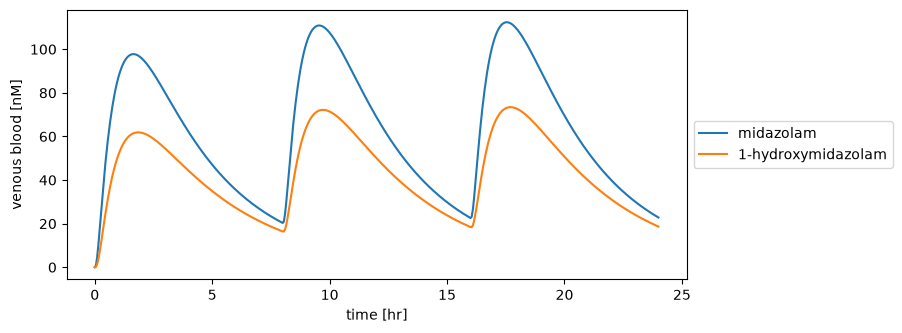

# sbmlsim: SBML simulation made easy
[](https://github.com/matthiaskoenig/sbmlsim/actions/workflows/ci-cd.yml) [](https://matthiaskoenig.github.io/sbmlsim) [](https://pypi.org/project/sbmlsim/) [](https://pypi.org/project/sbmlsim/) [](https://opensource.org/licenses/MIT) [](https://doi.org/10.5281/zenodo.3597770)

`sbmlsim` is a python library for simulating models in the [Systems Biology Markup Language](https://sbml.org) (SBML), the exchange format for models in systems biology ([Keating *et al.* 2020](references.md#standards)). It runs on the fast simulator [libroadrunner](https://libroadrunner.org) ([Welsh *et al.* 2023](references.md#simulation)) and adds what a simulation study needs around it: doses and other changes at given times, values with units, parameter scans, comparisons with experimental data, figures and reports, parameter fitting, and sensitivity and uncertainty analysis. The source code is on [GitHub](https://github.com/matthiaskoenig/sbmlsim).

!!! tip "New to sbmlsim?"
    [Install](installation.md) the package with `pip install sbmlsim`, then work through the [Tutorial](tutorial.md). It takes one drug model from a first simulation to a parameter fit and an uncertainty analysis, one small step at a time.

## A first simulation

`sbmlsim` ships a whole body model of midazolam, a sedative which the liver turns into 1-hydroxymidazolam. This simulation gives a 7.5 mg tablet every 8 hours and follows both substances in the blood for a day:

```python
import matplotlib.pyplot as plt

from sbmlsim import Q
from sbmlsim.resources import MIDAZOLAM_SBML
from sbmlsim.simulation import Change, Simulation
from sbmlsim.simulator import Simulator

simulator = Simulator()
simulation = Simulation(
    time_unit="hr",
    end=24,
    steps=480,
    changes=[Change([0, 8, 16], {"PODOSE_mid": Q(7.5, "mg")})],
)
res = simulator.run(MIDAZOLAM_SBML, simulation)

hours = res.quantity("time").to("hr").magnitude
fig, ax = plt.subplots(figsize=(8, 3.5))
for sid, name in [("[Cve_mid]", "midazolam"), ("[Cve_mid1oh]", "1-hydroxymidazolam")]:
    ax.plot(hours, res.quantity(sid).to("nM").magnitude, label=name)
ax.set(xlabel="time [hr]", ylabel="venous blood [nM]")
ax.legend(loc="center left", bbox_to_anchor=(1, 0.5))
```



The times are in hours and `sbmlsim` converts them into the minutes of the model. `res` is a `ScanResult` with every variable of the model over time and its unit, so `quantity(...).to("nM")` converts the concentrations from the mmol/l of the model. The [Tutorial](tutorial.md) starts from here and goes step by step through the features with a model of another drug.

## Features

Core:

- [Models](models.md): load SBML models, inspect them and set default changes.
- [Simulations](simulation.md): timecourses with changes before the start and at given times, e.g. repeated doses.
- [Units](units.md): give values in the units you have; `sbmlsim` converts them into the units of the model.
- [Simulation experiments](experiments.md): models, data, simulations and figures of one study in one reproducible python class.
- [Data](data.md): simulation results and experimental datasets, side by side in matching units.
- [Plots and reports](plotting.md): figures as images or interactive HTML pages, and reports of experiments.

Sensitivity and uncertainty:

- [Parameter scans](scans.md): run a simulation over ranges of values, in parallel if you like.
- [Sampling](sampling.md): draw parameters from distributions, e.g. a virtual population.
- [Uncertainty](uncertainty.md): propagate uncertain inputs and test statements about the predictions.
- [Observables](observables.md): values computed from every simulation, such as a peak concentration or a pharmacokinetic analysis.
- [Sensitivity analysis](sensitivity.md): local sensitivities and the global Sobol, FAST and Morris methods.

Parameter optimization:

- [Parameter fitting](fitting.md): fit parameters to data with local and global optimizers, with reports.
- [Identifiability](identifiability.md): profile likelihoods and the Fisher information of fitted parameters.
- [PEtab](petab.md): write a fit as a PEtab v2 problem and read PEtab v2 problems.
- [PEtab SciML](petab_sciml.md): hybrid models of SBML and neural networks.

[Test suites](testsuites.md) show how `sbmlsim` does on the [SBML Test Suite](testsuite.md), the [PEtab Test Suite](petab_testsuite.md), the [PEtab Benchmark Problems](petab_benchmark.md) and the [PEtab SciML Test Suite](sciml_testsuite.md). The standards and methods behind the package are cited in [References](references.md).

## How to cite

[](https://doi.org/10.5281/zenodo.3597770)

If you use `sbmlsim` please cite the archived software on [Zenodo](https://doi.org/10.5281/zenodo.3597770):

> König, M. (2026). *sbmlsim: SBML simulation made easy* (Version 0.10.2) [Computer software]. Zenodo. https://doi.org/10.5281/zenodo.23554765

## License

- Source Code: [MIT](https://opensource.org/license/MIT)
- Documentation: [CC BY-SA 4.0](http://creativecommons.org/licenses/by-sa/4.0/)
- Citation style: the bundled `src/sbmlsim/resources/references.csl` of the reports is the IEEE style of the [Citation Style Language](https://citationstyles.org) project under [CC BY-SA 3.0](https://creativecommons.org/licenses/by-sa/3.0/), adapted to print the version note of a software.

## Funding

Matthias König is supported by the German Research Foundation (DFG) within the Research Unit Programme FOR 5151 "QuaLiPerF (Quantifying Liver Perfusion-Function Relationship in Complex Resection - A Systems Medicine Approach)" by grant number 436883643 and by grant number 465194077 (Priority Programme SPP 2311, Subproject SimLivA).

Matthias König was supported by the Federal Ministry of Education and Research (BMBF, Germany) within the research network Systems Medicine of the Liver (**LiSyM**, grant number 031L0054). Matthias König has received funding from the EOSCsecretariat.eu which has received funding from the European Union's Horizon Programme call H2020-INFRAEOSC-05-2018-2019, grant Agreement number 831644.
