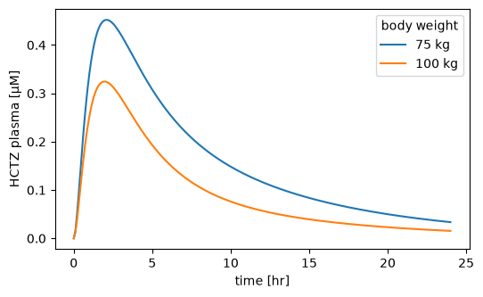

# Models

`sbmlsim` simulates models written in the [Systems Biology Markup Language](https://sbml.org) (SBML). It loads a model into [libroadrunner](https://libroadrunner.org), reads the units of the model and keeps a few settings with it: values to change before every simulation, the variables to record and the settings of the integrator. This page uses the HCTZ model of the [Tutorial](tutorial.md), a whole body model of the diuretic hydrochlorothiazide.

## Loading a model

A `Simulator` loads a model from the path of an SBML file or from the SBML itself as a string:

```python
from sbmlsim.resources import HCTZ_SBML
from sbmlsim.simulator import Simulator

simulator = Simulator()
model = simulator.load(HCTZ_SBML)
print(type(model).__name__)
print(model.r.model.getModelName())
```

```text title="Output"
RoadrunnerSBMLModel
Hydrochlorothiazide (HCTZ) body model
```

The model is a `RoadrunnerSBMLModel`, and `model.r` is its `roadrunner.RoadRunner` instance, for anything `sbmlsim` does not cover. You can also create one directly with `RoadrunnerSBMLModel(source=HCTZ_SBML)` and pass it to the simulator. A hierarchical model (SBML `comp`) is flattened when it is loaded.

`sbmlsim.resources` ships four models, which the documentation, the examples and the tests use:

| name | model |
| --- | --- |
| `REPRESSILATOR_SBML` | the repressilator of Elowitz and Leibler, a genetic oscillator |
| `DEMO_SBML` | a small demo model with three compartments and units |
| `MIDAZOLAM_SBML` | a whole body pharmacokinetics model of midazolam |
| `HCTZ_SBML` | a whole body pharmacokinetics and pharmacodynamics model of hydrochlorothiazide |

## Looking inside a model

`parameter_df` and `species_df` list the parameters and species with their values, SBML units and names:

```python
from sbmlsim.model import RoadrunnerSBMLModel

parameters = RoadrunnerSBMLModel.parameter_df(model.r)
selected = parameters[parameters.sid.isin(["BW", "PODOSE_hctz", "Mr_hctz"])]
print(selected[["sid", "value", "unit", "name"]].to_string(index=False))

species = RoadrunnerSBMLModel.species_df(model.r)
selected = species[species.sid.isin(["Cve_hctz", "Aurine_hctz"])]
print(selected[["sid", "amount", "unit", "name"]].to_string(index=False))
```

```text title="Output"
        sid  value       unit                           name
         BW   75.0         kg               body weight [kg]
    Mr_hctz  297.7 g_per_mole Molecular weight hctz [g/mole]
PODOSE_hctz    0.0         mg            oral dose hctz [mg]
        sid  amount  unit                                      name
   Cve_hctz     0.0 mmole hydrochlorothiazide (venous blood plasma)
Aurine_hctz     0.0 mmole               hydrochlorothiazide (urine)
```

The `unit` column holds the ids of the unit definitions in the SBML file. `model.uinfo` has the same units written for [pint](https://pint.readthedocs.io), which `sbmlsim` uses for every conversion (see [Units](units.md)). The id of a species is its amount, the id in brackets its concentration:

```python
for sid in ["BW", "Ka_dis_hctz", "Cve_hctz", "[Cve_hctz]", "time"]:
    print(f"{sid:12} {model.uinfo[sid]}")
```

```text title="Output"
BW           kg
Ka_dis_hctz  1/hr
Cve_hctz     mmol
[Cve_hctz]   mmol/litre
time         min
```

The tables show the current values, which change when you simulate. `loaded_value` gives the value of a parameter, compartment or species as the model was loaded, whatever ran on it since:

```python
print(model.loaded_value("BW"), model.loaded_value("[Cve_hctz]"))
```

```text title="Output"
75.0 0.0
```

`model.sbml_ids()` gives the ids of the constant parameters and of the species, e.g. to build a sensitivity design over every parameter (see [Sampling](sampling.md)).

## Changes for every simulation

`changes` set values of the model before every simulation of it. They are applied before the model is initialized, so initial assignments that depend on them follow. Here the patient weighs 100 kg instead of the 75 kg of the model, and both get the same 25 mg tablet:

```python
import matplotlib.pyplot as plt

from sbmlsim import Q
from sbmlsim.simulation import Change, Simulation

heavy = RoadrunnerSBMLModel(source=HCTZ_SBML, changes={"BW": Q(100, "kg")})

dose = Simulation(
    time_unit="hr", end=24, steps=240, changes=[Change(0, {"PODOSE_hctz": Q(25, "mg")})]
)
fig, ax = plt.subplots(figsize=(6, 3.5))
for m, label in [(model, "75 kg"), (heavy, "100 kg")]:
    res = simulator.run(m, dose)
    ax.plot(res["time"] / 60, res["[Cve_hctz]"] * 1000, label=label)
ax.set(xlabel="time [hr]", ylabel="HCTZ plasma [µM]")
ax.legend(title="body weight")
```



The heavier patient has a larger body, so the same dose gives a lower concentration in the plasma.

A change is a quantity, which is converted into the unit of the model, or a plain number, which is taken in the unit of the model (`sbmlsim` logs a warning for it). A simulation which sets the same target wins over the change of the model, see [Simulations](simulation.md).

## Choosing what is recorded

By default a simulation records every species (amount and concentration), parameter, reaction and compartment of the model. `selections` records only what you need, which makes large models and scans faster and their results smaller:

```python
small = RoadrunnerSBMLModel(
    source=HCTZ_SBML, selections=["time", "[Cve_hctz]", "Aurine_hctz"]
)
print(simulator.run(small, dose))
```

```text title="Output"
ScanResult(time: 241; [Cve_hctz], Aurine_hctz)
```

`model.set_selections([...])` changes the selections of a loaded model.

## Integrator settings

The integrator of roadrunner (CVODE by default) is configured on the simulator, e.g. `Simulator(relative_tolerance=1e-8)`, and the simulator sets its settings on every model it runs. A model takes settings of its own with `settings={...}` or `model.set_integrator_settings(...)`; a setting which the simulator does not set, e.g. `maximum_num_steps`, stays with the model, also in the worker processes of a parallel scan. The absolute tolerance is set per state from the kind of the state, `model.tolerances()` lists it. [Simulations](simulation.md#selections-and-integrator-settings) explains the settings and the tolerances.

## Compilation speed

roadrunner compiles every model into machine code when it is loaded. The optimization level `jit_optimization`, `O0` to `O3`, trades the time of the compilation against the speed of the simulation. `O2` is the default and simulates fast. `O0` compiles about four times faster and simulates up to a quarter slower, which pays off when a run loads many models and simulates little with each, e.g. when it initializes many experiments, or in tests.

Set the level on a model, on an `ExperimentRunner` or an `OptimizationProblem` (for all their models), or with the environment variable `SBMLSIM_JIT_OPTIMIZATION` for everything which is not given a level:

```python
from sbmlsim.model import JitOptimization

fast_compile = RoadrunnerSBMLModel(
    source=HCTZ_SBML, jit_optimization=JitOptimization.O0
)
```

```bash
SBMLSIM_JIT_OPTIMIZATION=O0 python my_script.py
```

The worker processes of a scan or a fit compile the model at the level of the main process. `O0` gives the same results as roadrunner's default compiler bitwise, the other levels can differ from them in the last bits.

## Models in an experiment

A [simulation experiment](experiments.md) describes its models without loading them, as an `AbstractModel` with the source and the changes. The `ExperimentRunner` loads them when it runs the experiment, and a simulator loads one with `load`:

```python
from sbmlsim.model import AbstractModel

description = AbstractModel(source=HCTZ_SBML, changes={"BW": Q(100, "kg")})
loaded = simulator.load(description)
print(type(loaded).__name__, loaded.changes)
```

```text title="Output"
RoadrunnerSBMLModel {'BW': Quantity(100, "kilogram")}
```

The source of a model is a path, absolute or relative to the `base_path` of the experiment, or the SBML itself. `sbmlsim` never downloads a model: a source which is neither an existing file nor SBML raises an `OSError`.
