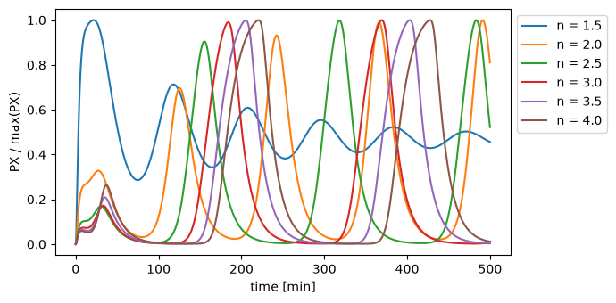
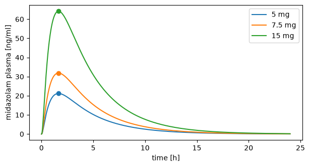

# Observables

An observable is a quantity computed from every simulation of a run: a timecourse, such as a concentration in ng/ml or normalized to its peak, or one value per simulation, such as the peak itself or the area under the curve. You pass them to `Simulator.run(model, scan, observables)`. There are three types:

- `Formula`: an expression of model variables, with reductions over time such as `max` and `mean`.
- `PK`: the non-compartmental analysis of a concentration with [pkpdutils](https://github.com/matthiaskoenig/pkpdutils), e.g. `cmax`, `auc` and the half-life.
- `Custom`: your own python function.

Observables are evaluated on the full solution of every simulation, before the result is interpolated onto a time grid, so they are as exact as the simulation itself.

## Formulas and reductions

A `Formula` uses the math of PEtab. It reads the variables of the model (`S` is the amount of a species, `[S]` its concentration, plus `time`, parameters and reactions) and other observables by their id. Here the repressilator runs for six values of the Hill coefficient `n`:

```python
import matplotlib.pyplot as plt
import numpy as np

from sbmlsim.plot import label_axes
from sbmlsim.resources import REPRESSILATOR_SBML
from sbmlsim.simulation import Dimension, Formula, Scan, Simulation
from sbmlsim.simulator import Simulator

simulator = Simulator()
scan = Scan(
    Simulation(end=500),
    [Dimension("hill", values={"n": np.linspace(1.5, 4.0, 6)})],
)
observables = [
    Formula("px", "PX"),
    Formula("px_max", "max(px)"),
    Formula("px_mean", "mean(px)"),
    Formula("px_250", "at(px, 250)"),
    Formula("px_rel", "px / px_max"),
]
res = simulator.run(REPRESSILATOR_SBML, scan, observables)
print(res.q["px_max"].round(0))
print(res["px_rel"].dims)
```

```text title="Output"
[731.0 2363.0 5572.0 7179.0 7861.0 8176.0] item
('hill', '_point')
```

`px_max` has one value per point of the scan, the number of `PX` molecules at the peak. `px_rel` divides a timecourse by a value per simulation, so every simulation is normalized to its own maximum. Every simulation has its own time points, the steps of the integrator, so `px_rel` is over `_point` and `res.sel(hill=k)` selects the timecourse of one point:

```python
fig, ax = plt.subplots(figsize=(7, 3.5))
for k, n in enumerate(res["n"].values):
    point = res.sel(hill=k)
    ax.plot(point.q["time"], point.q["px_rel"], label=f"n = {n:.1f}")
label_axes(ax, "time", "PX / max(PX)")
ax.legend(loc="upper left", bbox_to_anchor=(1, 1))
fig.tight_layout()
```



A reduction turns the timecourse of each simulation into one value:

| reduction | value |
| --- | --- |
| `max(x)`, `min(x)` | the largest and the smallest value, ignoring `NaN` |
| `mean(x)` | the time-weighted mean: the integral (trapezoidal rule) divided by the simulated time span |
| `at(x, t)` | the value at time `t`, interpolated linearly; `NaN` outside of the simulated times |

A formula that reads only values per simulation is itself a value per simulation, otherwise it is a timecourse. A value per simulation inside a timecourse is the same at every time point, which is how `px / px_max` normalizes to the maximum and `ins / at(ins, 0)` to the baseline. With two or more arguments, `max` and `min` are the elementwise maximum and minimum of PEtab.

The `t` of `at` is a number in the time unit of the model, or a value per simulation with that unit, such as `pk.tmax`. At the time of a change or an event, `at` gives the value after it. Neither the padding of a ragged scan nor the steady state after the end count as time points of a reduction.

## Units

The unit of a formula is derived from the units of what it reads, and a reduction keeps the unit of its argument. With `unit=` the formula is converted into that unit, and the observable has this unit everywhere: in the result and in every observable that reads it.

```python
from sbmlsim import Q
from sbmlsim.resources import MIDAZOLAM_SBML
from sbmlsim.simulation import PK, Change, Custom

simulation = Simulation(
    time_unit="hr",
    end=24,
    changes=[Change(0, {"PODOSE_mid": Q(7.5, "mg")})],
)
mass = Formula("mid", "[Cve_mid] * Mr_mid", unit="ng/ml")
res = simulator.run(MIDAZOLAM_SBML, simulation, [mass, Formula("mid_max", "max(mid)")])
print(res.units["mid"], res.units["mid_max"])
```

```text title="Output"
nanogram / milliliter nanogram / milliliter
```

`[Cve_mid]` is the molar concentration of midazolam in the venous plasma and `Mr_mid` its molar mass, so `mid` is the mass concentration in ng/ml.

Some rules for units:

- A formula that mixes units of one dimension at different scales raises when the scan is compiled, e.g. `mid - [Cve_mid] * Mr_mid` with `mid` in ng/ml and the product in mg/l. Declare one of them as a `Formula` with `unit=`; a factor in the formula does not convert it.
- pint cannot derive a unit for a comparison or a `piecewise`. Such a formula needs `unit=`, which is taken as given: `Formula("high", "piecewise(1, mid > 100, 0)", unit="dimensionless")`. Mixed scales inside it are not checked, so `piecewise(mid, time < 600, [Cve_mid] * Mr_mid)` runs and is off by a factor of 1000 in one branch.
- A formula without a unit it needs, a unit that cannot be converted, an unknown symbol and observables that read each other in a cycle all raise before any simulation runs.

## PK

`PK` runs a non-compartmental analysis of a timecourse with pkpdutils. Every PK parameter is one value per simulation, named `<id>.<parameter>`. The analysis uses the unit of the timecourse, so with `mid` in ng/ml the concentrations are in ng/ml and the times in minutes, the time unit of the model:

```python
doses = Scan(
    simulation,
    [
        Dimension(
            "dose",
            values={"PODOSE_mid": Q([5.0, 7.5, 15.0], "mg")},
            labels=["5 mg", "7.5 mg", "15 mg"],
        )
    ],
)
observables = [
    mass,
    PK("pk", "mid", dose="PODOSE_mid", route="oral"),
    Formula("auc_per_cmax", "pk.auc_inf_obs / pk.cmax"),
]
res = simulator.run(MIDAZOLAM_SBML, doses, observables)
print(res.q["pk.cmax"].round(2))
print(res.q["auc_per_cmax"].to("hr").round(2))
```

```text title="Output"
[21.17 31.84 64.19] nanogram / milliliter
[5.38 5.38 5.38] hour
```

A formula reads a PK parameter by its name: `auc_per_cmax` divides two of them and barely changes with the dose. `res.q[...]` gives a variable with its unit, which `.to(...)` converts.

The peak of every curve is at (`pk.tmax`, `pk.cmax`):

```python
fig, ax = plt.subplots(figsize=(7, 3.5))
for label in res["dose"].values:
    point = res.sel(dose=label)
    (line,) = ax.plot(point.q["time"].to("hr"), point.q["mid"], label=label)
    ax.plot(point.q["pk.tmax"], point.q["pk.cmax"], "o", color=line.get_color())
label_axes(ax, "time", "midazolam plasma")
ax.legend()
```



`res.nca("pk")` returns the `NCAResult` of pkpdutils and `res.to_timecourses("mid")` its `Timecourses`, for further analysis with pkpdutils.

How the doses are found:

- The values the simulation assigns to the dose target are the doses, and their times are the dose times. A dose of a scan dimension and multiple dosing with `Change([0, 12], ...)` therefore need nothing more. A value set before the start is a dose at the start.
- A value of zero is no dose. A control point with a zero dose gets `NaN` for the parameters that need a dose (e.g. `pk.cl_f`), and the other points keep them.
- `dose=` may also be a quantity, a fixed dose at the start. Without a dose, the parameters that need one (clearance, volume) are left out.

The parameters are the ones pkpdutils derives for the route and dosing, e.g. `pk.cmax`, `pk.tmax`, `pk.auc_inf_obs`, `pk.thalf`, `pk.cl_f` and `pk.flags`, the flags of the analysis. `parameters=[...]` keeps a subset and `options=pkpdutils.NCAOptions(...)` changes the settings of the analysis. At a change after the start the timecourse has two rows, the states before and after it; the analysis sees the state after it. The analysis uses the time points of the simulation. The steps of the integrator follow the curve within the tolerances of the integrator, so they need no time grid; `times` of the simulation gives the analysis the times of a study instead, e.g. its sampling times.

## Custom functions

A `Custom` observable calls a function `function(time, values)` once per simulation. `time` holds the time points in the time unit of the model and `values` a dict with the timecourses of the `symbols`, each in its unit. A time appears twice at a change after the start or an event (the states before and after it). The function returns a float, or an array of the length of `time` with `kind=ObservableKind.TIMECOURSE` (`ObservableKind` is in `sbmlsim.simulation`). You give the unit of the result.

The function must be defined at the top level of a module, so that it can be sent to the worker processes of a scan; a lambda or a closure raises. `examples/observables.py` has `time_above`, the time during which `mid` (in ng/ml) is above 25 ng/ml:

```python
from examples.observables import time_above

res = simulator.run(
    MIDAZOLAM_SBML,
    doses,
    [mass, Custom("t_above", time_above, "min", symbols=["mid"])],
    keep=["t_above"],
)
print(res.q["t_above"].to("hr").round(1))
```

```text title="Output"
[0.0 2.4 5.4] hour
```

## Keep only what you need

`keep` lists the observables in the result, all of them by default. The id of a `PK` observable keeps all of its parameters. Other observables are computed where a kept one needs them and then dropped, and an observable that no kept one needs is not computed at all:

```python
res = simulator.run(MIDAZOLAM_SBML, doses, observables, keep=["pk"])
print(len(res.variables), res.variables[:3], "time" in res.ds.dims)
```

```text title="Output"
44 ['pk.cmax', 'pk.tmax', 'pk.cmin'] False
```

A result whose kept observables are all values per simulation has no time dimension. This saves a lot of memory in a large scan: 100,000 points with 481 time points and two timecourses take 0.8 GB, the same points with ten values per simulation 8 MB.

`keep` may also name variables of the model, e.g. `keep=["pk.cmax", "[Cve_mid]"]`. A kept variable is a timecourse under its own name and in the unit of the model, so one run gives both the values per simulation and the timecourses for a figure.

## Errors

With `on_error="flag"`, a point that fails gets `NaN` for every observable and the variable `status` marks it, see [Parameter scans](scans.md); `res.nca` gives it the flag `NCAFlag.NO_DATA`. A point fails exactly when its own simulation or its own observables fail. With `on_error="raise"` (the default), the run raises for the first failing point in the order of the scan.
