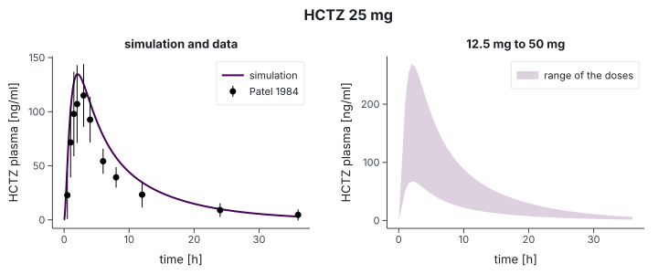
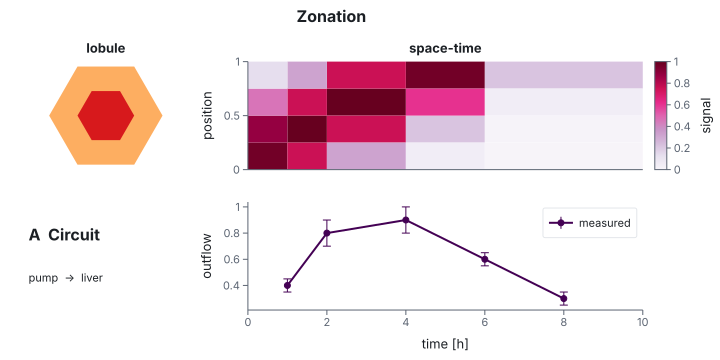
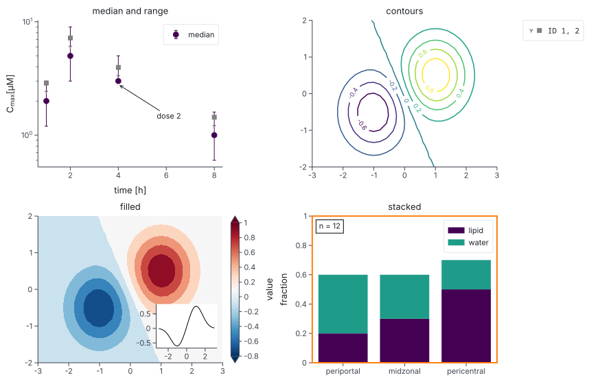
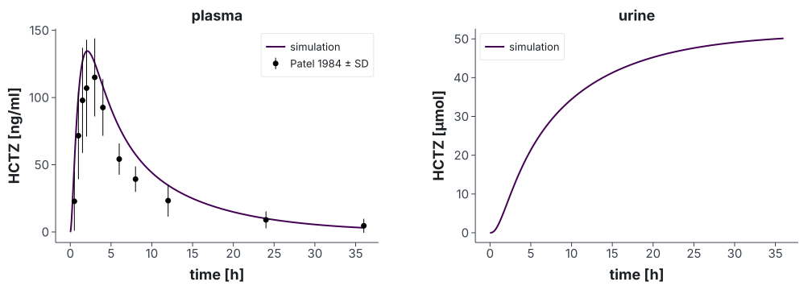
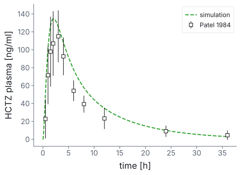
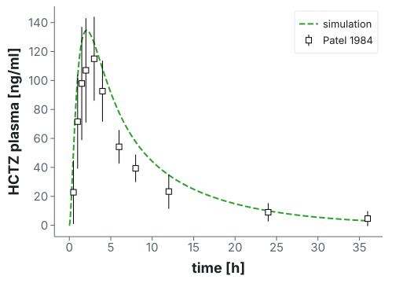
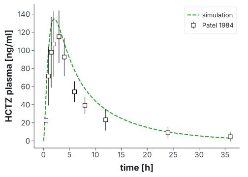

# Plots

Every figure of `sbmlsim` is drawn by the renderer of sbmlsim-core. There are two ways to describe one. The chart builder, `Chart`, is the direct way: you hand it numbers or quantities and it draws them, which is what you use for a quick look at a result in a notebook or a script. The figure model, `Figure`, is the description of what a simulation experiment draws: its curves name `Data` of the tasks and datasets instead of holding numbers, so the figure is stored in the JSON file of the experiment and the runner draws it after the run. The figure model resolves into a `Chart`, so both end in the same picture.

## The chart builder

A `Chart` is a grid of plots, `chart.plot(row, column, x=..., y=...)` adds one, and the methods of a plot add elements: `curve` (lines, markers and error bars), `band`, `area`, `bar`, `box`, `violin`, `histogram`, `heatmap`, `text`, `rule`, `polygon` and `colorbar`. Each returns the id of its element. The data are sequences, numpy arrays, pint quantities or xarray arrays. An axis, `ChartAxis(label=..., unit=...)`, converts the quantities on it to its unit, takes the unit of the first quantity when it has none and takes the `name` of an xarray array as its label, and the renderer shows it as `<label> [<unit>]`. This chart plots the HCTZ simulation of a 25 mg tablet next to the data of Patel et al. (1984), a band of two simulations next to it, and saves it three ways:

```python
import numpy as np

from sbmlsim import Q
from sbmlsim.plot import Chart, ChartAxis
from sbmlsim.resources import HCTZ_SBML
from sbmlsim.simulation import Change, Dimension, Formula, Scan, Simulation
from sbmlsim.simulator import Simulator

simulator = Simulator()
cp = Formula("cp", "[Cve_hctz] * Mr_hctz", unit="ng/ml")
dose = Simulation(
    time_unit="hr", end=36, changes=[Change(0, {"PODOSE_hctz": Q(25, "mg")})]
)
res = simulator.run(HCTZ_SBML, dose, [cp])
data_time = Q([0.5, 1, 1.5, 2, 3, 4, 6, 8, 12, 24, 36], "hr")
data = Q([22.8, 71.6, 97.9, 107, 115, 92.6, 54.2, 39.3, 23.3, 9.0, 4.6], "ng/ml")
sd = Q([21.9, 32.4, 39.1, 36.0, 29.0, 21.1, 11.6, 9.5, 11.9, 6.3, 5.2], "ng/ml")

chart = Chart(width=720, height=300, columns=2, title="HCTZ 25 mg")
plasma = chart.plot(
    0,
    0,
    title="simulation and data",
    x=ChartAxis(label="time", unit="hr"),
    y=ChartAxis(label="HCTZ plasma", unit="ng/ml"),
)
plasma.curve(res.q["time"], res.q["cp"], label="simulation")
plasma.curve(
    data_time,
    data,
    yerr=sd,
    line="none",
    marker="circle",
    color="black",
    label="Patel 1984",
)

doses = Dimension("dose", values={"PODOSE_hctz": Q([12.5, 50], "mg")})
grid = Q(np.linspace(0, 36, 73), "hr")
scan = simulator.run(HCTZ_SBML, Scan(dose, [doses]), [cp], time=grid)
band = chart.plot(
    0,
    1,
    title="12.5 mg to 50 mg",
    x=ChartAxis(label="time", unit="hr"),
    y=ChartAxis(label="HCTZ plasma", unit="ng/ml"),
)
band.band(scan.q["time"], scan.q["cp"][0], scan.q["cp"][1], label="range of the doses")

chart.save("hctz.svg")
chart.save("hctz.png", dpi=200)
chart.save("hctz.json")
```



A plot can have several colour bars: every `plot.colorbar(scale, low, high, label=...)` adds one, stacked right of the panel. A bar takes the part of its colour map it shows (`start`, `end`, from 0 to 1), its `ticks` and their `tick_labels`, and `categorical=True` draws one band per integer from `low` to `high`, labelled by `tick_labels`. `chart.plot(legend_swatches={group: {...}})` draws the swatch of a legend group in a style of its own, the style keywords of `curve`, e.g. the middle colour of lines which differ in colour. A text, a title or a label breaks its lines at `\n`; a tick label stays one line. The fonts of a chart take the sizes `title`, `label`, `tick`, `tick_y` (the y axes and the colour bars) and `legend` and the weights `title_weight`, `label_weight`, `tick_weight` and `legend_weight`, `normal` or `bold`: `Chart(fonts={"label": 13, "label_weight": "bold"})`.

A heat map and a colour bar take the sequential and the diverging colour maps of matplotlib by their names, in the case of matplotlib or in lower case (`Blues`, `Reds`, `PuRd`, `YlOrRd`, `RdBu`, ...), each also reversed (`Blues_r`); `sbmlsim_core.COLOR_SCALES` lists them, and a value has the colour matplotlib gives it. A heat map places its cells on the categories of its axes, or with `x_edges` and `y_edges` between edges on numeric axes, which stay numeric, so a space-time heat map shares its time with a curve below it. `ChartAxis(line_visible=False)` hides the line of an axis, and `chart.plot(aspect="equal")` makes a unit of y as long as a unit of x by widening the limits of one axis, so a lobule is a regular hexagon without measuring the panel. Error bars take caps of a length in pixels (`error_cap=`), a text its `size` and `weight`, and a text keeps its runs of spaces. The panel of a plot is at least 20 pixels over its span, so a grid of many thin columns fits its chart as long as its plots span several of them:

```python
import numpy as np

from sbmlsim.plot import Chart, ChartAxis

hidden = ChartAxis(label_visible=False, ticks_visible=False, line_visible=False)
chart = Chart(width=720, height=360, rows=2, columns=3, title="Zonation")
lobule = chart.plot(
    0, 0, title="lobule", x=hidden, y=hidden, aspect="equal", legend=False
)
angles = np.linspace(0, 2 * np.pi, 7)[:-1]
for radius, color, zone in [
    (1.0, "#fdae61", "periportal"),
    (0.5, "#d7191c", "pericentral"),
]:
    ring = np.column_stack([radius * np.cos(angles), radius * np.sin(angles)])
    lobule.polygon([ring], line="none", fill=color, fill_opacity=1.0, label=zone)

time = ChartAxis(label="time", unit="hr", min=0, max=10)
space_time = chart.plot(
    0,
    1,
    column_span=2,
    title="space-time",
    x=ChartAxis(min=0, max=10, ticks_visible=False),
    y=ChartAxis(label="position"),
    legend=False,
)
edges = np.array([0, 1, 2, 4, 6, 10])
position = np.linspace(0, 1, 5)
signal = np.exp(-(((edges[:-1] + edges[1:]) / 2 - 6 * position[:-1, None]) ** 2) / 8)
space_time.heatmap(None, None, signal, x_edges=edges, y_edges=position, scale="PuRd")
space_time.colorbar("PuRd", 0, 1, label="signal")

blank = ChartAxis(
    label_visible=False, ticks_visible=False, line_visible=False, min=0, max=1
)
note = chart.plot(1, 0, x=blank, y=blank, legend=False)
note.text(0.05, 0.7, "A  Circuit", size=16, weight="bold")
note.text(0.05, 0.3, "pump  ->  liver")

outflow = chart.plot(1, 1, column_span=2, x=time, y=ChartAxis(label="outflow"))
outflow.curve(
    [1, 2, 4, 6, 8],
    [0.4, 0.8, 0.9, 0.6, 0.3],
    yerr=[0.05, 0.1, 0.1, 0.05, 0.05],
    error_cap=8,
    marker="circle",
    label="measured",
)
chart
```



A chart shows itself in a notebook, where its SVG is the last expression of a cell. The SVG is the default format of the package, the PNG takes a `dpi` (the resolution is stored in the PNG), and the JSON is the spec of the contract `figure/1`, `chart.spec()` as a dictionary, which the renderer of sbmlsim-core, in Python or in the browser, draws again. A value which is not finite is a gap in a curve, `null` in the JSON.

## An experiment to plot

The examples on this page plot an experiment on the HCTZ model: a 25 mg tablet next to the data of Patel et al. (1984), a scan over four doses, and 50 virtual patients whose dissolution and excretion rates vary by 30 % (a Latin hypercube, see [Sampling](sampling.md)). The experiment computes the plasma concentration `cp` and its PK parameters:

```python
from pathlib import Path
from typing import override

import pandas as pd

from sbmlsim import Q
from sbmlsim.data import Data, DataSet
from sbmlsim.experiment import ExperimentRunner, SimulationExperiment
from sbmlsim.resources import HCTZ_SBML
from sbmlsim.simulation import (
    PK,
    Change,
    Dimension,
    Formula,
    Observable,
    Scan,
    Simulation,
    sampling,
)
from sbmlsim.simulator import Simulator
from sbmlsim.task import Task

patel1984 = pd.DataFrame(
    {
        "time": [0.5, 1, 1.5, 2, 3, 4, 6, 8, 12, 24, 36],
        "cp": [22.8, 71.6, 97.9, 107, 115, 92.6, 54.2, 39.3, 23.3, 9.0, 4.6],
        "cp_sd": [21.9, 32.4, 39.1, 36.0, 29.0, 21.1, 11.6, 9.5, 11.9, 6.3, 5.2],
    }
)


def oral_dose() -> Simulation:
    return Simulation(
        time_unit="hr",
        end=36,
        changes=[Change(0, {"PODOSE_hctz": Q(25, "mg")})],
    )


class Hctz(SimulationExperiment):
    @override
    def datasets(self) -> dict[str, DataSet]:
        units = {"time": "hr", "cp": "ng/ml"}
        return {"patel1984": DataSet.from_df(patel1984, udict=units)}

    @override
    def models(self) -> dict[str, Path]:
        return {"hctz": HCTZ_SBML}

    @override
    def simulations(self) -> dict[str, Simulation | Scan]:
        doses = Dimension("dose", values={"PODOSE_hctz": Q([12.5, 25, 50, 100], "mg")})
        patients = sampling.lhs(
            {
                "Ka_dis_hctz": sampling.LogNormal(cv=0.3),
                "KI__HCTZEX_k": sampling.LogNormal(cv=0.3),
            },
            50,
            seed=1,
            model=self._models["hctz"],
            id="patient",
        )
        return {
            "po25": oral_dose(),
            "doses": Scan(oral_dose(), [doses]),
            "patients": Scan(oral_dose(), [patients]),
        }

    @override
    def observables(self) -> dict[str, Observable]:
        return {
            "cp": Formula("cp", "[Cve_hctz] * Mr_hctz", unit="ng/ml"),
            "pk": PK("pk", "cp", dose="PODOSE_hctz", route="oral"),
        }

    @override
    def tasks(self) -> dict[str, Task]:
        return {
            "task_po25": Task(model="hctz", simulation="po25"),
            "task_doses": Task(model="hctz", simulation="doses"),
            "task_patients": Task(model="hctz", simulation="patients"),
        }

    @override
    def data(self) -> dict[str, Data]:
        data = [
            Data("cp", task="task_po25"),
            Data("Aurine_hctz", task="task_po25"),
            Data("cp", task="task_doses"),
            Data("pk.cmax", task="task_doses"),
            Data("cp", task="task_patients"),
        ]
        return {d.sid: d for d in data}


runner = ExperimentRunner(Hctz, base_path=None, data_path=None, simulator=Simulator())
[result] = runner.run_experiments(Path("results"), keep_results=True)
experiment = result.experiment
for task, res in experiment.results.items():
    print(task, res)
```

```text title="Output"
task_po25 ScanResult(_point: 873; cp, Aurine_hctz)
task_doses ScanResult(dose: 4, _point: 1009; cp, pk.cmax)
task_patients ScanResult(patient: 50, _point: 910; cp)
```

In a real project the figures are returned by the `figures()` method of the experiment, with `Figure(experiment=self, ...)`, and the runner writes them into the output folder (see [Simulation experiments](experiments.md)). While you design a figure it is quicker to draw it on an experiment that already ran: `figure_chart(experiment, figure)` from `sbmlsim.plot.resolve` returns a `Chart` of the renderer of sbmlsim-core, which a notebook shows. A figure drawn this way can only read data the run recorded, which is why the experiment lists the variables in `data()`.

## Figures, plots and axes

A `Figure` has `num_rows` x `num_cols` panels. `create_plots` makes one `Plot` per panel, each with a copy of the axes you pass. `add_data` adds a curve of a task or a dataset:

```python
from sbmlsim.plot import Axis, Figure
from sbmlsim.plot.resolve import figure_chart

fig = Figure(experiment=experiment, sid="fig_po25", num_cols=2)
plasma, urine = fig.create_plots(xaxis=Axis("time", unit="hr"))

plasma.set_title("plasma")
plasma.set_yaxis("HCTZ", unit="ng/ml")
plasma.add_data(task="task_po25", xid="time", yid="cp", label="simulation")
plasma.add_data(
    dataset="patel1984",
    xid="time",
    yid="cp",
    yid_sd="cp_sd",
    label="Patel 1984",
    color="black",
    marker="o",
    linestyle="",
)

urine.set_title("urine")
urine.set_yaxis("HCTZ", unit="µmol")
urine.add_data(task="task_po25", xid="time", yid="Aurine_hctz", label="simulation")

fig_po25 = figure_chart(experiment, fig)
```




`Figure.add_subplot(plot, row, col, row_span=2)` places a plot that spans several panels instead.

An `Axis` has a label and a unit, which make up the axis label, e.g. `HCTZ [ng/ml]`. The data on an axis are converted to its unit: the time of the model is in minutes and the amount in the urine in mmol, but the axes show hours and µmol. An axis also takes `scale` (`"linear"` or `"log"`), `min`, `max`, `grid=True` and `reverse=True`. `name=` sets the whole label yourself. `plot.set_yaxis_right(...)` adds a second y axis on the right, and a curve with `yaxis_position=YAxisPosition.RIGHT` (from `sbmlsim.plot.plotting`) is drawn against it.

## Curves

`add_data` is a shortcut for `Plot.curve`, which takes `Data` objects (see [Data](data.md)): `add_data(task="task_po25", xid="time", yid="cp")` is the same as `curve(x=Data("time", task="task_po25"), y=Data("cp", task="task_po25"))`. With `Data` you can also plot a function of data or select points with `sel`.

Both take the styling keywords of matplotlib, such as `color`, `linestyle`, `linewidth`, `marker`, `markersize` and `alpha`. For a dataset, `yid_sd` or `yid_se` (and `xid_sd`, `xid_se`) add error bars, and the label gets ` ± SD` or ` ± SE`. `count` adds the number of subjects to the label, as a number or as the name of a column of the dataset.

A curve draws lines and markers by default. `type=CurveType.BAR` (from `sbmlsim.plot.plotting`) draws bars, and there are `BARSTACKED`, `HORIZONTALBAR` and `HORIZONTALBARSTACKED` as well. `ShadedArea` fills the area between two curves. `examples/curve_types` shows all of them.

## One curve per point of a scan

The data of a scan has one dimension per scan dimension. Name the dimension in `over=` to draw one line per point:

```python
fig = Figure(experiment=experiment, sid="fig_doses", num_cols=2)
timecourse, peak = fig.create_plots()

timecourse.set_xaxis("time", unit="hr")
timecourse.set_yaxis("HCTZ plasma", unit="ng/ml")
timecourse.curve(
    Data("time", task="task_doses"), Data("cp", task="task_doses"), over="dose"
)

peak.set_xaxis("dose", unit="mg")
peak.set_yaxis("cmax", unit="ng/ml")
peak.curve(
    Data("dose.PODOSE_hctz", task="task_doses"),
    Data("pk.cmax", task="task_doses"),
    label="simulation",
    color="black",
    marker="o",
)

fig_doses = figure_chart(experiment, fig)
```




The lines get the colours of the viridis colour map at the value the dimension sets, and the legend says what that value is. With `color=` they get shades of that colour instead. The colour scale is logarithmic when all values are positive and the largest is more than 100 times the smallest. From eleven points on, a colour bar replaces the legend entries: it spans the values of the points, from the smallest to the largest, in the part of the colour map the lines take, so the colour of the bar at a value is the colour of its line, and the lines share one legend entry drawn in their middle colour. A dimension which does not set one target gets a bar of one band per point, labelled by the labels of the points. The shades of a colour of its own are no colour map of the renderer, so such lines get no colour bar. A plot of several curves with colour bars shows all of them, the same bar once.

The right panel plots a value per simulation, `pk.cmax`, over the values of the dimension, `dose.PODOSE_hctz`. The x data is the coordinate `<dimension>.<target>` that every array of the task has.

More about `over`:

- Every other dimension of the scan must be selected with `Data(..., sel={...})`, otherwise the experiment raises an error when it is initialized. The order of the labels in `sel` is the order of the lines.
- `over=("dose", "condition")` adds a second dimension, which sets the line style (solid, dashed, dotted and dash-dot, so at most four points).
- A dimension that sets several targets, or that runs different simulations or models, is coloured by position and labelled `<dimension> = <label>`.
- Bar curves cannot use `over`.

## Bands

A band summarizes many simulations, e.g. the draws of a Latin hypercube. `plot.band` reduces the dimension `across` to two quantiles and draws the area between them, with the median as a line:

```python
bands = Figure(experiment=experiment, sid="fig_patients", num_cols=2)
linear, log = bands.create_plots(
    xaxis=Axis("time", unit="hr"), yaxis=Axis("HCTZ plasma", unit="ng/ml")
)
log.yaxis.scale = "log"
log.yaxis.min = 1
for plot in [linear, log]:
    plot.band(
        Data("time", task="task_patients"),
        Data("cp", task="task_patients"),
        across="patient",
        name="50 patients",
    )
    plot.add_data(
        dataset="patel1984",
        xid="time",
        yid="cp",
        yid_sd="cp_sd",
        label="Patel 1984",
        color="black",
        marker="o",
        linestyle="",
    )

fig_patients = figure_chart(experiment, bands)
```




The default quantiles are 5 % and 95 %; `quantiles=(0.25, 0.75)` changes them and `median=False` leaves out the median. `over=` draws one band per point of one other dimension. A band takes `color=` and `alpha=`; without a colour it takes the next colour of the colour cycle. Bands are drawn below the curves.

The quantiles are computed when the figure is drawn, so you need no summary of the result. Every simulation here has its own time points, the steps of the integrator, so the draws are first interpolated onto 500 time points, dense where the simulations stepped densely.

## Log axes

By default a simulation returns the steps of the integrator, which start with tiny steps. A concentration that starts at zero is tiny there too, and the automatic limits of a log axis would span dozens of decades. A log axis therefore shows at most six decades below its largest value. Limits you set with `min` and `max` are kept, as `log.yaxis.min = 1` in the band figure above. For your own matplotlib figures, `limit_log_axes(figure)` from `sbmlsim.plot.axes` does the same, and the runner applies it to the matplotlib figures of `figures_mpl()`.

## Styles

Instead of matplotlib keywords, a curve can take a `Style`, which bundles a `Line`, a `Marker` and a `Fill`. A style is an object, so several curves can share it:

```python
from sbmlsim.plot.plotting import ColorType, Line, LineType, Marker, MarkerType, Style

dashed = Style(line=Line(color=ColorType("tab:green"), type=LineType.DASH, thickness=2))
squares = Style(
    line=Line(color=ColorType("black"), type=LineType.NONE, thickness=1),
    marker=Marker(
        type=MarkerType.SQUARE,
        size=8,
        fill=ColorType("white"),
        line_color=ColorType("black"),
    ),
)

fig = Figure(experiment=experiment, sid="fig_style")
[plot] = fig.create_plots(
    xaxis=Axis("time", unit="hr"), yaxis=Axis("HCTZ plasma", unit="ng/ml")
)
plot.curve(
    Data("time", task="task_po25"),
    Data("cp", task="task_po25"),
    name="simulation",
    style=dashed,
)
plot.curve(
    Data("time", dataset="patel1984"),
    Data("cp", dataset="patel1984"),
    yerr=Data("cp_sd", dataset="patel1984"),
    name="Patel 1984",
    style=squares,
)
fig_style = figure_chart(experiment, fig)
```




Colours are `ColorType` objects, made from matplotlib colour names or hex strings.

## Figure settings

Sizes, fonts and legends are set with `FigureSettings`: `fig_dpi`, `panel_width`, `panel_height`, the font sizes and weights of titles, labels, ticks and legends, `legend_position` and `legend_scope`, among others. `legend_loc` places a legend inside its plot at a location of matplotlib: `best` (the default) at the location of the least data, as matplotlib does, or a fixed one such as `upper left`; a legend stays inside however much data it covers and goes outside only when it does not fit into its panel. `fig_facecolor` (other than white) is not supported: the renderer has no background colour, the theme comes from CSS, so a figure which sets it logs one warning. The renderer has one title size: `axes_titlesize` is used for a figure with plot titles and no figure title, `fig_titlesize` otherwise, and a figure with both takes `fig_titlesize` for the plot titles as well, which is logged. The renderer has two weights, `normal` and `bold`: a weight of 600 or more, or `semibold`, `bold`, `heavy` and `black`, is bold, and the title of the figure and the titles of its plots share one weight, bold when either is. `xtick_labelsize` and `ytick_labelsize` are the sizes of the tick labels of the x and the y axes, and an axis with `ticks_visible=False` hides its tick labels and keeps the tick marks. The settings come in four levels, and the more specific level wins:

1. the defaults of `FigureSettings`,
2. the run: `run_experiments(..., figure_settings={"fig_dpi": 300})`,
3. the experiment: the class attribute `figure_settings`, which subclasses inherit,
4. the figure: `Figure(..., settings={...})`.

```python
from types import MappingProxyType

from sbmlsim.plot import FigureSettings


class ModelExperiment(SimulationExperiment):
    """The base of all experiments of a model."""

    figure_settings = MappingProxyType({"legend_fontsize": 10, "axes_labelsize": 16})


fig = Figure(experiment=None, sid="fig1", num_cols=2, settings={"axes_labelsize": 14})
settings = FigureSettings.resolve(
    run={"fig_dpi": 300, "legend_fontsize": 12},
    experiment=ModelExperiment.figure_settings,
    figure=fig.settings,
)
print(settings.fig_dpi, settings.legend_fontsize, settings.axes_labelsize)
print(fig.size(settings))
```

```text title="Output"
300 10 14
(14.0, 5.0)
```

The experiment overrides the legend font size of the run, and the figure overrides the label size of the experiment. A figure without an explicit `width` and `height` is `num_cols * panel_width` by `num_rows * panel_height` inches. To extend the settings of a base experiment, write `MappingProxyType({**Base.figure_settings, "fig_dpi": 300})`. An unknown setting raises a `ValueError` that lists the valid ones.

`fig_dpi` is the resolution of a PNG. An SVG, and so an interactive figure of a report, has 72 pixels per inch, whatever `fig_dpi` is.

Older code set the settings on the class, `Figure.fig_dpi = 300`, which changed every later figure of the process. That now raises an `AttributeError` that tells you where the setting goes.

### Legends

By default each plot has its legend inside, at the location of matplotlib which covers the least of the data (`legend_loc="best"`); it stays inside however much data it covers, as in matplotlib, and goes right of the plot only when it does not fit into the panel. `legend_loc` of the figure settings, of `Chart` or of `Chart.plot` (for one plot) puts it at a fixed location of matplotlib instead, e.g. `"upper left"` or `"lower center"`. `legend_position="outside"` puts it right of the plot, and the figure grows by the width of the legend, so the panels keep their size. When the plots of a row show the same entries, as the two panels of the band figure above, `legend_scope="row"` draws one legend per row, right of the grid, with every entry once:

```python
fig_row = figure_chart(experiment, bands, settings={"legend_scope": "row"})
```




The `legend` flag of a plot decides whether its entries go into the legend of the row.

## Formats

The renderer of sbmlsim-core draws every figure. The figure formats of a run are `svg` (the default) and `png`, e.g. `run_experiments(output_path, figure_formats=["svg", "png"])`, and the spec of the chart, `json`, is written beside every figure. A PNG has the resolution `fig_dpi` of the settings of its figure, which `FigureOutputs.savefig_dpi` of a project replaces; an SVG has no resolution. The format `html` of the interactive pages of plotly is gone and raises a `ValueError`. A `Chart` you build yourself is saved by the suffix of its path: `chart.save("figure.svg")`, `.png` (with `dpi=`) or `.json`.

## Interactivity

The spec is the whole figure. The HTML reports of the experiments and of a fit carry the spec of every figure next to its inline SVG, and the script `figures.js`, written once beside the pages of a report (`sbmlsim.report.figures.write_figure_script`, the script `figure_script` of sbmlsim-core), draws every figure again from its spec in the browser and makes it interactive: a click on a legend entry hides or shows its group, a click on a curve selects it and dims the others (a click on it again or Escape clears it), and the point under the pointer is read out with the units of the axes. A double click enlarges an interactive figure. The script loads nothing from the network and works from `file://`; a page without it shows the static SVG.

## Colours

The chart builder and the figure model take the colour names of matplotlib: a CSS name (`dimgrey`), a base colour of one letter (`k`), a tableau name (`tab:red`), an xkcd name (`xkcd:sky blue`), a colour of the default cycle (`C0` to `C9`), hex (`#rgb`, `#rrggbb`, with an alpha `#rrggbbaa`), a grey level as a text (`"0.4"`) and a tuple of floats. The spec holds `#rrggbb`: `sbmlsim.plot.colors.normalize_color` converts a name, and an alpha of the colour is multiplied into the opacity of the element or of its fill. `marker_fill="none"` draws a hollow marker, its edge alone.

```python
from sbmlsim.plot.colors import color_alpha, normalize_color

print(normalize_color("tab:green"), normalize_color("C3"), normalize_color("0.4"))
print(color_alpha("#ff000080"))
```

```text title="Output"
#2ca02c #d62728 #666666
('#ff0000', 0.5019607843137255)
```

## Your own figures

For a figure the description cannot express, override `figures_mpl()` and return figures by key. A `Chart` is drawn by the renderer like the other figures, and is the better choice: it has a spec, it is stored with the run and the reports show it. Any other object, e.g. a matplotlib figure, is saved with its own `savefig(path, bbox_inches="tight")` in every image format of the run, at the resolution of the run or else its own. This is slow, so the runner warns about it once per experiment class, and the figure has no spec, so a run whose only format is `json` writes no file of it. A figure of pyplot is closed after it was saved. Read the results with `self.results` and the settings with `FigureSettings.resolve(experiment=self.figure_settings)`; the settings of the run do not reach these figures. `limit_log_axis(ax)` from `sbmlsim.plot.axes` limits a log axis of such a figure to the decades the figure model shows. A variable of a result as a quantity, `res.q["cp"]`, is a pint quantity, which matplotlib plots in its unit once `ureg.setup_matplotlib(True)` of `sbmlsim.units.ureg` was called.

## Changed from matplotlib

Before the renderer every figure was drawn with matplotlib, and `label_axes(ax, "time", "HCTZ plasma")` of `sbmlsim.plot` wrote the units into the labels of its axes. The plot functions of the package, `plot_bands`, `plot_distribution`, `plot_heatmap`, `plot_indices`, `plot_morris`, `plot_profile`, `plot_profiles`, `plot_diff` and the figures of the fit report, now return a `Chart` and take no `ax=`: to put two of them side by side, build a `Chart` with a grid and add their elements, or save them apart. The units come from the quantities, and the axis label is `<name> [<unit>]` on its own. The figure keywords of matplotlib of the figure model (`linestyle`, `markersize`, `alpha`, ...) are still read, `fig_dpi` still sets the resolution of a PNG, and a matplotlib figure of `figures_mpl()` keeps working with its warning. matplotlib is no longer imported by `import sbmlsim.plot`, and neither matplotlib nor seaborn is a dependency of sbmlsim: they are your own dependencies for a figure of the hook or your own plotting code. `sbmlsim.plot.serialization_matplotlib` is gone without a replacement: annotate a matplotlib figure with `from matplotlib.figure import Figure`.

## Reports

The figures of a run end up in the HTML report of the experiments, see [Simulation experiments](experiments.md#reports).
