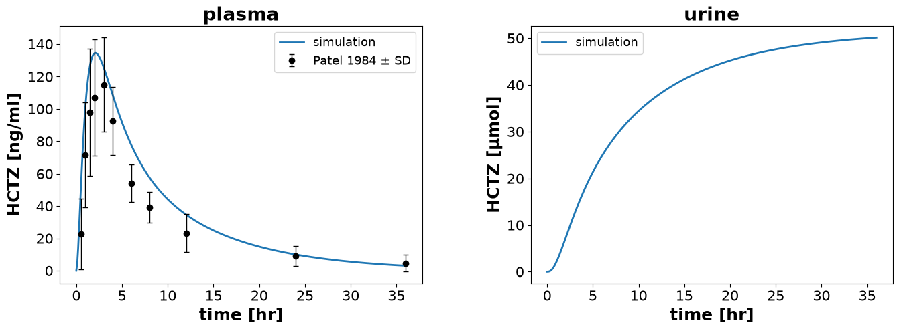
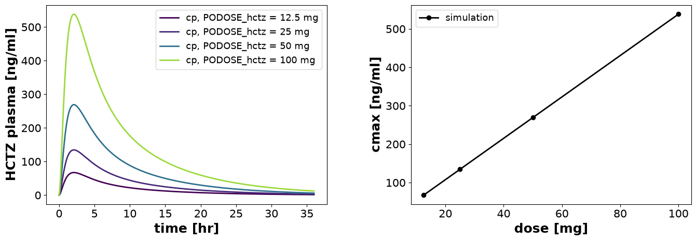
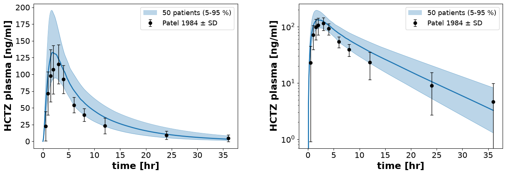
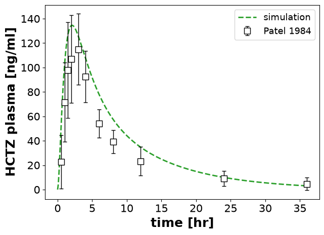
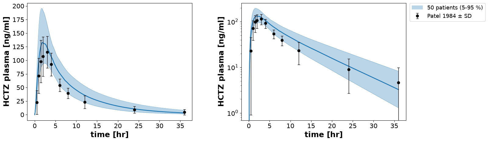

# Plots

The figures of a simulation experiment are descriptions of what to draw. A `Figure` holds a grid of `Plot` panels, and each plot has axes and curves that read `Data`. When the experiment runs, the runner draws every figure with matplotlib as an image (SVG by default) or with plotly as an interactive HTML page. Because a figure only names its data, it is stored in the JSON file of the experiment and both backends show the same thing.

## An experiment to plot

The examples on this page plot an experiment on the HCTZ model: a 25 mg tablet next to the data of Patel et al. (1984), a scan over four doses, and 50 virtual patients whose dissolution and excretion rates vary by 30 % (a Latin hypercube, see [Sampling](sampling.md)). The experiment computes the plasma concentration `cp` and its PK parameters:

```python
from pathlib import Path
from typing import override

import pandas as pd

from sbmlsim import Q
from sbmlsim.data import Data, DataSet
from sbmlsim.experiment import ExperimentRunner, SimulationExperiment
from sbmlsim.resources import HCTZ_SBML
from sbmlsim.simulation import (
    PK,
    Change,
    Dimension,
    Formula,
    Observable,
    Scan,
    Simulation,
    sampling,
)
from sbmlsim.simulator import Simulator
from sbmlsim.task import Task

patel1984 = pd.DataFrame(
    {
        "time": [0.5, 1, 1.5, 2, 3, 4, 6, 8, 12, 24, 36],
        "cp": [22.8, 71.6, 97.9, 107, 115, 92.6, 54.2, 39.3, 23.3, 9.0, 4.6],
        "cp_sd": [21.9, 32.4, 39.1, 36.0, 29.0, 21.1, 11.6, 9.5, 11.9, 6.3, 5.2],
    }
)


def oral_dose() -> Simulation:
    return Simulation(
        time_unit="hr",
        end=36,
        steps=360,
        changes=[Change(0, {"PODOSE_hctz": Q(25, "mg")})],
    )


class Hctz(SimulationExperiment):
    @override
    def datasets(self) -> dict[str, DataSet]:
        units = {"time": "hr", "cp": "ng/ml"}
        return {"patel1984": DataSet.from_df(patel1984, udict=units, ureg=self.ureg)}

    @override
    def models(self) -> dict[str, Path]:
        return {"hctz": HCTZ_SBML}

    @override
    def simulations(self) -> dict[str, Simulation | Scan]:
        doses = Dimension("dose", values={"PODOSE_hctz": Q([12.5, 25, 50, 100], "mg")})
        patients = sampling.lhs(
            {
                "Ka_dis_hctz": sampling.LogNormal(cv=0.3),
                "KI__HCTZEX_k": sampling.LogNormal(cv=0.3),
            },
            50,
            seed=1,
            model=self._models["hctz"],
            id="patient",
        )
        return {
            "po25": oral_dose(),
            "doses": Scan(oral_dose(), [doses]),
            "patients": Scan(oral_dose(), [patients]),
        }

    @override
    def observables(self) -> dict[str, Observable]:
        return {
            "cp": Formula("cp", "[Cve_hctz] * Mr_hctz", unit="ng/ml"),
            "pk": PK("pk", "cp", dose="PODOSE_hctz", route="oral"),
        }

    @override
    def tasks(self) -> dict[str, Task]:
        return {
            "task_po25": Task(model="hctz", simulation="po25"),
            "task_doses": Task(model="hctz", simulation="doses"),
            "task_patients": Task(model="hctz", simulation="patients"),
        }

    @override
    def data(self) -> dict[str, Data]:
        data = [
            Data("cp", task="task_po25"),
            Data("Aurine_hctz", task="task_po25"),
            Data("cp", task="task_doses"),
            Data("pk.cmax", task="task_doses"),
            Data("cp", task="task_patients"),
        ]
        return {d.sid: d for d in data}


runner = ExperimentRunner(Hctz, base_path=None, data_path=None, simulator=Simulator())
[result] = runner.run_experiments(Path("results"), keep_results=True)
experiment = result.experiment
for task, res in experiment.results.items():
    print(task, res)
```

```text title="Output"
task_po25 ScanResult(time: 361; cp, Aurine_hctz)
task_doses ScanResult(dose: 4, time: 361; cp, pk.cmax)
task_patients ScanResult(patient: 50, time: 361; cp)
```

In a real project the figures are returned by the `figures()` method of the experiment, with `Figure(experiment=self, ...)`, and the runner writes them into the output folder (see [Simulation experiments](experiments.md)). While you design a figure it is quicker to draw it on an experiment that already ran: `MatplotlibFigureSerializer.to_figure(experiment, figure)` returns a matplotlib figure, which a notebook shows. A figure drawn this way can only read data the run recorded, which is why the experiment lists the variables in `data()`.

## Figures, plots and axes

A `Figure` has `num_rows` x `num_cols` panels. `create_plots` makes one `Plot` per panel, each with a copy of the axes you pass. `add_data` adds a curve of a task or a dataset:

```python
from sbmlsim.plot import Axis, Figure
from sbmlsim.plot.serialization_matplotlib import MatplotlibFigureSerializer

fig = Figure(experiment=experiment, sid="fig_po25", num_cols=2)
plasma, urine = fig.create_plots(xaxis=Axis("time", unit="hr"))

plasma.set_title("plasma")
plasma.set_yaxis("HCTZ", unit="ng/ml")
plasma.add_data(task="task_po25", xid="time", yid="cp", label="simulation")
plasma.add_data(
    dataset="patel1984",
    xid="time",
    yid="cp",
    yid_sd="cp_sd",
    label="Patel 1984",
    color="black",
    marker="o",
    linestyle="",
)

urine.set_title("urine")
urine.set_yaxis("HCTZ", unit="µmol")
urine.add_data(task="task_po25", xid="time", yid="Aurine_hctz", label="simulation")

fig_po25 = MatplotlibFigureSerializer.to_figure(experiment, fig)
```



`Figure.add_subplot(plot, row, col, row_span=2)` places a plot that spans several panels instead.

An `Axis` has a label and a unit, which make up the axis label, e.g. `HCTZ [ng/ml]`. The data on an axis are converted to its unit: the time of the model is in minutes and the amount in the urine in mmol, but the axes show hours and µmol. An axis also takes `scale` (`"linear"` or `"log"`), `min`, `max`, `grid=True` and `reverse=True`. `name=` sets the whole label yourself. `plot.set_yaxis_right(...)` adds a second y axis on the right, and a curve with `yaxis_position=YAxisPosition.RIGHT` (from `sbmlsim.plot.plotting`) is drawn against it.

## Curves

`add_data` is a shortcut for `Plot.curve`, which takes `Data` objects (see [Data](data.md)): `add_data(task="task_po25", xid="time", yid="cp")` is the same as `curve(x=Data("time", task="task_po25"), y=Data("cp", task="task_po25"))`. With `Data` you can also plot a function of data or select points with `sel`.

Both take the styling keywords of matplotlib, such as `color`, `linestyle`, `linewidth`, `marker`, `markersize` and `alpha`. For a dataset, `yid_sd` or `yid_se` (and `xid_sd`, `xid_se`) add error bars, and the label gets ` ± SD` or ` ± SE`. `count` adds the number of subjects to the label, as a number or as the name of a column of the dataset.

A curve draws lines and markers by default. `type=CurveType.BAR` (from `sbmlsim.plot.plotting`) draws bars, and there are `BARSTACKED`, `HORIZONTALBAR` and `HORIZONTALBARSTACKED` as well. `ShadedArea` fills the area between two curves. `examples/curve_types` shows all of them.

## One curve per point of a scan

The data of a scan has one dimension per scan dimension. Name the dimension in `over=` to draw one line per point:

```python
fig = Figure(experiment=experiment, sid="fig_doses", num_cols=2)
timecourse, peak = fig.create_plots()

timecourse.set_xaxis("time", unit="hr")
timecourse.set_yaxis("HCTZ plasma", unit="ng/ml")
timecourse.curve(
    Data("time", task="task_doses"), Data("cp", task="task_doses"), over="dose"
)

peak.set_xaxis("dose", unit="mg")
peak.set_yaxis("cmax", unit="ng/ml")
peak.curve(
    Data("dose.PODOSE_hctz", task="task_doses"),
    Data("pk.cmax", task="task_doses"),
    label="simulation",
    color="black",
    marker="o",
)

fig_doses = MatplotlibFigureSerializer.to_figure(experiment, fig)
```



The lines get the colours of the viridis colour map at the value the dimension sets, and the legend says what that value is. With `color=` they get shades of that colour instead. The colour scale is logarithmic when all values are positive and the largest is more than 100 times the smallest. From eleven points on, a colour bar replaces the legend entries.

The right panel plots a value per simulation, `pk.cmax`, over the values of the dimension, `dose.PODOSE_hctz`. The x data is the coordinate `<dimension>.<target>` that every array of the task has.

More about `over`:

- Every other dimension of the scan must be selected with `Data(..., sel={...})`, otherwise the experiment raises an error when it is initialized. The order of the labels in `sel` is the order of the lines.
- `over=("dose", "condition")` adds a second dimension, which sets the line style (solid, dashed, dotted and dash-dot, so at most four points).
- A dimension that sets several targets, or that runs different simulations or models, is coloured by position and labelled `<dimension> = <label>`.
- Bar curves cannot use `over`.

## Bands

A band summarizes many simulations, e.g. the draws of a Latin hypercube. `plot.band` reduces the dimension `across` to two quantiles and draws the area between them, with the median as a line:

```python
bands = Figure(experiment=experiment, sid="fig_patients", num_cols=2)
linear, log = bands.create_plots(
    xaxis=Axis("time", unit="hr"), yaxis=Axis("HCTZ plasma", unit="ng/ml")
)
log.yaxis.scale = "log"
for plot in [linear, log]:
    plot.band(
        Data("time", task="task_patients"),
        Data("cp", task="task_patients"),
        across="patient",
        name="50 patients",
    )
    plot.add_data(
        dataset="patel1984",
        xid="time",
        yid="cp",
        yid_sd="cp_sd",
        label="Patel 1984",
        color="black",
        marker="o",
        linestyle="",
    )

fig_patients = MatplotlibFigureSerializer.to_figure(experiment, bands)
```



The default quantiles are 5 % and 95 %; `quantiles=(0.25, 0.75)` changes them and `median=False` leaves out the median. `over=` draws one band per point of one other dimension. A band takes `color=` and `alpha=`; without a colour it takes the next colour of the colour cycle. Bands are drawn below the curves.

The quantiles are computed when the figure is drawn, so you need no summary of the result. If every simulation has its own time points (the steps of the integrator), the draws are first interpolated onto 500 time points, dense where the simulations stepped densely.

## Log axes

Without `steps` or `times` a simulation returns the steps of the integrator, which start with tiny steps. A concentration that starts at zero is tiny there too, and the automatic limits of a log axis would span dozens of decades. A log axis therefore shows at most six decades below its largest value. Limits you set with `min` and `max` are kept. For your own matplotlib figures, `limit_log_axis(ax)` from `sbmlsim.plot.serialization_matplotlib` does the same.

## Styles

Instead of matplotlib keywords, a curve can take a `Style`, which bundles a `Line`, a `Marker` and a `Fill`. A style is an object, so several curves can share it:

```python
from sbmlsim.plot.plotting import ColorType, Line, LineType, Marker, MarkerType, Style

dashed = Style(line=Line(color=ColorType("tab:green"), type=LineType.DASH, thickness=2))
squares = Style(
    line=Line(color=ColorType("black"), type=LineType.NONE, thickness=1),
    marker=Marker(
        type=MarkerType.SQUARE,
        size=8,
        fill=ColorType("white"),
        line_color=ColorType("black"),
    ),
)

fig = Figure(experiment=experiment, sid="fig_style")
[plot] = fig.create_plots(
    xaxis=Axis("time", unit="hr"), yaxis=Axis("HCTZ plasma", unit="ng/ml")
)
plot.curve(
    Data("time", task="task_po25"),
    Data("cp", task="task_po25"),
    name="simulation",
    style=dashed,
)
plot.curve(
    Data("time", dataset="patel1984"),
    Data("cp", dataset="patel1984"),
    yerr=Data("cp_sd", dataset="patel1984"),
    name="Patel 1984",
    style=squares,
)
fig_style = MatplotlibFigureSerializer.to_figure(experiment, fig)
```



Colours are `ColorType` objects, made from matplotlib colour names or hex strings.

## Figure settings

Sizes, fonts and legends are set with `FigureSettings`: `fig_dpi`, `panel_width`, `panel_height`, the font sizes and weights of titles, labels, ticks and legends, `legend_position`, `legend_loc` and `legend_scope`, among others. The settings come in four levels, and the more specific level wins:

1. the defaults of `FigureSettings`,
2. the run: `run_experiments(..., figure_settings={"fig_dpi": 300})`,
3. the experiment: the class attribute `figure_settings`, which subclasses inherit,
4. the figure: `Figure(..., settings={...})`.

```python
from types import MappingProxyType

from sbmlsim.plot import FigureSettings


class ModelExperiment(SimulationExperiment):
    """The base of all experiments of a model."""

    figure_settings = MappingProxyType({"legend_fontsize": 10, "axes_labelsize": 16})


fig = Figure(experiment=None, sid="fig1", num_cols=2, settings={"axes_labelsize": 14})
settings = FigureSettings.resolve(
    run={"fig_dpi": 300, "legend_fontsize": 12},
    experiment=ModelExperiment.figure_settings,
    figure=fig.settings,
)
print(settings.fig_dpi, settings.legend_fontsize, settings.axes_labelsize)
print(fig.size(settings))
```

```text title="Output"
300 10 14
(14.0, 5.0)
```

The experiment overrides the legend font size of the run, and the figure overrides the label size of the experiment. A figure without an explicit `width` and `height` is `num_cols * panel_width` by `num_rows * panel_height` inches. To extend the settings of a base experiment, write `MappingProxyType({**Base.figure_settings, "fig_dpi": 300})`. An unknown setting raises a `ValueError` that lists the valid ones.

`fig_dpi` is the resolution of the static images. The interactive pages always have 72 pixels per inch, whatever `fig_dpi` is.

Older code set the settings on the class, `Figure.fig_dpi = 300`, which changed every later figure of the process. That now raises an `AttributeError` that tells you where the setting goes.

### Legends

By default each plot has its legend inside, at the best place matplotlib finds. `legend_position="outside"` puts it right of the plot, and the figure grows by the width of the legend, so the panels keep their size. When the plots of a row show the same entries, as the two panels of the band figure above, `legend_scope="row"` draws one legend per row, right of the grid, with every entry once:

```python
fig_row = MatplotlibFigureSerializer.to_figure(
    experiment, bands, settings={"legend_scope": "row"}
)
```



The `legend` flag of a plot decides whether its entries go into the legend of the row. In the interactive pages of plotly the figure has one legend right of all panels, and `legend_scope="row"` gives each row its own.

## Images and interactive pages

The figure formats of a run choose the backend, e.g. `run_experiments(output_path, figure_formats=["svg", "html"])` writes both:

- `svg`, `png` and `pdf` are static images drawn by matplotlib, for publications.
- `html` is an interactive page drawn by plotly, which you can zoom, pan and hover over. The pages are written with the javascript of plotly next to them, so they work offline.

plotly is not a dependency of `sbmlsim`; install it to write pages. Without it, a run that asks for `html` reports that and writes no page. `PlotlyFigureSerializer.to_figure` in `sbmlsim.plot.serialization_plotly` is the counterpart of `MatplotlibFigureSerializer.to_figure`.

## Your own matplotlib figures

For a figure the description cannot express, override `figures_mpl()` and return matplotlib figures by key. The runner saves them next to the other figures, but they have no interactive version. Read the results with `self.results` and the settings with `FigureSettings.resolve(experiment=self.figure_settings)`; the settings of the run do not reach these figures.

## Reports

The figures of a run end up in the HTML report of the experiments, see [Simulation experiments](experiments.md#reports).
