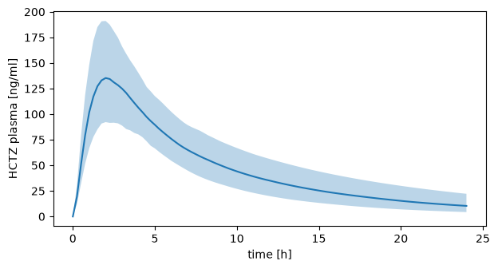
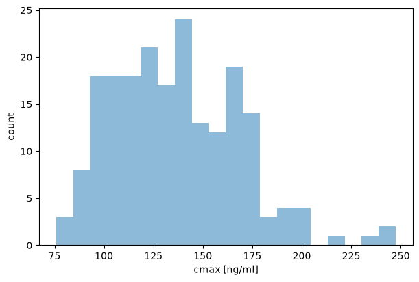
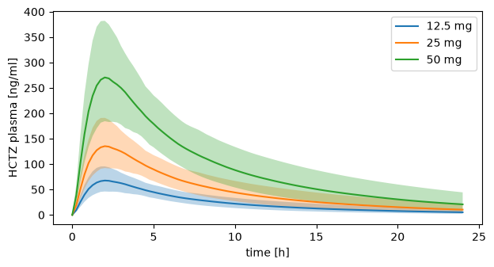

# Sampling

Parameters are rarely known exactly, and patients differ. To see what this does to a prediction, you draw parameter values from distributions, simulate every draw and look at the spread of the outputs. `sbmlsim.simulation.sampling` creates the draws as a `Dimension` of a [scan](scans.md), so a run simulates them like any other scan.

The examples use the HCTZ model of the [tutorial](tutorial.md): a 25 mg tablet of hydrochlorothiazide, simulated for one day.

## Draw parameter values

`sampling.lhs` draws a Latin hypercube: `n` points that cover the range of every distribution evenly. The example draws 200 values of the dissolution rate of the tablet and of the renal excretion rate, each with a coefficient of variation of 30 % around its value in the model:

```python
import matplotlib.pyplot as plt
import numpy as np

from sbmlsim import Q
from sbmlsim.plot import label_axes
from sbmlsim.resources import HCTZ_SBML
from sbmlsim.simulation import Change, Formula, Scan, Simulation, sampling
from sbmlsim.simulation.sampling import LogNormal
from sbmlsim.simulator import Simulator

simulator = Simulator()
model = simulator.load(HCTZ_SBML)
dose = Simulation(
    time_unit="hr",
    end=24,
    changes=[Change(0, {"PODOSE_hctz": Q(25, "mg")})],
)

draws = sampling.lhs(
    {"Ka_dis_hctz": LogNormal(cv=0.3), "KI__HCTZEX_k": LogNormal(cv=0.3)},
    200,
    seed=1,
    model=model,
)
print(draws)
print(draws.values["Ka_dis_hctz"][:4].round(3))
```

```text title="Output"
Dimension(lhs[200], values=['Ka_dis_hctz', 'KI__HCTZEX_k'], design=lhs)
[0.539 0.39 0.412 0.536] / hour
```

`LogNormal(cv=0.3)` has no median of its own, so its median is the value of the parameter in the model. The design needs the model (`model=`) to read these values. The values keep the units of the model.

The draws are a dimension named `lhs`. Put them into a `Scan` and run it. `time=` puts the timecourses of all draws on one grid of times, every 15 minutes, so the summary over `lhs` has the quantiles at every time of the grid. The median with a band from the 5 % to the 95 % quantile shows the spread:

```python
from sbmlsim.sensitivity.uncertainty import plot_distribution

observables = [
    Formula("cp", "[Cve_hctz] * Mr_hctz", unit="ng/ml"),
    Formula("cmax", "max(cp)"),
]
grid = Q(np.linspace(0, 24, 97), "hr")
res = simulator.run(model, Scan(dose, [draws]), observables, time=grid)
bands = res.summary("lhs", quantiles=[0.05, 0.5, 0.95])


def plot_band(ax, bands, label=None):
    low, median, high = (
        bands.sel(statistic=s).q["cp"] for s in ("q0.05", "q0.5", "q0.95")
    )
    hours = bands.q["time"].to("hr")
    ax.plot(hours, median, label=label)
    ax.fill_between(hours, low, high, alpha=0.3)


fig, ax = plt.subplots(figsize=(7, 3.5))
plot_band(ax, bands)
label_axes(ax, "time", "HCTZ plasma")
```



`cp` is the plasma concentration in ng/ml and `cmax` its peak, one value per draw. `max` reads the steps of the integrator, before the timecourse is interpolated onto the grid, so the grid does not cut the peak. `plot_distribution` draws the values of the draws as a histogram, and the summary has their statistics:

```python
fig = plot_distribution(res, "cmax", dim="lhs", bins=20)
print(bands["cmax"].to_pandas().round(1))
```

```text title="Output"
statistic
mean     136.7
sd        32.2
cv         0.2
min       75.8
max      247.5
q0.05     92.3
q0.5     135.4
q0.95    191.5
Name: cmax, dtype: float64
```



## Combine with other dimensions

The draws are a dimension like any other, so they combine with doses or patient groups. The same 200 draws run for every dose, and the summary has a band per dose:

```python
from sbmlsim.simulation import Dimension

doses = Dimension(
    "dose",
    values={"PODOSE_hctz": Q([12.5, 25, 50], "mg")},
    labels=["12.5 mg", "25 mg", "50 mg"],
)
res = simulator.run(model, Scan(dose, [doses, draws]), observables, time=grid)
bands = res.summary("lhs", quantiles=[0.05, 0.5, 0.95])
fig, ax = plt.subplots(figsize=(7, 3.5))
for label in doses.labels:
    plot_band(ax, bands.sel(dose=label), label=label)
label_axes(ax, "time", "HCTZ plasma")
ax.legend()
```



`plot_bands(bands, "cp")` of `sbmlsim.sensitivity.uncertainty` draws these bands in one call, with the time in the unit of the model.

## Distributions

A distribution turns probabilities between 0 and 1 into values (`ppf`, the inverse of the cumulative distribution function). Every design draws points in the unit cube and maps them through the distribution of each parameter, so every distribution works with every design:

```python
from sbmlsim.simulation.sampling import Normal, Truncated, Uniform

print(Uniform(1.0, 2.0).ppf([0.0, 0.5, 1.0]))
weight = Truncated(Normal(Q(75, "kg"), Q(12, "kg")), lower=Q(40, "kg"))
print(weight.ppf([0.01, 0.5, 0.99]).round(1))
rate = LogNormal(cv=0.3)
print(rate.ppf([0.05, 0.5, 0.95], reference=Q(0.35, "1/hr")).round(3))
```

```text title="Output"
[1.  1.5 2. ]
[47.8 75.0 102.9] kilogram
[0.216 0.35 0.567] / hour
```

The lines are the uniform distribution at 0, 0.5 and 1, the 1 %, 50 % and 99 % quantiles of a body weight of 75 ± 12 kg cut at 40 kg, and the 5 %, 50 % and 95 % quantiles of a log-normal rate with a CV of 30 % around a reference of 0.35/hr.

| distribution | values |
| --- | --- |
| `Uniform(lower, upper)`, `Uniform(relative=r)` | uniform between the bounds, or between `1 - r` and `1 + r` times the reference |
| `LogUniform(lower, upper)`, `LogUniform(factor=f)` | uniform in log10, or between the reference divided and multiplied by `f` |
| `Normal(mean, sd)`, `Normal(cv=c)` | normal; without a mean around the reference, with `sd` equal to `c` times the magnitude of the reference |
| `LogNormal(median, cv)`, `LogNormal(cv=c)` | log-normal; without a median the median is the reference |
| `Truncated(distribution, lower, upper)` | another distribution cut at one or both bounds |
| `Empirical(values)` | the given values, with equal weights |
| `Fixed(value)` | one value for every point |

A distribution without a location (`relative=`, `factor=`, or no mean or median) is relative to the reference of its parameter. The reference is the value the model gives the parameter at the start of the simulation, after the changes of the model and of the simulation and the initial assignments. Pass `simulation=` to a design when the simulation changes the parameter before the start. Numbers are in the unit of the parameter in the model, quantities are converted.

## Designs

| design | points |
| --- | --- |
| `random(distributions, n, seed=..., correlation=...)` | `n` independent random draws, or correlated ones |
| `lhs(distributions, n, seed=..., correlation=...)` | a Latin hypercube of `n` points, optionally correlated |
| `local(targets, delta, model=...)` | the reference, and every parameter alone at `1 + delta` and `1 - delta` times its reference |
| `sobol(...)`, `fast(...)`, `morris(...)` | the designs of the global sensitivity analyses, see [Sensitivity analysis](sensitivity.md) |
| `fit_parameters(fisher, n, seed=...)` | the parameters of a fit, drawn from the normal distribution of their Fisher covariance |
| `profile_parameters(identifiability, n, seed=...)` | the parameters of a fit, each drawn from its profile likelihood |
| `fit_repeats(result, size)` | the best parameter sets of the repeated runs of a fit |
| `population(function, covariates, n, seed=...)` | covariates such as body weight or age, drawn and turned into parameter values by a function |

`sampling.parameters_of(model)` lists the constant parameters of a model, for an analysis that varies all of them.

`correlation` is a matrix of Spearman rank correlations between the parameters, in the order of the distributions. `random` correlates its draws with a Gaussian copula, `lhs` reorders its points (Iman and Conover), which keeps the even coverage of each parameter:

```python
from scipy.stats import spearmanr

correlated = sampling.lhs(
    {"Ka_dis_hctz": LogNormal(cv=0.3), "KI__HCTZEX_k": LogNormal(cv=0.3)},
    100,
    seed=1,
    correlation=[[1.0, -0.6], [-0.6, 1.0]],
    model=model,
)
values = [correlated.values[pid].magnitude for pid in correlated.values]
print(round(spearmanr(*values).statistic, 2))
```

```text title="Output"
-0.59
```

The rank correlation of the drawn values is close to the one asked for.

The designs of a fit draw the uncertainty of fitted parameters. `fit_parameters` draws only in the directions the data constrain; the other directions stay at the fitted value, and it raises when the fit has no degrees of freedom. `profile_parameters` follows asymmetric and open confidence intervals: a closed side of a profile continues with a quadratic tail, an open side runs to the bound, and no draw leaves the bounds of a parameter. Both write each parameter to its target in the model (`FitParameter.target_id`) unless `targets=` maps it elsewhere. See [Identifiability](identifiability.md) for the Fisher information and the profiles.

A `population` passes the drawn covariates to a function, which returns the values of the parameters. The function must be defined at the top level of a module, so that it can be sent to the worker processes. The covariates are coordinates of the result, so you can plot an output against them, but they are never set on the model.

## Reproduce draws

A design records how it was drawn: the method, the distributions, the options with the seed, and the references. The result of a run keeps this record in `res.ds.attrs["scan"]`, so an analysis needs only the result. Without `seed=`, a design draws a seed and records it, so the draws can always be repeated:

```python
print(draws.design.method, draws.design.options)
print(draws.design.references)
```

```text title="Output"
lhs {'n': 200, 'seed': 1, 'correlation': None}
{'Ka_dis_hctz': {'value': 0.351813311553606, 'unit': '1 / hour'}, 'KI__HCTZEX_k': {'value': 0.00371089047925543, 'unit': '1 / milliliter'}}
```

For the uncertainty of a prediction with uncertain doses, body weights and parameters, Monte Carlo errors and probability statements, see [Uncertainty](uncertainty.md).
