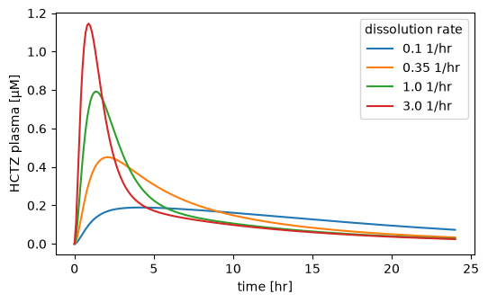
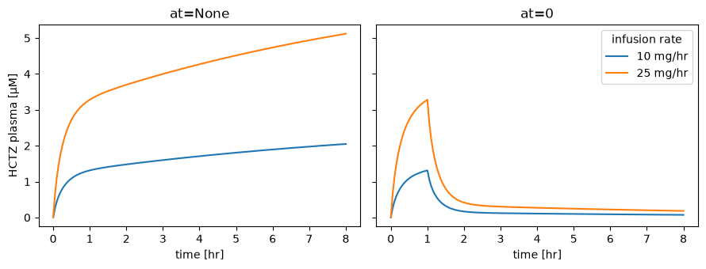
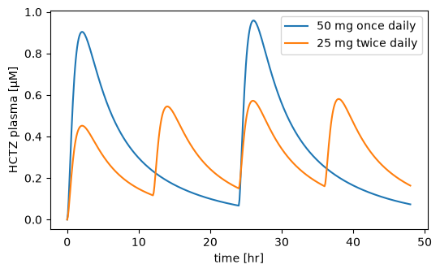
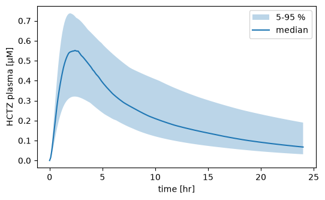

# Parameter scans

A scan runs the same simulation many times with different values: several doses, several patients, a range of a parameter. You describe it with a `Scan`, which combines a `Simulation` with one or more `Dimension`s. `Simulator.run` runs all points, in parallel when there are many, and returns a `ScanResult`: a labeled array with one axis per dimension and one for the time.

The examples use the HCTZ model of the [Tutorial](tutorial.md). [Simulations](simulation.md) explains the `Simulation` itself.

## A one dimensional scan

A `Dimension` has an id and maps a target, e.g. a parameter, to an array of values. Here the dissolution rate of the tablet takes four values:

```python
import matplotlib.pyplot as plt

from sbmlsim import Q
from sbmlsim.resources import HCTZ_SBML
from sbmlsim.simulation import Change, Dimension, Scan, Simulation
from sbmlsim.simulator import Simulator

simulator = Simulator()
model = simulator.load(HCTZ_SBML)
model.set_selections(["time", "[Cve_hctz]", "Aurine_hctz", "PODOSE_hctz", "Ri_hctz"])

tablet = Simulation(
    time_unit="hr",
    end=24,
    steps=240,
    changes=[Change(0, {"PODOSE_hctz": Q(25, "mg")})],
)
scan = Scan(
    tablet,
    [Dimension("dissolution", values={"Ka_dis_hctz": Q([0.1, 0.35, 1, 3], "1/hr")})],
)
res = simulator.run(model, scan)
print(res)
print(res["[Cve_hctz]"].dims)
print(res["Ka_dis_hctz"].values)
```

```text title="Output"
ScanResult(dissolution: 4, time: 241; [Cve_hctz], Aurine_hctz, PODOSE_hctz, Ri_hctz)
('dissolution', 'time')
[0.1  0.35 1.   3.  ]
```

The result has the dimensions of the scan first and the time last, here `(dissolution, time)`. The scanned values are a coordinate along their dimension, `Ka_dis_hctz`. The selections keep the result small, see [Simulations](simulation.md#selections-and-integrator-settings).

Each point is one curve. `isel` picks a point by its position:

```python
fig, ax = plt.subplots(figsize=(6, 3.5))
for k, ka in enumerate(res["Ka_dis_hctz"].values):
    point = res.isel(dissolution=k)
    ax.plot(point["time"] / 60, point["[Cve_hctz]"] * 1000, label=f"{ka} 1/hr")
ax.set(xlabel="time [hr]", ylabel="HCTZ plasma [µM]")
ax.legend(title="dissolution rate")
```



A faster dissolving tablet gives an earlier and higher peak.

The values of a dimension are numbers in the unit of the target in the model, or a quantity as here. A dimension can scan several targets at once, see [Several dimensions](#several-dimensions-simulations-and-models). The points are labeled `0, 1, 2, ...` unless you give `labels=`.

## Where the values of a scan go

A scanned value replaces its target wherever the simulation sets it: in the `preinit_changes` and in every `Change`. A target that the simulation does not set becomes a pre-initialization change. So scanning `PODOSE_hctz` replaces the 25 mg of the tablet:

```python
scan = Scan(
    tablet,
    [
        Dimension(
            "dose",
            values={"PODOSE_hctz": Q([10, 25, 50], "mg")},
            labels=["10 mg", "25 mg", "50 mg"],
        )
    ],
)
res = simulator.run(model, scan)
print(res)
print(list(res.ds.coords))
```

```text title="Output"
ScanResult(dose: 3, time: 241; [Cve_hctz], Aurine_hctz, PODOSE_hctz, Ri_hctz)
['dose', 'dose.PODOSE_hctz', 'time']
```

`PODOSE_hctz` is also one of the selections, so the result keeps its timecourse under its own name and stores the scanned values as the coordinate `dose.PODOSE_hctz`, i.e. `<dimension>.<target>`. The `Data` of a simulation experiment always uses that form, see [Data](data.md#selecting-points).

In a multiple dosing simulation a scanned dose therefore replaces every dose, which is usually what you want. It goes wrong when the simulation sets the target to different values, e.g. an infusion that starts and later stops: a scan of the infusion rate also replaces the stop, and the infusion never ends. `sbmlsim` logs a warning in that case, "The dimension 'rate' replaces the target 'Ri_hctz' in every place the simulation sets it, ...", with the values and times the simulation sets. `at=` fixes it: the dimension then sets its values as a `Change` at that time, and the other changes of the simulation stay:

```python
infusion = Simulation(
    time_unit="hr",
    end=8,
    steps=160,
    changes=[Change(0, {"Ri_hctz": Q(25, "mg/hr")}), Change(1, {"Ri_hctz": 0})],
)
rates = {"Ri_hctz": Q([10, 25], "mg/hr")}
rate_labels = ["10 mg/hr", "25 mg/hr"]

fig, axes = plt.subplots(1, 2, figsize=(9, 3.5), sharey=True)
for ax, at in zip(axes, [None, 0]):
    rate = Dimension("rate", values=rates, at=at, labels=rate_labels)
    res = simulator.run(model, Scan(infusion, [rate]))
    for label in res["rate"].values:
        point = res.sel(rate=label)
        ax.plot(point["time"] / 60, point["[Cve_hctz]"] * 1000, label=label)
    ax.set(xlabel="time [hr]", title=f"at={at}")
axes[0].set_ylabel("HCTZ plasma [µM]")
axes[1].legend(title="infusion rate")
fig.tight_layout()
```



Without `at` the infusion runs for the whole simulation. With `at=0` it starts with the scanned rate and stops after one hour as the simulation says. A dose repeated with the same value does not warn.

## Several dimensions, simulations and models

The arrays of one dimension have the same length and are coupled: point `k` sets the `k`-th value of every target. Use this for things that belong together, like the body weight and the kidney function of one patient. Several dimensions span all combinations of their points:

```python
patients = Dimension(
    "patient",
    values={"BW": [60, 75, 110], "f_renal_function": [1.0, 0.6, 0.3]},
    labels=["A", "B", "C"],
)
doses = Dimension(
    "dose",
    values={"PODOSE_hctz": Q([12.5, 25, 50], "mg")},
    labels=["12.5 mg", "25 mg", "50 mg"],
)
res = simulator.run(model, Scan(tablet, [patients, doses]))
print(res)
peak = res["[Cve_hctz]"].max("time") * 1000
print(peak.round(3).to_pandas())
```

```text title="Output"
ScanResult(patient: 3, dose: 3, time: 241; [Cve_hctz], Aurine_hctz, PODOSE_hctz, Ri_hctz)
dose     12.5 mg  25 mg  50 mg
patient
A          0.286  0.572  1.145
B          0.275  0.550  1.101
C          0.244  0.487  0.974
```

The table has the peak plasma concentration in µM for every patient and dose. The points run in C order, the last dimension fastest. A sampled design, e.g. values drawn from a distribution, is one dimension with coupled values, see [Designs](#designs).

A dimension and a scan never change after you create them; the values are read-only copies. `dataclasses.replace(dimension, at=10)` gives a new dimension with other fields, checked like a new one. It keeps the labels, and `labels=None` takes the default labels.

### Simulations and models

A dimension of `simulations` gives every point its own simulation, e.g. different dosing regimens:

```python
regimens = Dimension(
    "regimen",
    simulations={
        "50 mg once daily": Simulation(
            time_unit="hr",
            end=48,
            steps=480,
            changes=[Change([0, 24], {"PODOSE_hctz": Q(50, "mg")})],
        ),
        "25 mg twice daily": Simulation(
            time_unit="hr",
            end=48,
            steps=480,
            changes=[Change([0, 12, 24, 36], {"PODOSE_hctz": Q(25, "mg")})],
        ),
    },
)
res = simulator.run(model, Scan(tablet, [regimens]))
print(res)

fig, ax = plt.subplots(figsize=(6, 3.5))
for label in res["regimen"].values:
    point = res.sel(regimen=label)
    ax.plot(point["time"] / 60, point["[Cve_hctz]"] * 1000, label=label)
ax.set(xlabel="time [hr]", ylabel="HCTZ plasma [µM]")
ax.legend()
```

```text title="Output"
ScanResult(regimen: 2, time: 484; [Cve_hctz], Aurine_hctz, PODOSE_hctz, Ri_hctz)
```



The simulations of the dimension replace the simulation of the scan, here `tablet`. The same daily dose split into two gives lower peaks and higher troughs.

A dimension of `models` gives every point its own model: `models={"label": model, ...}` with paths, an `AbstractModel` or loaded models. The model argument of the run is then `None`, `simulator.run(None, scan)`.

## The output and the run

When all simulations have the same output times (`times` or `steps`), the result has the dimension `time`. An output time at a change after the start appears twice, the state before the change and the state after it (see [Simulations](simulation.md#two-rows-at-a-change)). Simulations that differ only in the changes on their grid share the grid, with a time twice where any of them has a change. The regimen result above has 481 grid times plus the change times 12, 24 and 36 hours a second time, 484 in all.

Without `times` and `steps` every simulation keeps the steps of its integrator. The result then has the dimension `_point` instead of `time`, `time` is a variable, and shorter simulations are padded with `NaN`. `res.ragged` tells you which layout you have. `time=` of `Simulator.run` puts every simulation onto a common grid:

```python
import numpy as np

infusion = Simulation(
    time_unit="hr",
    end=8,
    changes=[Change(0, {"Ri_hctz": Q(25, "mg/hr")}), Change(1, {"Ri_hctz": 0})],
)
scan = Scan(infusion, [Dimension("rate", values=rates, at=0, labels=rate_labels)])
res = simulator.run(model, scan)
print(res.ragged, res["time"].dims)

res_grid = simulator.run(model, scan, time=np.linspace(0, 480, 9))
print(res_grid.ragged, res_grid["time"].values)
```

```text title="Output"
True ('rate', '_point')
False [  0.  60. 120. 180. 240. 300. 360. 420. 480.]
```

`res.interpolate(times)` does the same for a result you already have. Both use the times of the changes, which the result keeps in `res.ds.attrs["changes"]`, and follow these rules:

- a time before a change is interpolated toward the state before it,
- a time at a change sees the state after it,
- a time that appears twice in the grid sees the state before the change first, then the state after it.

```python
grid = res.interpolate([0, 30, 60, 60, 90])
print((grid["Ri_hctz"] * 60).round(1).to_pandas().T)
```

```text title="Output"
rate  10 mg/hr  25 mg/hr
time
0.0       10.0      25.0
30.0      10.0      25.0
60.0      10.0      25.0
60.0       0.0       0.0
90.0       0.0       0.0
```

The infusion stops at 60 minutes, so the grid with 60 twice shows the rate before and after the stop. An event of the model is a jump too: a time at it, or at most the resolution of the time before it, sees the state after it. Jumps closer together than that resolution count as one, and a time at them sees the state after the last one. [The semantics](simulation.md#the-semantics) has the full rules.

Since a time can appear twice, xarray methods which need unique times raise on `res.ds`, e.g. `res.ds.interp(time=...)`, `res.ds.sel(time=..., method="nearest")` and `res.ds.reindex(time=...)`. Use `res.interpolate(times)` to put a result on other times. `res.sel(time=t)` at a change selects both rows, `res.isel(time=k)` one of them. A sensitivity result is different: its `sel(time=t)` selects the state after the change, see [Sensitivity analysis](sensitivity.md#the-result).

### Parallel runs

`Simulator(n_workers=...)` sets the number of processes:

- `1` runs every point in the calling process.
- A number is the size of a pool of worker processes.
- `None`, the default, uses every CPU for a scan of 256 points or more (`sbmlsim.parallel.POOL_THRESHOLD`) and runs a smaller scan in the calling process.

The result is the same for any number of workers. The pool is kept for the life of the process, so only the first pooled run pays for starting the workers, and each worker loads a model once. For a short script with one scan of a fast model, `n_workers=1` can be faster. A script that runs a pool needs its code under `if __name__ == "__main__":`, because the workers import the script again. The workers end with the process that started them, also when it crashes or is killed.

By default the first failing point raises a `ScanError` with its labels and values. With `on_error="flag"` the run keeps going: a failed point has `NaN` values and the variable `status` is `1` for it.

## Observables

A scan can compute observables from every simulation, e.g. a mass concentration or its maximum. `keep` chooses which of them the result keeps. [Observables](observables.md) covers formulas, PK parameters and custom functions:

```python
from sbmlsim.simulation import Formula

observables = [
    Formula("cp", "[Cve_hctz] * Mr_hctz", unit="ng/ml"),
    Formula("cmax", "max(cp)"),
    Formula("cmean", "mean(cp)"),
]
res = simulator.run(model, Scan(tablet, [regimens]), observables)
print(res)
print(res.ds[["cmax", "cmean"]].to_pandas().round(1))
```

```text title="Output"
ScanResult(regimen: 2, time: 484; cp, cmax, cmean)
                    cmax  cmean
regimen
50 mg once daily   285.4  100.0
25 mg twice daily  172.9   94.7
```

`cmax` and `cmean` are one value per simulation, so they have only the dimension `regimen`. Both regimens give the same daily dose and about the same mean concentration, but twice daily dosing lowers the peak.

## Working with scan results

A `ScanResult` wraps an `xarray.Dataset`, `res.ds`, and keeps the unit of every variable and coordinate. The most common operations:

- `res["[Cve_hctz]"]` is the `xarray.DataArray` of a variable, `res.quantity(key)` its values with the unit.
- `res.sel(patient="A")` selects points by label, `res.isel(patient=0)` by position.
- `res.summary(dims)` gives statistics over dimensions: mean, sd, cv, min, max and quantiles.
- `res.interpolate(times)` puts the result on other times.
- `res.ds.to_dataframe()` is a pandas table.
- `res.to_netcdf(path)` and `ScanResult.from_netcdf(path)` store and load the result with its units.

```python
from pathlib import Path

from sbmlsim.result import ScanResult

res = simulator.run(model, Scan(tablet, [patients, doses]))
peak = res.sel(patient="C", dose="25 mg").quantity("[Cve_hctz]").max()
print(f"{peak.to('µmol/l'):~.3f}")

summary = res.summary("patient")
print(summary)

res.to_netcdf(Path("scan.nc"))
print(ScanResult.from_netcdf(Path("scan.nc")))
```

```text title="Output"
0.487 μmol / l
ScanResult(statistic: 5, dose: 3, time: 241; [Cve_hctz], Aurine_hctz, PODOSE_hctz, Ri_hctz)
ScanResult(patient: 3, dose: 3, time: 241; [Cve_hctz], Aurine_hctz, PODOSE_hctz, Ri_hctz)
```

The summary over `patient` has the statistics as a new dimension `statistic` and keeps `dose` and `time`.

## Designs

A design is a dimension with values from a sampling method. `sbmlsim.simulation.sampling` creates local designs, random draws, Latin hypercubes, the designs of global sensitivity analyses, draws of fitted parameters and virtual populations, see [Sampling](sampling.md). Here a Latin hypercube draws 50 virtual patients with a variable dissolution rate, body weight and kidney function:

```python
from sbmlsim.simulation import sampling

draws = sampling.lhs(
    {
        "Ka_dis_hctz": sampling.LogNormal(cv=0.3),
        "BW": sampling.Normal(sd=10),
        "f_renal_function": sampling.Uniform(0.3, 1.0),
    },
    50,
    seed=1,
    model=model,
)
res = simulator.run(model, Scan(tablet, [draws]))
print(res)

summary = res.summary("lhs", quantiles=[0.05, 0.5, 0.95])
hours = summary["time"] / 60
cp = summary["[Cve_hctz]"] * 1000
fig, ax = plt.subplots(figsize=(6, 3.5))
ax.fill_between(
    hours,
    cp.sel(statistic="q0.05"),
    cp.sel(statistic="q0.95"),
    alpha=0.3,
    label="5-95 %",
)
ax.plot(hours, cp.sel(statistic="q0.5"), label="median")
ax.set(xlabel="time [hr]", ylabel="HCTZ plasma [µM]")
ax.legend()
```

```text title="Output"
ScanResult(lhs: 50, time: 241; [Cve_hctz], Aurine_hctz, PODOSE_hctz, Ri_hctz)
```



A distribution without a location, like `LogNormal(cv=0.3)` or `Normal(sd=10)`, is centered on the reference of its target: the value the model has after the pre-initialization of the simulation. The dimension of a design is named after its method, here `lhs`, and the result records the design, so an analysis needs only the result.

`sampling.local(targets, delta, model=model)` is the design of a local sensitivity analysis. It changes every target alone by the relative `delta` up and down around its reference:

```python
local = sampling.local(["Ka_dis_hctz", "BW"], delta=0.1, model=model)
print(local.labels)
```

```text title="Output"
['reference' 'Ka_dis_hctz+' 'Ka_dis_hctz-' 'BW+' 'BW-']
```
