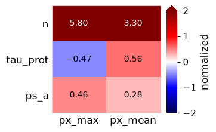
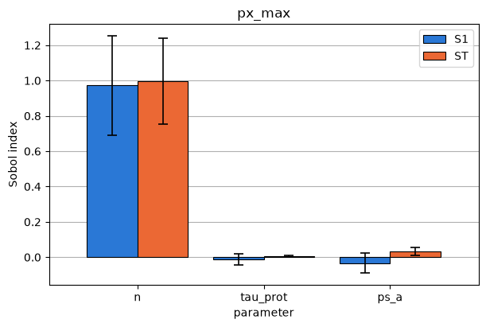
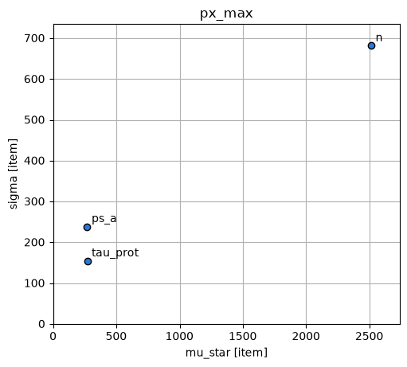
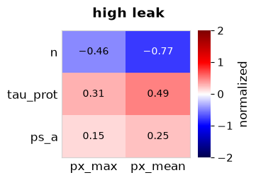

# Sensitivity analysis

A sensitivity analysis tells you which parameters an output depends on, and how strongly. In `sbmlsim` it takes three steps:

1. Create a design with `sbmlsim.simulation.sampling` (`local`, `sobol`, `fast` or `morris`, see [Sampling](sampling.md)). The design is a dimension of a `Scan`.
2. Run the scan with `Simulator.run` and the observables you are interested in.
3. Compute the indices from the result with `sensitivity.local`, `sensitivity.sobol`, `sensitivity.fast` or `sensitivity.morris`. They read the design from the result and compute the global indices with [SALib](https://salib.readthedocs.io), see [References](references.md#sensitivity-analysis).

The examples use the repressilator, three of its parameters and two observables: the peak `px_max` and the time-weighted mean `px_mean` of the protein `PX`. For the global methods every parameter varies uniformly within ±20 % of its value in the model:

```python
from sbmlsim import sensitivity
from sbmlsim.resources import REPRESSILATOR_SBML
from sbmlsim.simulation import Dimension, Formula, Scan, Simulation, sampling
from sbmlsim.simulation.sampling import Uniform
from sbmlsim.simulator import Simulator

simulator = Simulator()
model = simulator.load(REPRESSILATOR_SBML)
simulation = Simulation(end=200, steps=200)
parameters = ["n", "tau_prot", "ps_a"]
observables = [Formula("px_max", "max(PX)"), Formula("px_mean", "mean(PX)")]
bounds = {pid: Uniform(relative=0.2) for pid in parameters}
```

## Local sensitivities

The local design changes one parameter at a time to `1 + delta` and `1 - delta` times its value, and the analysis takes central differences. It needs only `2 d + 1` simulations for `d` parameters, but it describes the model only near the reference values.

```python
design = sampling.local(parameters, 0.01, model=model)
result = simulator.run(model, Scan(simulation, [design]), observables)
local = sensitivity.local(result)
print(local.index("normalized").to_pandas().round(3))
```

```text title="Output"
observable  px_max  px_mean
parameter
n            5.804    3.303
tau_prot    -0.467    0.562
ps_a         0.463    0.280
```

There are two indices:

- `normalized` is the relative change of the output per relative change of the parameter. It has no unit, so you can compare it between parameters and outputs. A value of 5.8 means that 1 % more `n` gives about 5.8 % more `px_max`.
- `raw` is the change of the output per change of the parameter, in the unit of the output per unit of the parameter (without a unit when the parameters have different units).

`plot_heatmap` shows an index for all parameters and outputs, on a color scale centered at 0:

```python
fig = sensitivity.plot_heatmap(local, "normalized")
```



A normalized index is `NaN` when the output is zero at the reference. A parameter whose reference is zero is not moved by the design, so both of its indices are `NaN`: undefined rather than insensitive. Its row in the heatmap stays, in grey.

## Sobol indices

The Sobol method decomposes the variance of an output over the whole parameter range. The design of Saltelli has `n (d + 2)` points for `d` parameters, `n` a power of two.

- `S1`, the first-order index, is the share of the variance a parameter explains alone.
- `ST`, the total index, adds all its interactions with other parameters. A large gap between `ST` and `S1` points to interactions.
- `S2` is the share of a pair of parameters, with `second_order=True` in the design.

Each index comes with a confidence interval, e.g. `S1_conf` (set by `conf_level` and `num_resamples`). The indices have no unit.

```python
design = sampling.sobol(bounds, 64, seed=1, model=model)
result = simulator.run(model, Scan(simulation, [design]), observables)
sobol = sensitivity.sobol(result)
print(sobol.index("ST").to_pandas().round(3))
```

```text title="Output"
observable  px_max  px_mean
parameter
n            0.997    0.970
tau_prot     0.008    0.036
ps_a         0.033    0.033
```

`plot_indices` draws `S1` and `ST` of one output with their intervals:

```python
fig = sensitivity.plot_indices(sobol, "px_max")
```



The Hill coefficient `n` explains almost all of the variance of the peak. The small negative `S1` values and the wide intervals are the noise of a small design; more base points (the second argument of `sampling.sobol`) narrow them.

## FAST and Morris

The extended FAST method also gives `S1` and `ST` with intervals. Its design needs more than `4 m^2` points per parameter (`m = 4` by default, so at least 65). SALib documents its bootstrap intervals as unreliable, so read `S1_conf` and `ST_conf` of FAST as rough indications.

Morris screening is the cheapest global method, with `trajectories (d + 1)` points. For every parameter it gives:

- `mu`, the mean of the elementary effects, and `mu_star`, the mean of their absolute values, which ranks the parameters;
- `sigma`, the standard deviation of the effects. A large `sigma` compared with `mu_star` points to interactions or nonlinear effects;
- `mu_star_conf`, the confidence interval of `mu_star`.

The elementary effects have the unit of the output. SALib divides the change of the output by the step on its grid of levels, so with the default of four levels an effect is 1.5 times the change of the output over one step.

```python
fast = sensitivity.fast(
    simulator.run(
        model,
        Scan(simulation, [sampling.fast(bounds, 65, seed=1, model=model)]),
        observables,
    )
)
morris = sensitivity.morris(
    simulator.run(
        model,
        Scan(simulation, [sampling.morris(bounds, 10, seed=1, model=model)]),
        observables,
    )
)
print(fast.index("ST").to_pandas().round(3))
print(morris.index("mu_star").to_pandas().round(1))
```

```text title="Output"
observable  px_max  px_mean
parameter
n            0.995    0.930
tau_prot     0.010    0.043
ps_a         0.031    0.030
observable  px_max  px_mean
parameter
n           2513.4    389.8
tau_prot     270.1     64.8
ps_a         269.8     55.8
```

`plot_morris` draws `mu_star` against `sigma`, one point per parameter, both axes from 0:

```python
fig = sensitivity.plot_morris(morris, "px_max")
```



## Conditions and time points

The design can be combined with other dimensions of the scan, e.g. doses or conditions. The analysis then computes the indices for every condition. For a timecourse on a common time grid it also computes them at every time point. Here the leak transcription rate `ps_0` is low or high, and `px` is the whole timecourse of `PX`:

```python
leak = Dimension("leak", values={"ps_0": [0.0005, 0.005]}, labels=["low", "high"])
result = simulator.run(
    model,
    Scan(simulation, [leak, sampling.local(parameters, 0.01, model=model)]),
    [*observables, Formula("px", "PX")],
)
by_condition = sensitivity.local(result)
print(by_condition["px_max.normalized"].to_pandas().round(3))
print(by_condition["px.normalized"].dims)
at_100 = by_condition.sel(time=100.0, leak="low")
print(at_100.index("normalized").to_pandas().round(3))
```

```text title="Output"
leak         low   high
parameter
n          5.804 -0.462
tau_prot  -0.467  0.306
ps_a       0.463  0.155
('parameter', 'leak', 'time')
observable     px  px_max  px_mean
parameter
n          -5.866   5.804    3.303
tau_prot   -7.545  -0.467    0.562
ps_a        1.205   0.463    0.280
```

The plots select one label of every other dimension by keyword:

```python
fig = sensitivity.plot_heatmap(
    by_condition, "normalized", leak="high", title="high leak"
)
```



With a high leak, `n` has much less effect on the peak, and the sign of its index flips.

A timecourse needs common time points: set `steps` or `times` in the simulation, or pass `time=` to the run. A timecourse with the native time points of the integrator (ragged) raises. Each index is one call of SALib per element, about 10 ms for a Sobol design with `n = 1024` and five parameters. A timecourse of 1000 time points under three conditions therefore takes about half a minute per output, so ask the run only for the time points you need.

## The result

`sensitivity.local` and the other analyses return a `SensitivityResult`. It wraps an `xarray.Dataset` (`ds`) with one variable per output and index, `<output>.<index>`, over `(parameter, *dimensions, [time])`. The units are in `attrs["units"]`, the method and its options in `attrs`. Second-order indices are over `(parameter, parameter_2, ...)`.

```python
print(sobol.method, sobol.parameters, sobol.observables)
print(sorted(sobol.ds.data_vars)[:4])
print(sobol.to_dataframe("px_max.ST").round(3))
```

```text title="Output"
sobol ['n', 'tau_prot', 'ps_a'] ['px_max', 'px_mean']
['px_max.S1', 'px_max.S1_conf', 'px_max.ST', 'px_max.ST_conf']
           px_max.ST
parameter
n              0.997
tau_prot       0.008
ps_a           0.033
```

- `index(name)` stacks one index of all scalar outputs into an array over `(parameter, observable, ...)`. A timecourse joins the stack once a time is selected, as `at_100` above shows.
- `sel` and `isel` select labels; a single label of `parameter` keeps the dimension. At the time of a change, which a timecourse has twice (before and after the change), `sel` gives the state after the change.
- `to_dataframe` gives a table, and `to_netcdf`/`from_netcdf` write and read the result.
- `classify(name)` sorts every value of a dimensionless index (`normalized`, `S1`, `ST`, ...) into the classes of sensitivity of the IPCS, see `sensitivity.classification`. It raises for an index with a unit.

```python
print(local.classify("px_max.normalized").values)
sobol.to_netcdf("sobol.nc")
print(sensitivity.SensitivityResult.from_netcdf("sobol.nc").method)
```

```text title="Output"
['high' 'medium' 'medium']
sobol
```

## Failed and constant outputs

A point whose simulation fails is `NaN` (with `on_error="flag"` in the run), and so are the indices that use it. One warning counts them. For Sobol, FAST and Morris every index of the element is `NaN`; for the local analysis the indices of the parameter whose point failed, or of every parameter if the reference failed.

An output that does not vary, e.g. a saturated or conserved value or a steady state, has no variance to share out: its Sobol and FAST indices are `NaN` and its Morris effects zero. An output counts as constant when its range is at most `tolerance * max|y|`. The default tolerance is 1000 times the relative tolerance of the integrator (`1e-7` for the default `1e-10` of `Simulator`, and never lower), because the integrator solves a value only to about 50 relative tolerances. `tolerance=` of `sobol`, `fast` and `morris` overrides it, and `0` keeps every element that is not exactly constant. A value that has decayed to the level of the absolute tolerance of the integrator is not caught; leave such time points out. The local indices of a constant output are zero within the error of the integrator.

## Plots

The plots return a matplotlib figure. `path=` saves it as well, at `dpi=` (300 by default). Labels of other dimensions of the scan are selected by keyword, e.g. `leak="high"`.

| plot | shows |
| --- | --- |
| `plot_heatmap(result, index)` | an index of all scalar outputs over the parameters, clustered, with the value in every cell; signed indices (`raw`, `normalized`, `mu`) on a color scale centered at 0 |
| `plot_indices(result, observable)` | the bars of `S1` and `ST` of a Sobol or FAST analysis with their intervals |
| `plot_morris(result, observable)` | `mu_star` against `sigma`, one point per parameter; a note names a parameter with undefined effects |

The heatmap leaves out parameters whose values are all below `cutoff`, in the unit of the index. The default is `0.1` for the dimensionless indices (`normalized`, `S1`, `ST`) and no cutoff for indices with a unit; `cutoff=0` keeps every parameter. A heatmap in which no parameter reaches the cutoff raises and names the largest value. Undefined values are never left out. All outputs of a heatmap share one color scale, so for an index with a unit the outputs with the largest values dominate; use `normalized` to compare outputs with different units.

For the spread of outputs over random draws, see `plot_bands` and `plot_distribution` in [Sampling](sampling.md#draw-parameter-values) and [Uncertainty](uncertainty.md).

`examples/sensitivity/sensitivity_example.py` runs all four methods with a dimension of conditions and writes the figures; `--cores` sets the number of workers and `--quick` runs small designs.
