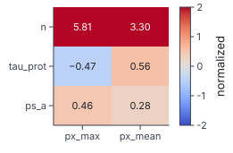
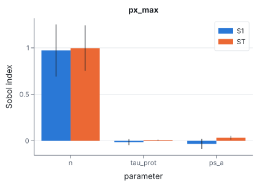
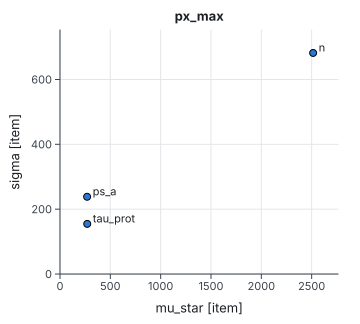
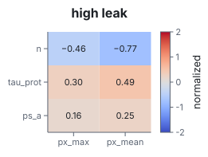

# Sensitivity analysis

A sensitivity analysis tells you which parameters an output depends on, and how strongly. In `sbmlsim` it takes three steps:

1. Create a design with `sbmlsim.simulation.sampling` (`local`, `sobol`, `fast` or `morris`, or the plain sample `lhs` or `random` for a polynomial chaos expansion, see [Sampling](sampling.md)). The design is a dimension of a `Scan`.
2. Run the scan with `Simulator.run` and the observables you are interested in.
3. Compute the indices from the result with `sensitivity.local`, `sensitivity.sobol`, `sensitivity.fast`, `sensitivity.morris` or `sensitivity.pce`. They read the design from the result and compute the global indices, the first three with the estimators of `sensitivity.estimators`, the ones of [SALib](https://salib.readthedocs.io) in Rust in sbmlsim-core, which apply to every element of an output at once, see [References](references.md#sensitivity-analysis).

The points of the global designs (`sobol`, `fast`, `morris`) and the resamples of their intervals are drawn by sbmlsim-core as well, from the seed of the design: a seed gives the same points and the same intervals on every platform, natively and in WebAssembly, but not the points SALib draws for it (0.51.0).

The exact local sensitivities of a single simulation are the exception: they come from the engine and need no design and no scan, see [Exact local sensitivities](#exact-local-sensitivities).

The examples use the repressilator, three of its parameters and two observables: the peak `px_max` and the time-weighted mean `px_mean` of the protein `PX`. For the global methods every parameter varies uniformly within ±20 % of its value in the model:

```python
from sbmlsim import sensitivity
from sbmlsim.resources import REPRESSILATOR_SBML
from sbmlsim.simulation import Dimension, Formula, Scan, Simulation, sampling
from sbmlsim.simulation.sampling import Uniform
from sbmlsim.simulator import Simulator

simulator = Simulator()
model = simulator.load(REPRESSILATOR_SBML)
simulation = Simulation(end=200)
parameters = ["n", "tau_prot", "ps_a"]
observables = [Formula("px_max", "max(PX)"), Formula("px_mean", "mean(PX)")]
bounds = {pid: Uniform(relative=0.2) for pid in parameters}
```

## Local sensitivities

The local design changes one parameter at a time to `1 + delta` and `1 - delta` times its value, and the analysis takes central differences. It needs only `2 d + 1` simulations for `d` parameters, but it describes the model only near the reference values. A step which would leave the domain of its parameter, the values the model accepts for it, is clamped to the domain and the difference is taken over the two values the design reached, see [the domain of a parameter](sampling.md#the-domain-of-a-parameter).

```python
design = sampling.local(parameters, 0.01, model=model)
result = simulator.run(model, Scan(simulation, [design]), observables)
local = sensitivity.local(result)
print(local.index("normalized").to_pandas().round(3))
```

```text title="Output"
observable  px_max  px_mean
parameter
n            5.811    3.303
tau_prot    -0.466    0.562
ps_a         0.465    0.280
```

There are two indices:

- `normalized` is the relative change of the output per relative change of the parameter. It has no unit, so you can compare it between parameters and outputs. A value of 5.8 means that 1 % more `n` gives about 5.8 % more `px_max`.
- `raw` is the change of the output per change of the parameter, in the unit of the output per unit of the parameter (without a unit when the parameters have different units).

`plot_heatmap` shows an index for all parameters and outputs, on a color scale centered at 0:

```python
fig = sensitivity.plot_heatmap(local, "normalized")
```



A normalized index is `NaN` when the output is zero at the reference. A parameter whose reference is zero is not moved by the design, so both of its indices are `NaN`: undefined rather than insensitive. Its row in the heatmap stays, in grey.

## Exact local sensitivities

The central differences above cost `2 d + 1` simulations and are as accurate as the step `delta` you choose: a large step measures the curvature of the model, a small one the error of the integrator. The [sbmlsim-core](simulation.md#engines) integrates the derivatives themselves along with the states of the model (forward sensitivities, CVODES), so one simulation of `d` parameters gives `dy/dp` at every output time, with no step to choose:

```python
core = Simulator(engine="core")
exact = sensitivity.forward(
    core,
    REPRESSILATOR_SBML,
    Simulation(end=200, steps=4),
    ["tau_prot", "ps_a"],
    selections=["PX"],
)
print(exact.ds["PX.normalized"].to_pandas().round(3))
```

```text title="Output"
time       0.0    50.0   100.0  150.0  200.0
parameter
tau_prot     NaN  2.482 -7.533  6.824 -8.435
ps_a         NaN  0.036  1.205 -0.158  0.561
```

`PX` is zero at the start of the simulation, where there is no relative change, so the first column is `NaN`. Of four parameters and 201 output times the exact indices take 4.2 ms against 31.5 ms for the design, which simulates nine points and assembles the result of a scan. The indices are the `raw` and `normalized` of the local analysis, over `(parameter, time)` instead of over the observables of a scan, and the reference of a normalized index is the value the parameter has at the start of the simulation, so a pre-initialization of the simulation is the point the indices are taken at. On the oscillating repressilator the central differences of a design at `delta = 0.01` agree with them to three digits at the first peak and drift to about 1 % by the fourth, where the oscillation amplifies the step. `Simulator.sensitivities` gives the same derivatives as a table of `(row, column, parameter)` next to the values of the simulation.

What the design does and this does not: the derivatives are the ones of the selections of the model, not of reduced observables such as `max(PX)` or the parameters of a PK analysis, which are no derivatives the engine integrates; the simulation is one interval without changes and without a presimulation, of a model without events, and the engine refuses the others; and a parameter which enters the model as an exponent of a state which reaches zero, the Hill coefficient `n` of the repressilator, has no finite derivative there, so its integration fails. Take the central differences of a `local` design for all of those.

## Sobol indices

The Sobol method decomposes the variance of an output over the whole parameter range. The design of Saltelli has `n (d + 2)` points for `d` parameters, `n` a power of two.

- `S1`, the first-order index, is the share of the variance a parameter explains alone.
- `ST`, the total index, adds all its interactions with other parameters. A large gap between `ST` and `S1` points to interactions.
- `S2` is the share of a pair of parameters, with `second_order=True` in the design.

Each index comes with a confidence interval, e.g. `S1_conf` (set by `conf_level` and `num_resamples`). The indices have no unit.

```python
design = sampling.sobol(bounds, 64, seed=1, model=model)
result = simulator.run(model, Scan(simulation, [design]), observables)
sobol = sensitivity.sobol(result)
print(sobol.index("ST").to_pandas().round(3))
```

```text title="Output"
observable  px_max  px_mean
parameter
n            0.962    0.915
tau_prot     0.009    0.045
ps_a         0.024    0.024
```

`plot_indices` draws `S1` and `ST` of one output with their intervals:

```python
fig = sensitivity.plot_indices(sobol, "px_max")
```



The Hill coefficient `n` explains almost all of the variance of the peak. The small negative `S1` values and the wide intervals are the noise of a small design; more base points (the second argument of `sampling.sobol`) narrow them.

## FAST and Morris

The extended FAST method also gives `S1` and `ST` with intervals. Its design needs more than `4 m^2` points per parameter (`m = 4` by default, so at least 65). SALib documents its bootstrap intervals as unreliable, so read `S1_conf` and `ST_conf` of FAST as rough indications.

Morris screening is the cheapest global method, with `trajectories (d + 1)` points. For every parameter it gives:

- `mu`, the mean of the elementary effects, and `mu_star`, the mean of their absolute values, which ranks the parameters;
- `sigma`, the standard deviation of the effects. A large `sigma` compared with `mu_star` points to interactions or nonlinear effects;
- `mu_star_conf`, the confidence interval of `mu_star`.

The elementary effects have the unit of the output. The change of the output is divided by the step on the grid of levels of SALib, so with the default of four levels an effect is 1.5 times the change of the output over one step.

```python
fast = sensitivity.fast(
    simulator.run(
        model,
        Scan(simulation, [sampling.fast(bounds, 65, seed=1, model=model)]),
        observables,
    )
)
morris = sensitivity.morris(
    simulator.run(
        model,
        Scan(simulation, [sampling.morris(bounds, 10, seed=1, model=model)]),
        observables,
    )
)
print(fast.index("ST").to_pandas().round(3))
print(morris.index("mu_star").to_pandas().round(1))
```

```text title="Output"
observable  px_max  px_mean
parameter
n            0.993    0.921
tau_prot     0.008    0.023
ps_a         0.040    0.037
observable  px_max  px_mean
parameter
n           2707.5    426.7
tau_prot     177.2     83.6
ps_a         288.6     60.6
```

`plot_morris` draws `mu_star` against `sigma`, one point per parameter, both axes from 0:

```python
fig = sensitivity.plot_morris(morris, "px_max")
```



## Polynomial chaos

A polynomial chaos expansion fits the output as a series of polynomials of the parameters which are orthonormal under their distributions, and reads the indices off its coefficients: the mean of the output is the constant coefficient, its variance is the sum of the squares of the others, and the share of a parameter is the share of the coefficients which read it. Nothing is estimated from differences of sample means, so the indices come from a plain sample of a few hundred points instead of the `n (d + 2)` points of a Saltelli design, and the fit is a surrogate of the model as well.

The design is a sample of the distributions of the parameters, `sampling.lhs` or `sampling.random`, or the points of a Saltelli design which was simulated already. The parameters must be independent, a design with a `correlation` is refused, since the share of a variance is the share of independent inputs.

```python
design = sampling.lhs(bounds, 256, seed=1, model=model)
result = simulator.run(model, Scan(simulation, [design]), observables)
chaos = sensitivity.pce(result)
print(chaos.index("ST").to_pandas().round(3))
print(chaos.index("loo").to_pandas().round(4))
print(chaos.index("degree").to_pandas())
```

```text title="Output"
observable  px_max  px_mean
parameter
n            0.979    0.962
tau_prot     0.008    0.044
ps_a         0.029    0.029
observable
px_max     0.003
px_mean    0.002
Name: px_max.loo, dtype: float64
observable
px_max     4.0
px_mean    5.0
Name: px_max.degree, dtype: float64
```

The total indices are the ones of the Sobol and FAST sections above, from a design which carries no structure of its own and which an uncertainty analysis or a plot of the output can reuse.

The indices are `S1` and `ST`, and `S2` with `second_order=True`, exact for the expansion and without a confidence interval: their uncertainty is the error of the fit, which the result carries per output next to them.

- `loo` is the corrected leave-one-out error, the share of the variance of the simulated values which the expansion does not predict. Read the indices of an output of a large `loo` with care; 0.003 above means the expansion follows 99.7 % of the variance.
- `degree` is the total degree of its basis. The degree is not given but chosen per output from `loo`, up to `degree=` (5 by default), so a higher limit never costs accuracy and costs little time: the basis of a candidate is a prefix of the basis of the largest degree the points support, and the thin QR of the first columns of a matrix is the first columns of its `Q` and the leading block of its `R`, so one decomposition serves every candidate and every element of the output. The decomposition depends on the points and the basis alone, never on the values, so the observables of one scan share it as well. The decomposition is the cost of the method; `sensitivity.supported` is the budget of points per term which decides the largest basis.
- `mean` and `sd` are the mean and standard deviation of the expansion over the distributions of the parameters, in the unit of the output. They are the moments of the distribution of the parameters and not of the sample.

A basis of the degree `p` over `d` parameters has `(p + d)! / (p! d!)` terms and the fit needs at least two points per term, so a high dimension needs a truncated basis: `q` below 1 drops the terms which read many parameters at a high degree (the hyperbolic truncation of Blatman and Sudret, `q=0.5` keeps about the terms of one and two parameters) and `max_interaction` caps the number of parameters of a term. Without enough points for the first degree the analysis raises rather than reporting a fit nobody can trust.

`sensitivity.choose_truncation` picks the truncation a sample supports, which is what `ChaosAnalysis` of the runner does when none is given: the exponent falls before the interaction is capped, so the basis keeps the interactions of a low degree as long as the points carry them, and a sample which carries none gets the additive basis instead of an error. The full basis of the degree 5 over 22 parameters has 80730 terms; 2048 points take `q=0.75` and its 782 terms of the degree 4.

```py
from sbmlsim.sensitivity import choose_truncation

q, max_interaction = choose_truncation(22, 2048, 4)  # (0.75, None)
```

`sensitivity.fit_chaos` is the expansion itself, on the unit cube rather than on a result, which `PolynomialChaos.predict` evaluates at points which were never simulated:

```py
from sbmlsim.sensitivity import fit_chaos

chaos = fit_chaos(u, y, degree=8, parameters=parameters)
predicted = chaos.predict(other_points)
```

## Conditions and time points

The design can be combined with other dimensions of the scan, e.g. doses or conditions. The analysis then computes the indices for every condition. For a timecourse on a common time grid it also computes them at every time point. Here the leak transcription rate `ps_0` is low or high, and `px` is the whole timecourse of `PX`, every 5 minutes (`time=`):

```python
import numpy as np

from sbmlsim import Q

leak = Dimension("leak", values={"ps_0": [0.0005, 0.005]}, labels=["low", "high"])
result = simulator.run(
    model,
    Scan(simulation, [leak, sampling.local(parameters, 0.01, model=model)]),
    [*observables, Formula("px", "PX")],
    time=Q(np.linspace(0, 200, 41), "min"),
)
by_condition = sensitivity.local(result)
print(by_condition["px_max.normalized"].to_pandas().round(3))
print(by_condition["px.normalized"].dims)
at_100 = by_condition.sel(time=100.0, leak="low")
print(at_100.index("normalized").to_pandas().round(3))
```

```text title="Output"
leak         low   high
parameter
n          5.811 -0.458
tau_prot  -0.466  0.304
ps_a       0.465  0.157
('parameter', 'leak', 'time')
observable     px  px_max  px_mean
parameter
n          -5.866   5.811    3.303
tau_prot   -7.544  -0.466    0.562
ps_a        1.206   0.465    0.280
```

The plots select one label of every other dimension by keyword:

```python
fig = sensitivity.plot_heatmap(
    by_condition, "normalized", leak="high", title="high leak"
)
```



With a high leak, `n` has much less effect on the peak, and the sign of its index flips.

A timecourse needs common time points: pass `time=` to the run, or set `times` in the simulation. A timecourse with the time points of the integrator, which differ between the points of the scan, raises. Every element of an output is estimated in the same pass, so a timecourse costs little more than a scalar: with five parameters, a Sobol design with `n = 1024` takes 0.12 s for 1000 elements, FAST with `n = 1025` 0.15 s and Morris with 100 trajectories 0.01 s, the elements spread over the CPUs (one call of SALib per element took 9.5 s, 9.2 s and 1.0 s).

## The result

`sensitivity.local` and the other analyses return a `SensitivityResult`. It wraps an `xarray.Dataset` (`ds`) with one variable per output and index, `<output>.<index>`, over `(parameter, *dimensions, [time])`. The units are in `attrs["units"]`, the method and its options in `attrs`. Second-order indices are over `(parameter, parameter_2, ...)`.

```python
print(sobol.method, sobol.parameters, sobol.observables)
print(sorted(sobol.ds.data_vars)[:4])
print(sobol.to_dataframe("px_max.ST").round(3))
```

```text title="Output"
sobol ['n', 'tau_prot', 'ps_a'] ['px_max', 'px_mean']
['px_max.S1', 'px_max.S1_conf', 'px_max.ST', 'px_max.ST_conf']
           px_max.ST
parameter
n              0.962
tau_prot       0.009
ps_a           0.024
```

- `index(name)` stacks one index of all scalar outputs into an array over `(parameter, observable, ...)`. A timecourse joins the stack once a time is selected, as `at_100` above shows.
- `sel` and `isel` select labels; a single label of `parameter` keeps the dimension. At the time of a change, which a timecourse has twice (before and after the change), `sel` gives the state after the change.
- `to_dataframe` gives a table, and `to_netcdf`/`from_netcdf` write and read the result.
- `classify(name)` sorts every value of a dimensionless index (`normalized`, `S1`, `ST`, ...) into the classes of sensitivity of the IPCS, see `sensitivity.classification`. It raises for an index with a unit.

```python
print(local.classify("px_max.normalized").values)
sobol.to_netcdf("sobol.nc")
print(sensitivity.SensitivityResult.from_netcdf("sobol.nc").method)
```

```text title="Output"
['high' 'medium' 'medium']
sobol
```

## Failed and constant outputs

A point whose simulation fails is `NaN` (with `on_error="flag"` in the run), and so are the indices that use it. One warning counts them. For Sobol, FAST and Morris every index of the element is `NaN`; for the local analysis the indices of the parameter whose point failed, or of every parameter if the reference failed.

An output that does not vary, e.g. a saturated or conserved value or a steady state, has no variance to share out: its Sobol and FAST indices are `NaN` and its Morris effects zero. An output counts as constant when its range is at most `tolerance * max|y|`. The default tolerance is 1000 times the relative tolerance of the integrator (`1e-7` for the default `1e-10` of `Simulator`, and never lower), because the integrator solves a value only to about 50 relative tolerances. `tolerance=` of `sobol`, `fast` and `morris` overrides it, and `0` keeps every element that is not exactly constant. A value that has decayed to the level of the absolute tolerance of the integrator is not caught; leave such time points out. The local indices of a constant output are zero within the error of the integrator.

## Plots

The plots return a `sbmlsim.plot.Chart`, which `fig.save("heatmap.svg")` or `fig.save("heatmap.png", dpi=300)` writes. Labels of other dimensions of the scan are selected by keyword, e.g. `leak="high"`.

| plot | shows |
| --- | --- |
| `plot_heatmap(result, index)` | an index of all scalar outputs over the parameters, clustered, with the value in every cell; signed indices (`raw`, `normalized`, `mu`) on a color scale centered at 0 |
| `plot_indices(result, observable)` | the bars of `S1` and `ST` of a Sobol or FAST analysis with their intervals |
| `plot_morris(result, observable)` | `mu_star` against `sigma`, one point per parameter; a note names a parameter with undefined effects |

The heatmap draws `cmap` with the color scales of the renderer (`viridis`, `magma`, `rdbu`, `coolwarm`, `greys`; `seismic` is drawn as `coolwarm`). It leaves out parameters whose values are all below `cutoff`, in the unit of the index. The default is `0.1` for the dimensionless indices (`normalized`, `S1`, `ST`) and no cutoff for indices with a unit; `cutoff=0` keeps every parameter. A heatmap in which no parameter reaches the cutoff raises and names the largest value. Undefined values are never left out. All outputs of a heatmap share one color scale, so for an index with a unit the outputs with the largest values dominate; use `normalized` to compare outputs with different units.

For the spread of outputs over random draws, see `plot_bands` and `plot_distribution` in [Sampling](sampling.md#draw-parameter-values) and [Uncertainty](uncertainty.md).

`examples/sensitivity/sensitivity_example.py` runs all four methods with a dimension of conditions and writes the figures; `--cores` sets the number of workers and `--quick` runs small designs.

## Sensitivity analyses of a project

A model package runs the same analyses over the groups of its simulations, e.g. a control and the degrees of a renal impairment, and keeps their tables and figures next to the model. A `SensitivityRunner` of `sbmlsim.sensitivity.runner` holds what is the model's own: the table of the parameters with their bounds, the outputs (an observable each, also a parameter of a `PK` observable such as `pk.cmax`), the observables or a function building them when a run starts, and the analyses with their groups:

```py
from sbmlsim.sensitivity.parameters import parameters_from_sbml, set_relative_bounds
from sbmlsim.sensitivity.runner import (
    ChaosAnalysis,
    LocalAnalysis,
    SamplingAnalysis,
    SensitivityGroup,
    SensitivityOutput,
    SensitivityRunner,
    SobolAnalysis,
)


def parameters():
    table = parameters_from_sbml(PROJECT.model_path, exclude_ids={"Mr_hctz"})
    set_relative_bounds(table, 0.15)
    return table


GROUPS = [
    SensitivityGroup("control", "Control", Simulation(end=24, time_unit="hr")),
    SensitivityGroup(
        "renal", "Renal", Simulation(end=24, time_unit="hr"), variant="renal"
    ),
]

SENSITIVITY = SensitivityRunner(
    parameters=parameters,
    outputs=[SensitivityOutput("cmax", "Cmax", observable="pk.cmax")],
    observables=observables,
    analyses={
        "local": LocalAnalysis(groups=GROUPS),
        "sampling": SamplingAnalysis(groups=GROUPS, n=1000),
        "sobol": SobolAnalysis(groups=GROUPS[:1], n=4096),
        "chaos": ChaosAnalysis(groups=GROUPS[:1], n=2048),
    },
    default=("local",),
)

PROJECT = Project(..., sensitivities={"pk": ".sensitivity:SENSITIVITY"})
```

The project lists the runner in `sensitivities`, as an object or a reference, and the kind `sensitivity` of the [run layer](run.md#simulate-scan-sensitivity-and-uncertainty) runs it into its output, one unit per analysis: `python -m sbmlsim.run sensitivity pk.yaml --out results/sensitivity` with `analysis: pk` and optionally `analyses: [local, sampling]`. A runner which a project lists without a `project` of its own runs on that project; a runner with `project=` and `out=` runs from a script as well, `SENSITIVITY.main()`, with the names of the analyses, `--workers` and `--out` on its command line, or `SENSITIVITY.run(["local"], path=...)`. A model with several simulations has a runner per simulation, listed as a mapping by subfolder (`run_subfolders`), which share one table of the parameters.

`ChaosAnalysis` is the cheapest of the global analyses: it fits a polynomial chaos expansion on a Latin hypercube, so the indices of the Saltelli design of `SobolAnalysis` come from a fraction of its `n (d + 2)` simulations (on the HCTZ model of pkdb_models, 22 parameters, 2048 points give the total indices of a design of 98304 to three decimals). Its basis is truncated to what the points support unless `q` is given, see [Polynomial chaos](#polynomial-chaos), and `quality.tsv` says how well every output is fitted.

A group runs a variant of the model of the project (`variant`, the default variant without) and may prepare the scan of every design (`prepare`, e.g. an equilibration). An analysis varies the parameters of the table which no simulation of its groups sets (`free_parameters`); a global design is drawn once and a group of another variant samples it relative to the values of its variant (`design_factors`, `relative_design`), so e.g. a group of women varies the body weight around the female one by the same factors. The designs and indices are the ones above with the seed `1234`; the environment variable `SBMLSIM_SENSITIVITY_N` replaces the numbers of samples for a quick run.

The files are the ones of sbmlsim 0.8.5, which manuscripts read; every figure is the PNG of sbmlsim 0.8.5 at 300 dpi and an SVG of the same name:

| analysis | files |
| --- | --- |
| every run | `parameters.tsv` and `parameters.tex`, the table of the parameters with the values of the other variants of the groups, `value_<variant>` |
| `LocalAnalysis` | `local/local_d<delta>_nvar<n_var>_<k>_<group>.tsv`: the normalized sensitivity `Sij`, the mean over `n_var` steps up to `delta`, with its class, and the heatmap `.png` and `.svg` |
| `SamplingAnalysis` | a Latin hypercube: `sampling/<group>/samples.tsv`, `sampling/sampling_N<n>.tsv` with the statistics of `ScanResult.summary` per group and output (`mean`, `median`, `std` the sample standard deviation, `cv`, `min`, `q005`, `q095`, `max`, the uncertainty `U = (P97.5 - P2.5) / P50` and its class), `_compact.tsv`, `.tex` and the figures of the samples and the outputs per group |
| `FastAnalysis`, `SobolAnalysis`, `ChaosAnalysis` | `<analysis>/<group>/<output>.S1.tsv` and `.ST.tsv`, the heatmaps of `S1` and `ST` and the bars of `plot_indices` per output |
| `ChaosAnalysis` | and `chaos/<group>/quality.tsv`, a row per output with the `loo`, the `degree` of its basis and the `mean` and `sd` of its expansion, plus `<output>.S2.tsv` with `second_order=True` |
