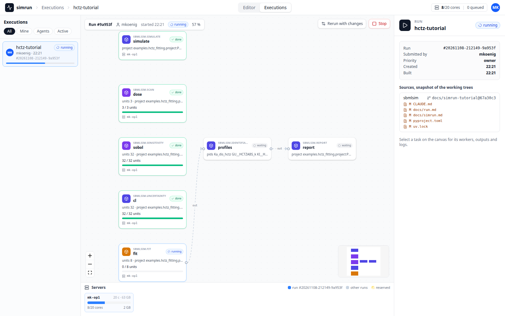
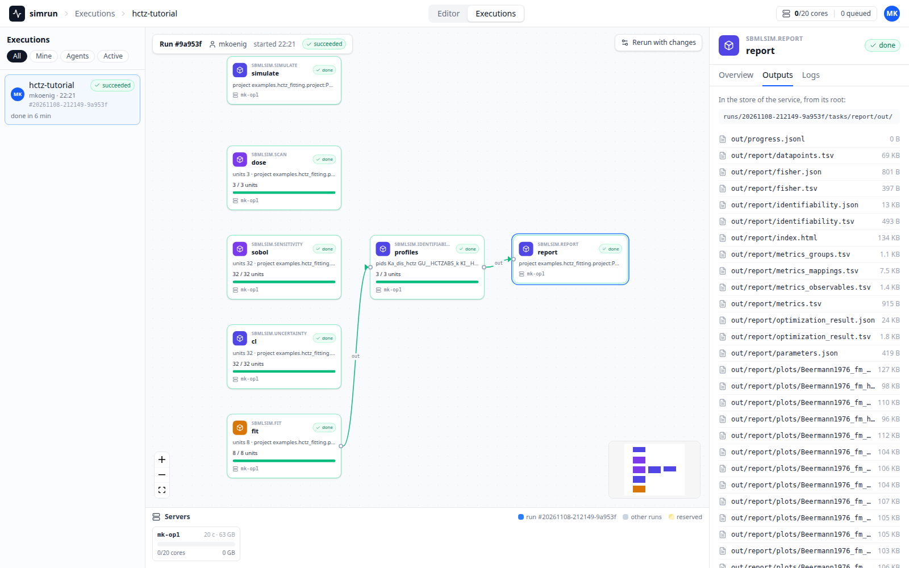
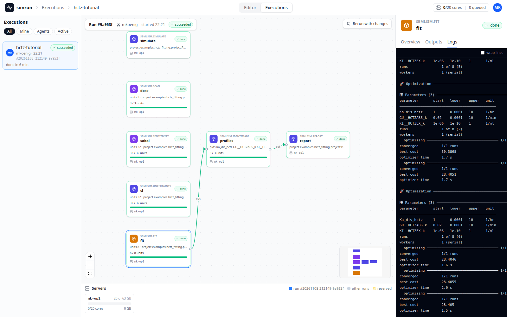
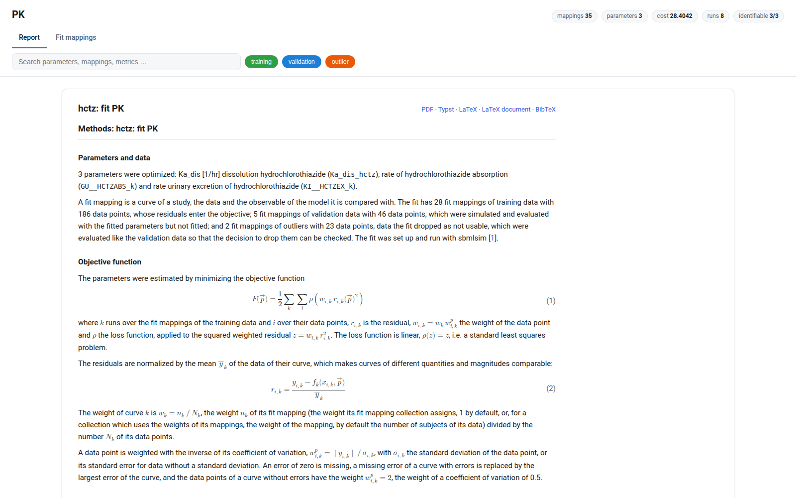
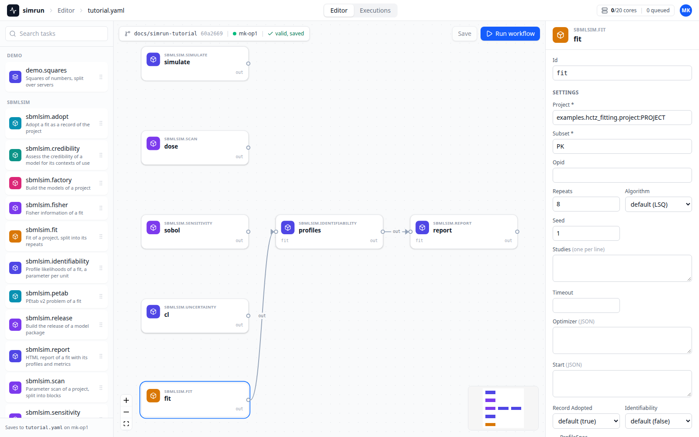

# Workflows with simrun

The [tutorial](tutorial.md) runs every analysis of the HCTZ model in one python session: a dose, a parameter scan, a sensitivity analysis, a fit and an uncertainty analysis. This page runs the same analyses as one workflow of [simrun](https://github.com/matthiaskoenig/simrun), on your laptop with `--local` or on a cluster with the same file, and shows how to bring an analysis of your own there.

A workflow is a YAML file of tasks. Every task is an analysis of a [project](project.md), run by the [run layer](run.md) of `sbmlsim`, and simrun schedules the tasks, splits the large ones into units (the repeats of a fit, the points of a scan, the draws of an uncertainty analysis), runs them on all cores or servers, merges the units, and keeps the outputs, the logs and the provenance of every run. A web app shows the runs live.

## From the tutorial to a project

The interactive code of the tutorial builds its objects in a session and writes nothing. A workflow needs every analysis by name, so the analyses become entries of a `Project`, a description of the model package. The HCTZ example has one, `examples/hctz_fitting/project.py`:

| tutorial | project | kind of the run layer | task type of simrun |
| --- | --- | --- | --- |
| [Simulate a dose](tutorial.md#simulate-a-dose), the simulation experiments of the studies | `experiments` | `simulate` | `sbmlsim.simulate` |
| [Scan parameters](tutorial.md#scan-parameters) | `scans`, a `ScanAnalysis` | `scan` | `sbmlsim.scan` |
| [Sensitivity analysis](tutorial.md#sensitivity-analysis) | `scans`, a `ScanAnalysis` with `indices` | `sensitivity` | `sbmlsim.sensitivity` |
| [Fit the model to data](tutorial.md#fit-the-model-to-data) | `fits`, a `FitDefinition` per subset | `fit`, `identifiability`, `report` | `sbmlsim.fit`, `sbmlsim.identifiability`, `sbmlsim.report` |
| [Uncertainty analysis](tutorial.md#uncertainty-analysis) | `uncertainties`, an `UncertaintyAnalysis` | `uncertainty` | `sbmlsim.uncertainty` |

`python -m sbmlsim.run list` shows what a project offers; run it from the root of the repository, which `python -m` puts on the path:

```bash
python -m sbmlsim.run list examples.hctz_fitting.project:PROJECT
```

```text
kind             name   description
simulate         all    the simulation experiments of the project
fit              PK     fit of the problem 'PK'
identifiability  PK     profile likelihoods of the fit of the problem 'PK'
...
scan             dose   oral doses of 12.5, 25 and 50 mg over one day
scan             sobol  Sobol design of the dissolution and the renal excretion of a 25 mg oral dose
sensitivity      sobol  sobol indices of the scan 'sobol'
uncertainty      cl     the AUC of a 25 mg oral dose under a renal excretion uncertain by 30 %
```

## Converting an analysis

Take the dose scan of the tutorial. As a script it builds the scan, runs it and saves the result:

```py
simulator = Simulator()
model = simulator.load(HCTZ_SBML)
dose = Simulation(time_unit="hr", end=24, changes=[Change(0, {"PODOSE_hctz": Q(25, "mg")})])
scan = Scan(dose, [Dimension("dose", values={"PODOSE_hctz": Q([12.5, 25, 50], "mg")})])
observables = [
    Formula("cp", "[Cve_hctz] * Mr_hctz", unit="ng/ml"),
    PK("pk", "cp", dose="PODOSE_hctz", route="oral"),
]
res = simulator.run(model, scan, observables, time=np.linspace(0, 24 * 60, 49))
res.to_netcdf("dose.nc")
```

In a project the same analysis is a set of functions which build the objects, and an entry which names them:

```py
def oral_dose() -> Simulation:
    return Simulation(time_unit="hr", end=24, changes=[Change(0, {"PODOSE_hctz": Q(25, "mg")})])


def dose_scan() -> Scan:
    return Scan(
        oral_dose(),
        [
            Dimension(
                "dose",
                values={"PODOSE_hctz": Q([12.5, 25, 50], "mg")},
                labels=["12.5 mg", "25 mg", "50 mg"],
            )
        ],
    )


def observables() -> list[Observable]:
    return [
        Formula("cp", "[Cve_hctz] * Mr_hctz", unit="ng/ml"),
        PK("pk", "cp", dose="PODOSE_hctz", route="oral"),
    ]


PROJECT = Project(
    name="hctz",
    root=HCTZ_PATH,
    scans={
        "dose": ScanAnalysis(
            model=MODEL_PATH,
            scan=dose_scan,
            observables=observables,
            time=DOSE_TIMES,
            description="oral doses of 12.5, 25 and 50 mg over one day",
        ),
    },
)
```

What changes, and why:

- **Functions instead of objects.** Every unit of a split analysis runs in its own process, possibly on another server, and builds the scan again from the project. A function of the module builds it the same way everywhere; the run layer checks that every unit built the same scan (`scan_hash`).
- **Deterministic.** A design, a sample or a draw has a fixed seed (`sobol(..., seed=1)`, `UncertaintyAnalysis(seed=1)`), so a unit on one server draws the same points as on another. The plan draws a seed for a fit or a propagation without one and records it.
- **Paths of the package.** The model, the data and the records are paths relative to the package (`MODEL_PATH`, `DATA_PATH`), never to the current directory, which differs between a laptop, a worker process and a pod.
- **No output code.** The run layer writes the result (`result.nc`, the indices, the reports) and its provenance into the output of the task, so the script code which saved or plotted the result is gone; read the result afterwards, see [Results](#results).
- **Importable.** The project is a module attribute, `examples.hctz_fitting.project:PROJECT`, which the client of simrun imports to plan the workflow and every task imports to run it. A model package installs its project with the package, see [Projects](project.md).

Check the converted analysis on its own before it goes into a workflow, with a spec which names it:

```yaml title="dose.yaml"
project: examples.hctz_fitting.project:PROJECT
analysis: dose
```

```bash
python -m sbmlsim.run plan scan dose.yaml          # the planned spec, units and hash
python -m sbmlsim.run scan dose.yaml --out results/dose
```

The other analyses convert the same way: an experiment class into `experiments`, a scan with a sensitivity design into a `ScanAnalysis` with `indices="sobol"`, a fit into a `FitDefinition` of `fits`, a propagation into an `UncertaintyAnalysis`. [Analyses](run.md) lists the settings of every kind.

## The workflow

`examples/hctz_fitting/workflows/tutorial.yaml` runs the analyses of the tutorial. A task names its type and the spec of its kind as `settings`; `inputs` connect a task to the output `out` of another one, here the fit to its profiles and the profiles to the report:

```yaml title="examples/hctz_fitting/workflows/tutorial.yaml"
name: hctz-tutorial
tasks:
  - id: simulate
    type: sbmlsim.simulate
    settings:
      project: examples.hctz_fitting.project:PROJECT
  - id: dose
    type: sbmlsim.scan
    settings:
      project: examples.hctz_fitting.project:PROJECT
      analysis: dose
  - id: sobol
    type: sbmlsim.sensitivity
    settings:
      project: examples.hctz_fitting.project:PROJECT
      analysis: sobol
  - id: cl
    type: sbmlsim.uncertainty
    settings:
      project: examples.hctz_fitting.project:PROJECT
      analysis: cl
  - id: fit
    type: sbmlsim.fit
    settings:
      project: examples.hctz_fitting.project:PROJECT
      subset: PK
      repeats: 8
      seed: 1
  - id: profiles
    type: sbmlsim.identifiability
    settings:
      project: examples.hctz_fitting.project:PROJECT
      subset: PK
    inputs:
      fit: fit.out
  - id: report
    type: sbmlsim.report
    settings:
      project: examples.hctz_fitting.project:PROJECT
      subset: PK
    inputs:
      fit: profiles.out
```

The tasks without inputs run side by side as soon as cores are free, `profiles` waits for `fit` and `report` for `profiles`.

## Run it on your laptop

Install `sbmlsim` with the extra `simrun`, which installs simrun and registers the task types `sbmlsim.<kind>`:

```bash
pip install "sbmlsim[simrun]"
```

From the root of the repository, `--local` runs the workflow with the local service of simrun, which starts in the background and keeps its runs in `.simrun/` of the current directory. The HCTZ project is in `examples/`, which is not part of the package `sbmlsim`; a task imports from the root of the source of the model first, as `python -m` in the checkout, so it finds `examples` without further settings:

```bash
simrun estimate examples/hctz_fitting/workflows/tutorial.yaml --source sbmlsim=. --local
simrun submit examples/hctz_fitting/workflows/tutorial.yaml --source sbmlsim=. --local
```

`estimate` shows the plan of every task: its processes, the cores and the memory it asks for, and the units of a split task (3 points of the dose scan, 32 blocks of the Sobol design and of the draws, 8 repeats of the fit, a profile per parameter). `submit` plans the tasks, records the provenance of the sources and follows the run to its end with a line per task; on 20 idle cores the workflow takes about a minute:

```bash
simrun status <run> --local
```

```text
┏━━━━━━━━━━┳━━━━━━━┳━━━━━━┳━━━━━━━┓
┃ task     ┃ state ┃ done ┃ total ┃
┡━━━━━━━━━━╇━━━━━━━╇━━━━━━╇━━━━━━━┩
│ simulate │ done  │      │       │
│ dose     │ done  │ 3    │ 3     │
│ sobol    │ done  │ 32   │ 32    │
│ cl       │ done  │ 32   │ 32    │
│ fit      │ done  │ 8    │ 8     │
│ profiles │ done  │ 3    │ 3     │
│ report   │ done  │      │       │
└──────────┴───────┴──────┴───────┘
```

### The web app

The local service serves the web app of simrun at `/ui/` of the address in `.simrun/service.json`, which asks for the token stored there. The **Executions** show the run as a graph of its tasks, with the units of every split task and the cores of the machine, live while it runs:



A click on a task opens it in the inspector on the right: its **Overview**, its **Outputs** and its **Logs**. The outputs of the report are the report of the fit with its profiles, metrics and figures:



The logs are the console of the run layer, here the repeats of the fit with their costs; long lines scroll sideways, **wrap lines** wraps them at the width of the inspector:



### Results

`simrun outputs` lists the files of a task or copies them with `--to`; every task writes the output of its run into `out/`, see [The output](run.md#the-output):

```bash
simrun outputs <run> dose --local
simrun outputs <run> report --local --to results/report
```

```text
┏━━━━━━━━━━━━━━━━━━━━━━━━━━━┳━━━━━━━━┓
┃ path                      ┃  bytes ┃
┡━━━━━━━━━━━━━━━━━━━━━━━━━━━╇━━━━━━━━┩
│ out/blocks/points-0-1.nc  │ 157608 │
│ out/blocks/points-1-2.nc  │ 157608 │
│ out/blocks/points-2-3.nc  │ 157608 │
│ out/progress/unit-0.jsonl │    222 │
│ out/progress/unit-1.jsonl │    222 │
│ out/progress/unit-2.jsonl │    222 │
│ out/progress.jsonl        │      0 │
│ out/result.nc             │ 158845 │
│ out/run.json              │   1614 │
...
```

The results are the objects of the tutorial, read from their files:

```py
from sbmlsim.result.scan import ScanResult
from sbmlsim.sensitivity import SensitivityResult
from sbmlsim.uncertainty import UncertaintyResult

dose = ScanResult.from_netcdf("results/dose/out/result.nc")
print(dose["pk.cmax"].round(1).to_pandas())

sobol = SensitivityResult.from_netcdf("results/sobol/out/sensitivity.nc")
print(sobol.index("ST").to_pandas().round(2))

cl = UncertaintyResult.from_netcdf("results/cl/out/uncertainty")
print(cl.summary(outputs=["pk.auc_inf_obs"])[["output", "n", "mean", "sd", "q0.05", "q0.95"]])
```

```text
dose
12.5 mg     67.3
25 mg      134.6
50 mg      269.2

observable    pk.cmax  pk.auc_inf_obs
parameter
Ka_dis_hctz      0.96            0.00
KI__HCTZEX_k     0.15            0.43

        output  n    mean      sd   q0.05    q0.95
pk.auc_inf_obs 32 77768.0 19271.0 51348.0 113101.0
```

`results/report/out/report/index.html` is the report of the fit, as in [Parameter fitting](fitting.md), with the profiles of the identifiability analysis:



A split result equals the result of the whole analysis on one machine bitwise, so the numbers do not depend on how the run was split, see [Units and merges](run.md#units-and-merges).

### The Editor

`simrun edit` opens the workflow file in the **Editor** of the web app: the task types of `sbmlsim` in the palette, the tasks as cards, the settings of the selected task as a form of its spec, without the fields the plan sets, such as the units. A save writes the YAML file, **Run workflow** submits it:

```bash
simrun edit examples/hctz_fitting/workflows/tutorial.yaml --source sbmlsim=. --local
```



## Run it on a cluster

The same workflow runs on a cluster of simrun without `--local`, with the address and the token of the service in `SIMRUN_URL` and `SIMRUN_TOKEN`. The client takes snapshots of the sources, which the pods install, and the split tasks spread their units over the idle servers:

```bash
simrun submit examples/hctz_fitting/workflows/tutorial.yaml --source sbmlsim=.
simrun wait <run>
simrun outputs <run> report --to results/report
```

A project of a model package outside of `sbmlsim` names its source first and `sbmlsim` second, e.g. `--source model=~/git/my_model --source sbmlsim=~/git/sbmlsim`: the pods install the snapshots, which install the package of the model with its project, and import from the root of the model first, so a project at the root of a checkout, such as the examples of `sbmlsim`, is found as well. [simrun](run.md#simrun) in Analyses describes the plan in the client, the provenance and the task types, the documentation of simrun the service, the cluster and the web app.
