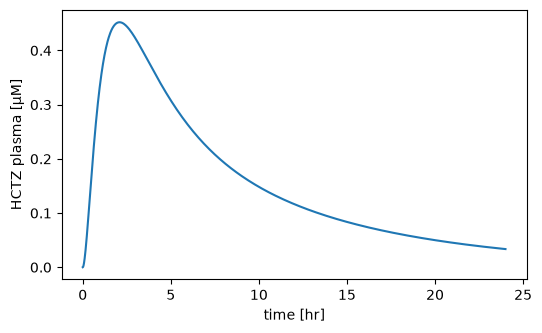
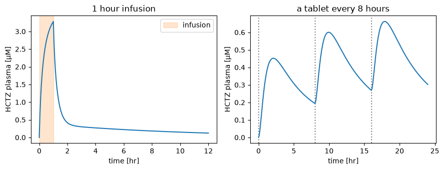
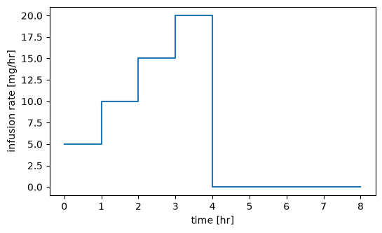
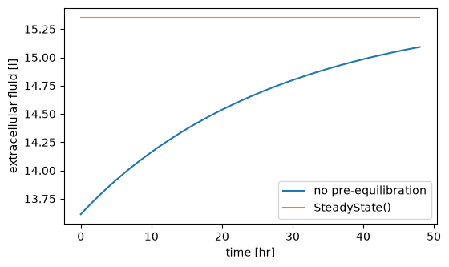

# Simulations

A `Simulation` says what to simulate: how long the model runs, which values you change before the start and during the run, and at which time points you want the results. You run it with `Simulator.run`. Simulation experiments, scans, parameter fits and PEtab problems all use the same `Simulation`, so what you learn on this page applies everywhere. The rules follow [PEtab v2](https://petab.readthedocs.io); [The semantics](#the-semantics) at the end lists them in full.

The examples use the HCTZ model of the [Tutorial](tutorial.md), a whole-body model of the diuretic hydrochlorothiazide that ships with `sbmlsim`.

## A simulation

Load the model with a `Simulator` and give the simulation an end time. `time_unit` is the unit of the times you write, here hours. The `Change` at time 0 gives a 25 mg tablet:

```python
import matplotlib.pyplot as plt

from sbmlsim import Q
from sbmlsim.resources import HCTZ_SBML
from sbmlsim.simulation import Change, Simulation
from sbmlsim.simulator import Simulator

simulator = Simulator()
model = simulator.load(HCTZ_SBML)

tablet = Change(0, {"PODOSE_hctz": Q(25, "mg")})
res = simulator.run(model, Simulation(time_unit="hr", end=24, changes=[tablet]))
print(res)
print("time unit of the result:", res.units["time"])
```

```text title="Output"
ScanResult(_point: 840; na, na_loop, na_urine, cl, cl_loop, cl_urine, Cki_plasma_hctz, Cli_plasma_hctz, ... (190 variables))
time unit of the result: min
```

You read a variable by its roadrunner name: `S` is the amount of a species and `[S]` its concentration. `[Cve_hctz]` is the HCTZ concentration in the venous plasma. The result is always in the units of the model, so the time is in minutes even though the simulation was written in hours, and the concentration is in mmol/l. The plot converts both:

```python
fig, ax = plt.subplots(figsize=(6, 3.5))
ax.plot(res["time"] / 60, res["[Cve_hctz]"] * 1000)
ax.set(xlabel="time [hr]", ylabel="HCTZ plasma [µM]")
```



Without further settings you get the steps the integrator took. They are dense where the curve changes fast and sparse where it is flat. Every simulation has its own number of steps, so the result has the dimension `_point` instead of `time`, and `time` is a variable.

### Output times

Most of the time you want fixed time points. `steps=n` gives `n + 1` evenly spaced points, and `times` gives exactly the time points you list:

```python
res = simulator.run(
    model, Simulation(time_unit="hr", end=24, steps=48, changes=[tablet])
)
print(res["time"].size)

res = simulator.run(
    model,
    Simulation(time_unit="hr", end=24, times=[0, 1, 2, 4, 8, 24], changes=[tablet]),
)
print(res["time"].values / 60)
print((res["[Cve_hctz]"].values * 1000).round(3))
```

```text title="Output"
49
[ 0.  1.  2.  4.  8. 24.]
[0.    0.342 0.452 0.363 0.194 0.034]
```

Output times closer together than the resolution of the time are simulated once, at the smaller time. Digitized data often has times such as `3.99999999999999` and `4.0`, which become one output time. The resolution is `1e-9` times the largest of the absolute start, the absolute end and the length of the simulation. A parameter fit merges the times of its data the same way, so every data point has its output time.

## Units and times

A value is either a plain number in the unit of its target in the model, or a quantity `Q(value, unit)`, which `sbmlsim` converts into the unit of the model (see [Units](units.md)). The same holds for times: a number is in the `time_unit` of the simulation (the time unit of the model if you give none), and a quantity is converted. A simulation can start at a negative time, e.g. a dosing protocol whose data counts the time from the last dose:

```python
doses = Change(range(-120, 1, 12), {"PODOSE_hctz": Q(25, "mg")})
res = simulator.run(
    model,
    Simulation(time_unit="hr", start=-120, end=Q(1, "day"), steps=144, changes=[doses]),
)
print(res["time"].values[[0, -1]] / 60)
```

```text title="Output"
[-120.   24.]
```

This gives eleven doses 12 hours apart, the last one at time 0. The end is a quantity, one day.

## Changes before the initialization

`preinit_changes` set values before the model is initialized. Use them for the properties of a patient or a condition, e.g. body weight or kidney function. The initial assignments of the model are evaluated afterwards, so everything whose initial value depends on a changed parameter follows the change. In the HCTZ model the extracellular fluid `ECF` starts at a value computed from the body weight `BW`:

```python
for bw in [75, 100]:
    res = simulator.run(
        model, Simulation(end=10, times=[0], preinit_changes={"BW": bw})
    )
    print(f"BW {bw} kg: ECF {res['ECF'].values[0]:.2f} l")
```

```text title="Output"
BW 75 kg: ECF 13.61 l
BW 100 kg: ECF 18.15 l
```

A target you set keeps your value: its own initial assignment is skipped. A pre-initialization change is a number or a quantity, not a formula.

## Changes during the simulation

A `Change` sets values at a time. With a list of times it is the same change at each of them, which is how you write multiple dosing. Here the drug runs as an infusion: `Ri_hctz` is the infusion rate, which starts at time 0 and stops after one hour. The second simulation repeats a tablet every 8 hours:

```python
infusion = Simulation(
    time_unit="hr",
    end=12,
    steps=240,
    changes=[Change(0, {"Ri_hctz": Q(25, "mg/hr")}), Change(1, {"Ri_hctz": 0})],
)
every_8h = Simulation(
    time_unit="hr",
    end=24,
    steps=240,
    changes=[Change([0, 8, 16], {"PODOSE_hctz": Q(25, "mg")})],
)

fig, (ax1, ax2) = plt.subplots(1, 2, figsize=(9, 3.5))
res = simulator.run(model, infusion)
ax1.axvspan(0, 1, color="tab:orange", alpha=0.2, label="infusion")
ax1.plot(res["time"] / 60, res["[Cve_hctz]"] * 1000)
ax1.set(xlabel="time [hr]", ylabel="HCTZ plasma [µM]", title="1 hour infusion")
ax1.legend()
res = simulator.run(model, every_8h)
for t in [0, 8, 16]:
    ax2.axvline(t, color="gray", linestyle=":")
ax2.plot(res["time"] / 60, res["[Cve_hctz]"] * 1000)
ax2.set(xlabel="time [hr]", ylabel="HCTZ plasma [µM]", title="a tablet every 8 hours")
fig.tight_layout()
```



The plasma concentration rises while the infusion runs and falls as soon as it stops. With a tablet every 8 hours (dotted lines) the drug accumulates a little from dose to dose.

### Values which depend on the state

A value can also be a formula, a string in the math of PEtab over the symbols of the model. It is evaluated with the state just before the change and in the units of the model. `S` is the amount of a species, `[S]` its concentration and `time` the time of the change. This step-up infusion raises the rate by 5 mg/hr every hour, up to 20 mg/hr:

```python
step_up = Simulation(
    time_unit="hr",
    end=8,
    steps=160,
    changes=[
        Change([0, 1, 2, 3], {"Ri_hctz": "Ri_hctz + 5/60"}),  # 5 mg/hr in mg/min
        Change(4, {"Ri_hctz": 0}),
    ],
)
res = simulator.run(model, step_up)

fig, ax = plt.subplots(figsize=(6, 3.5))
ax.plot(res["time"] / 60, res["Ri_hctz"] * 60)
ax.set(xlabel="time [hr]", ylabel="infusion rate [mg/hr]")
```



The rate of the model is in `mg/min`, so the formula adds 5 mg/hr as `5/60` mg/min.

### Two rows at a change

At the time of a change after the start the model has two states, the one before the change and the one after it. The output has both, as two rows with the same time. This keeps the jump in the data, and a plot draws it as a vertical line. Here the infusion stops at 1 hour, which is 60 minutes:

```python
res = simulator.run(
    model,
    Simulation(
        time_unit="hr", end=4, times=[0, 0.5, 1, 2, 4], changes=infusion.changes
    ),
)
print(res.ds[["Ri_hctz"]].to_dataframe().round(3))
```

```text title="Output"
       Ri_hctz
time
0.0      0.417
30.0     0.417
60.0     0.417
60.0     0.000
120.0    0.000
240.0    0.000
```

`Ri_hctz` is in mg/min in the model, so the 25 mg/hr are 0.417. The first row at 60 minutes is the state before the stop, the second the state after it. A change at the start, like the infusion start at 0, is the initial condition and gives one row. The change at the end does give two rows. A change between two output times leaves no trace in the output, but the simulation still applies it. The steps of the integrator contain every change.

Since a time can appear twice, xarray methods which need unique times, such as `res.ds.interp(time=...)`, raise. Use `res.interpolate(times)` instead, see [Parameter scans](scans.md#the-output-and-the-run).

## Pre-equilibration

`presimulation=SteadyState()` runs the model until nothing changes any more before the simulation starts. This is useful when the pre-initialization changes push the model out of balance. A patient with 30 % kidney function keeps more fluid. Without a pre-equilibration the fluid builds up during the simulation, with it the patient starts in balance:

```python
from sbmlsim.simulation import SteadyState

fig, ax = plt.subplots(figsize=(6, 3.5))
cases = {"no pre-equilibration": None, "SteadyState()": SteadyState()}
for label, presimulation in cases.items():
    res = simulator.run(
        model,
        Simulation(
            time_unit="hr",
            end=48,
            steps=96,
            preinit_changes={"f_renal_function": 0.3},
            presimulation=presimulation,
        ),
    )
    ax.plot(res["time"] / 60, res["ECF"], label=label)
ax.set(xlabel="time [hr]", ylabel="extracellular fluid [l]")
ax.legend()
```



The model is initialized once, with the `preinit_changes` of the simulation and of the `SteadyState` together, and a target may be in only one of them. A value that should differ after the steady state is a `Change` at the start. The steady state is reached when every rate of change is small, `|dx/dt| <= absolute_tolerance + relative_tolerance * |x|`, with the tolerances of the `SteadyState`. A model which does not get there within `SteadyState(max_time=...)` raises a `SteadyStateError`.

Every state takes part in the test, also one that only grows, such as the urine volume `Vurine` in this model. Such a state passes the relative test only once it is large, so it starts the simulation at a large value.

## Selections and integrator settings

By default a simulation records all species (amounts and concentrations), parameters, reactions and compartments. A compartment without a size, e.g. a membrane whose area the model never uses, is left out. Recording fewer variables makes the simulation faster:

```python
model.set_selections(["time", "[Cve_hctz]", "Aurine_hctz", "Ri_hctz"])
res = simulator.run(model, infusion)
print(res.variables)
```

```text title="Output"
['[Cve_hctz]', 'Aurine_hctz', 'Ri_hctz']
```

The integrator settings of roadrunner go to the `Simulator`, or you set them later. Every setting is passed on to the integrator, and a name it does not know is an error. The settings apply to every model the simulator runs, also in worker processes:

```python
simulator = Simulator(absolute_tolerance=1e-10, relative_tolerance=1e-10)
simulator.set_integrator_settings(stiff=True)
```

### Absolute tolerances

The absolute tolerance is one value per state, which `sbmlsim` sets from the kind of the state:

- `amount`: a species with `hasOnlySubstanceUnits=true`.
- `concentration`: any other species. The integrator works with its amount, so the tolerance is the concentration tolerance times the initial volume of its compartment in the model as loaded. A volume that is zero, negative or not finite is replaced by `1e-6` times the largest initial volume, with a log message.
- `other`: a parameter or compartment with a rate rule.

A float gives every kind the same tolerance. An `AbsoluteTolerance` gives one per kind and overrides single states by their id; an override applies to the integrated value, i.e. the amount of a concentration species. The default is `1e-10` for every kind. `tolerances()` of a model lists the result:

```python
from sbmlsim.model.tolerances import AbsoluteTolerance

simulator.set_integrator_settings(
    absolute_tolerance=AbsoluteTolerance(
        amount=1e-10, concentration=1e-10, other=1e-10, ids={"ECF": 1e-8}
    )
)
tolerances = simulator.load(model).tolerances()
print(tolerances[tolerances["sid"].isin(["ECF", "Cve_hctz", "Aurine_hctz"])])
```

```text title="Output"
            sid           kind compartment  volume  absolute_tolerance
0           ECF          other         NaN     NaN        1.000000e-08
19     Cve_hctz  concentration         Vve  2.9321        2.932100e-10
25  Aurine_hctz         amount      Vurine     NaN        1.000000e-10
```

The reference volumes come from the model as loaded. A pre-initialization change of a volume, e.g. through the body weight, does not change the tolerances, so a simulation never depends on the one that ran before it.

### The first step after a change

The integrator estimates its first step at the start and after every change. Most models do not read the time in their math, and `sbmlsim` integrates them in local time: every piece between two changes starts at time 0 internally, and the output is shifted back. A model that reads `time` or `delay`, or has an event with a delay, is integrated in absolute time. Late in such a simulation the first step after a change can be smaller than the resolution of the time, and the integrator warns "t + h = t on the next step". A small positive `initial_time_step`, in the time unit of the model, avoids the estimate:

```python
simulator.set_integrator_settings(initial_time_step=1e-10)
```

A step that is too large fails the error test of the integrator, so keep it small.

## Results

`Simulator.run` returns a `ScanResult`, a wrapper of an `xarray.Dataset` (`res.ds`) that keeps the unit of every variable. A single simulation is a scan without dimensions; [Parameter scans](scans.md#working-with-scan-results) shows how to work with the result. You can turn it into a pandas table or store it as netCDF with its units:

```python
from pathlib import Path

df = res.ds.to_dataframe()
print(df.head(3))

res.to_netcdf(Path("hctz.nc"))
```

```text title="Output"
      [Cve_hctz]  Aurine_hctz   Ri_hctz
time
0.0     0.000000     0.000000  0.416667
3.0     0.000653     0.000173  0.416667
6.0     0.001126     0.000694  0.416667
```

`simulator.simulate(model, simulation)` gives the raw solution of one simulation as a `TimecourseResult`, the array of roadrunner with its column names.

## Serialization

A `Simulation` converts to JSON with its units and back. Simulation experiments store their simulations this way:

```python
json_str = infusion.to_json()
print(Simulation.from_json(json_str))
```

```text title="Output"
Simulation([0.0, 12] hr, preinit=0, changes=2, steps=240)
```

## The semantics

This is what happens in one simulation, in order. The rules are the ones of PEtab v2.

1. Pre-initialization: The `preinit_changes` are set on the model.
2. Initialization: The model starts from its state as loaded, every time, so a simulation never depends on the one before it on the same model. Then the initial assignments are evaluated, except the ones of the targets you set.
3. Steady state: With a `SteadyState`, the model runs until the rates of change are within its tolerances.
4. Integration: The simulation runs from `start` to `end`, split at the times of the changes. Every piece ends in its state at its end, and the change at that time is applied to it.
5. A change: All values of a change are evaluated with the state just before it, then set at once.
6. Events of the model: an event fires at its time during the integration. An event whose trigger becomes true through a change fires right after the change. Several such events fire one at a time, in the order of their priorities. An event at the time of a change fires after the change, also at the end. Simultaneous events of the same priority fire in random order, see [SBML Test Suite](testsuite.md).

Species and compartments:

- When you change a compartment, a species whose initial value is a concentration, or which you set as `[S]`, keeps its concentration. Every other species keeps its amount.
- A species defined by an assignment rule always follows its rule.

Output:

- An output time at a change after the start appears twice: the state before the change, then the state after it. This includes a change at the end. A change at the start gives one row.
- The steps of the integrator include every change. An event of the model is also two rows at its time, before and after it, also at the end. An output time at the end sees the state after such an event. `sbmlsim` adds parameters to a model with events to tell these two rows apart, see [`model.event_rows`](api/model.event_rows.md).
- With the steps of the integrator, an event with a delay fires at the end of the integrator step after its time, i.e. a little late.
- Output times closer than the resolution of the time (`1e-9` times the largest of the absolute start, the absolute end and the length) are one output time, at the smallest of them.

Interpolation onto a grid (`time=` of `Simulator.run`, `ScanResult.interpolate`):

- A time before a change is interpolated toward the state before it.
- A time at a change sees the state after it.
- A time that appears twice in the grid sees the state before the change first, then the state after it.
- An event of the model is a jump as well. A time at it sees the state after it, and so does a time at most the resolution before it, since the integrator finds an event a little after its time.
- Jumps closer together than the resolution, e.g. a change and an event it triggers, count as one, and a time at or inside them sees the state after the last one.

A parameter fit compares data at the time of a change with the state before it by default, see [Parameter fitting](fitting.md#data-at-the-time-of-a-change).

Some events cannot fire right after a change: an event with a delay, and an event whose math `sbmlsim` cannot evaluate, e.g. a trigger with a function definition. They are reported with a warning that names the event. During the integration roadrunner fires them as usual.
