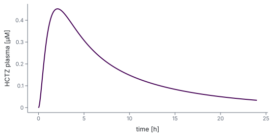
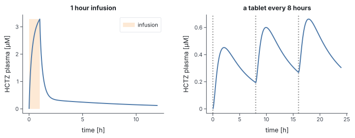
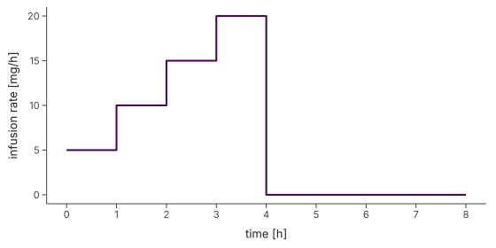
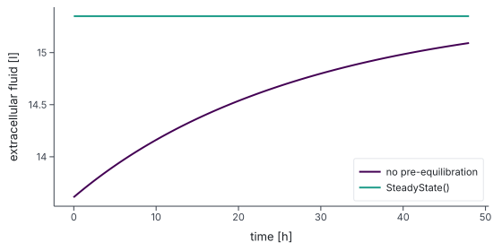

# Simulations

A `Simulation` says what to simulate: how long the model runs, which values you change before the start and during the run, and at which time points you want the results. You run it with `Simulator.run`. Simulation experiments, scans, parameter fits and PEtab problems all use the same `Simulation`, so what you learn on this page applies everywhere. The rules follow [PEtab v2](https://petab.readthedocs.io); [The semantics](#the-semantics) at the end lists them in full.

The examples use the HCTZ model of the [Tutorial](tutorial.md), a whole-body model of the diuretic hydrochlorothiazide that ships with `sbmlsim`.

## A simulation

Load the model with a `Simulator` and give the simulation an end time. `time_unit` is the unit of the times you write, here hours. The `Change` at time 0 gives a 25 mg tablet:

```python
from sbmlsim import Q
from sbmlsim.plot import Chart, ChartAxis
from sbmlsim.resources import HCTZ_SBML
from sbmlsim.simulation import Change, Simulation
from sbmlsim.simulator import Simulator

simulator = Simulator()
model = simulator.load(HCTZ_SBML)

tablet = Change(0, {"PODOSE_hctz": Q(25, "mg")})
res = simulator.run(model, Simulation(time_unit="hr", end=24, changes=[tablet]))
print(res)
print("time unit of the result:", res.units["time"])
```

```text title="Output"
ScanResult(_point: 841; na, na_loop, na_urine, cl, cl_loop, cl_urine, Cki_plasma_hctz, Cli_plasma_hctz, ... (190 variables))
time unit of the result: min
```

You read a variable by its roadrunner name: `S` is the amount of a species and `[S]` its concentration. `[Cve_hctz]` is the HCTZ concentration in the venous plasma. The result is in the units of the model, so the time is in minutes even though the simulation was written in hours, and the concentration is in mmol/l. `res.q[...]` gives a variable as a quantity, its values with their unit, and `.to(...)` converts it. A `Chart` takes quantities directly and labels each axis with its name and unit:

```python
chart = Chart(width=560, height=280)
plot = chart.plot(
    x=ChartAxis(label="time", unit="hr"),
    y=ChartAxis(label="HCTZ plasma", unit="µM"),
)
plot.curve(res.q["time"], res.q["[Cve_hctz]"])
```



Without further settings you get the steps the integrator took. They are dense where the curve changes fast and sparse where it is flat, and every change and event of the model is in the output at its exact time. This is the recommended output. Every simulation has its own number of steps, so the result has the dimension `_point` instead of `time`, and `time` is a variable.

### Output times

Set output times only when you need them, e.g. the sampling times of a study. `times` gives exactly the time points you list, and `steps=n` gives `n + 1` evenly spaced points. A coarse grid can miss a fast peak, and the curve between two output times is a straight line:

```python
res = simulator.run(
    model,
    Simulation(time_unit="hr", end=24, times=[0, 1, 2, 4, 8, 24], changes=[tablet]),
)
print(f"{res.q['time'].to('hr'):~}")
print(f"{res.q['[Cve_hctz]'].to('µM').round(3):~}")

res = simulator.run(
    model, Simulation(time_unit="hr", end=24, steps=48, changes=[tablet])
)
print(res["time"].size)
```

```text title="Output"
[0.0 1.0 2.0 4.0 8.0 24.0] h
[0.0 0.342 0.452 0.363 0.194 0.034] μM
49
```

Output times closer together than the resolution of the time are simulated once, at the smaller time. Digitized data often has times such as `3.99999999999999` and `4.0`, which become one output time. The resolution is `1e-9` times the largest of the absolute start, the absolute end and the length of the simulation. A parameter fit merges the times of its data the same way, so every data point has its output time.

## Units and times

A value is either a plain number in the unit of its target in the model, or a quantity `Q(value, unit)`, which `sbmlsim` converts into the unit of the model (see [Units](units.md)). The same holds for times: a number is in the `time_unit` of the simulation (the time unit of the model if you give none), and a quantity is converted. A simulation can start at a negative time, e.g. a dosing protocol whose data counts the time from the last dose:

```python
doses = Change(range(-120, 1, 12), {"PODOSE_hctz": Q(25, "mg")})
res = simulator.run(
    model,
    Simulation(time_unit="hr", start=-120, end=Q(1, "day"), changes=[doses]),
)
print(f"{res.q['time'][[0, -1]].to('hr'):~}")
```

```text title="Output"
[-120.0 24.0] h
```

This gives eleven doses 12 hours apart, the last one at time 0. The end is a quantity, one day.

## Changes before the initialization

`preinit_changes` set values before the model is initialized. Use them for the properties of a patient or a condition, e.g. body weight or kidney function. The initial assignments of the model are evaluated afterwards, so everything whose initial value depends on a changed parameter follows the change. In the HCTZ model the extracellular fluid `ECF` starts at a value computed from the body weight `BW`:

```python
for bw in [75, 100]:
    res = simulator.run(
        model, Simulation(end=10, times=[0], preinit_changes={"BW": bw})
    )
    print(f"BW {bw} kg: ECF {res.q['ECF'][0]:~.2f}")
```

```text title="Output"
BW 75 kg: ECF 13.61 l
BW 100 kg: ECF 18.15 l
```

A target you set keeps your value: its own initial assignment is skipped. A pre-initialization change is a number or a quantity, not a formula.

## Changes during the simulation

A `Change` sets values at a time. With a list of times it is the same change at each of them, which is how you write multiple dosing. Here the drug runs as an infusion: `Ri_hctz` is the infusion rate, which starts at time 0 and stops after one hour. The second simulation repeats a tablet every 8 hours:

```python
infusion = Simulation(
    time_unit="hr",
    end=12,
    changes=[Change(0, {"Ri_hctz": Q(25, "mg/hr")}), Change(1, {"Ri_hctz": 0})],
)
every_8h = Simulation(
    time_unit="hr",
    end=24,
    changes=[Change([0, 8, 16], {"PODOSE_hctz": Q(25, "mg")})],
)

chart = Chart(width=720, height=280, columns=2)
hours = ChartAxis(label="time", unit="hr")
plasma = ChartAxis(label="HCTZ plasma", unit="µM")
left = chart.plot(0, 0, title="1 hour infusion", x=hours, y=plasma)
res = simulator.run(model, infusion)
cp = res.q["[Cve_hctz]"].to("µM")
left.band(
    Q([0, 1], "hr"),
    Q([0, 0], "µM"),
    cp.max() * [1, 1],
    color="#f58518",
    label="infusion",
)
left.curve(res.q["time"], cp, color="#4c78a8")
right = chart.plot(0, 1, title="a tablet every 8 hours", x=hours, y=plasma)
res = simulator.run(model, every_8h)
for t in Q([0, 8, 16], "hr"):
    right.rule(t, orientation="vertical", line="dotted", color="#888888")
right.curve(res.q["time"], res.q["[Cve_hctz]"], color="#4c78a8")
```



The plasma concentration rises while the infusion runs and falls as soon as it stops. With a tablet every 8 hours (dotted lines) the drug accumulates a little from dose to dose.

### Values which depend on the state

A value can also be a formula, a string in the math of PEtab over the symbols of the model. It is evaluated with the state just before the change and in the units of the model. `S` is the amount of a species, `[S]` its concentration and `time` the time of the change. This step-up infusion raises the rate by 5 mg/hr every hour, up to 20 mg/hr:

```python
step_up = Simulation(
    time_unit="hr",
    end=8,
    changes=[
        Change([0, 1, 2, 3], {"Ri_hctz": "Ri_hctz + 5/60"}),  # 5 mg/hr in mg/min
        Change(4, {"Ri_hctz": 0}),
    ],
)
res = simulator.run(model, step_up)

chart = Chart(width=560, height=280)
plot = chart.plot(
    x=ChartAxis(label="time", unit="hr"),
    y=ChartAxis(label="infusion rate", unit="mg/hr"),
)
plot.curve(res.q["time"], res.q["Ri_hctz"])
```



The rate of the model is in `mg/min`, so the formula adds 5 mg/hr as `5/60` mg/min.

### Two rows at a change

At the time of a change after the start the model has two states, the one before the change and the one after it. The output has both, as two rows with the same time. This keeps the jump in the data, and a plot draws it as a vertical line. Here the infusion stops at 1 hour, which is 60 minutes:

```python
res = simulator.run(
    model,
    Simulation(
        time_unit="hr", end=4, times=[0, 0.5, 1, 2, 4], changes=infusion.changes
    ),
)
print(res.ds[["Ri_hctz"]].to_dataframe().round(3))
```

```text title="Output"
       Ri_hctz
time
0.0      0.417
30.0     0.417
60.0     0.417
60.0     0.000
120.0    0.000
240.0    0.000
```

`Ri_hctz` is in mg/min in the model, so the 25 mg/hr are 0.417. The first row at 60 minutes is the state before the stop, the second the state after it. A change at the start, like the infusion start at 0, is the initial condition and gives one row. The change at the end does give two rows. A change between two output times leaves no trace in the output, but the simulation still applies it. The steps of the integrator contain every change.

Since a time can appear twice, xarray methods which need unique times, such as `res.ds.interp(time=...)`, raise. Use `res.interpolate(times)` instead, see [Parameter scans](scans.md#the-output-and-the-run).

## Pre-equilibration

`presimulation=SteadyState()` runs the model until nothing changes any more before the simulation starts. This is useful when the pre-initialization changes push the model out of balance. A patient with 30 % kidney function keeps more fluid. Without a pre-equilibration the fluid builds up during the simulation, with it the patient starts in balance:

```python
from sbmlsim.simulation import SteadyState

chart = Chart(width=560, height=280)
plot = chart.plot(
    x=ChartAxis(label="time", unit="hr"), y=ChartAxis(label="extracellular fluid")
)
cases = {"no pre-equilibration": None, "SteadyState()": SteadyState()}
for label, presimulation in cases.items():
    res = simulator.run(
        model,
        Simulation(
            time_unit="hr",
            end=48,
            preinit_changes={"f_renal_function": 0.3},
            presimulation=presimulation,
        ),
    )
    plot.curve(res.q["time"], res.q["ECF"], label=label)
```



The model is initialized once, with the `preinit_changes` of the simulation and of the `SteadyState` together, and a target may be in only one of them. A value that should differ after the steady state is a `Change` at the start. The steady state is reached when every rate of change is small, `|dx/dt| <= absolute_tolerance + relative_tolerance * |x|`, with the tolerances of the `SteadyState`. A model which does not get there within `SteadyState(max_time=...)` raises a `SteadyStateError`.

Every state takes part in the test, also one that only grows, such as the urine volume `Vurine` in this model. Such a state passes the relative test only once it is large, so it starts the simulation at a large value.

## Selections and integrator settings

By default a simulation records all species (amounts and concentrations), parameters, reactions and compartments. A compartment without a size, e.g. a membrane whose area the model never uses, is left out. Recording fewer variables makes the simulation faster:

```python
model.set_selections(["time", "[Cve_hctz]", "Aurine_hctz", "Ri_hctz"])
res = simulator.run(model, infusion)
print(res.variables)
```

```text title="Output"
['[Cve_hctz]', 'Aurine_hctz', 'Ri_hctz']
```

The integrator settings of roadrunner go to the `Simulator`, or you set them later. Every setting is passed on to the integrator, and a name it does not know is an error. The settings apply to every model the simulator runs, also in worker processes. [Engines](#engines) lists the settings the other engines take. The settings of this section and the table of the tolerances below are roadrunner's, so the simulator names that engine:

```python
simulator = Simulator(
    engine="roadrunner", absolute_tolerance=1e-10, relative_tolerance=1e-10
)
simulator.set_integrator_settings(stiff=True)
```

### Absolute tolerances

The absolute tolerance is one value per state, which `sbmlsim` sets from the kind of the state:

- `amount`: a species with `hasOnlySubstanceUnits=true`.
- `concentration`: any other species. The integrator works with its amount, so the tolerance is the concentration tolerance times the initial volume of its compartment in the model as loaded. A volume that is zero, negative or not finite is replaced by `1e-6` times the largest initial volume, with a log message.
- `other`: a parameter or compartment with a rate rule.

A float gives every kind the same tolerance. An `AbsoluteTolerance` gives one per kind and overrides single states by their id; an override applies to the integrated value, i.e. the amount of a concentration species. The default is `1e-10` for every kind. `tolerances()` of a model lists the result:

```python
from sbmlsim.model.tolerances import AbsoluteTolerance

simulator.set_integrator_settings(
    absolute_tolerance=AbsoluteTolerance(
        amount=1e-10, concentration=1e-10, other=1e-10, ids={"ECF": 1e-8}
    )
)
tolerances = simulator.load(model).tolerances()
print(tolerances[tolerances["sid"].isin(["ECF", "Cve_hctz", "Aurine_hctz"])])
```

```text title="Output"
            sid           kind compartment  volume  absolute_tolerance  scale
0           ECF          other         NaN     NaN        1.000000e-08    NaN
19     Cve_hctz  concentration         Vve  2.9321        2.932100e-10    NaN
25  Aurine_hctz         amount      Vurine     NaN        1.000000e-10    NaN
```

The reference volumes come from the model as loaded. A pre-initialization change of a volume, e.g. through the body weight, does not change the tolerances, so a simulation never depends on the one that ran before it.

#### Tolerances relative to the scale of a state

The tolerance of a kind is the same for a small state as for a large one. A drug in nM next to sodium in mM is then integrated with the relative accuracy `atol / |x|` of the drug, about `1e-4` at the defaults, instead of the relative tolerance; the curves look the same, but the finite differences of a fit, the Fisher information and the profiles see the error. With `relative`, the tolerance of every state is `relative` times its scale, its typical magnitude, so every state has the relative accuracy `relative`; set it to the relative tolerance of the integrator. The scale of a state is its initial value in the model as loaded (the amount of a species). A state which starts at 0, like a drug before its dose, keeps the tolerance of its kind unless `scales` gives its typical magnitude. `typical_scales` takes the largest magnitude of every state in test simulations, here the tablet:

```python
from sbmlsim.simulator.scales import typical_scales

scales = typical_scales(
    simulator, HCTZ_SBML, Simulation(time_unit="hr", end=48, changes=[tablet])
)
scaled = Simulator(
    engine="roadrunner",
    absolute_tolerance=AbsoluteTolerance(relative=1e-10, scales=scales),
    relative_tolerance=1e-10,
)
tolerances = scaled.load(HCTZ_SBML).tolerances()
print(
    tolerances[tolerances["sid"].isin(["na", "Cve_hctz", "Aurine_hctz", "IVDOSE_hctz"])]
)
```

```text title="Output"
            sid           kind compartment   volume  absolute_tolerance        scale
3   IVDOSE_hctz          other         NaN      NaN        1.000000e-10          NaN
7            na  concentration         ECF  13.6125        1.905750e-07  1905.750000
19     Cve_hctz  concentration         Vve   2.9321        1.325556e-13     0.001326
25  Aurine_hctz         amount      Vurine      NaN        5.101054e-12     0.051011
```

Changing the units of a model, e.g. the drug in nmol, changes the integration only through these tolerances, so scaled tolerances replace a rescaled model, see [#435](https://github.com/matthiaskoenig/sbmlsim/issues/435). Compute the scales once, e.g. from the standard doses of a model, and store them with it, e.g. as the JSON of `AbsoluteTolerance.to_dict` in the settings of the simulator of its project: a simulation must not derive its tolerances from its own scenario. Scales of a standard dose keep the drug accurate to about `1e-7` from a hundredth to a hundred times the dose. COPASI and AMICI have one absolute tolerance and do not scale the states, while sbmlsim-core integrates with the vector roadrunner computes, these scales included, see the engines below.

### The first step after a change

The integrator estimates its first step at the start and after every change. Most models do not read the time in their math, and `sbmlsim` integrates them in local time: every piece between two changes starts at time 0 internally, and the output is shifted back. A model that reads `time` or `delay`, or has an event with a delay, is integrated in absolute time. Late in such a simulation the first step after a change can be smaller than the resolution of the time, and the integrator warns "t + h = t on the next step". A small positive `initial_time_step`, in the time unit of the model, avoids the estimate:

```python
simulator.set_integrator_settings(initial_time_step=1e-10)
```

A step that is too large fails the error test of the integrator, so keep it small.

## Results

`Simulator.run` returns a `ScanResult`, a wrapper of an `xarray.Dataset` (`res.ds`) that keeps the unit of every variable. `res.q[key]` is a variable or coordinate as a pint quantity, the same as `res.quantity(key)`, and `res[key]` the `xarray.DataArray` in the units of the model. A single simulation is a scan without dimensions; [Parameter scans](scans.md#working-with-scan-results) shows how to work with the result. You can turn it into a pandas table or store it as netCDF with its units:

```python
from pathlib import Path

print(f"{res.q['Aurine_hctz'][-1].to('µmol'):~.2f} excreted after 12 hours")

df = res.ds.to_dataframe()
print(df.tail(3))

res.to_netcdf(Path("hctz.nc"))
```

```text title="Output"
68.65 μmol excreted after 12 hours
              time  [Cve_hctz]  Aurine_hctz  Ri_hctz
_point
698     695.657528    0.000128     0.068032      0.0
699     708.570699    0.000126     0.068365      0.0
700     720.000000    0.000123     0.068654      0.0
```

With the steps of the integrator the table has the index `_point` and the time as a column. `simulator.simulate(model, simulation)` gives the raw solution of one simulation as a `TimecourseResult`, the array of the engine with its column names.

## Serialization

A `Simulation` converts to JSON with its units and back. Simulation experiments store their simulations this way:

```python
json_str = infusion.to_json()
print(Simulation.from_json(json_str))
```

```text title="Output"
Simulation([0.0, 12] hr, preinit=0, changes=2, integrator)
```

## Engines

An engine is the simulator which integrates a model. `sbmlsim` compiles every simulation into one plan, the segments between its changes with the output of each, and an engine runs that plan: it integrates the segments and finds the events of the model, while `sbmlsim` applies the changes and fires the events a change triggers. Since all engines run the same plan, every rule of [The semantics](#the-semantics) holds for each of them: the pre-initialization, the changes and the events a change fires, the two rows at a change, and an event of the model as two rows in the steps of the integrator. The engines differ in their integrators, so the steps of the integrator differ between the engines, while the rows at the changes, at the events and at the end correspond. Use output times to compare the engines point by point.

`sbmlsim` simulates SBML level 3. A document of a lower level is converted to level 3 version 2 with libsbml once, when the model is loaded, for every engine, and a level 3 document is used byte for byte as it is. A conversion for which libsbml logs an error is refused with a `ValueError`, because the converted model would silently lose what level 3 version 2 cannot hold: the `fast` attribute of a reaction is the example, and a level 2 model with a fast reaction cannot be loaded. A level 2 model with a `stoichiometryMath` is converted faithfully, the math becomes an assignment rule of a non-constant species reference, which roadrunner cannot integrate: such a model fails with a CVODE `CV_CONV_FAILURE` instead of a result (the cases 01435, 01437, 01439, 01441 and 01443 of the SBML Test Suite). A level 3 version 1 document is not converted and can still carry a fast reaction.

The engine is a setting of the `Simulator`, and every model it runs is simulated with that engine. A model loaded with roadrunner is loaded again in COPASI, AMICI or sbmlsim-core from the same SBML, with its changes and selections, but without a state you set on it. Selecting an engine which is not installed raises an `ImportError` that names what to install, the extra of COPASI or of AMICI and, for sbmlsim-core, whose bindings every install of sbmlsim brings. Everything that runs through a simulator can use another engine, shown here for COPASI, and the same with `engine="amici"` or `engine="core"`:

- Simulations and scans: `Simulator(engine="copasi").run(model, simulation)`.
- Simulation experiments: `ExperimentRunner(experiments, simulator=Simulator(engine="copasi"))` or `run_experiments(experiments, output_path, simulator=Simulator(engine="copasi"))`. The worker processes of a run use the engine of the simulator too.
- Parameter fits: `OptimizationProblem(..., engine="copasi")`, or `problem.set_simulator(Simulator(engine="copasi"))` on an initialized problem. The problem then computes its residuals, metrics and reports with that engine, also in the workers of a parallel fit. This is made for evaluating stored parameters with a second engine, e.g. to check the predictions of a fit, and not for optimizing with COPASI or AMICI. Every fit runs on sbmlsim-core unless it is told otherwise: a problem without an engine takes `DEFAULT_ENGINE`, the engine core, a `FitDefinition(..., engine=...)` sets the engine of its problems, and a definition without one takes the engine of the `SimulatorSettings` of its project, which is the engine core as well unless the project names another. The engine simulates the residuals of the fit, in the calling process and in every worker of a pool, and with it the whole fit runs in the engine where the problem has no gap, see the `engine_fit` of [Running the optimization](fitting.md#running-the-optimization).

The engine is part of the provenance: a `ScanResult` has it in `res.ds.attrs["engine"]`, the JSON of a simulation experiment and of a fit problem stores it, and the report of a fit names it with its integrator; a fit with AMICI records the version of AMICI. The roadrunner path never imports COPASI, AMICI or the bindings of sbmlsim-core.

The Rust engine [sbmlsim-core](https://github.com/matthiaskoenig/sbmlsim-core) (`Simulator(engine="core")`) compiles a model to WebAssembly and runs the points of a scan on threads of the engine instead of in worker processes. Its bindings are a dependency of sbmlsim and need no extra, see [Installation](installation.md). What a load, a simulation and a scan cost in each of the four engines, and how closely each of them reproduces roadrunner, is measured in [Benchmarks](benchmarks.md).

The integrator settings keep their roadrunner names in every engine. sbmlsim-core takes the settings its request has a field for (`REQUEST_SETTINGS` of `sbmlsim.model.model_core`: the four below, `initial_time_step`, `stiff`, `maximum_bdf_order`, `maximum_adams_order` and `minimum_time_step`), COPASI and AMICI take `relative_tolerance`, `absolute_tolerance`, `maximum_num_steps` and `maximum_time_step`. Each of them ignores the other settings of roadrunner, e.g. `variable_step_size`, `multiple_steps` or `jit_optimization`, with one warning or report per model; `takes_integrator_setting` of a model answers whether its engine has an equivalent of a setting, which a caller whose run depends on one asks before it sets it. A name no engine knows is an error. COPASI and AMICI have a single absolute tolerance, which is derived from the smallest tolerance of an `AbsoluteTolerance`, while sbmlsim-core takes one tolerance per state as roadrunner does, see the engines below. A parameter fit evaluates with the tolerances of the `FitSettings` it is initialized with, in every engine.

sbmlsim-core, COPASI and AMICI refuse what they would simulate differently from roadrunner, with an error that names the feature; the sections of the engines list what each of them refuses. The reference values of a sampling design, see [Sampling](sampling.md), are read with roadrunner whatever the engine, so a design draws the same values for every engine.

### sbmlsim-core

[sbmlsim-core](https://github.com/matthiaskoenig/sbmlsim-core) is an implementation of SBML in Rust, the engine the sections below name first. Its python bindings are a runtime dependency of sbmlsim, which the factory also reads to write the web app of a model, so the engine needs no extra and no build of its own, see [Installation](installation.md).

The engine compiles a model into a WebAssembly module with a description of its states, parameters and selections, which the runtime of the engine loads. Both are kept per SBML and per process: the HCTZ model compiles in 3 milliseconds and its module loads in 4, while the runtime, which compiles the engine itself, is created once per process and takes about 50 milliseconds. What a load, a simulation and a scan cost here and in the three other engines is measured in [Benchmarks](benchmarks.md).

The engine integrates with CVODE of SUNDIALS, as roadrunner does, and its absolute tolerance is one tolerance per state, computed as roadrunner computes its vector for CVODE, see [Absolute tolerances](#absolute-tolerances), so sbmlsim-core needs no factor on a single tolerance as COPASI and AMICI do. It is a build of CVODE of its own, which chooses its own steps, so a result is not roadrunner's bitwise and the error of the engine is not bounded by roadrunner's: measured against roadrunner at `absolute_tolerance=1e-16` and `relative_tolerance=1e-12`, the error of a scan of three doses of the HCTZ model is 1.0003 of roadrunner's, and 0.98 and 1.03 of it on the two other packaged models which have an error at all, while at `1e-10` and `1e-8` it is 1.24 of it.

The engine is stateless: a simulation is one request which carries the values before the initialization, the changes, the output and the settings of the integrator, and the engine answers with the table of the selections, so a model holds nothing of the simulations which ran. A scan hands the requests of a chunk to the engine as one batch, which runs its points on threads of the engine inside one python process: a run of sbmlsim-core starts no worker processes at all, and `n_workers` is the number of those threads.

The engine integrates the derivatives of a simulation in its parameters along with its states (forward sensitivities, CVODES), which no other engine of sbmlsim does: `Simulator.sensitivities(model, simulation, parameters)` answers the simulation and that table, and `sensitivity.forward` reads it as the local sensitivities of the simulation, one simulation of `k` parameters instead of the `2 k + 1` of a design and with no step to choose, see [Exact local sensitivities](sensitivity.md#exact-local-sensitivities). They need `sbmlsim-core` 0.14.0 or newer.

A simulation has no wall clock deadline. The bindings give their runtime one of 30 seconds by default, which sbmlsim turns off (`sbmlsim.model.model_core.TIMEOUT_MS`): the result of a simulation does not depend on the load of the machine, and with a deadline whether it completes does, so the same model with the same parameters answered on an idle machine and was interrupted next to other work, see [#581](https://github.com/matthiaskoenig/sbmlsim/issues/581). The work of an integration is bounded by `maximum_num_steps`, which ends an integration which does not converge whatever the clock does. A caller which simulates models it does not control and wants a deadline anyway, e.g. a service, sets `SBMLSIM_CORE_TIMEOUT_MS` to the milliseconds it allows, before the first simulation of its process; one runtime holds the compiled models of a process, so the deadline belongs to the process and is no setting of a `Simulator`. A deadline which fires raises a `RuntimeError` which names it and what it was.

sbmlsim-core refuses:

- A model the compiler refuses, e.g. one with a fast reaction, a package it requires, a cycle of assignment rules or a draw of a distribution of `distrib`, raises a `ValueError` with the message of the compiler, which names the feature, and so does a model the engine cannot load. Algebraic rules and the `delay` csymbol are simulated: the engine integrates a model with algebraic rules with IDA since sbmlsim-core 0.10.0 and a model with delays with the integrator of its delays since 0.11.0.
- A value before the initialization which a plan sets by a formula, unless the formula can be evaluated without the model: a request carries numbers, and a formula of a parameter whose symbols are the values of the model as loaded or the numbers the same pre-initialization sets is folded into one. No request answers the values before the initialization, so nothing else is.
- A formula at a change which reads a symbol that is no output of the engine, i.e. neither a parameter, a compartment nor the amount `S` or the concentration `[S]` of a species.

A steady state after the end of a simulation, the output at the time `inf`, is the field `steady_state_after` of the same request since sbmlsim-core 0.18.0 ([sbmlsim-core#60](https://github.com/matthiaskoenig/sbmlsim-core/issues/60)): the engine continues from the state the timecourse of that request ended in, with the triggers of its events as the timecourse left them, so an event which fired during the timecourse does not fire again, and the row of the steady state is the last of the output. Its `from`, the time the integration to it starts at, is the end of the timecourse for a model whose math reads the time or whose events have a delay, where the executor of roadrunner continues at the clock of its model, and 0 for every other one, which is what the executor of roadrunner passes, so the two agree whatever the model. It was a refusal of three kinds of model before that release, which a second request whose pre-initialization carried the state the timecourse ended in could not answer as roadrunner: case 0023 of the PEtab test suite, whose event adds 1000 to its state at the threshold its steady state is past, answered 2500 against roadrunner's 1500.

A formula at a change is folded with the state of the model at the time of the change, which the executor reads with a request of the segment which ends there, so a relative dose (`PODOSE_x: PODOSE_x + 2.0`, a change which adds to the dose state instead of setting it) runs. The probe of a model with events carries `before_events`, so the engine integrates to the time of the change and does not fire the events there and the last row of its output is the state before them, which is the state the executor of roadrunner folds: it evaluates the triggers and applies the change before it fires the events of that time. The field is sbmlsim-core 0.18.0 ([sbmlsim-core#19](https://github.com/matthiaskoenig/sbmlsim-core/issues/19)); before it the probe ended one unit in the last place before the time of the change and a formula which reads a target an event of the model moves was refused, since the engine fires an event of a time for an end within about 1e-9 of it, far wider than the unit in the last place CVODE resolves, so no probe could tell the two states apart. A segment resumes from the state of the one before it, which it sets with a change at its start, so the fold integrates the simulation once over all its changes and the pre-equilibration runs once; a model with a state the executor cannot set that way, e.g. a species reference which is not constant, folds every segment from the start of the simulation and costs one pass per change. Measured on the HCTZ model with a dose a day and 200 output times, 3, 30 and 100 doses: 8.8, 88 and 290 ms with the resume, 9.7, 562 and 5870 ms without it, against 4.7, 35 and 116 ms for the same protocol with the doses as numbers (roadrunner 5.2, 40 and 133 ms). So a relative protocol costs about two and a half times the numeric one whatever the number of doses. The folds of the points of a chunk of a scan are batched over its points: the k-th segment of every point is one batch of the engine, since a segment of a point depends on the segments of that point alone, so a chunk pays as many rounds of the threads as its longest protocol has changes which read the model and no fold runs in the python process of the run. Measured with 200 output times on four threads, against the same scan with the doses as numbers: 20 points of 3 doses cost 120 ms against 109 (136 ms with the folds one after the other), 20 points of 10 doses 170 against 133 (249 ms) and 100 points of 3 doses 202 against 159 (305 ms), so the fold of a scan costs a third of what it did and 20 points of three doses are faster than the 138 ms of roadrunner.

The state a change is folded with is the one of a request which stops at the change while the simulation integrates past it, so the step of a relative change is roadrunner's within the error of the integration and not exactly: measured as 1.8e-8 of the value at the default tolerances of a change in the middle of a small model and 4.5e-12 at `1e-12` and `1e-10`, which is the size of that error there and no bound of it.

Beyond that the engine differs from roadrunner where their integrators differ: a change which sets a state exactly to the threshold of a strict comparison of a trigger fires that event right after the change, as in COPASI and AMICI, while the CVODE of roadrunner ignores a root which is 0 at the start of a segment; a change of an entity named `time` sets that entity, where roadrunner sets its clock; and events which accumulate, e.g. a bouncing ball at its accumulation point, and the roots of a condition which chatters share the budget of `maximum_num_steps` steps towards one output time, so a model which roadrunner finishes after millions of steps can end with `CV_TOO_MUCH_WORK` here.

### roadrunner

[libroadrunner](https://libroadrunner.org) is the default engine, installed with `sbmlsim`, and the reference the other engines are measured against. It compiles a model into machine code when it is loaded, at the optimization level `jit_optimization`, see [Compilation speed](models.md#compilation-speed), and integrates it with CVODE of SUNDIALS. Its absolute tolerance is one tolerance per state, from the kind of the state, see [Absolute tolerances](#absolute-tolerances). roadrunner finds and fires the events of the model during the integration, and `sbmlsim` fires the events a change makes true, which roadrunner does not see.

roadrunner is faster than COPASI and AMICI, between four and a half and eight and a half times on one simulation of the two physiologically based packaged models. sbmlsim-core costs about the same as roadrunner for one simulation, or less, and as little as a third as much for a serial scan, about half as much on the HCTZ model, depending on how much of the cost of a point is the integration, while for a warm parallel scan which of the two is ahead depends on the model and on the width of the output grid; [Benchmarks](benchmarks.md) measures all four. A scan in worker processes gives the results of a serial run bitwise.

### COPASI

[COPASI](https://copasi.org) is the second engine. The extra `copasi` installs python-copasi:

```bash
pip install "sbmlsim[copasi]"
```

COPASI integrates with LSODA. Its absolute tolerance is the smallest tolerance of an `AbsoluteTolerance` times `COPASI_ATOL_FACTOR` (`1e-2`, in `sbmlsim.model.model_copasi`). LSODA scales that tolerance with the initial value of every state, and the factor makes COPASI at least as accurate as roadrunner at equal settings, measured on the HCTZ model.

COPASI refuses:

- A model with an algebraic rule, a non-constant species reference (which is what the conversion to level 3 makes of a stoichiometry math), an initial assignment of a species reference or the `delay` csymbol raises a `ValueError` when it is loaded.
- COPASI simulates conversion factors with the values they have when the model is loaded. A simulation which changes a conversion factor, or an entity its initial assignment reads, raises a `NotImplementedError`.
- A model with a delayed event (an event with a `delay`) raises a `NotImplementedError` in a simulation with a change after the start or with a presimulation, before any point of a scan runs. Without these, COPASI simulates delayed events itself. In a model with a delayed event, a run in which an event of the model sets a trigger exactly to its threshold and COPASI misses its crossing raises a `NotImplementedError` as well.

A COPASI result is not bitwise reproducible across loads of a model. COPASI sums the rates of the reactions of a species in an order that depends on the memory of its process ([basico#77](https://github.com/copasi/basico/issues/77)), so two loads differ in the last bit of a rate, and the integration amplifies it. Any memory the process freed before a load changes the order, e.g. a released COPASI model or memory of python, so a model loaded after another one was released differs from a first load as well. On the HCTZ model with a dose the loads differ by up to a few tens of times the tolerances of the integrator, while a rounding residue near 0 (see above) can differ in all its digits. A scan in worker processes agrees with a serial run within the integration. With roadrunner and AMICI the two are equal bitwise.

COPASI walks a run in pieces after the events of the model when an event may set a trigger to its threshold, e.g. a dose of the model which moves the time of its next dose, `time > tnext` with `tnext = tnext + 2`: 1000 such doses take about 0.14 seconds, 14 times as long as without the walk.

### AMICI

[AMICI](https://github.com/AMICI-dev/AMICI) is the third engine. The extra `amici` installs AMICI, see [Optional packages](installation.md#optional-packages) for its build requirements:

```bash
pip install "sbmlsim[amici]"
```

AMICI integrates with CVODES of SUNDIALS. Its absolute tolerance is the smallest tolerance of an `AbsoluteTolerance` times `AMICI_ATOL_FACTOR` (`1e-3`, in `sbmlsim.model.model_amici`). CVODES in AMICI applies it to the concentration of a concentration species and to the amount of the other species, and the factor makes AMICI at least as accurate as roadrunner at equal settings, measured on the HCTZ model.

AMICI compiles a model into a python extension before it simulates it, which takes about 9 seconds for the HCTZ model. The compiled models are cached in `~/.cache/sbmlsim/amici`, or in the directory of the environment variable `SBMLSIM_AMICI_CACHE`, keyed on the SBML, the version of AMICI, the python and the machine, so a model is compiled once and loaded from the cache afterwards (0.3 seconds for the HCTZ model). The worker processes of a scan, of a simulation experiment and of a fit load the models from the directory their parent loaded them from, also when the environment variable changed after the pool started. AMICI compiles a model with `ninja`, which the extra installs; `sbmlsim` finds it in the scripts of the python environment also when the environment is not activated ([AMICI#3505](https://github.com/AMICI-dev/AMICI/issues/3505)).

AMICI integrates the model and finds the roots of the triggers of its events, while `sbmlsim` fires the events itself with the semantics of SBML: the order of the priorities, the persistence of the triggers, the values of the assignments at the trigger or at the execution and the events an assignment triggers. This covers what the events of AMICI do differently from roadrunner, the states of the triggers when an integration restarts from values set between two integrations ([AMICI#3507](https://github.com/AMICI-dev/AMICI/issues/3507)) and an event which moves the time of its own trigger ([AMICI#3425](https://github.com/AMICI-dev/AMICI/issues/3425)). AMICI evaluates a trigger which is exactly at its threshold at the start of an integration as true, also a strict one ([AMICI#3508](https://github.com/AMICI-dev/AMICI/issues/3508)), and does not find the crossing of a comparison which is exactly at its threshold when an integration starts. A comparison of a trigger or of a math of the model, e.g. the condition of a piecewise in a rate, which is exactly at its threshold at the start of an integration is therefore shifted by a little, so AMICI finds the crossing when the operands move, as roadrunner evaluates it in every step; COPASI, whose LSODA finds no such crossing either, shifts them in the same way. A parameter with an initial assignment keeps its value when an event changes what the assignment reads, as in roadrunner, while AMICI would make it follow its math ([AMICI#3506](https://github.com/AMICI-dev/AMICI/issues/3506)).

AMICI outputs the states at given times only. The steps of the integrator, the default output of a `Simulation`, are a substitute with AMICI: a grid of 100 intervals of the same length per segment between two changes, refined where the linear interpolation between two rows misses the solution at their midpoint by more than the square root of the relative tolerance of the integrator times the largest value of the column in the segment (`1e-5` at the default `1e-10`), and every event of the model as two rows at its time, the states before and after it. Everything which interpolates the steps, a run with a `time=` grid, a band, `ScanResult.interpolate`, the figures and the NCA, is therefore as accurate as with the steps of roadrunner: on the HCTZ model the interpolated rows are within `6e-6` of the peak concentration, the steps of roadrunner within `3e-5`, at about twice the rows of roadrunner and three to four times the cost of the grid alone. With output times AMICI gives exactly those times.

AMICI refuses:

- A model with an algebraic rule, a non-constant species reference (which is what the conversion to level 3 makes of a stoichiometry math), an initial assignment of a species reference or of a conversion factor, the `delay` csymbol, the csymbol `rateOf` ([AMICI#3504](https://github.com/AMICI-dev/AMICI/issues/3504)), a fast reaction, a delayed event or a trigger which compares for equality, `a == b` or `a != b`, raises a `ValueError` when it is loaded. AMICI finds no root of an equality, and roadrunner fires such an event only where a step of its integrator lands on the equality.
- AMICI 1.2 does not import a trigger with a negated comparison, e.g. `!(X <= 3)`, which raises when the model is loaded.
- A simulation which sets a compartment whose size in the SBML is not a number and which has no initial assignment raises.

A simulation of the HCTZ model at given output times takes about five times as long with AMICI as with roadrunner, see [Benchmarks](benchmarks.md), and a model with many events 5 to 30 times as long, since `sbmlsim` fires every event between two integrations of AMICI.

### Differences between the engines

Beyond what sbmlsim-core, COPASI and AMICI refuse, the engines differ where their integrators and their handling of events differ (the section of sbmlsim-core lists its own differences):

- roadrunner fires a delayed event late in the steps of the integrator, at the end of the next step of CVODE. COPASI fires it at its time. The steps of LSODA can fail on a delayed event with "TCRIT behind TCUR", which raises a `RuntimeError`; output times work.
- roadrunner does not fire an event whose trigger is true only within one step of CVODE, e.g. `X > 0.5 && X < 0.8`. COPASI fires it.
- An event whose trigger becomes true within the rounding of the state just before the end fires before the end in roadrunner, which has one row at the end. COPASI fires it at the end, and its steps have the states before and after it there.
- roadrunner evaluates the triggers of the events at time 0, also for a simulation with a negative start. COPASI and AMICI evaluate them at the start.
- An event which sets a trigger of another event exactly to its threshold, e.g. `X = 0` and `X > 0`, fires the other event up to one resolution of the time (`1e-9` of the time of the simulation) later in COPASI than in roadrunner. A comparison of a math of the model which turns at a time, e.g. `time <= tend` in a rate, turns up to about the resolution of the time (`1e-9` of the time of the simulation) late in AMICI: an infusion of the length 0 delivers its rate times that resolution.
- An output time at the exact root of a strict trigger of the time has the state before the event in AMICI. The row of roadrunner depends on where CVODE lands its root, the state before the event at `time > 0.1` and the state after it at `time > 1/3`, a time which is no double.
- AMICI 1.2 computes the time of a trigger of the time with about eight digits: `time >= 1 + 1e-8` fires at 1 in AMICI and at `1 + 1e-8` in roadrunner.
- Simultaneous events of the same priority execute in the order of the document in AMICI, roadrunner orders them at random.
- A value that roadrunner computes as exactly 0 can be a tiny number in COPASI, about `1e-19` to `2e-16`. Compare such values with an absolute tolerance.

### Comparing the engines

At the default tolerances of the simulator, how closely COPASI agrees with roadrunner depends on the model: the largest difference relative to the largest value of a variable is about `1.3e-7` on the HCTZ model and `5e-5` on the midazolam model (`GU__MIDIM`). Verify a model in two engines with tight tolerances, e.g. `absolute_tolerance=1e-12` and `relative_tolerance=1e-10` as below, so that the comparison measures the engines and not the integration error.

`DataSetsComparison` of `sbmlsim.comparison.diff` compares results column by column, row by row. The infusion runs once per engine at the same output times and with tight tolerances, here roadrunner, COPASI and sbmlsim-core, and every engine is compared with roadrunner. Every result has the two rows at the stop of the infusion after 1 hour:

```python
import pandas as pd

from sbmlsim.comparison.diff import DataSetsComparison

sampled = Simulation(
    time_unit="hr", end=12, times=[0, 0.5, 1, 2, 4, 8, 12], changes=infusion.changes
)
engines = ("roadrunner", "copasi", "core")
results = {
    engine: Simulator(
        engine=engine, absolute_tolerance=1e-12, relative_tolerance=1e-10
    ).run(model, sampled)
    for engine in engines
}
copasi = results["copasi"]
print(copasi.ds.attrs["engine"])
print(f"{copasi.q['[Cve_hctz]'].to('µM').round(3):~}")

comparisons = {
    engine: DataSetsComparison(
        {"roadrunner": results["roadrunner"].ds, engine: results[engine].ds}
    )
    for engine in engines[1:]
}
print("equal:", all(c.is_equal() for c in comparisons.values()))
agreement = pd.DataFrame({e: c.diff_rel.max() for e, c in comparisons.items()})
print(agreement.to_string(float_format="{:.1e}".format))
```

```text title="Output"
copasi
[0.0 2.721 3.282 3.282 0.417 0.27 0.183 0.123] μM
equal: True
             copasi    core
time        0.0e+00 0.0e+00
Aurine_hctz 4.5e-10 2.2e-11
Ri_hctz     0.0e+00 0.0e+00
[Cve_hctz]  7.4e-09 6.2e-11
```

`is_equal` checks every value against the tolerances of the comparison, `DataSetsComparison.tol_abs` and `tol_rel`, and `diff_rel` holds the relative differences, the largest of each column per engine in the table. With `"amici"` among the engines, AMICI agrees with roadrunner on the infusion to `7.3e-9` relative in `[Cve_hctz]`. sbmlsim-core agrees with roadrunner the most closely of the three at these tolerances: on the packaged models the largest relative difference is `2.4e-11` on the HCTZ model and `1.7e-8` on the midazolam model, a factor of 16 to 660 below COPASI and AMICI, because sbmlsim-core integrates with the vector of absolute tolerances which roadrunner computes per state while the other two have a single one, see [Benchmarks](benchmarks.md) and [Absolute tolerances](#absolute-tolerances). Agreeing with roadrunner closely is not the same as being more accurate: the error of sbmlsim-core is not bounded by roadrunner's, see [sbmlsim-core](#sbmlsim-core). With `1e-6` for both tolerances, the residuals of the HCTZ fitting problem of `examples/hctz_fitting` differ between the engines by up to `3.8e-3` relative, the error of the integrators. With an absolute tolerance of `1e-12` and a relative one of `1e-10` they differ by at most `1.4e-7`.

## The semantics

This is what happens in one simulation, in order. The rules are the ones of PEtab v2.

1. Pre-initialization: The `preinit_changes` are set on the model.
2. Initialization: The model starts from its state as loaded, every time, so a simulation never depends on the one before it on the same model. Then the initial assignments are evaluated, except the ones of the targets you set. Then the events at the start fire: an event whose trigger is false before time 0 (`initialValue="false"`) and true in the initialized model, e.g. a dose `dose > 0` with `preinit_changes={"dose": 10}`, fires with the values of the pre-initialization, and the output at the start has the state after it. A pre-initialization which makes such a trigger false, e.g. one which moves the first dose of `time >= tnext`, keeps the event from firing at the start.
3. Steady state: With a `SteadyState`, the model runs until the rates of change are within its tolerances.
4. Integration: The simulation runs from `start` to `end`, split at the times of the changes. Every piece ends in its state at its end, and the change at that time is applied to it.
5. A change: All values of a change are evaluated with the state just before it, then set at once.
6. Events of the model: an event fires at its time during the integration. An event whose trigger becomes true through a change fires right after the change. Several such events fire one at a time, in the order of their priorities. An event at the time of a change fires after the change, also at the end. Simultaneous events of the same priority fire in random order, see [SBML Test Suite](testsuite.md).

Species and compartments:

- When you change a compartment, a species whose initial value is a concentration, or which you set as `[S]`, keeps its concentration. Every other species keeps its amount. The same holds before the initialization for a compartment whose size is an assignment rule, e.g. a volume of the body weight: a species starts at its initial concentration in the new volume.
- A species defined by an assignment rule always follows its rule.

Output:

- An output time at a change after the start appears twice: the state before the change, then the state after it. This includes a change at the end. A change at the start gives one row.
- The steps of the integrator include every change. An event of the model is also two rows at its time, before and after it, also at the end. An output time at the end sees the state after such an event. `sbmlsim` adds parameters to a model with events to tell these two rows apart, see [`model.event_rows`](api/model.event_rows.md).
- With the steps of the integrator, an event with a delay fires at the end of the integrator step after its time, i.e. a little late.
- Output times closer than the resolution of the time (`1e-9` times the largest of the absolute start, the absolute end and the length) are one output time, at the smallest of them.

Interpolation onto a grid (`time=` of `Simulator.run`, `ScanResult.interpolate`):

- A time before a change is interpolated toward the state before it.
- A time at a change sees the state after it.
- A time that appears twice in the grid sees the state before the change first, then the state after it.
- An event of the model is a jump as well. A time at it sees the state after it, and so does a time at most the resolution before it, since the integrator finds an event a little after its time.
- Jumps closer together than the resolution, e.g. a change and an event it triggers, count as one, and a time at or inside them sees the state after the last one.

A parameter fit compares data at the time of a change with the state before it by default, see [Parameter fitting](fitting.md#data-at-the-time-of-a-change).

Some events cannot fire right after a change: an event with a delay, and an event whose math has no value at a single time, i.e. uses `rateOf` or `delay`. They are reported with a warning that names the event. During the integration roadrunner fires them as usual.
