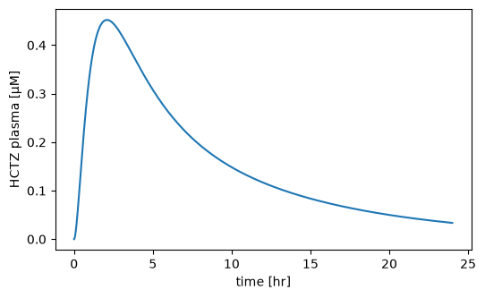
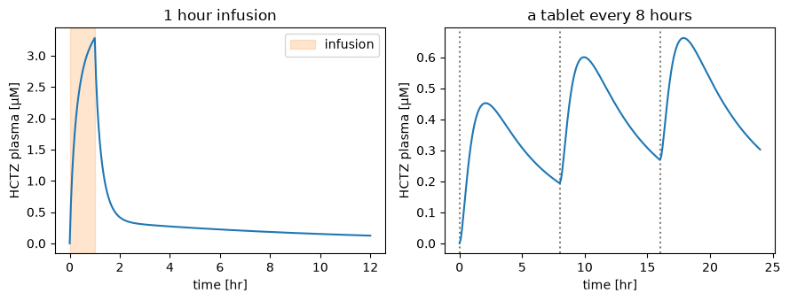
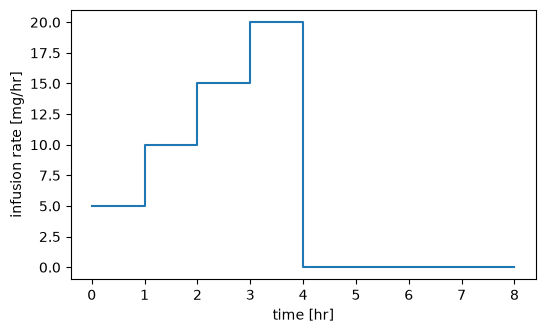
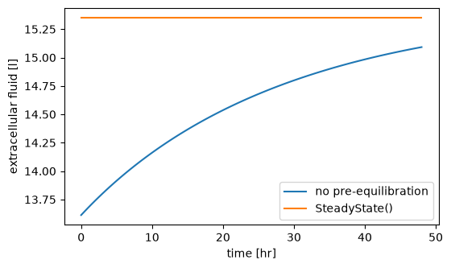

# Simulations

A `Simulation` says what to simulate: how long the model runs, which values you change before the start and during the run, and at which time points you want the results. You run it with `Simulator.run`. Simulation experiments, scans, parameter fits and PEtab problems all use the same `Simulation`, so what you learn on this page applies everywhere. The rules follow [PEtab v2](https://petab.readthedocs.io); [The semantics](#the-semantics) at the end lists them in full.

The examples use the HCTZ model of the [Tutorial](tutorial.md), a whole-body model of the diuretic hydrochlorothiazide that ships with `sbmlsim`.

## A simulation

Load the model with a `Simulator` and give the simulation an end time. `time_unit` is the unit of the times you write, here hours. The `Change` at time 0 gives a 25 mg tablet:

```python
import matplotlib.pyplot as plt

from sbmlsim import Q
from sbmlsim.plot import label_axes
from sbmlsim.resources import HCTZ_SBML
from sbmlsim.simulation import Change, Simulation
from sbmlsim.simulator import Simulator

simulator = Simulator()
model = simulator.load(HCTZ_SBML)

tablet = Change(0, {"PODOSE_hctz": Q(25, "mg")})
res = simulator.run(model, Simulation(time_unit="hr", end=24, changes=[tablet]))
print(res)
print("time unit of the result:", res.units["time"])
```

```text title="Output"
ScanResult(_point: 840; na, na_loop, na_urine, cl, cl_loop, cl_urine, Cki_plasma_hctz, Cli_plasma_hctz, ... (190 variables))
time unit of the result: min
```

You read a variable by its roadrunner name: `S` is the amount of a species and `[S]` its concentration. `[Cve_hctz]` is the HCTZ concentration in the venous plasma. The result is in the units of the model, so the time is in minutes even though the simulation was written in hours, and the concentration is in mmol/l. `res.q[...]` gives a variable as a quantity, its values with their unit, and `.to(...)` converts it. Quantities plot directly with matplotlib, and `label_axes` writes the name and the unit of each axis:

```python
fig, ax = plt.subplots(figsize=(6, 3.5))
ax.plot(res.q["time"].to("hr"), res.q["[Cve_hctz]"].to("µM"))
label_axes(ax, "time", "HCTZ plasma")
```



Without further settings you get the steps the integrator took. They are dense where the curve changes fast and sparse where it is flat, and every change and event of the model is in the output at its exact time. This is the recommended output. Every simulation has its own number of steps, so the result has the dimension `_point` instead of `time`, and `time` is a variable.

### Output times

Set output times only when you need them, e.g. the sampling times of a study. `times` gives exactly the time points you list, and `steps=n` gives `n + 1` evenly spaced points. A coarse grid can miss a fast peak, and the curve between two output times is a straight line:

```python
res = simulator.run(
    model,
    Simulation(time_unit="hr", end=24, times=[0, 1, 2, 4, 8, 24], changes=[tablet]),
)
print(f"{res.q['time'].to('hr'):~}")
print(f"{res.q['[Cve_hctz]'].to('µM').round(3):~}")

res = simulator.run(
    model, Simulation(time_unit="hr", end=24, steps=48, changes=[tablet])
)
print(res["time"].size)
```

```text title="Output"
[0.0 1.0 2.0 4.0 8.0 24.0] h
[0.0 0.342 0.452 0.363 0.194 0.034] μM
49
```

Output times closer together than the resolution of the time are simulated once, at the smaller time. Digitized data often has times such as `3.99999999999999` and `4.0`, which become one output time. The resolution is `1e-9` times the largest of the absolute start, the absolute end and the length of the simulation. A parameter fit merges the times of its data the same way, so every data point has its output time.

## Units and times

A value is either a plain number in the unit of its target in the model, or a quantity `Q(value, unit)`, which `sbmlsim` converts into the unit of the model (see [Units](units.md)). The same holds for times: a number is in the `time_unit` of the simulation (the time unit of the model if you give none), and a quantity is converted. A simulation can start at a negative time, e.g. a dosing protocol whose data counts the time from the last dose:

```python
doses = Change(range(-120, 1, 12), {"PODOSE_hctz": Q(25, "mg")})
res = simulator.run(
    model,
    Simulation(time_unit="hr", start=-120, end=Q(1, "day"), changes=[doses]),
)
print(f"{res.q['time'][[0, -1]].to('hr'):~}")
```

```text title="Output"
[-120.0 24.0] h
```

This gives eleven doses 12 hours apart, the last one at time 0. The end is a quantity, one day.

## Changes before the initialization

`preinit_changes` set values before the model is initialized. Use them for the properties of a patient or a condition, e.g. body weight or kidney function. The initial assignments of the model are evaluated afterwards, so everything whose initial value depends on a changed parameter follows the change. In the HCTZ model the extracellular fluid `ECF` starts at a value computed from the body weight `BW`:

```python
for bw in [75, 100]:
    res = simulator.run(
        model, Simulation(end=10, times=[0], preinit_changes={"BW": bw})
    )
    print(f"BW {bw} kg: ECF {res.q['ECF'][0]:~.2f}")
```

```text title="Output"
BW 75 kg: ECF 13.61 l
BW 100 kg: ECF 18.15 l
```

A target you set keeps your value: its own initial assignment is skipped. A pre-initialization change is a number or a quantity, not a formula.

## Changes during the simulation

A `Change` sets values at a time. With a list of times it is the same change at each of them, which is how you write multiple dosing. Here the drug runs as an infusion: `Ri_hctz` is the infusion rate, which starts at time 0 and stops after one hour. The second simulation repeats a tablet every 8 hours:

```python
infusion = Simulation(
    time_unit="hr",
    end=12,
    changes=[Change(0, {"Ri_hctz": Q(25, "mg/hr")}), Change(1, {"Ri_hctz": 0})],
)
every_8h = Simulation(
    time_unit="hr",
    end=24,
    changes=[Change([0, 8, 16], {"PODOSE_hctz": Q(25, "mg")})],
)

fig, (ax1, ax2) = plt.subplots(1, 2, figsize=(9, 3.5))
res = simulator.run(model, infusion)
ax1.axvspan(Q(0, "hr"), Q(1, "hr"), color="tab:orange", alpha=0.2, label="infusion")
ax1.plot(res.q["time"].to("hr"), res.q["[Cve_hctz]"].to("µM"))
ax1.set_title("1 hour infusion")
label_axes(ax1, "time", "HCTZ plasma")
ax1.legend()
res = simulator.run(model, every_8h)
for t in Q([0, 8, 16], "hr"):
    ax2.axvline(t, color="gray", linestyle=":")
ax2.plot(res.q["time"].to("hr"), res.q["[Cve_hctz]"].to("µM"))
ax2.set_title("a tablet every 8 hours")
label_axes(ax2, "time", "HCTZ plasma")
fig.tight_layout()
```



The plasma concentration rises while the infusion runs and falls as soon as it stops. With a tablet every 8 hours (dotted lines) the drug accumulates a little from dose to dose.

### Values which depend on the state

A value can also be a formula, a string in the math of PEtab over the symbols of the model. It is evaluated with the state just before the change and in the units of the model. `S` is the amount of a species, `[S]` its concentration and `time` the time of the change. This step-up infusion raises the rate by 5 mg/hr every hour, up to 20 mg/hr:

```python
step_up = Simulation(
    time_unit="hr",
    end=8,
    changes=[
        Change([0, 1, 2, 3], {"Ri_hctz": "Ri_hctz + 5/60"}),  # 5 mg/hr in mg/min
        Change(4, {"Ri_hctz": 0}),
    ],
)
res = simulator.run(model, step_up)

fig, ax = plt.subplots(figsize=(6, 3.5))
ax.plot(res.q["time"].to("hr"), res.q["Ri_hctz"].to("mg/hr"))
label_axes(ax, "time", "infusion rate")
```



The rate of the model is in `mg/min`, so the formula adds 5 mg/hr as `5/60` mg/min.

### Two rows at a change

At the time of a change after the start the model has two states, the one before the change and the one after it. The output has both, as two rows with the same time. This keeps the jump in the data, and a plot draws it as a vertical line. Here the infusion stops at 1 hour, which is 60 minutes:

```python
res = simulator.run(
    model,
    Simulation(
        time_unit="hr", end=4, times=[0, 0.5, 1, 2, 4], changes=infusion.changes
    ),
)
print(res.ds[["Ri_hctz"]].to_dataframe().round(3))
```

```text title="Output"
       Ri_hctz
time
0.0      0.417
30.0     0.417
60.0     0.417
60.0     0.000
120.0    0.000
240.0    0.000
```

`Ri_hctz` is in mg/min in the model, so the 25 mg/hr are 0.417. The first row at 60 minutes is the state before the stop, the second the state after it. A change at the start, like the infusion start at 0, is the initial condition and gives one row. The change at the end does give two rows. A change between two output times leaves no trace in the output, but the simulation still applies it. The steps of the integrator contain every change.

Since a time can appear twice, xarray methods which need unique times, such as `res.ds.interp(time=...)`, raise. Use `res.interpolate(times)` instead, see [Parameter scans](scans.md#the-output-and-the-run).

## Pre-equilibration

`presimulation=SteadyState()` runs the model until nothing changes any more before the simulation starts. This is useful when the pre-initialization changes push the model out of balance. A patient with 30 % kidney function keeps more fluid. Without a pre-equilibration the fluid builds up during the simulation, with it the patient starts in balance:

```python
from sbmlsim.simulation import SteadyState

fig, ax = plt.subplots(figsize=(6, 3.5))
cases = {"no pre-equilibration": None, "SteadyState()": SteadyState()}
for label, presimulation in cases.items():
    res = simulator.run(
        model,
        Simulation(
            time_unit="hr",
            end=48,
            preinit_changes={"f_renal_function": 0.3},
            presimulation=presimulation,
        ),
    )
    ax.plot(res.q["time"].to("hr"), res.q["ECF"], label=label)
label_axes(ax, "time", "extracellular fluid")
ax.legend()
```



The model is initialized once, with the `preinit_changes` of the simulation and of the `SteadyState` together, and a target may be in only one of them. A value that should differ after the steady state is a `Change` at the start. The steady state is reached when every rate of change is small, `|dx/dt| <= absolute_tolerance + relative_tolerance * |x|`, with the tolerances of the `SteadyState`. A model which does not get there within `SteadyState(max_time=...)` raises a `SteadyStateError`.

Every state takes part in the test, also one that only grows, such as the urine volume `Vurine` in this model. Such a state passes the relative test only once it is large, so it starts the simulation at a large value.

## Selections and integrator settings

By default a simulation records all species (amounts and concentrations), parameters, reactions and compartments. A compartment without a size, e.g. a membrane whose area the model never uses, is left out. Recording fewer variables makes the simulation faster:

```python
model.set_selections(["time", "[Cve_hctz]", "Aurine_hctz", "Ri_hctz"])
res = simulator.run(model, infusion)
print(res.variables)
```

```text title="Output"
['[Cve_hctz]', 'Aurine_hctz', 'Ri_hctz']
```

The integrator settings of roadrunner go to the `Simulator`, or you set them later. Every setting is passed on to the integrator, and a name it does not know is an error. The settings apply to every model the simulator runs, also in worker processes. [Engines](#engines) lists the settings COPASI takes:

```python
simulator = Simulator(absolute_tolerance=1e-10, relative_tolerance=1e-10)
simulator.set_integrator_settings(stiff=True)
```

### Absolute tolerances

The absolute tolerance is one value per state, which `sbmlsim` sets from the kind of the state:

- `amount`: a species with `hasOnlySubstanceUnits=true`.
- `concentration`: any other species. The integrator works with its amount, so the tolerance is the concentration tolerance times the initial volume of its compartment in the model as loaded. A volume that is zero, negative or not finite is replaced by `1e-6` times the largest initial volume, with a log message.
- `other`: a parameter or compartment with a rate rule.

A float gives every kind the same tolerance. An `AbsoluteTolerance` gives one per kind and overrides single states by their id; an override applies to the integrated value, i.e. the amount of a concentration species. The default is `1e-10` for every kind. `tolerances()` of a model lists the result:

```python
from sbmlsim.model.tolerances import AbsoluteTolerance

simulator.set_integrator_settings(
    absolute_tolerance=AbsoluteTolerance(
        amount=1e-10, concentration=1e-10, other=1e-10, ids={"ECF": 1e-8}
    )
)
tolerances = simulator.load(model).tolerances()
print(tolerances[tolerances["sid"].isin(["ECF", "Cve_hctz", "Aurine_hctz"])])
```

```text title="Output"
            sid           kind compartment  volume  absolute_tolerance
0           ECF          other         NaN     NaN        1.000000e-08
19     Cve_hctz  concentration         Vve  2.9321        2.932100e-10
25  Aurine_hctz         amount      Vurine     NaN        1.000000e-10
```

The reference volumes come from the model as loaded. A pre-initialization change of a volume, e.g. through the body weight, does not change the tolerances, so a simulation never depends on the one that ran before it.

### The first step after a change

The integrator estimates its first step at the start and after every change. Most models do not read the time in their math, and `sbmlsim` integrates them in local time: every piece between two changes starts at time 0 internally, and the output is shifted back. A model that reads `time` or `delay`, or has an event with a delay, is integrated in absolute time. Late in such a simulation the first step after a change can be smaller than the resolution of the time, and the integrator warns "t + h = t on the next step". A small positive `initial_time_step`, in the time unit of the model, avoids the estimate:

```python
simulator.set_integrator_settings(initial_time_step=1e-10)
```

A step that is too large fails the error test of the integrator, so keep it small.

## Results

`Simulator.run` returns a `ScanResult`, a wrapper of an `xarray.Dataset` (`res.ds`) that keeps the unit of every variable. `res.q[key]` is a variable or coordinate as a pint quantity, the same as `res.quantity(key)`, and `res[key]` the `xarray.DataArray` in the units of the model. A single simulation is a scan without dimensions; [Parameter scans](scans.md#working-with-scan-results) shows how to work with the result. You can turn it into a pandas table or store it as netCDF with its units:

```python
from pathlib import Path

print(f"{res.q['Aurine_hctz'][-1].to('µmol'):~.2f} excreted after 12 hours")

df = res.ds.to_dataframe()
print(df.tail(3))

res.to_netcdf(Path("hctz.nc"))
```

```text title="Output"
68.65 μmol excreted after 12 hours
              time  [Cve_hctz]  Aurine_hctz  Ri_hctz
_point
696     700.596589    0.000127     0.068160      0.0
697     713.069526    0.000125     0.068479      0.0
698     720.000000    0.000123     0.068654      0.0
```

With the steps of the integrator the table has the index `_point` and the time as a column. `simulator.simulate(model, simulation)` gives the raw solution of one simulation as a `TimecourseResult`, the array of the engine with its column names.

## Serialization

A `Simulation` converts to JSON with its units and back. Simulation experiments store their simulations this way:

```python
json_str = infusion.to_json()
print(Simulation.from_json(json_str))
```

```text title="Output"
Simulation([0.0, 12] hr, preinit=0, changes=2, integrator)
```

## Engines

`sbmlsim` simulates with [libroadrunner](https://libroadrunner.org) by default. [COPASI](https://copasi.org) and [AMICI](https://github.com/AMICI-dev/AMICI) are a second and a third engine. Each comes with an optional extra, `copasi` installs python-copasi and `amici` installs AMICI, see [Optional packages](installation.md#optional-packages) for the build requirements of AMICI:

```bash
pip install "sbmlsim[copasi]"
pip install "sbmlsim[amici]"
```

The engine is a setting of the `Simulator`, and every model it runs is simulated with that engine. A model loaded with roadrunner is loaded again in COPASI or AMICI from the same SBML, with its changes and selections, but without a state you set on it. Selecting an engine without its extra raises an `ImportError` that names the install command. Everything that runs through a simulator can use another engine, shown here for COPASI, and the same with `engine="amici"`:

- Simulations and scans: `Simulator(engine="copasi").run(model, simulation)`.
- Simulation experiments: `ExperimentRunner(experiments, simulator=Simulator(engine="copasi"))` or `run_experiments(experiments, output_path, simulator=Simulator(engine="copasi"))`. The worker processes of a run use the engine of the simulator too.
- Parameter fits: `OptimizationProblem(..., engine="copasi")`, or `problem.set_simulator(Simulator(engine="copasi"))` on an initialized problem. The problem then computes its residuals, metrics and reports with that engine, also in the workers of a parallel fit. This is made for evaluating stored parameters with a second engine, e.g. to check the predictions of a fit, and not for optimizing with COPASI or AMICI.

The engine is part of the provenance: a `ScanResult` has it in `res.ds.attrs["engine"]`, the JSON of a simulation experiment and of a fit problem stores it, and the report of a fit names it with its integrator; a fit with AMICI records the version of AMICI. The roadrunner path never imports COPASI or AMICI.

All engines run the same compiled plan, so every rule of [The semantics](#the-semantics) holds for each of them: the pre-initialization, the changes and the events a change fires, the two rows at a change, and an event of the model as two rows in the steps of the integrator. COPASI integrates with LSODA, AMICI with CVODES of SUNDIALS. The steps of the integrator differ between the engines, while the rows at the changes, at the events and at the end correspond. Use output times to compare the engines point by point.

The integrator settings keep their roadrunner names. COPASI and AMICI take `relative_tolerance`, `absolute_tolerance`, `maximum_num_steps` and `maximum_time_step`. They ignore the other settings of roadrunner, e.g. `variable_step_size`, `initial_time_step`, `maximum_bdf_order` or `jit_optimization`, with one warning per model. A name no engine knows is an error. COPASI and AMICI have a single absolute tolerance: the smallest tolerance of an `AbsoluteTolerance` times `COPASI_ATOL_FACTOR` (`1e-2`, in `sbmlsim.model.model_copasi`) or `AMICI_ATOL_FACTOR` (`1e-3`, in `sbmlsim.model.model_amici`). LSODA scales that tolerance with the initial value of every state, CVODES in AMICI applies it to the concentration of a concentration species and to the amount of the other species, and the factors make both engines at least as accurate as roadrunner at equal settings, measured on the HCTZ model. A parameter fit evaluates with the tolerances of the `FitSettings` it is initialized with, in every engine.

### AMICI

AMICI compiles a model into a python extension before it simulates it, which takes about 9 seconds for the HCTZ model. The compiled models are cached in `~/.cache/sbmlsim/amici`, or in the directory of the environment variable `SBMLSIM_AMICI_CACHE`, keyed on the SBML, the version of AMICI, the python and the machine, so a model is compiled once and loaded from the cache afterwards (0.3 seconds for the HCTZ model). The worker processes of a scan, of a simulation experiment and of a fit load the models from the directory their parent loaded them from, also when the environment variable changed after the pool started. AMICI compiles a model with `ninja`, which the extra installs; `sbmlsim` finds it in the scripts of the python environment also when the environment is not activated ([AMICI#3505](https://github.com/AMICI-dev/AMICI/issues/3505)).

AMICI integrates the model and finds the roots of the triggers of its events, while `sbmlsim` fires the events itself with the semantics of SBML: the order of the priorities, the persistence of the triggers, the values of the assignments at the trigger or at the execution and the events an assignment triggers. This covers what the events of AMICI do differently from roadrunner, the states of the triggers when an integration restarts from values set between two integrations ([AMICI#3507](https://github.com/AMICI-dev/AMICI/issues/3507)) and an event which moves the time of its own trigger ([AMICI#3425](https://github.com/AMICI-dev/AMICI/issues/3425)). AMICI evaluates a trigger which is exactly at its threshold at the start of an integration as true, also a strict one ([AMICI#3508](https://github.com/AMICI-dev/AMICI/issues/3508)), and does not find the crossing of a comparison which is exactly at its threshold when an integration starts. A comparison of a trigger or of a math of the model, e.g. the condition of a piecewise in a rate, which is exactly at its threshold at the start of an integration is therefore shifted by a little, so AMICI finds the crossing when the operands move, as roadrunner evaluates it in every step; COPASI, whose LSODA finds no such crossing either, shifts them in the same way. A parameter with an initial assignment keeps its value when an event changes what the assignment reads, as in roadrunner, while AMICI would make it follow its math ([AMICI#3506](https://github.com/AMICI-dev/AMICI/issues/3506)).

AMICI outputs the states at given times only. The steps of the integrator, the default output of a `Simulation`, are a substitute with AMICI: a grid of 100 intervals of the same length per segment between two changes, refined where the linear interpolation between two rows misses the solution at their midpoint by more than the square root of the relative tolerance of the integrator times the largest value of the column in the segment (`1e-5` at the default `1e-10`), and every event of the model as two rows at its time, the states before and after it. Everything which interpolates the steps, a run with a `time=` grid, a band, `ScanResult.interpolate`, the figures and the NCA, is therefore as accurate as with the steps of roadrunner: on the HCTZ model the interpolated rows are within `6e-6` of the peak concentration, the steps of roadrunner within `3e-5`, at about twice the rows of roadrunner and three to four times the cost of the grid alone. With output times AMICI gives exactly those times.

### Differences between the engines

COPASI and AMICI refuse what they would simulate differently from roadrunner, with an error that names the feature.

COPASI:

- A model with an algebraic rule, a stoichiometry math, a non-constant species reference, an initial assignment of a species reference or the `delay` csymbol raises a `ValueError` when it is loaded.
- COPASI simulates conversion factors with the values they have when the model is loaded. A simulation which changes a conversion factor, or an entity its initial assignment reads, raises a `NotImplementedError`.
- A model with a delayed event (an event with a `delay`) raises a `NotImplementedError` in a simulation with a change after the start or with a presimulation, before any point of a scan runs. Without these, COPASI simulates delayed events itself. In a model with a delayed event, a run in which an event of the model sets a trigger exactly to its threshold and COPASI misses its crossing raises a `NotImplementedError` as well.

AMICI:

- A model with an algebraic rule, a stoichiometry math, a non-constant species reference, an initial assignment of a species reference or of a conversion factor, the `delay` csymbol, the csymbol `rateOf` ([AMICI#3504](https://github.com/AMICI-dev/AMICI/issues/3504)), a fast reaction, a delayed event or a trigger which compares for equality, `a == b` or `a != b`, raises a `ValueError` when it is loaded. AMICI finds no root of an equality, and roadrunner fires such an event only where a step of its integrator lands on the equality.
- AMICI 1.2 does not import a trigger with a negated comparison, e.g. `!(X <= 3)`, which raises when the model is loaded.
- A simulation which sets a compartment whose size in the SBML is not a number and which has no initial assignment raises.

Other differences come from the integrators and how they handle events:

- roadrunner fires a delayed event late in the steps of the integrator, at the end of the next step of CVODE. COPASI fires it at its time. The steps of LSODA can fail on a delayed event with "TCRIT behind TCUR", which raises a `RuntimeError`; output times work.
- roadrunner does not fire an event whose trigger is true only within one step of CVODE, e.g. `X > 0.5 && X < 0.8`. COPASI fires it.
- An event whose trigger becomes true within the rounding of the state just before the end fires before the end in roadrunner, which has one row at the end. COPASI fires it at the end, and its steps have the states before and after it there.
- roadrunner evaluates the triggers of the events at time 0, also for a simulation with a negative start. COPASI and AMICI evaluate them at the start.
- An event whose trigger is false before time 0 (`initialValue="false"`) and which a pre-initialization makes true, e.g. a dose `dose > 0` with `preinit_changes={"dose": 10}`, fires at the start in COPASI and AMICI, and the output at the start has the state after it, as in libroadrunner after `resetAll` and in the SBML Test Suite. The default engine does not fire such an event, see [#439](https://github.com/matthiaskoenig/sbmlsim/issues/439). An event of the start which the model makes true itself, e.g. `time >= 0`, fires in every engine.
- An event which sets a trigger of another event exactly to its threshold, e.g. `X = 0` and `X > 0`, fires the other event up to one resolution of the time (`1e-9` of the time of the simulation) later in COPASI than in roadrunner. A comparison of a math of the model which turns at a time, e.g. `time <= tend` in a rate, turns up to about the resolution of the time (`1e-9` of the time of the simulation) late in AMICI: an infusion of the length 0 delivers its rate times that resolution.
- An output time at the exact root of a strict trigger of the time has the state before the event in AMICI. The row of roadrunner depends on where CVODE lands its root, the state before the event at `time > 0.1` and the state after it at `time > 1/3`, a time which is no double.
- AMICI 1.2 computes the time of a trigger of the time with about eight digits: `time >= 1 + 1e-8` fires at 1 in AMICI and at `1 + 1e-8` in roadrunner.
- Simultaneous events of the same priority execute in the order of the document in AMICI, roadrunner orders them at random.
- A value that roadrunner computes as exactly 0 can be a tiny number in COPASI, about `1e-19` to `2e-16`. Compare such values with an absolute tolerance.
- A COPASI result is not bitwise reproducible across loads of a model. COPASI sums the rates of the reactions of a species in an order that depends on the memory of its process ([basico#77](https://github.com/copasi/basico/issues/77)), so two loads differ in the last bit of a rate, and the integration amplifies it. Any memory the process freed before a load changes the order, e.g. a released COPASI model or memory of python, so a model loaded after another one was released differs from a first load as well. On the HCTZ model with a dose the loads differ by up to a few tens of times the tolerances of the integrator, while a rounding residue near 0 (see above) can differ in all its digits. A scan in worker processes agrees with a serial run within the integration. With roadrunner and AMICI the two are equal bitwise.

roadrunner is the fastest engine. A simulation of the HCTZ model takes about twice as long with AMICI, and a model with many events 5 to 30 times as long, since `sbmlsim` fires every event between two integrations of AMICI. COPASI walks a run in pieces after the events of the model when an event may set a trigger to its threshold, e.g. a dose of the model which moves the time of its next dose, `time > tnext` with `tnext = tnext + 2`: 1000 such doses take about 0.14 seconds, 14 times as long as without the walk.

The reference values of a sampling design, see [Sampling](sampling.md), are read with roadrunner whatever the engine, so a design draws the same values for every engine.

### Comparing the engines

At the default tolerances of the simulator, how closely COPASI agrees with roadrunner depends on the model: the largest difference relative to the largest value of a variable is about `1.3e-7` on the HCTZ model and `5e-5` on the midazolam model (`GU__MIDIM`). Verify a model in two engines with tight tolerances, e.g. `absolute_tolerance=1e-12` and `relative_tolerance=1e-10` as below, so that the comparison measures the engines and not the integration error.

`DataSetsComparison` of `sbmlsim.comparison.diff` compares results column by column, row by row. The infusion runs once per engine at the same output times and with tight tolerances. Both results have the two rows at the stop of the infusion after 1 hour:

```python
from sbmlsim.comparison.diff import DataSetsComparison

sampled = Simulation(
    time_unit="hr", end=12, times=[0, 0.5, 1, 2, 4, 8, 12], changes=infusion.changes
)
results = {
    engine: Simulator(
        engine=engine, absolute_tolerance=1e-12, relative_tolerance=1e-10
    ).run(model, sampled)
    for engine in ("roadrunner", "copasi")
}
copasi = results["copasi"]
print(copasi.ds.attrs["engine"])
print(f"{copasi.q['[Cve_hctz]'].to('µM').round(3):~}")

comparison = DataSetsComparison({engine: res.ds for engine, res in results.items()})
print("equal:", comparison.is_equal())
print(comparison.diff_rel.max().to_string())
```

```text title="Output"
copasi
[0.0 2.721 3.282 3.282 0.417 0.27 0.183 0.123] μM
equal: True
time           0.000000e+00
Aurine_hctz    4.398536e-10
Ri_hctz        0.000000e+00
[Cve_hctz]     7.446912e-09
```

`is_equal` checks every value against the tolerances of the comparison, `DataSetsComparison.tol_abs` and `tol_rel`, and `diff_rel` holds the relative differences. With `"amici"` in place of `"copasi"`, AMICI agrees with roadrunner on the infusion to `7.3e-9` relative in `[Cve_hctz]`. With `1e-6` for both tolerances, the residuals of the HCTZ fitting problem of `examples/hctz_fitting` differ between the engines by up to `3.8e-3` relative, the error of the integrators. With an absolute tolerance of `1e-12` and a relative one of `1e-10` they differ by at most `1.4e-7`.

## The semantics

This is what happens in one simulation, in order. The rules are the ones of PEtab v2.

1. Pre-initialization: The `preinit_changes` are set on the model.
2. Initialization: The model starts from its state as loaded, every time, so a simulation never depends on the one before it on the same model. Then the initial assignments are evaluated, except the ones of the targets you set.
3. Steady state: With a `SteadyState`, the model runs until the rates of change are within its tolerances.
4. Integration: The simulation runs from `start` to `end`, split at the times of the changes. Every piece ends in its state at its end, and the change at that time is applied to it.
5. A change: All values of a change are evaluated with the state just before it, then set at once.
6. Events of the model: an event fires at its time during the integration. An event whose trigger becomes true through a change fires right after the change. Several such events fire one at a time, in the order of their priorities. An event at the time of a change fires after the change, also at the end. Simultaneous events of the same priority fire in random order, see [SBML Test Suite](testsuite.md).

Species and compartments:

- When you change a compartment, a species whose initial value is a concentration, or which you set as `[S]`, keeps its concentration. Every other species keeps its amount. The same holds before the initialization for a compartment whose size is an assignment rule, e.g. a volume of the body weight: a species starts at its initial concentration in the new volume.
- A species defined by an assignment rule always follows its rule.

Output:

- An output time at a change after the start appears twice: the state before the change, then the state after it. This includes a change at the end. A change at the start gives one row.
- The steps of the integrator include every change. An event of the model is also two rows at its time, before and after it, also at the end. An output time at the end sees the state after such an event. `sbmlsim` adds parameters to a model with events to tell these two rows apart, see [`model.event_rows`](api/model.event_rows.md).
- With the steps of the integrator, an event with a delay fires at the end of the integrator step after its time, i.e. a little late.
- Output times closer than the resolution of the time (`1e-9` times the largest of the absolute start, the absolute end and the length) are one output time, at the smallest of them.

Interpolation onto a grid (`time=` of `Simulator.run`, `ScanResult.interpolate`):

- A time before a change is interpolated toward the state before it.
- A time at a change sees the state after it.
- A time that appears twice in the grid sees the state before the change first, then the state after it.
- An event of the model is a jump as well. A time at it sees the state after it, and so does a time at most the resolution before it, since the integrator finds an event a little after its time.
- Jumps closer together than the resolution, e.g. a change and an event it triggers, count as one, and a time at or inside them sees the state after the last one.

A parameter fit compares data at the time of a change with the state before it by default, see [Parameter fitting](fitting.md#data-at-the-time-of-a-change).

Some events cannot fire right after a change: an event with a delay, and an event whose math has no value at a single time, i.e. uses `rateOf` or `delay`. They are reported with a warning that names the event. During the integration roadrunner fires them as usual.
