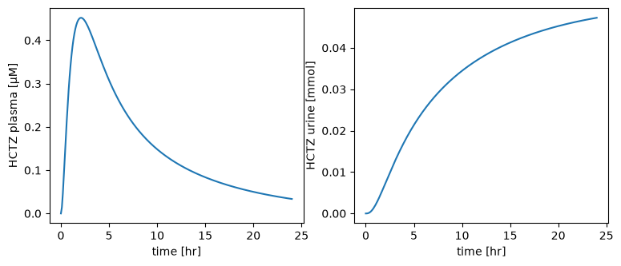
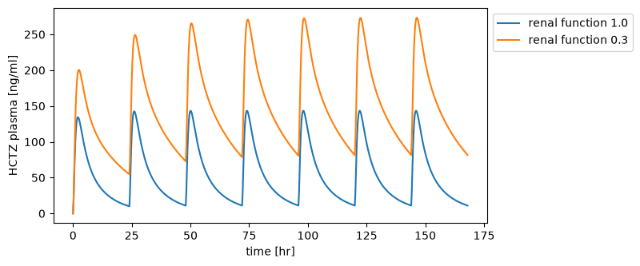
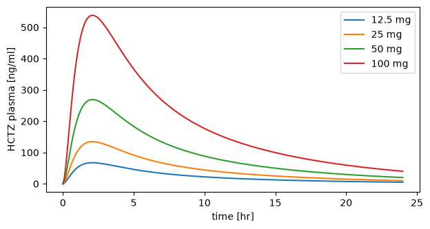
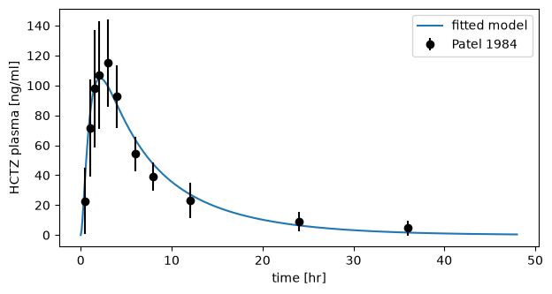
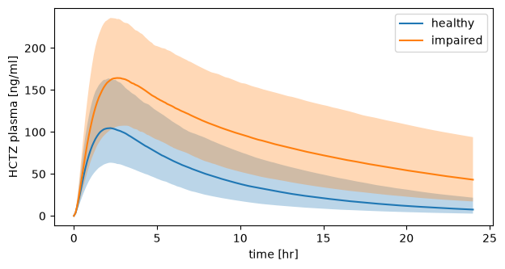

# Tutorial

This tutorial takes one model through the main features of `sbmlsim`. You simulate a dose of a drug, change the patient, scan doses, fit the model to clinical data and find out how uncertain a prediction is. Each step builds on the previous one, and each code block is followed by what it prints and plots.

The model describes hydrochlorothiazide (HCTZ), a diuretic used against high blood pressure, in the whole human body. An HCTZ tablet dissolves in the gut, the drug is absorbed into the blood, distributes into the organs and is excreted by the kidneys into the urine. The model ships with `sbmlsim`, so you only need `pip install sbmlsim` (see [Installation](installation.md)).

!!! tip "Running the code"
    Run the blocks one after another in a Jupyter notebook, or paste them into one script. A script shows a figure with `plt.show()` or saves it with `fig.savefig("figure.png")`. Large runs, like the uncertainty analysis at the end, start worker processes, so a script needs its code under `if __name__ == "__main__":`.

## Load the model

A `Simulator` loads and runs models. `load` reads the SBML file into [libroadrunner](https://libroadrunner.org) and reads the units of the model:

```python
import matplotlib.pyplot as plt

from sbmlsim import Q
from sbmlsim.resources import HCTZ_SBML
from sbmlsim.simulator import Simulator

simulator = Simulator()
model = simulator.load(HCTZ_SBML)

for pid in ["BW", "PODOSE_hctz", "Ka_dis_hctz", "f_renal_function"]:
    print(f"{pid:18} {model.loaded_value(pid):8.4g} {model.uinfo[pid]}")
print("time unit:", model.uinfo["time"])
```

```text title="Output"
BW                       75 kg
PODOSE_hctz               0 mg
Ka_dis_hctz          0.3518 1/hr
f_renal_function          1 dimensionless
time unit: min
```

`BW` is the body weight, `PODOSE_hctz` the oral dose, `Ka_dis_hctz` the rate at which the tablet dissolves and `f_renal_function` the kidney function relative to a healthy adult. Time in the model is in minutes.

## Simulate a dose

A `Simulation` says what to simulate: for how long, and what changes when. Here a 25 mg tablet is taken at time 0 and the model runs for one day. `time_unit` is the unit of the times you write, and `steps=240` gives 241 evenly spaced output points:

```python
from sbmlsim.simulation import Change, Simulation

dose = Simulation(
    time_unit="hr",
    end=24,
    steps=240,
    changes=[Change(0, {"PODOSE_hctz": Q(25, "mg")})],
)
res = simulator.run(model, dose)
print(res)
print(res.units["[Cve_hctz]"])
```

```text title="Output"
ScanResult(time: 241; na, na_loop, na_urine, cl, cl_loop, cl_urine, Cki_plasma_hctz, Cli_plasma_hctz, ... (190 variables))
mmol/litre
```

The result has every variable of the model over time, in the units of the model. `[Cve_hctz]` is the HCTZ concentration in the venous plasma, `Aurine_hctz` the amount excreted into the urine so far:

```python
hours = res["time"] / 60

fig, (ax1, ax2) = plt.subplots(1, 2, figsize=(9, 3.5))
ax1.plot(hours, res["[Cve_hctz]"] * 1000)  # mmol/l to µmol/l
ax1.set(xlabel="time [hr]", ylabel="HCTZ plasma [µM]")
ax2.plot(hours, res["Aurine_hctz"])
ax2.set(xlabel="time [hr]", ylabel="HCTZ urine [mmol]")
```



## Observables

Clinical studies report HCTZ in ng/ml and describe a curve by pharmacokinetic parameters, such as the peak concentration `cmax`. Observables compute both for every simulation. A `Formula` is an expression of model variables in the unit you ask for, and `PK` runs a non-compartmental analysis of a concentration:

```python
from sbmlsim.simulation import PK, Formula

observables = [
    Formula("cp", "[Cve_hctz] * Mr_hctz", unit="ng/ml"),
    PK("pk", "cp", dose="PODOSE_hctz", route="oral"),
]
res = simulator.run(model, dose, observables)
for key in ["pk.cmax", "pk.tmax", "pk.auc_inf_obs", "pk.thalf"]:
    print(f"{key:15} {res.quantity(key):~.4g}")
```

```text title="Output"
pk.cmax         134.6 ng / ml
pk.tmax         126 min
pk.auc_inf_obs  7.518e+04 min * ng / ml
pk.thalf        410.1 min
```

`Mr_hctz` is the molar mass of HCTZ, so `cp` is the mass concentration. `res.quantity` returns a value with its unit. The PK parameters keep the units of the model, so the peak time `tmax` and the half-life `thalf` are in minutes.

## Change the model

There are two kinds of changes. `preinit_changes` set values before the simulation starts, e.g. the body weight or the kidney function of a patient. A `Change` sets values at a time during the simulation, e.g. a dose. A `Change` with a list of times is a dosing regimen.

Here a patient with healthy kidneys and a patient with 30 % kidney function take 25 mg every day for a week:

```python
def daily_dose(renal_function: float) -> Simulation:
    return Simulation(
        time_unit="hr",
        end=7 * 24,
        steps=7 * 24 * 4,
        preinit_changes={"f_renal_function": renal_function},
        changes=[Change(range(0, 7 * 24, 24), {"PODOSE_hctz": Q(25, "mg")})],
    )


fig, ax = plt.subplots(figsize=(7, 3.5))
for renal_function in [1.0, 0.3]:
    res = simulator.run(model, daily_dose(renal_function), observables)
    ax.plot(res["time"] / 60, res["cp"], label=f"renal function {renal_function}")
ax.set(xlabel="time [hr]", ylabel="HCTZ plasma [ng/ml]")
ax.legend(loc="upper left", bbox_to_anchor=(1, 1))
```



The kidneys remove HCTZ from the body. With 30 % kidney function the drug accumulates over the week.

## Scan parameters

A `Scan` runs a simulation for every point of its `Dimension`s. A dimension maps parameters to arrays of values, and two dimensions give every combination of their values. The result is a labeled array with one axis per dimension:

```python
from sbmlsim.simulation import Dimension, Scan

scan = Scan(
    dose,
    [
        Dimension(
            "dose",
            values={"PODOSE_hctz": Q([12.5, 25, 50, 100], "mg")},
            labels=["12.5 mg", "25 mg", "50 mg", "100 mg"],
        ),
        Dimension(
            "renal",
            values={"f_renal_function": [1.0, 0.5, 0.25]},
            labels=["normal", "mild", "severe"],
        ),
    ],
)
res = simulator.run(model, scan, observables)
print(res)
print(res["pk.cmax"].round(1).to_pandas())
```

```text title="Output"
ScanResult(dose: 4, renal: 3, time: 241; cp, pk.cmax, pk.tmax, pk.cmin, pk.tmin, pk.clast, pk.clast_pred, pk.tlast, ... (45 variables))
renal    normal   mild  severe
dose
12.5 mg    67.3   87.1   104.5
25 mg     134.6  174.1   208.9
50 mg     269.2  348.2   417.8
100 mg    538.3  696.5   835.7
```

The values of the `dose` dimension replace the 25 mg of the `Change`. The peak concentration doubles with the dose, and it rises as the kidney function drops. `sel` selects points by their labels, here the curves of normal kidney function:

```python
normal = res.sel(renal="normal")

fig, ax = plt.subplots(figsize=(7, 3.5))
for label in normal["dose"].values:
    ax.plot(normal["time"] / 60, normal["cp"].sel(dose=label), label=label)
ax.set(xlabel="time [hr]", ylabel="HCTZ plasma [ng/ml]")
ax.legend()
```



A scan with many points runs in parallel on all cores. [Parameter scans](scans.md) has the details.

## Sensitivity analysis

Which parameters decide the exposure to the drug? A local sensitivity analysis changes each parameter by 1 % on its own and measures the relative change of the outputs. A value of 1 means the output changes in proportion to the parameter, -1 in inverse proportion. The design of the analysis is a dimension of a scan, so it runs like any other scan:

```python
from sbmlsim import sensitivity
from sbmlsim.simulation import sampling

parameters = ["Ka_dis_hctz", "GU__F_hctz_abs", "KI__HCTZEX_k", "Kp_hctz", "BW"]
design = sampling.local(parameters, 0.01, model=model)
res = simulator.run(model, Scan(dose, [design]), observables)
local = sensitivity.local(res, observables=["pk.cmax", "pk.auc_inf_obs"])
print(local.index("normalized").to_pandas().round(2))
```

```text title="Output"
observable      pk.cmax  pk.auc_inf_obs
parameter
Ka_dis_hctz        0.62            0.00
GU__F_hctz_abs     1.00            1.00
KI__HCTZEX_k      -0.42           -0.84
Kp_hctz           -0.45           -0.00
BW                -1.10           -1.85
```

The fraction absorbed (`GU__F_hctz_abs`) scales the whole curve. The dissolution rate (`Ka_dis_hctz`) changes the peak but not the total exposure, the AUC. The excretion rate (`KI__HCTZEX_k`) lowers both. Body weight has the largest effect: in the model, organ volumes and blood flows grow with body weight, and so does the excretion by the kidneys, so a heavier patient has lower concentrations. [Sensitivity analysis](sensitivity.md) covers the global methods Sobol, FAST and Morris.

## Fit the model to data

Patel et al. (1984) measured HCTZ in the plasma of 12 healthy volunteers after a 25 mg tablet. These are their means and standard deviations:

```python
import pandas as pd

patel1984 = pd.DataFrame(
    {
        "time": [0.5, 1, 1.5, 2, 3, 4, 6, 8, 12, 24, 36],
        "cp": [22.8, 71.6, 97.9, 107, 115, 92.6, 54.2, 39.3, 23.3, 9.0, 4.6],
        "cp_sd": [21.9, 32.4, 39.1, 36.0, 29.0, 21.1, 11.6, 9.5, 11.9, 6.3, 5.2],
    }
)
```

A fit has to know which simulation belongs to which data. A `SimulationExperiment` describes a study: its models, datasets, simulations and tasks, where a task runs a simulation on a model. A `FitMapping` pairs a dataset with the simulated variable it measures:

```python
from pathlib import Path
from typing import override

from sbmlsim.data import DataSet
from sbmlsim.experiment import SimulationExperiment
from sbmlsim.fit import FitData, FitMapping
from sbmlsim.task import Task


class Patel1984(SimulationExperiment):
    """A single oral dose of 25 mg HCTZ (Patel et al. 1984)."""

    @override
    def datasets(self) -> dict[str, DataSet]:
        units = {"time": "hr", "cp": "ng/ml", "cp_sd": "ng/ml"}
        return {"hctz25": DataSet.from_df(patel1984, udict=units, ureg=self.ureg)}

    @override
    def models(self) -> dict[str, Path]:
        return {"hctz": HCTZ_SBML}

    @override
    def simulations(self) -> dict[str, Simulation]:
        po25 = Simulation(
            time_unit="hr",
            end=48,
            steps=480,
            changes=[Change(0, {"PODOSE_hctz": Q(25, "mg")})],
        )
        return {"po25": po25}

    @override
    def observables(self) -> dict[str, Formula]:
        return {"cp": Formula("cp", "[Cve_hctz] * Mr_hctz", unit="ng/ml")}

    @override
    def tasks(self) -> dict[str, Task]:
        return {"task_po25": Task(model="hctz", simulation="po25")}

    @override
    def fit_mappings(self) -> dict[str, FitMapping]:
        return {
            "fm_po25": FitMapping(
                self,
                reference=FitData(
                    self, dataset="hctz25", xid="time", yid="cp", yid_sd="cp_sd"
                ),
                observable=FitData(self, task="task_po25", xid="time", yid="cp"),
            )
        }
```

The fit estimates the dissolution rate and the excretion rate. A `FitParameter` names a model parameter with its bounds. `run_optimization` starts a local optimizer from random points within the bounds and collects the fits:

```python
from sbmlsim.fit import FitMappingCollection, FitParameter
from sbmlsim.fit.optimization import OptimizationProblem
from sbmlsim.fit.runner import run_optimization

problem = OptimizationProblem(
    "hctz_fit",
    [FitMappingCollection(experiment=Patel1984)],
    [
        FitParameter(pid="Ka_dis_hctz", lower_bound=0.01, upper_bound=10, unit="1/hr"),
        FitParameter(pid="KI__HCTZEX_k", lower_bound=1e-5, upper_bound=1, unit="1/ml"),
    ],
)
fit = run_optimization(problem, size=5, seed=1, show_progress=False)
fitted = fit.parameter_set()
fitted_changes = {pid: Q(v, fitted.units[pid]) for pid, v in fitted.values.items()}
for pid, value in fitted_changes.items():
    print(f"{pid:13} {value:~.3g}")
```

```text title="Output"
🚀 Optimization ────────────────────────────────────────────────────────────────

🎛 Parameters (2) ───────────────────────────────────────────────────────────────
parameter      start   lower   upper   unit
───────────────────────────────────────────
Ka_dis_hctz    -       0.01    10      1/hr
KI__HCTZEX_k   -       1e-05   1       1/ml
runs                5
workers             1 (serial)
converged           5/5 runs
best cost           425.865
optimizer time      0.3 s
Ka_dis_hctz   0.297 / h
KI__HCTZEX_k  0.00512 / ml
```

To compare the fitted model with the data, set the fitted values before the start of the simulation:

```python
fitted_dose = Simulation(
    time_unit="hr",
    end=48,
    steps=480,
    preinit_changes=fitted_changes,
    changes=[Change(0, {"PODOSE_hctz": Q(25, "mg")})],
)
res = simulator.run(model, fitted_dose, observables)

fig, ax = plt.subplots(figsize=(7, 3.5))
ax.plot(res["time"] / 60, res["cp"], label="fitted model")
ax.errorbar(
    patel1984["time"],
    patel1984["cp"],
    yerr=patel1984["cp_sd"],
    fmt="o",
    color="black",
    label="Patel 1984",
)
ax.set(xlabel="time [hr]", ylabel="HCTZ plasma [ng/ml]")
ax.legend()
```



A real fit combines many studies, with training and validation data, global optimizers and HTML reports. [Parameter fitting](fitting.md) explains these, and [Identifiability](identifiability.md) shows how well the data determine each parameter.

## Uncertainty analysis

The fitted values are estimates, and patients differ from each other. How sure is the prediction that weak kidneys raise the exposure? An `Uncertain` value is a value with a distribution. Here the body weight varies between patients (75 ± 12 kg), and both fitted parameters get an uncertainty of 30 %. An uncertain value goes where the value is used, e.g. into the simulation. Uncertain parameters go into an `UncertaintyModel`:

```python
from sbmlsim.uncertainty import Uncertain, UncertaintyModel

weight = Uncertain(Q(75, "kg"), sd=Q(12, "kg"), kind="variability")


def patient(renal_function: float) -> Simulation:
    return Simulation(
        time_unit="hr",
        end=24,
        steps=240,
        preinit_changes={"BW": weight, "f_renal_function": renal_function},
        changes=[Change(0, {"PODOSE_hctz": Q(25, "mg")})],
    )


uq = UncertaintyModel(
    parameters={pid: Uncertain(q, cv=0.3) for pid, q in fitted_changes.items()}
)
```

`propagate` draws the uncertain values, simulates every draw and summarizes the outputs. Both scenarios use the same draws, so they compare the same virtual patients:

```python
from sbmlsim.uncertainty import propagate

uncertainty = propagate(
    model,
    {"healthy": patient(1.0), "impaired": patient(0.3)},
    uq,
    observables,
    outputs=["pk.cmax", "pk.auc_inf_obs"],
    n=1024,
    seed=1,
)
auc = uncertainty.summary(["pk.auc_inf_obs"])
print(auc[["scenario", "mean", "sd", "q0.05", "q0.95"]].round(0))
print(uncertainty.contributions("pk.auc_inf_obs", scenario="healthy").round(2))
```

```text title="Output"
   scenario      mean       sd    q0.05     q0.95
0   healthy   66252.0  26029.0  33718.0  114602.0
1  impaired  193099.0  84120.0  90805.0  350911.0
       variable  index  correlated
0            BW   0.54       False
1  KI__HCTZEX_k   0.36       False
2   Ka_dis_hctz   0.00       False
```

`contributions` ranks the uncertain values by how much of the spread of the output each explains. The 5 % and 95 % quantiles of the concentration over all draws form a band:

```python
fig, ax = plt.subplots(figsize=(7, 3.5))
for scenario, result in uncertainty.results.items():
    cp = result.summary(quantiles=[0.05, 0.5, 0.95])["cp"]
    hours = cp["time"] / 60
    ax.plot(hours, cp.sel(statistic="q0.5"), label=scenario)
    ax.fill_between(
        hours, cp.sel(statistic="q0.05"), cp.sel(statistic="q0.95"), alpha=0.3
    )
ax.set(xlabel="time [hr]", ylabel="HCTZ plasma [ng/ml]")
ax.legend()
```



Last, test a statement about the prediction: in at least 90 % of the patients, does impaired kidney function raise the AUC by more than half?

```python
from sbmlsim.uncertainty import Hypothesis

hypothesis = Hypothesis(
    "pk.auc_inf_obs", contrast=("impaired", "healthy"), greater=1.5, at_least=0.9
)
report = uncertainty.test([hypothesis])
print(report.table()[["hypothesis", "estimate", "low", "high", "decision"]])
```

```text title="Output"
                                        hypothesis  estimate       low  high  decision
0  P(pk.auc_inf_obs:impaired/healthy > 1.5) >= 0.9       1.0  0.993154   1.0  accepted
```

The test takes the number of draws into account: with too few draws the decision is `undecided`. [Uncertainty](uncertainty.md) explains the statistics.

## Next steps

- [Simulations](simulation.md): changes, events and outputs in detail.
- [Simulation experiments](experiments.md): studies as python classes, with figures and HTML reports.
- [Units](units.md): how `sbmlsim` reads and converts units.
- [PEtab](petab.md): exchange a fit with other tools as a PEtab problem.
