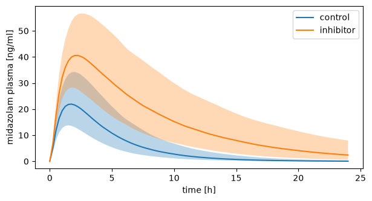
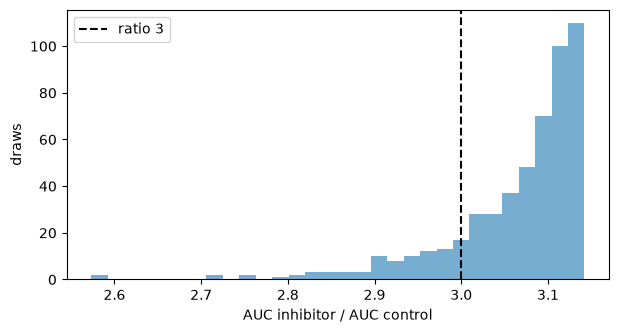

# Uncertainty

A prediction depends on inputs that are not known exactly: a dose and a body weight reported as mean ± SD, a parameter from the literature with a CV, a clearance with an interval. `sbmlsim.uncertainty` lets you declare such values as uncertain where you use them, runs them through the simulations, and answers questions about the predictions with their Monte Carlo error.

The example on this page is midazolam, a sedative that the liver clears. The question is how much an inhibitor of the liver enzyme, which leaves 30 % of its activity, raises the exposure to midazolam.

## Uncertain values

An `Uncertain` is a value with a distribution. You can use it wherever you would use a value: in a `Change`, in the `preinit_changes` of a `Simulation`, or as the prior of a `FitParameter`.

```python
from sbmlsim import Q
from sbmlsim.uncertainty import Uncertain

dose = Uncertain(Q(5, "mg"), cv=0.05)  # log-normal, mean 5 mg, CV 5 %
weight = Uncertain(Q(75, "kg"), sd=Q(12, "kg"), low=Q(45, "kg"), kind="variability")
fraction = Uncertain.range(0.6, 0.9)  # uniform
clearance = Uncertain.interval(Q(12, "l/hr"), Q(30, "l/hr"), level=0.9)
auc = Uncertain.se(Q(40, "mg*hr/l"), Q(2, "mg*hr/l"), n=16)  # SD = SE * sqrt(n)
print(dose.shape, dose.mean(), dose.sd())
print(round(weight.mean(), 2))
```

```text title="Output"
log-normal 5.0 milligram 0.25 milligram
75.03 kilogram
```

The mean of the weight is a little above 75 kg because the distribution is cut at 45 kg. How the arguments set the distribution:

| given | distribution | nominal value |
|---|---|---|
| `sd=` or `cv=` of a positive value | log-normal with that mean and SD | the value |
| `sd=`/`cv=` with `shape="normal"`, or a value that may be negative | normal | the value |
| `low=`/`high=` in addition | the distribution above, truncated | the value |
| `Uncertain.range(low, high)` | uniform (`log=True`: log-uniform) | the (geometric) midpoint |
| `Uncertain.interval(low, high, level)` | log-normal (positive) or normal with these quantiles | the median |
| `Uncertain.se(mean, se, n)` | the SD `se * sqrt(n)` | the mean |
| `distribution=` | a distribution of [`sbmlsim.simulation.sampling`](sampling.md#distributions) | the value |

A positive value given with an SD or a CV, e.g. a dose, a body weight, a volume or a rate, is log-normal by default, because a normal distribution with a large CV gives negative values. Its median is `mean / sqrt(1 + cv²)` and its logarithm has the standard deviation `sqrt(ln(1 + cv²))` (Limpert et al. 2001). `shape="normal"` asks for the normal distribution instead.

`kind` is `uncertainty` (something not known about a value) or `variability` (a value that differs between subjects). Using one object twice, or two objects with the same `name`, gives one random variable.

A simulation always simulates the nominal values, so declaring a value uncertain changes nothing until you propagate it. The simulations of this page differ in the activity of the enzyme, `LI__MIDOH_f`:

```python
from sbmlsim.resources import MIDAZOLAM_SBML
from sbmlsim.simulation import PK, Change, Formula, Simulation


def simulation(activity: float = 1.0) -> Simulation:
    return Simulation(
        end=24,
        time_unit="hr",
        preinit_changes={"BW": weight, "LI__MIDOH_f": activity},
        changes=[Change(0, {"PODOSE_mid": dose})],
    )


control = simulation()
print([use.target for use in control.uncertain_values()])
print(control.preinit_changes["BW"], control.changes[0].values["PODOSE_mid"])
```

```text title="Output"
['BW', 'PODOSE_mid']
75 kilogram 5 milligram
```

## Covariances

A `Covariance` describes how uncertain values depend on each other. It is a covariance matrix (in the units of the targets, on the linear or the log scale), a correlation matrix, or the correlation coefficients of pairs:

```python
from sbmlsim.uncertainty import Covariance

correlation = Covariance.correlation({("BW", "LI__MIDOH_Vmax"): 0.4})
omega = Covariance(["CL", "V"], matrix=[[0.09, 0.03], [0.03, 0.04]], scale="log")
print(correlation.matrix)
print(omega.correlation_matrix())
```

```text title="Output"
[[1.  0.4]
 [0.4 1. ]]
[[1.  0.5]
 [0.5 1. ]]
```

Every matrix is checked: it must be symmetric and positive semi-definite, and a correlation matrix must have ones on the diagonal. `nearest=True` replaces a correlation matrix that is not positive semi-definite by the nearest one that is (Higham 2002).

The draws are correlated through their normal scores, a Gaussian copula (Nelsen 2006). For normal values this is the multivariate normal of the covariance, for log-normal values the multivariate normal of their logarithms; a linear-scale covariance of log-normal values is converted exactly. The variances in a covariance must match the variances of the distributions.

## Propagation

An `UncertaintyModel` collects what is uncertain: the uncertain values in the simulations and extra `parameters` with their distributions. `propagate` draws them, simulates every draw in every scenario and returns an `UncertaintyResult`. `time=` puts the timecourses of all draws on one grid of times, which the bands below need:

```python
import numpy as np

from sbmlsim.uncertainty import UncertaintyModel, propagate

uq = UncertaintyModel(
    parameters={"LI__MIDOH_Vmax": Uncertain(0.005, cv=0.3)},
    covariance=[correlation],
)
observables = [
    Formula("mid", "[Cve_mid] * Mr_mid", unit="ng/ml"),
    PK("pk", "mid", dose="PODOSE_mid", route="oral"),
]
res = propagate(
    MIDAZOLAM_SBML,
    {"control": simulation(), "inhibitor": simulation(activity=0.3)},
    uq,
    observables,
    outputs=["pk.auc_last", "pk.cmax"],
    n=512,
    seed=1234,
    time=Q(np.linspace(0, 24, 97), "hr"),
)
summary = res.summary(["pk.auc_last"])
print(summary[["scenario", "mean", "mean_se", "sd", "q0.05", "q0.95"]].round(0))
print(res.contributions("pk.auc_last", scenario="control").round(2))
```

```text title="Output"
    scenario     mean  mean_se      sd    q0.05    q0.95
0    control   7728.0    134.0  3037.0   3886.0  13356.0
1  inhibitor  23471.0    374.0  8459.0  12127.0  39570.0
         variable  index  correlated
0  LI__MIDOH_Vmax   0.75        True
1              BW   0.45        True
2      PODOSE_mid   0.00       False
```

The inhibitor triples the mean AUC (in ng/ml × min). The PK parameters are computed from the steps of the integrator, before the timecourses are interpolated onto the grid. `summary` gives every output that is one value per draw, with its Monte Carlo errors: the standard errors of the mean (`mean_se`) and of the SD, and distribution-free intervals of the quantiles (Hahn and Meeker 1991). A timecourse raises; reduce it to a value with an observable, e.g. `at`, `max` or a `PK` parameter.

`contributions` ranks the uncertain values by their first-order index, the share of the variance of the output each one explains, estimated from the same draws (Plischke et al. 2013). The index of a correlated value includes the effect of the values it is correlated with, which is why the indices of `LI__MIDOH_Vmax` and `BW` add up to more than 1.

`res.results` holds the result of each scenario, a scan over the dimension `draw`. The quantiles of its summary over the draws are bands of the prediction:

```python
import matplotlib.pyplot as plt

from sbmlsim.plot import label_axes

fig, ax = plt.subplots(figsize=(7, 3.5))
for scenario, result in res.results.items():
    bands = result.summary(quantiles=[0.05, 0.5, 0.95])
    hours = bands.q["time"].to("hr")
    low, median, high = (
        bands.sel(statistic=s).q["mid"] for s in ("q0.05", "q0.5", "q0.95")
    )
    ax.plot(hours, median, label=scenario)
    ax.fill_between(hours, low, high, alpha=0.3)
label_axes(ax, "time", "midazolam plasma")
ax.legend()
```



How the draws are made:

- The draws are quasi-random (scrambled Sobol points, Owen 1998; Joe and Kuo 2008), one dimension of a scan, so the model is compiled once and many draws run in parallel worker processes.
- All scenarios use the same draws (common random numbers, Glasserman 2003), so a ratio between two scenarios is paired: it compares them at the same draw. When one target has different distributions in different scenarios, e.g. a dose of 100 mg in one and 200 mg in another, it is drawn at the same quantile in each.
- A parameter of the `UncertaintyModel` is drawn in every scenario, so no scenario may set it; that raises. Set another target instead, as the inhibitor sets the activity `LI__MIDOH_f` rather than the uncertain `LI__MIDOH_Vmax`.
- Without `n`, the number of draws doubles until the half widths of the 95 % intervals of the mean, the SD and the 5 % and 95 % quantiles of the outputs are below `rel_tol` (0.1) times their SD, the adaptive procedure of GUM Supplement 1 (JCGM 101:2008).
- Sobol and random points (`design="random"`) continue their sequence, so a result with more draws starts with the draws of a smaller one. A Latin hypercube (`design="lhs"`) cannot be continued and needs `n`.

`values(output, scenario)` gives the draws of an output, `contrast(output, a, b)` the paired ratio (or difference) of two scenarios, and `to_netcdf`/`from_netcdf` store the result with its record: the seed, the design, the number of draws, the convergence history, the variables and the covariances.

## Probability statements

A question about a prediction is a probability over the draws. For example: is the probability that the inhibitor raises the AUC by more than 25 % at least 90 %, and how likely is it to more than triple the AUC? The paired ratio of the AUCs over the draws shows the answers:

```python
ratio = res.contrast("pk.auc_last", "inhibitor", "control")
fig, ax = plt.subplots(figsize=(7, 3.5))
ax.hist(ratio, bins=30, alpha=0.6)
ax.axvline(3.0, color="black", linestyle="--", label="ratio 3")
ax.set(xlabel="AUC inhibitor / AUC control", ylabel="draws")
ax.legend(loc="upper left")
```



`P(H)` is the probability that the output satisfies a hypothesis H, given everything that is uncertain. It is estimated by the fraction of the draws that satisfy H. `P(H)` is a property of the model and its uncertainties, not of the number of draws; more draws only estimate it more precisely. A `Hypothesis` compares `P(H)` with a threshold `at_least=p0`:

```python
from sbmlsim.uncertainty import Hypothesis

hypotheses = [
    Hypothesis(
        "pk.auc_last", contrast=("inhibitor", "control"), greater=1.25, at_least=0.9
    ),
    Hypothesis("pk.auc_last", contrast=("inhibitor", "control"), greater=3.0),
    Hypothesis("pk.cmax", scenario="control", less=Q(40, "ng/ml"), at_least=0.95),
]
report = res.test(hypotheses)
print(report.table()[["hypothesis", "estimate", "low", "high", "decision"]].round(3))
print(res.probability(ratio, greater=2.0, at_least=0.5).decision)
```

```text title="Output"
                                       hypothesis  estimate    low   high  decision
0  P(pk.auc_last:inhibitor/control > 1.25) >= 0.9     1.000  0.986  1.000  accepted
1               pk.auc_last:inhibitor/control > 3     0.836  0.773  0.887  estimate
2           P(pk.cmax:control < 40 ng/ml) >= 0.95     0.990  0.964  0.999  accepted
accepted
```

`estimate` is the fraction of the draws that satisfy H and `low`/`high` its interval. Every draw raises the AUC by more than 25 %, so the first hypothesis is accepted. About 84 % of the draws more than triple it; the second hypothesis has no `at_least`, so it only gives this estimate. With a threshold, the decision is one of:

- `accepted`: `P(H) >= p0` is shown;
- `rejected`: `P(H) < p0` is shown;
- `equivalent`: `P(H)` is shown to be within the `margin` of the threshold (two one-sided tests, Schuirmann 1987). The margin is a difference of probability that does not matter, 0.05 by default; it makes a hypothesis whose probability is exactly the threshold decidable;
- `undecided`: the draws are not enough, and `n_needed` estimates how many would decide it.

`res.probability(values, ...)` decides one statement about any array of draws. The last line tests the ratio above: a probability of at least 50 % that the AUC more than doubles is `accepted`.

The intervals are confidence sequences (Robbins 1970; Lai 1976; Howard et al. 2021): with probability 95 % they contain `P(H)` at every number of draws at once. This makes the statements anytime valid. You may look at a statement after every batch of draws and continue with more. A confidence interval for a fixed number of draws, e.g. the Wilson interval, misses `P(H)` far more often when it is checked repeatedly. More draws only make a statement more precise: an undecided one becomes decided, an equivalent one becomes the direction shown later, and a direction once shown is kept. A decision is therefore never reversed, and it is wrong with probability at most 5 %.

A `TestReport` decides `m` hypotheses together at the Bonferroni level of 5 % / `m` each, with simultaneous intervals, so the probability that any of its decisions is wrong is at most 5 % (`family_error`), whatever the dependence between the hypotheses, which share their draws. The level is not relaxed after a correct decision, because every hypothesis has a true null hypothesis of its own. This costs draws but never reverses a decision of the report either.

`propagate(..., hypotheses=hypotheses)` draws until every hypothesis of the report is decided, or `n_max` is reached. It uses random points by default, for which the statements hold exactly. The counts of the quasi-random Sobol points of a propagation without hypotheses fluctuate less than those of random points; the statements are then conservative in practice, but not by a theorem. Failed draws (`NaN`) are excluded and counted; infinite values, e.g. a ratio over zero, are values.

A probability statement is about the predictive distribution, i.e. about what is uncertain (Gelman et al. 2013). It is not a test of a study: the draws are not subjects.

`examples/uncertainty_midazolam.py` runs the analysis of this page with an adaptive number of draws, which draws until its hypotheses are decided.

## References

- JCGM 101:2008. Evaluation of measurement data, Supplement 1 to the GUM: propagation of distributions using a Monte Carlo method.
- Limpert E, Stahel WA, Abbt M (2001). Log-normal distributions across the sciences: keys and clues. BioScience 51:341-352.
- Owen AB (1998). Scrambling Sobol' and Niederreiter-Xing points. J Complexity 14:466-489. Joe S, Kuo FY (2008). Constructing Sobol sequences with better two-dimensional projections. SIAM J Sci Comput 30:2635-2654.
- Nelsen RB (2006). An Introduction to Copulas, 2nd ed. Springer. Higham NJ (2002). Computing the nearest correlation matrix: a problem from finance. IMA J Numer Anal 22:329-343.
- Glasserman P (2003). Monte Carlo Methods in Financial Engineering. Springer.
- Hahn GJ, Meeker WQ (1991). Statistical Intervals: A Guide for Practitioners. Wiley.
- Plischke E, Borgonovo E, Smith CL (2013). Global sensitivity measures from given data. Eur J Oper Res 226:536-550.
- Robbins H (1970). Statistical methods related to the law of the iterated logarithm. Ann Math Stat 41:1397-1409. Lai TL (1976). On confidence sequences. Ann Stat 4:265-280. Howard SR, Ramdas A, McAuliffe J, Sekhon J (2021). Time-uniform, nonparametric, nonasymptotic confidence sequences. Ann Stat 49:1055-1080.
- Schuirmann DJ (1987). A comparison of the two one-sided tests procedure and the power approach for assessing the equivalence of average bioavailability. J Pharmacokinet Biopharm 15:657-680.
- Gelman A, Carlin JB, Stern HS, Dunson DB, Vehtari A, Rubin DB (2013). Bayesian Data Analysis, 3rd ed. CRC Press.
