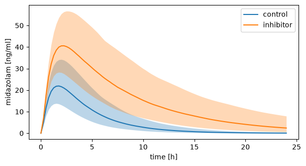
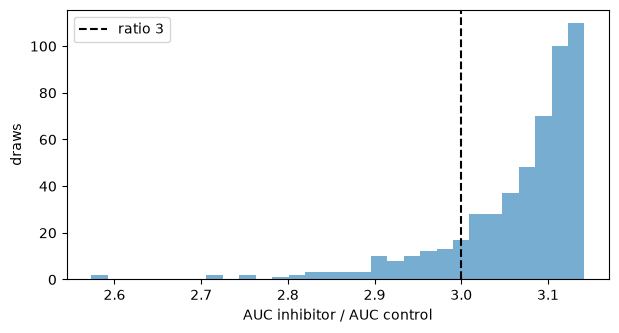

# Uncertainty

A prediction depends on inputs that are not known exactly: a dose and a body weight reported as mean ± SD, a parameter from the literature with a CV, a clearance with an interval. `sbmlsim.uncertainty` lets you declare such values as uncertain where you use them, runs them through the simulations, and answers questions about the predictions with their Monte Carlo error.

To repeat the simulation experiments of a project over draws of the fitted parameters of its adopted fits, with the curves of the figures as bands, see [Simulation experiments](experiments.md#over-the-draws-of-the-fitted-parameters).

The example on this page is midazolam, a sedative that the liver clears. The question is how much an inhibitor of the liver enzyme, which leaves 30 % of its activity, raises the exposure to midazolam.

## Uncertain values

An `Uncertain` is a value with a distribution. You can use it wherever you would use a value: in a `Change`, in the `preinit_changes` of a `Simulation`, or as the prior of a `FitParameter`.

```python
from sbmlsim import Q
from sbmlsim.uncertainty import Uncertain

dose = Uncertain(Q(5, "mg"), cv=0.05)  # log-normal, mean 5 mg, CV 5 %
weight = Uncertain(Q(75, "kg"), sd=Q(12, "kg"), low=Q(45, "kg"), kind="variability")
fraction = Uncertain.range(0.6, 0.9)  # uniform
clearance = Uncertain.interval(Q(12, "l/hr"), Q(30, "l/hr"), level=0.9)
auc = Uncertain.se(Q(40, "mg*hr/l"), Q(2, "mg*hr/l"), n=16)  # SD = SE * sqrt(n)
print(dose.shape, dose.mean(), dose.sd())
print(round(weight.mean(), 2))
```

```text title="Output"
log-normal 5.0 milligram 0.25 milligram
75.03 kilogram
```

The mean of the weight is a little above 75 kg because the distribution is cut at 45 kg. How the arguments set the distribution:

| given | distribution | nominal value |
|---|---|---|
| `sd=` or `cv=` of a positive value | log-normal with that mean and SD | the value |
| `sd=`/`cv=` with `shape="normal"`, or a value that may be negative | normal | the value |
| `low=`/`high=` in addition | the distribution above, truncated | the value |
| `Uncertain.range(low, high)` | uniform (`log=True`: log-uniform) | the (geometric) midpoint |
| `Uncertain.interval(low, high, level)` | log-normal (positive) or normal with these quantiles | the median |
| `Uncertain.se(mean, se, n)` | the SD `se * sqrt(n)` | the mean |
| `distribution=` | a distribution of [`sbmlsim.simulation.sampling`](sampling.md#distributions) | the value |

A positive value given with an SD or a CV, e.g. a dose, a body weight, a volume or a rate, is log-normal by default, because a normal distribution with a large CV gives negative values. Its median is `mean / sqrt(1 + cv²)` and its logarithm has the standard deviation `sqrt(ln(1 + cv²))` (Limpert et al. 2001). `shape="normal"` asks for the normal distribution instead.

`kind` is `uncertainty` (something not known about a value) or `variability` (a value that differs between subjects). Using one object twice, or two objects with the same `name`, gives one random variable. The variability between the subjects of a fit, relative to the inputs of every study group, and its predictive check are on the page [Fitting](fitting.md#variability-and-the-predictive-check).

A simulation always simulates the nominal values, so declaring a value uncertain changes nothing until you propagate it. The simulations of this page differ in the activity of the enzyme, `LI__MIDOH_f`:

```python
from sbmlsim.resources import MIDAZOLAM_SBML
from sbmlsim.simulation import PK, Change, Formula, Simulation


def simulation(activity: float = 1.0) -> Simulation:
    return Simulation(
        end=24,
        time_unit="hr",
        preinit_changes={"BW": weight, "LI__MIDOH_f": activity},
        changes=[Change(0, {"PODOSE_mid": dose})],
    )


control = simulation()
print([use.target for use in control.uncertain_values()])
print(control.preinit_changes["BW"], control.changes[0].values["PODOSE_mid"])
```

```text title="Output"
['BW', 'PODOSE_mid']
75 kilogram 5 milligram
```

## Covariances

A `Covariance` describes how uncertain values depend on each other. It is a covariance matrix (in the units of the targets, on the linear or the log scale), a correlation matrix, or the correlation coefficients of pairs:

```python
from sbmlsim.uncertainty import Covariance

correlation = Covariance.correlation({("BW", "LI__MIDOH_Vmax"): 0.4})
omega = Covariance(["CL", "V"], matrix=[[0.09, 0.03], [0.03, 0.04]], scale="log")
print(correlation.matrix)
print(omega.correlation_matrix())
```

```text title="Output"
[[1.  0.4]
 [0.4 1. ]]
[[1.  0.5]
 [0.5 1. ]]
```

Every matrix is checked: it must be symmetric and positive semi-definite, and a correlation matrix must have ones on the diagonal. `nearest=True` replaces a correlation matrix that is not positive semi-definite by the nearest one that is (Higham 2002).

The draws are correlated through their normal scores, a Gaussian copula (Nelsen 2006). For normal values this is the multivariate normal of the covariance, for log-normal values the multivariate normal of their logarithms; a linear-scale covariance of log-normal values is converted exactly. The variances in a covariance must match the variances of the distributions.

## Propagation

An `UncertaintyModel` collects what is uncertain: the uncertain values in the simulations and extra `parameters` with their distributions. `propagate` draws them, simulates every draw in every scenario and returns an `UncertaintyResult`. `time=` puts the timecourses of all draws on one grid of times, which the bands below need:

```python
import numpy as np

from sbmlsim.uncertainty import UncertaintyModel, propagate

uq = UncertaintyModel(
    parameters={"LI__MIDOH_Vmax": Uncertain(0.005, cv=0.3)},
    covariance=[correlation],
)
observables = [
    Formula("mid", "[Cve_mid] * Mr_mid", unit="ng/ml"),
    PK("pk", "mid", dose="PODOSE_mid", route="oral"),
]
res = propagate(
    MIDAZOLAM_SBML,
    {"control": simulation(), "inhibitor": simulation(activity=0.3)},
    uq,
    observables,
    outputs=["pk.auc_last", "pk.cmax"],
    n=512,
    seed=1234,
    time=Q(np.linspace(0, 24, 97), "hr"),
)
summary = res.summary(["pk.auc_last"])
print(summary[["scenario", "mean", "mean_se", "sd", "q0.05", "q0.95"]].round(0))
print(res.contributions("pk.auc_last", scenario="control").round(2))
```

```text title="Output"
    scenario     mean  mean_se      sd    q0.05    q0.95
0    control   7728.0    134.0  3037.0   3886.0  13356.0
1  inhibitor  23471.0    374.0  8459.0  12127.0  39570.0
         variable  index  correlated
0  LI__MIDOH_Vmax   0.75        True
1              BW   0.45        True
2      PODOSE_mid   0.00       False
```

The inhibitor triples the mean AUC (in ng/ml × min). The PK parameters are computed from the steps of the integrator, before the timecourses are interpolated onto the grid. `summary` gives every output that is one value per draw, with its Monte Carlo errors: the standard errors of the mean (`mean_se`) and of the SD, and distribution-free intervals of the quantiles (Hahn and Meeker 1991). A timecourse raises; reduce it to a value with an observable, e.g. `at`, `max` or a `PK` parameter.

`contributions` ranks the uncertain values by their first-order index, the share of the variance of the output each one explains, estimated from the same draws (Plischke et al. 2013). The index of a correlated value includes the effect of the values it is correlated with, which is why the indices of `LI__MIDOH_Vmax` and `BW` add up to more than 1.

`res.results` holds the result of each scenario, a scan over the dimension `draw`. The quantiles of its summary over the draws are bands of the prediction, which `plot_bands` draws as a median line and a band from the 5 % to the 95 % quantile, in the units you ask for:

```python
import matplotlib.pyplot as plt

from sbmlsim.sensitivity.uncertainty import plot_bands

fig, ax = plt.subplots(figsize=(7, 3.5))
for scenario, result in res.results.items():
    bands = result.summary(quantiles=[0.05, 0.5, 0.95])
    plot_bands(bands, "mid", ax=ax, label=scenario, time_unit="hr", name="midazolam")
```



How the draws are made:

- The draws are quasi-random (scrambled Sobol points, Owen 1998; Joe and Kuo 2008), one dimension of a scan, so the model is compiled once and many draws run in parallel worker processes.
- All scenarios use the same draws (common random numbers, Glasserman 2003), so a ratio between two scenarios is paired: it compares them at the same draw. When one target has different distributions in different scenarios, e.g. a dose of 100 mg in one and 200 mg in another, it is drawn at the same quantile in each.
- A parameter of the `UncertaintyModel` is drawn in every scenario, so no scenario may set it; that raises. Set another target instead, as the inhibitor sets the activity `LI__MIDOH_f` rather than the uncertain `LI__MIDOH_Vmax`.
- Without `n`, the number of draws doubles until the half widths of the 95 % intervals of the mean, the SD and the 5 % and 95 % quantiles of the outputs are below `rel_tol` (0.1) times their SD, the adaptive procedure of GUM Supplement 1 (JCGM 101:2008).
- Sobol and random points (`design="random"`) continue their sequence, so a result with more draws starts with the draws of a smaller one. A Latin hypercube (`design="lhs"`) cannot be continued and needs `n`.

`values(output, scenario)` gives the draws of an output, `contrast(output, a, b)` the paired ratio (or difference) of two scenarios, and `to_netcdf`/`from_netcdf` store the result with its record: the seed, the design, the number of draws, the convergence history, the variables and the covariances.

## Probability statements

A question about a prediction is a probability over the draws. For example: is the probability that the inhibitor raises the AUC by more than 25 % at least 90 %, and how likely is it to more than triple the AUC? The paired ratio of the AUCs over the draws shows the answers:

```python
ratio = res.contrast("pk.auc_last", "inhibitor", "control")
fig, ax = plt.subplots(figsize=(7, 3.5))
ax.hist(ratio, bins=30, alpha=0.6)
ax.axvline(3.0, color="black", linestyle="--", label="ratio 3")
ax.set(xlabel="AUC inhibitor / AUC control", ylabel="draws")
ax.legend(loc="upper left")
```



`P(H)` is the probability that the output satisfies a hypothesis H, given everything that is uncertain. It is estimated by the fraction of the draws that satisfy H. `P(H)` is a property of the model and its uncertainties, not of the number of draws; more draws only estimate it more precisely. A `Hypothesis` compares `P(H)` with a threshold `at_least=p0`:

```python
from sbmlsim.uncertainty import Hypothesis

hypotheses = [
    Hypothesis(
        "pk.auc_last", contrast=("inhibitor", "control"), greater=1.25, at_least=0.9
    ),
    Hypothesis("pk.auc_last", contrast=("inhibitor", "control"), greater=3.0),
    Hypothesis("pk.cmax", scenario="control", less=Q(40, "ng/ml"), at_least=0.95),
]
report = res.test(hypotheses)
print(report.table()[["hypothesis", "estimate", "low", "high", "decision"]].round(3))
print(res.probability(ratio, greater=2.0, at_least=0.5).decision)
```

```text title="Output"
                                       hypothesis  estimate    low   high  decision
0  P(pk.auc_last:inhibitor/control > 1.25) >= 0.9     1.000  0.986  1.000  accepted
1               pk.auc_last:inhibitor/control > 3     0.836  0.773  0.887  estimate
2           P(pk.cmax:control < 40 ng/ml) >= 0.95     0.990  0.964  0.999  accepted
accepted
```

`estimate` is the fraction of the draws that satisfy H and `low`/`high` its interval. Every draw raises the AUC by more than 25 %, so the first hypothesis is accepted. About 84 % of the draws more than triple it; the second hypothesis has no `at_least`, so it only gives this estimate. With a threshold, the decision is one of:

- `accepted`: `P(H) >= p0` is shown;
- `rejected`: `P(H) < p0` is shown;
- `equivalent`: `P(H)` is shown to be within the `margin` of the threshold (two one-sided tests, Schuirmann 1987). The margin is a difference of probability that does not matter, 0.05 by default; it makes a hypothesis whose probability is exactly the threshold decidable;
- `undecided`: the draws are not enough, and `n_needed` estimates how many would decide it.

`res.probability(values, ...)` decides one statement about any array of draws. The last line tests the ratio above: a probability of at least 50 % that the AUC more than doubles is `accepted`.

The intervals are confidence sequences (Robbins 1970; Lai 1976; Howard et al. 2021): with probability 95 % they contain `P(H)` at every number of draws at once. This makes the statements anytime valid. You may look at a statement after every batch of draws and continue with more. A confidence interval for a fixed number of draws, e.g. the Wilson interval, misses `P(H)` far more often when it is checked repeatedly. More draws only make a statement more precise: an undecided one becomes decided, an equivalent one becomes the direction shown later, and a direction once shown is kept. A decision is therefore never reversed, and it is wrong with probability at most 5 %.

A `TestReport` decides `m` hypotheses together at the Bonferroni level of 5 % / `m` each, with simultaneous intervals, so the probability that any of its decisions is wrong is at most 5 % (`family_error`), whatever the dependence between the hypotheses, which share their draws. The level is not relaxed after a correct decision, because every hypothesis has a true null hypothesis of its own. This costs draws but never reverses a decision of the report either.

`propagate(..., hypotheses=hypotheses)` draws until every hypothesis of the report is decided, or `n_max` is reached. It uses random points by default, for which the statements hold exactly. The counts of the quasi-random Sobol points of a propagation without hypotheses fluctuate less than those of random points; the statements are then conservative in practice, but not by a theorem. Failed draws (`NaN`) are excluded and counted; infinite values, e.g. a ratio over zero, are values.

A probability statement is about the predictive distribution, i.e. about what is uncertain (Gelman et al. 2013). It is not a test of a study: the draws are not subjects.

`examples/uncertainty_midazolam.py` runs the analysis of this page with an adaptive number of draws, which draws until its hypotheses are decided.

## Priors and the posterior of a fit

A fitted parameter is known from its data and, before the data, from its prior: `FitParameter(prior=...)` takes a prior of PEtab v2, a distribution of [sampling](sampling.md) or an `Uncertain`, truncated at the bounds of the parameter. A parameter without a prior has the uniform prior over its bounds. A fit of the objective `posterior` minimizes the negative log posterior and gives the maximum a posteriori estimate (see [The objective](fitting.md#the-objective)), the objectives `least_squares` and `likelihood` leave the priors out.

### Correlated priors

The priors are independent unless the problem has a `prior_correlation`: a `Covariance.correlation` of parameters with normal or log-normal priors, by their pids. It is the correlation of their normal scores, a Gaussian copula, as everywhere in this package: the multivariate normal of the values of normal priors and of the logarithms of log-normal ones, restricted to the bounds.

```py
from sbmlsim.fit.cli import FitDefinition
from sbmlsim.fit.objects import FitParameter
from sbmlsim.uncertainty import Covariance, Uncertain

parameters = [
    FitParameter(
        "CL",
        lower_bound=1,
        upper_bound=100,
        unit="l/hr",
        prior=Uncertain(Q(20, "l/hr"), cv=0.3),
    ),
    FitParameter(
        "V",
        lower_bound=10,
        upper_bound=1000,
        unit="l",
        prior=Uncertain(Q(150, "l"), cv=0.4),
    ),
]
definition = FitDefinition(
    ...,
    parameters=parameters,
    prior_correlation=Covariance.correlation({("CL", "V"): 0.6}),
)
```

The fit minimizes the correlated priors as whitened residuals (Tarantola 2005): with the normal scores `z` and the Cholesky factor `L` of the correlation `R = L L'`, the residuals `L⁻¹ z` have the half sum of squares `z' R⁻¹ z / 2`, the quadratic form of the multivariate normal, so the Gauss-Newton structure of the least squares optimizer is kept. The cost is the negative log posterior up to a constant of the problem: the correlated priors are normalized without their bounds. The PEtab export writes the priors into the parameter table and the correlation into the `sbmlsim` extension (the gap `prior-correlation`), so the round trip is exact.

### The posterior of a fit

`posterior_laplace` (`sbmlsim.fit.posterior`) is the Laplace approximation of the posterior (Tierney & Kadane 1986): the multivariate normal around the estimate whose precision is the curvature of the negative log posterior, in the space the optimizer searches, the `parameter_scale` of the fit. On a logarithmic scale it is a log-normal of the values.

```
precision = J' J / σ² + H_prior,   covariance = precision⁻¹
```

`J' J` is the [Fisher information](identifiability.md#fisher-information) of the data, the Gauss-Newton curvature, which is exact for normal noise of a known scale and a model linear in the parameters. `H_prior` is the Hessian of the negative log density of the priors, by central differences. What enters is what the fit minimized: `posterior` the likelihood and the priors, `likelihood` the likelihood alone, and `least_squares` the weighted least squares as the likelihood of normal noise of the variance `σ² = 2 cost / (n - k)`, whose posterior covariance is the covariance of the Fisher information.

```py
from sbmlsim.fit.posterior import ParameterPosterior, posterior_laplace

posterior = posterior_laplace(problem, settings, parameter_set)  # or run.posterior()
print(posterior.summary_df)  # value, sd on the scale, 95 % interval, unit
print(posterior.correlation)
posterior.write(Path("results"))  # posterior.json
posterior = ParameterPosterior.read(Path("results"))
```

A direction which neither the data nor the priors constrain has no curvature: the posterior is the uniform prior of the bounds there, which no normal describes, and `posterior_laplace` raises and names the parameters of the direction. Give them priors, or see the [profile likelihood](identifiability.md#profile-likelihood). `posterior.problems` lists, and the log warns, where the approximation is questionable: a parameter at a bound, where the posterior is cut off, and a 95 % interval which reaches past a bound. The kinds `fit` and `fisher` of the run layer write the posterior with `posterior: true` into `posterior.json`, see [Analyses](run.md); the record of an adopted fit keeps it.

### The posterior and the priors as a source

The posterior is the uncertainty of the parameters of a propagation, of a scan and of a sensitivity analysis. Its marginals are a normal (linear scale) or a log-normal (logarithmic scale) per target, and their correlation of the normal scores makes them the normal of the space of the parameters:

```py
from sbmlsim.simulation.sampling import lhs, posterior_parameters, sobol
from sbmlsim.uncertainty import propagate

uq = posterior.uncertainty_model()  # the marginals and the correlation
res = propagate(model, simulations, uq, observables, outputs=["pk.auc"], n=512)

draws = posterior_parameters(posterior, 200, seed=1234)  # a Dimension of a Scan
points = lhs(posterior.distributions(), 200, correlation=posterior.rank_correlation())
indices = sobol(posterior.distributions(), 1024)  # independent marginals
```

`rank_correlation` is the Spearman correlation `6 / π asin(r / 2)` of the normal, which the designs `lhs` and `random` convert back. The Sobol, FAST and Morris designs of a sensitivity analysis take independent marginals; with correlated parameters the first-order indices are no decomposition of the variance. A parameter of a version (two parameters of one target) needs `targets=` to give the versions different targets.

The priors of a problem are a source in the same way, e.g. for the parameters from the literature which no data informs: `prior_distributions(problem)` (`sbmlsim.fit.priors`) gives every target its prior truncated at the bounds or the uniform distribution over the bounds, and `prior_model(problem)` the `UncertaintyModel` with the correlation of the priors.

## The uncertainty of the fitted parameters

The fitted parameters of a model are known only within their confidence intervals, and so are its predictions. The records of the adopted fits, their distributions and the run of the experiments over their draws make the uncertainty of the fitted parameters part of the model. A fit becomes part of a model in three steps: it is adopted, the factory takes its values with their uncertainty, and a run draws them.

### Adopting a fit

A fit writes its results into its output, which is not tracked. The `adopt` option of the kind `fit` (or the kind `adopt` for a fit which finished without it) copies the record of the fit into `fits/<fit id>` of the output, a folder a person commits into the directory of the adopted fits of the [project](project.md) (`fits_dir`), together with `adopted.json`, which names the fit adopted for each subset. The record is the part of the results which the model needs (`sbmlsim.fit.records.RECORD_FILES`, `adopt_fit`): the best parameter sets (`parameters.json`), the problem with its settings and bounds (`optimization_result.json`), the profile likelihood (`identifiability.json`, `identifiability.tsv`), the Fisher information (`fisher.json`, `fisher.tsv`), the metrics, the text report and the methods report (`report.pdf`, its Typst source `report.typ` with `references.bib` and `references.csl` and the SVG figures it shows in `plots/`, so that `report.typ` compiles in the record). The LaTeX sources, the HTML report and the runs stay in the results of the fit. See [Adopted fits](fitting.md#adopted-fits).

### The fitted values in the factory

A model file takes the value of a fitted parameter from the record of its fit, so the value, its uncertainty and its provenance come from one place and cannot drift apart. `Project.fit_records()` reads the records (`sbmlsim.fit.records.AdoptedRecords`), and `AdoptedRecords.parameter(pid, unit=...)` gives the keyword arguments of an `sbmlutils.factory.Parameter`: its `value`, its `uncertainties` and its `unit`. The pid is the id of the parameter in the flat model, as the fit names it:

```py
FITS = PROJECT.fit_records()

Parameter(
    "k_el",
    **FITS.parameter("KI__k_el", unit=U.per_min),
    name="elimination rate",
)
```

A parameter which no adopted fit has, and a parameter which two adopted fits have, raise. `sbmlsim.project_checks.check_model` checks with `sbmlsim.experiment.draws.check_fit_parameters` that every parameter of an adopted fit is a parameter of every variant of the model with the value of the fit and a distribution, and that the other variants have the distribution of the default variant: the draws are those of the default variant and run on every variant.

### The uncertainty in the SBML

The uncertainty is a `distrib:uncertainty` of the SBML parameter (the distrib package of SBML), which comp flattening keeps. It has three children and the provenance in its notes (`sbmlsim.fit.records.ParameterUncertainty`):

| child | value |
| --- | --- |
| `uncertSpan` of the type `confidenceInterval` | the confidence interval of the profile likelihood at the level of the fit (0.95); a side which the profile does not close is the bound of the fit |
| `uncertParameter` of the type `standardError` | the standard error of the Fisher information in the unit of the model (delta method), if the fit has one |
| `uncertParameter` of the type `distribution` | the distribution the draws of the parameter come from |

The distribution follows the confidence interval in the space the fit searched the parameter in, the `parameter_scale` of the fit:

| the profile | the distribution |
| --- | --- |
| closed, logarithmic scale | `lognormal(ln(value), sigma, lb, ub)`: sigma is the mean of the closed half widths of the interval in the logarithm divided by `z = sqrt(chi2(alpha, df))`, truncated to the bounds of the fit |
| open on one side | the closed side gives sigma, the bound cuts off the open side (a value at its bound gives a half lognormal) |
| open on both sides (not identifiable) | `uniform(lb, ub)` |
| linear scale | `normal(value, sigma, lb, ub)` with the same rule |
| no profile (the Fisher fallback) | sigma is the standard error of the Fisher information in the space of the fit |

The notes name the fit, the record, the cost and the number of data points, the bounds and the scale, the method, the class of the profile, the confidence intervals of the profile and of the Fisher information and the distribution. The draws are independent per parameter: distrib states one distribution per parameter, the correlations of the Fisher information stay in the record (the [credibility](credibility.md#parameter-uncertainty) propagation uses them).

### Running over the draws

The experiments of a project run over the draws of the fitted parameters with `Project.run_experiments(..., uncertainty=UncertaintySettings(...))` or the field `uncertainty` of the kind `simulate`, see [Simulation experiments](experiments.md#over-the-draws-of-the-fitted-parameters). The run reads the distribution of every parameter of the default variant (`sbmlsim.simulation.sampling.parameter_distributions`) and draws them once in a Latin hypercube into the dimension `uncertainty` (`sbmlsim.simulation.sampling.uncertainty_dimension`, `sbmlsim.experiment.draws.UncertaintySettings`: 100 draws, seed 1234, the quantiles 0.05 and 0.95). Every simulation becomes a scan over the draws, and the curves of the figures become bands of the quantiles with the median. A figure an experiment draws itself with matplotlib reads `self.uncertainty` and draws the bands with `point_band`, see [Scans](scans.md#working-with-scan-results).

## References

- JCGM 101:2008. Evaluation of measurement data, Supplement 1 to the GUM: propagation of distributions using a Monte Carlo method.
- Limpert E, Stahel WA, Abbt M (2001). Log-normal distributions across the sciences: keys and clues. BioScience 51:341-352.
- Owen AB (1998). Scrambling Sobol' and Niederreiter-Xing points. J Complexity 14:466-489. Joe S, Kuo FY (2008). Constructing Sobol sequences with better two-dimensional projections. SIAM J Sci Comput 30:2635-2654.
- Nelsen RB (2006). An Introduction to Copulas, 2nd ed. Springer. Higham NJ (2002). Computing the nearest correlation matrix: a problem from finance. IMA J Numer Anal 22:329-343.
- Glasserman P (2003). Monte Carlo Methods in Financial Engineering. Springer.
- Hahn GJ, Meeker WQ (1991). Statistical Intervals: A Guide for Practitioners. Wiley.
- Plischke E, Borgonovo E, Smith CL (2013). Global sensitivity measures from given data. Eur J Oper Res 226:536-550.
- Robbins H (1970). Statistical methods related to the law of the iterated logarithm. Ann Math Stat 41:1397-1409. Lai TL (1976). On confidence sequences. Ann Stat 4:265-280. Howard SR, Ramdas A, McAuliffe J, Sekhon J (2021). Time-uniform, nonparametric, nonasymptotic confidence sequences. Ann Stat 49:1055-1080.
- Schuirmann DJ (1987). A comparison of the two one-sided tests procedure and the power approach for assessing the equivalence of average bioavailability. J Pharmacokinet Biopharm 15:657-680.
- Gelman A, Carlin JB, Stern HS, Dunson DB, Vehtari A, Rubin DB (2013). Bayesian Data Analysis, 3rd ed. CRC Press.
- Tierney L, Kadane JB (1986). Accurate approximations for posterior moments and marginal densities. J Am Stat Assoc 81:82-86.
- Tarantola A (2005). Inverse Problem Theory and Methods for Model Parameter Estimation. SIAM.
- Pearson K (1907). Mathematical contributions to the theory of evolution XVI: on further methods of determining correlation. Drapers' Company Research Memoirs, Biometric Series IV.
