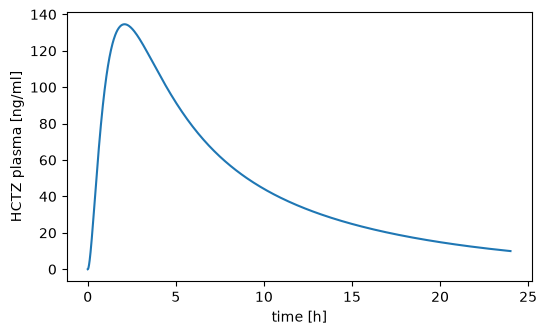

# Units

An SBML model declares the units of its parameters, species and compartments. `sbmlsim` reads them, so you can give every value in the unit you have at hand: a dose in gram for a model which counts in milligram, a time in hours for a model which runs in minutes. The values are [pint](https://pint.readthedocs.io) quantities, and `sbmlsim` converts them into the units of the model before it simulates. A unit which does not fit, e.g. a concentration for a dose, raises an error instead of being simulated with the wrong number.

## The unit registry and `Q`

`Q` creates a quantity, a number with a unit, which converts with `to`:

```python
from sbmlsim import Q

dose = Q(0.025, "g")
print(dose.to("mg"))
print(Q(2, "hr").to("min"))
```

```text title="Output"
25.0 milligram
120 minute
```

Every model, simulation, dataset, experiment and fit of `sbmlsim` uses the one unit registry `sbmlsim.units.ureg`, so their quantities combine. It knows the units of pint and adds the counts `none` and `item`, and `percent`.

The registry has no international unit (`IU`). An IU is specific to a substance (an IU of insulin is a different amount than an IU of heparin), so one definition would convert the data of one substance with the factor of another. Define the unit you need under the name of its substance before you use it:

```python
from sbmlsim.units import ureg

ureg.define("IU_insulin = 0.0347 * mg")
insulin = Q(10, "IU_insulin/ml").to("mg/ml")
print(f"{insulin:.3f}")
```

```text title="Output"
0.347 milligram / milliliter
```

A unit which the registry does not know raises an error when it is read: `Q` raises the `UndefinedUnitError` of pint, and a `DataSet` raises a `ValueError` naming the column when the data is imported (see [Data](data.md)). For an `IU` both messages say how to define it.

## Units of a model

A loaded model has its units in `model.uinfo`, a mapping from id to unit. The id of a species is its amount, the id in brackets its concentration, and `time` is the time unit of the model:

```python
from sbmlsim.resources import HCTZ_SBML
from sbmlsim.simulator import Simulator

simulator = Simulator()
model = simulator.load(HCTZ_SBML)
for sid in ["PODOSE_hctz", "BW", "Cve_hctz", "[Cve_hctz]", "time"]:
    print(f"{sid:12} {model.uinfo[sid]}")
```

```text title="Output"
PODOSE_hctz  mg
BW           kg
Cve_hctz     mmol
[Cve_hctz]   mmol/litre
time         min
```

`sbmlsim` writes the unit definitions of the SBML file as units of pint, e.g. `mmol/min` for a millimole per minute. `UnitsInformation.from_sbml(path)` of `sbmlsim.units` reads them without loading the model.

## Values with units in a simulation

The values of a `Simulation`, its `Change`s and the `Dimension`s of a scan are quantities or plain numbers. A quantity is converted into the unit of its target in the model, a plain number is taken in the unit of the model. The times are numbers in the `time_unit` of the simulation. Here a 25 mg dose is written in gram, and the times in hours:

```python
from sbmlsim.simulation import Change, Simulation

dose = Simulation(
    time_unit="hr",
    end=24,
    changes=[Change(0, {"PODOSE_hctz": Q(0.025, "g")})],
)
res = simulator.run(model, dose)
print(res.q["PODOSE_hctz"][0])
```

```text title="Output"
25.0 milligram
```

The model got its dose in milligram. A unit which cannot be converted into the unit of the target raises a `ValueError` which names the target and both units:

```python
wrong = Simulation(end=60, changes=[Change(0, {"PODOSE_hctz": Q(25, "mM")})])
try:
    simulator.run(model, wrong)
except ValueError as err:
    print(err)
```

```text title="Output"
The simulation: The value '25 millimolar' of 'PODOSE_hctz' cannot be converted into the unit 'mg' of the model: Cannot convert from 'millimolar' ([substance] / [length] ** 3) to 'milligram' ([mass])
```

## Results with units

A `ScanResult` has the units of its variables in `units`. `res.q[...]` returns a variable or a coordinate as a pint quantity (the same as `res.quantity(...)`), and `.to(...)` converts it, so you report a result in the units of a study. Clinical studies give HCTZ in ng/ml, the model in mmol/l; the molecular weight `Mr_hctz`, a parameter of the model and so a variable of the result, converts the one into the other:

```python
print(res.units["[Cve_hctz]"])
plasma = (res.q["[Cve_hctz]"] * res.q["Mr_hctz"]).to("ng/ml")
print(f"cmax = {plasma.max():.1f~P}")
```

```text title="Output"
mmol/litre
cmax = 134.6 ng/ml
```

Quantities plot directly with matplotlib. The first quantity on an axis sets its unit and later ones are converted into it. `label_axes` from `sbmlsim.plot` labels each axis with a name and the unit it shows:

```python
import matplotlib.pyplot as plt

from sbmlsim.plot import label_axes

fig, ax = plt.subplots(figsize=(6, 3.5))
ax.plot(res.q["time"].to("hr"), plasma)
label_axes(ax, "time", "HCTZ plasma")
```



`res.to(...)` converts whole variables and coordinates of a result and keeps their labels, so a converted result selects, tabulates and plots as before. Converting `time` converts the times of the changes as well:

```python
in_hours = res.to({"time": "hr", "[Cve_hctz]": "µM"})
print(in_hours.units["time"], in_hours.units["[Cve_hctz]"])
print(f"{in_hours.q['time'].max():~P}, {in_hours.q['[Cve_hctz]'].max():.3f~P}")
```

```text title="Output"
hour micromolar
24.0 h, 0.452 μM
```

The statistics of a scan keep the units of their variables (`res.summary(...)`, see [Parameter scans](scans.md)), and `Data` converts simulations and datasets into the units a figure asks for (see [Data](data.md) and [Plots and reports](plotting.md)).

## Unit ids of a model

The unit definitions of a model have ids, such as `mg_per_hr` or `per_min` in the HCTZ model. `Q` does not know them, since two models can define one id differently. `model.Q` does: it replaces every unit id of the model in a unit by its expression, so ids combine with the units of pint, e.g. `mg_per_hr/kg`:

```python
print(model.uinfo.unit_ids["mg_per_hr"])
print(model.Q(1, "mg_per_hr").to("mg/day"))
print(model.Q(1, "mg_per_hr/kg"))
```

```text title="Output"
mg/hr
24 milligram / day
1 milligram / hour / kilogram
```

A unit id wins over a unit of pint with the same name, since the model defines what its id means. `Q(1, "mg_per_hr")` raises an `UndefinedUnitError` whose message points to `model.Q`.

In a [simulation experiment](experiments.md) `self.Q` resolves the unit ids of the models of the experiment. The runner loads the models before it initializes the experiment, so `self.Q` works in `simulations()` and the methods after it:

```python
from pathlib import Path
from typing import override

from sbmlsim.experiment import ExperimentRunner, SimulationExperiment
from sbmlsim.model import AbstractModel


class Infusion(SimulationExperiment):
    @override
    def models(self) -> dict[str, AbstractModel | Path]:
        return {"hctz": HCTZ_SBML}

    @override
    def simulations(self) -> dict[str, Simulation]:
        rate = self.Q(1, "mg_per_hr")  # a unit id of the HCTZ model
        return {
            "infusion": Simulation(
                time_unit="hr", end=24, changes=[Change(0, {"Ri_hctz": rate})]
            )
        }


runner = ExperimentRunner(
    [Infusion], simulator=simulator, base_path=Path.cwd(), data_path=Path.cwd()
)
experiment = runner.experiments["Infusion"]
print(experiment.simulations()["infusion"].changes[0].values)
```

```text title="Output"
{'Ri_hctz': Quantity(1, "milligram / hour")}
```

When the models of an experiment define one id differently, `self.Q(value, unit, model="hctz")` says which model's id is meant; without `model=` a `ValueError` names the models and their expressions. Before the models are loaded `self.Q` knows only the units of pint.

The `unit` of a `FitParameter` can use the unit ids of the model of its target as well, e.g. `unit="per_min"`. The parameter keeps that unit in the tables of a fit and in a PEtab export, while the fitted values carry the unit of pint (`1/min`), see [Parameter fitting](fitting.md).
